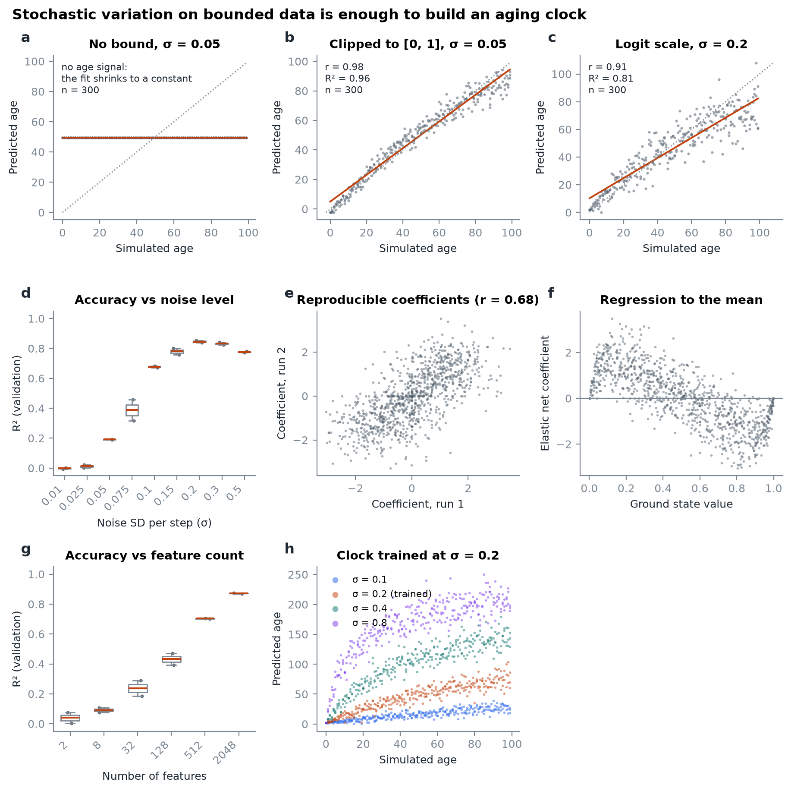
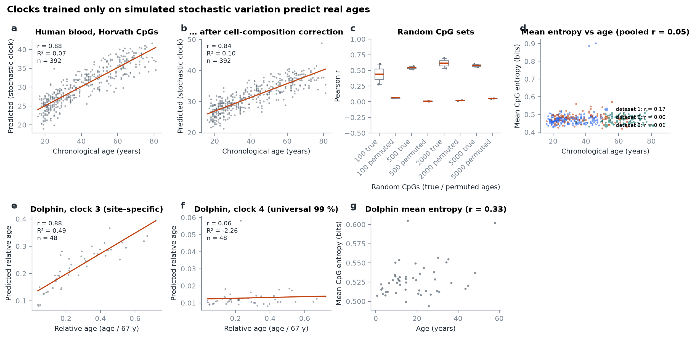
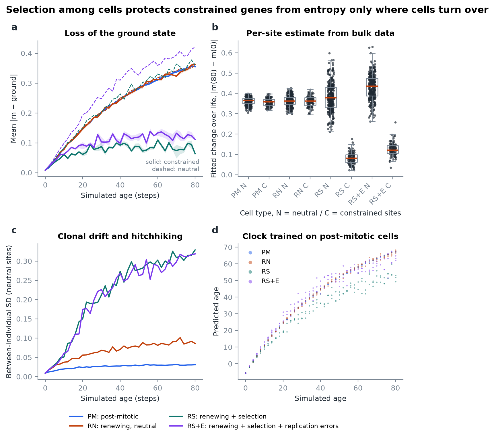
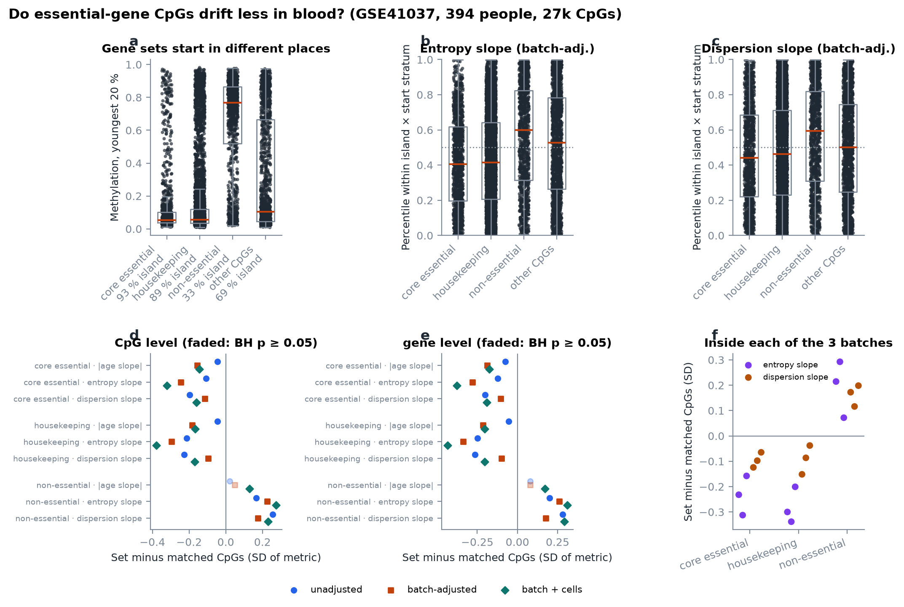

# entropy-age

**Aging clocks from accumulating stochastic variation, reimplemented and extended to gene- and
cell-type-specific stochasticity under selection.**

This is a modern reimplementation of Meyer & Schumacher (2024),
[*Aging clocks based on accumulating stochastic variation*](https://doi.org/10.1038/s43587-024-00619-x),
*Nature Aging* 4:871–885 ([original code](https://github.com/Meyer-DH/StochasticAgingClock), MIT).
The paper shows that random noise added to bounded data starting from a "young" ground state is
enough to build an accurate aging clock. A clock trained *only on simulated noise* predicts the age
of real people (r = 0.87; this repo r = 0.88).

We build on it to ask a follow-up question: **is that stochasticity the same for every gene and cell
type, or does selection among cells protect some loci from entropy where cells turn over?** A first
real-data test in 394 blood methylomes says the gene-level part holds: CpGs of essential and
housekeeping genes gain entropy 0.2–0.4 SD more slowly than CpGs that start at the same level,
and non-essential genes faster, robust to batch and cell composition
([details](docs/extension.md#prediction-1-on-real-data-essential-genes-drift-less-in-blood)).

| | |
|---|---|
|  |  |
| Random, bounded noise is enough for a clock | A clock trained on simulated noise predicts real ages |
|  |  |
| Selection protects constrained genes only where cells turn over | In blood, essential-gene CpGs drift less than matched CpGs |

## Documentation

* [Infographic](https://claude.ai/artifact/MnWiNNmRTAwqet4aTGk6aw): a one-page visual explainer of the
  paper, the reproduction and the selection extension (private until shared from its Share menu).
* [docs/paper.md](docs/paper.md): the paper in one page, a table of every reproduced result (paper vs
  this repo), where we differ and why, a map from the original script to modules, and upstream bugs fixed.
* [docs/model.md](docs/model.md): the models in equations, the closed forms the paper does not state,
  and why the simulator is exact yet much faster.
* [docs/extension.md](docs/extension.md): the selection hypothesis, its predictions, a virtual
  experiment with known ground truth, a first real-data test, and a recipe for testing it on new data.
* Figures: [Fig. 1 bulk](docs/figures/fig1_bulk.png) · [Fig. 3 single cell](docs/figures/fig3_single_cell.png) ·
  [Fig. 4 published clocks](docs/figures/fig4_published_clocks.png) · [Fig. 5 real data](docs/figures/fig5_real_data.png) ·
  [Extension](docs/figures/extension_selection.png) · [Atlas](docs/figures/atlas_real_data.png) ·
  [Gene sets](docs/figures/gene_sets.png)

## Quick start

```bash
uv sync
```

```bash
uv run entropy-age fetch upstream
```

```bash
uv run entropy-age fetch geo GSE41037
```

```bash
uv run entropy-age fetch annotation
```

```bash
uv run entropy-age figures
```

`fetch upstream` downloads the clock coefficients, sample sheets and the dolphin methylation example
from the original repository at a pinned commit (`--from-dir path/to/StochasticAgingClock/Data`
copies from a local clone). `fetch geo` downloads the GSE41037 series matrix (81 MB) from NCBI GEO. `fetch annotation`
downloads the Illumina 27k probe manifest (6 MB) and the essential, non-essential and housekeeping
gene lists used to test the extension on real data.
`figures` regenerates every figure into `docs/figures/` and every table into `data/output/`.
Add `--scale paper` for the publication's sweep sizes (slow), or name figures:
`uv run entropy-age figures fig1 extension`.

Run the tests:

```bash
uv run pytest
```

## Data layout

```
data/input/     downloads exactly as fetched            (gitignored: recreate with `entropy-age fetch`)
data/interim/   parquet parsed from the inputs          (gitignored)
data/output/    result tables per figure                (small CSV summaries tracked, parquet ignored)
docs/figures/   rendered figures                        (tracked)
```

Everything under `data/input` and `data/interim` is reproducible from the downloaders. Set
`ENTROPY_AGE_DATA` to put data on another disk.

## Using the library

```python
import numpy as np
from entropy_age.simulate import Bound, MaintenanceRates, age_grid, random_ground_state, simulate_bulk, simulate_methylation
from entropy_age.clock import ClockConfig, evaluate, train_clock

rng = np.random.default_rng(0)
ground = random_ground_state(1000, rng)
ages = age_grid(100, 3)                                   # 3 samples for each age 0..99

# Fig. 1: Gaussian noise clipped to [0, 1]
train = simulate_bulk(ground, ages, sigma=0.05, bound=Bound.CLIP, rng=rng)
clock = train_clock(train, ages, config=ClockConfig.fast())
print(evaluate(ages, clock.predict(simulate_bulk(ground, ages, sigma=0.05, bound=Bound.CLIP, rng=rng))))

# Fig. 3: single-cell methylation with per-site maintenance (exact binomial simulation)
rates = MaintenanceRates.random(1000, rng, em_limit=0.97, ed_limit=0.05)
x = simulate_methylation(ground, age_grid(100, 3, start=1), rates, n_cells=1000, rng=rng)
print(rates.equilibrium[:3], rates.relaxation_rate[:3])   # per-site equilibrium and entropy rate
```

Extension:

```python
from entropy_age.simulate import CellPopulation, SelectionModel, simulate_with_selection
from entropy_age.stochasticity import compare_groups, drift_metrics, fit_relaxation

weights = np.r_[np.ones(100), np.zeros(300)]               # first 100 sites are fitness-relevant
blood_like = CellPopulation("renewing", MaintenanceRates.universal(400, 0.99),
                            SelectionModel(weights, strength=0.5, turnover=0.2))
x = simulate_with_selection(ground[:400], np.repeat(np.arange(0, 81, 2), 3), blood_like, rng=rng)
```

Per-feature stochasticity on your own cohort, with an optional gene-set contrast:

```bash
uv run entropy-age stochasticity betas.parquet samples.parquet --groups gene_sets.csv --metric entropy_slope
```

## Package map

| Module | Contents |
|---|---|
| `simulate/bulk.py` | bounded Gaussian (or Laplace or uniform) noise, per-feature σ |
| `simulate/methylation.py` | `MaintenanceRates` (universal, random, empirical, from rate and equilibrium), exact binomial and per-cell simulators, closed forms |
| `simulate/selection.py` | cell turnover, fitness-proportional replacement, replication errors |
| `clock.py` | elastic-net training, paper configurations, age transforms, metrics |
| `published.py` | Horvath, PhenoAge, Lin, Vidal-Bralo, Weidner and BiT-age clocks |
| `stochasticity.py` | per-feature drift, entropy and dispersion slopes, relaxation fits, matched group contrasts, cell-composition correction |
| `data/` | GEO series-matrix, upstream and annotation (27k manifest, gene sets) downloaders and parsers, `FeatureMatrix` |
| `experiments/` | one module per figure, run by `entropy-age figures` |

Stack: Python 3.13, uv, polars, numpy, scipy, scikit-learn, matplotlib, typer, pathlib throughout;
no pandas.

## Credits

The original method, code and bundled data are by David H. Meyer and Björn Schumacher (University of
Cologne), MIT-licensed. Ported functions keep that attribution (see [NOTICE](NOTICE)). Please cite:

> Meyer D.H., Schumacher B. Aging clocks based on accumulating stochastic variation. *Nat Aging* 4, 871–885 (2024).
> https://doi.org/10.1038/s43587-024-00619-x

GSE41037: Horvath S. et al. (2012), Genome Biology 13:R97. The dolphin example data is from the
Mammalian Methylation Consortium (Lu et al. 2023, *Nature Aging*).

This repository is licensed under AGPL-3.0 (see [LICENSE](LICENSE)).
