# Extension: is stochasticity gene- and cell-type-specific because of selection?

## Hypothesis

The paper treats stochastic variation as one knob per dataset (σ, or one $E_m$) or as a per-site
rate inferred from one old sample. It then argues that clock CpGs drift fastest because they matter
least for the cell. We want to turn that remark into a testable model:

> **Stochasticity differs between genes and between cell types, because selection among cells can
> protect fitness-relevant loci from entropy, and selection can only act where cells turn over.**

Testable predictions:

1. **Gene level.** In tissues with cell turnover, loci whose state matters for fitness
   (essential and housekeeping genes, cell-identity genes) drift *less* than baseline-matched
   loci. Their bulk level is held near the ground state at a mutation–selection balance.
2. **Cell-type level.** The protection disappears in post-mitotic cells (neurons, cardiomyocytes,
   most muscle). There, epimutations accumulate at the intrinsic maintenance rate wherever they fall.
3. **Hitchhiking.** Where selection acts, neutral loci gain *between-individual* variance as
   fitter clones expand (clonal drift; compare clonal haematopoiesis). Dispersion at neutral sites
   rises faster in renewing tissues than in post-mitotic ones.
4. **Clock pace.** A clock trained on unprotected (post-mitotic-like) dynamics reads protected
   tissues as younger. The tissue's "pace of aging" partly reflects how much of its methylome is
   under selection.
5. **Replication errors cut the other way.** Each division is another chance for a maintenance
   error (the mitotic-clock idea), so high turnover also *raises* drift at unprotected sites. Turnover
   is not uniformly protective.

## Model

`entropy_age.simulate.selection` adds two things to the paper's single-cell Markov model:
cell turnover and fitness-proportional replacement. The equations are in
[model.md §4](model.md#4-extension-selection-among-cells). Knobs:

| Knob | Meaning | Biological reading |
|---|---|---|
| `MaintenanceRates(em, ed)` per site | intrinsic stochasticity | DNMT1 fidelity, chromatin context, replication timing |
| `SelectionModel.weights` per site | fitness relevance | essential / identity genes > 0, passengers = 0 |
| `strength` | fitness cost per deviating site | how deleterious an epimutation is |
| `turnover` | fraction of cells replaced per step | blood, gut, skin high; neurons ≈ 0 |
| `division_error` | extra epimutation in daughters | replication-coupled maintenance errors |
| `reference="founder"` or `"target"` | what counts as deviation | change from the lineage state, or from a fixed functional state |

## Virtual experiment (known ground truth)

`uv run entropy-age figures extension` takes 400 CpGs from the 16-year-old blood sample (bimodal
levels <0.1 or >0.9) and marks 100 of them as constrained. All sites share $E_m = 99\,\%$, so every
site has the same *intrinsic* stochasticity. The methylome is then aged in four cell types:
PM (post-mitotic), RN (renewing, no selection), RS (renewing with selection), and RS+E (RS plus
replication errors).


| Observation (panel) | PM | RN | RS | RS+E |
|---|---|---|---|---|
| Fitted change over life, constrained / neutral (b) | 0.36 / 0.37 | 0.36 / 0.36 | **0.08 / 0.38** | **0.12 / 0.44** |
| Cliff's δ constrained vs neutral, permutation p | −0.15, p = 0.09 | ≈ 0 | **−1.0, p ≤ 0.001** | **−1.0, p ≤ 0.001** |
| Between-individual SD of neutral sites at step 80 (c) | 0.03 | 0.09 | **0.33** | **0.32** |
| Slope of a post-mitotic-trained clock (d) | 0.88 | 0.95 | **0.70** | 0.79 |

All five predictions appear in the simulation. Two lessons matter for real data:

* **Protection does not look like a slower rate.** Constrained sites under selection reach their
  mutation–selection plateau *quickly*, so their fitted relaxation rate λ is *higher* (median 0.072 vs
  0.022 per step) while they move much less. Rank genes by the amount of change (`window_change`,
  entropy slope, dispersion slope), and read λ only together with the fitted equilibrium.
* **Neutral turnover alone already adds dispersion** (RN: 0.09 vs PM: 0.03); selection makes it far
  larger. Dispersion slopes distinguish post-mitotic from renewing tissues even without knowing
  which genes are constrained.

The parameters (selection strength, turnover per step, 200 cells per sample) are illustrative, not
calibrated. The figure shows that the effects exist and that the estimators recover them from
cross-sectional bulk data, which is all real cohorts offer.

## First look at real data: are clock CpGs the fast-drifting ones?

`uv run entropy-age figures atlas` computes every metric for all 27,577 CpGs of the 394 GSE41037
controls (16–88 y) and for the 37,554 CpGs of the 50 dolphins. It then compares clock CpGs with
CpGs *that start at the same level* (deciles of the young-adult baseline). For the human cohort,
slopes are estimated within processing batches (see the confound below). The λ histogram comes
from `fit_relaxation`, which takes no covariates, so it is unadjusted.


Human blood, clock CpGs vs level-matched CpGs, batch-adjusted slopes (2,000 stratified permutations,
p not corrected for the six tests):

| Group | Metric | Matched difference | p |
|---|---|---|---|
| Horvath (353) | entropy slope | +1.6 × 10⁻⁵ bits / year | 0.60 |
| PhenoAge (513) | entropy slope | +5.0 × 10⁻⁵ bits / year | 0.07 |
| Horvath | dispersion slope | +1.3 × 10⁻⁵ | 0.58 |
| PhenoAge | dispersion slope | +4.8 × 10⁻⁵ | 0.01 |

**Not supported.** An earlier version of this page reported that clock CpGs gain entropy faster
than level-matched CpGs (p = 0.004 for Horvath). That came from unadjusted slopes across a cohort
whose processing batches are confounded with age. With batch as a covariate the difference
disappears for Horvath's CpGs and is weak for PhenoAge's. On this data, clock CpGs are typical
drifting CpGs, not the fastest ones.

Dolphins have no clock-CpG contrast. The human clock probes present on the mammalian array do not
hybridise in dolphin DNA: they sit at about 0.5 with almost no variance, so any comparison would
measure probe failure, not biology.

**Caveat on matching.** The baseline used for matching should be measured independently of the
drift being compared: a separate young or fetal reference, or a sorted cell type at its youngest.
A baseline taken from the cohort already contains early drift. Fast-drifting CpGs then fall into
other strata than slow ones, and matching removes part of the effect.
`compare_groups` reports `n_matched` so this shows up, and a test in the suite documents it.

## Prediction 1 on real data: essential genes drift less in blood

`uv run entropy-age fetch annotation` downloads the Illumina 27k probe manifest (GEO GPL8490,
which gives the gene, Entrez ID, RefSeq accession and CpG-island flag per probe) and three
curated gene sets:

* Hart et al. core-essential genes (CEGv2) and non-essential genes (NEGv1) from CRISPR screens,
  pinned at a commit of hart-lab/bagel and matched by Entrez ID;
* Eisenberg & Levanon (2013) housekeeping genes, matched by RefSeq accession, then by symbol.

`uv run entropy-age figures genesets` then compares each set with every other CpG in the same
**stratum**: CpG-island status (fixed by sequence, so drift cannot move it) crossed with the decile
of young-adult methylation. Without matching the sets are not comparable: 93 % of core-essential
CpGs sit in islands near 0 % methylation, but only 33 % of non-essential CpGs do (panel a).


| Set | CpGs (genes) on the array |
|---|---|
| core essential | 1,140 (603) |
| housekeeping | 5,825 (3,087) |
| non-essential | 1,063 (605) |

**A confound we found and removed.** GSE41037 was run in three processing datasets whose ages
barely overlap: dataset 1 is mostly under 50 and dataset 3 mostly over 50. A slope across the whole
cohort partly measures that batch; the clock-CpG result above is one casualty. Every gene-set
contrast was therefore repeated with batch as a covariate (`drift_metrics(..., covariates=...)` gives
partial slopes), with batch plus the seven blood-cell fractions, and separately inside each batch.

Set minus matched CpGs, in SD of the metric (CpG level; * = BH-adjusted p < 0.05 over all 72 tests,
1,000 stratified permutations each, so the smallest p is 0.001):

| Set · metric | unadjusted | batch-adjusted | batch + cells | inside batch 1 / 2 / 3 |
|---|---|---|---|---|
| core essential · entropy slope | −0.11 * | −0.25 * | −0.32 * | −0.23 / −0.31 / −0.16, all * |
| housekeeping · entropy slope | −0.21 * | −0.30 * | −0.38 * | −0.30 / −0.34 / −0.20, all * |
| non-essential · entropy slope | +0.17 * | +0.23 * | +0.27 * | +0.21 / +0.29 / +0.07, all * |
| core essential · dispersion slope | −0.20 * | −0.11 * | −0.16 * | −0.12 / −0.10 / −0.06, all * |
| housekeeping · dispersion slope | −0.23 * | −0.10 * | −0.17 * | −0.15 / −0.09 / −0.04, all * |
| non-essential · dispersion slope | +0.26 * | +0.18 * | +0.23 * | +0.17 / +0.12 / +0.20, all * |
| core essential · \|age slope\| | −0.04 * | −0.16 * | −0.14 * | |
| housekeeping · \|age slope\| | −0.04 * | −0.18 * | −0.17 * | |
| non-essential · \|age slope\| | +0.02 | +0.05 | +0.13 * | |

Gene-level aggregation (median per gene, so genes with many probes do not dominate) gives the
same signs and similar sizes (`data/output/gene_sets/contrasts.csv`).

**Reading.** In whole blood, a renewing tissue, CpGs of essential and housekeeping genes gain
entropy and between-person dispersion more slowly than CpGs that start at the same level in the
same kind of sequence. CpGs of genes no cell line needs drift faster. This holds after removing the
batch confound and cell composition, and it replicates inside each processing batch. The effects
are modest (0.1–0.4 SD), as one would expect if most drift is neutral.

**What this does not show yet.** It is the gene-level half of the hypothesis (prediction 1). The
same pattern would arise without any selection if active, open promoters are simply better
maintained: H3K4me3 and transcription keep DNMT3 away whatever the cell's fitness. The
discriminating test is prediction 2. If selection does the protecting, the essential-gene advantage
should shrink or vanish in post-mitotic cells such as neurons, where no cell can be replaced by a
fitter neighbour. If chromatin does it, the advantage should stay the same size. That needs a
cohort with a post-mitotic tissue next to a renewing one; the next section tests it.

## Prediction 2 on real data: the protection is larger in blood than in brain

The essential-gene advantage is larger in blood than in brain, in two independent designs. That is
what selection among cells predicts. The same-donor contrast survives an adjustment of every tissue
for its cell mix; the lifespan-slope contrast does so only partly (see
[the composition check](#composition-check)).

**Data** (Illumina 450k, run on a cluster: `entropy-age fetch cohort hannum jaffe lunnon`, then
`entropy-age figures tissues`):

| Design | Tissue | People | Ages | Measure, adjusted for |
|---|---|---|---|---|
| Lifespan cohorts | blood, Hannum et al. 2013 (GSE40279) | 656 | 19–101 | age slopes; plate, site, sex, ancestry |
| Lifespan cohorts | prefrontal cortex, Jaffe et al. 2016 (GSE74193), adult controls | 213 | 21–85 | age slopes; plate, sex, ancestry, neuron fraction |
| Same donors | Lunnon et al. 2014 (GSE59685): blood and four brain regions | 71–80 per tissue | 70–105 | between-person dispersion; age, sex, Alzheimer's status |

Each tissue uses about 109,000 autosomal promoter CpGs: every CpG in a promoter of a gene in the three
sets (6,891 core-essential, 42,173 housekeeping, 4,945 non-essential), plus a fixed random background
of 60,000 promoter CpGs for matching. As in prediction 1, each set is compared with CpGs of the same
island status and starting-level decile, in SD of the metric. Blood minus brain gets a 95 % interval
from 200 bootstraps: independent resamples in the two lifespan cohorts, the same resampled donors in
all five Lunnon tissues.


**Set minus matched CpGs, by tissue** (SD; all differ from zero at BH-adjusted p < 0.05 except
where marked):

| Set | Blood (Hannum), entropy slope | Cortex (Jaffe), entropy slope | Blood (Lunnon), dispersion | Four brain regions (Lunnon), dispersion |
|---|---|---|---|---|
| core essential | −0.23 | −0.12 | −0.08 | −0.04 to −0.06 |
| housekeeping | −0.35 | −0.21 | −0.15 | −0.04 to −0.07 |
| non-essential | +0.31 | +0.08 | +0.20 | +0.01 (ns, entorhinal) to +0.11 |

**Blood minus brain** (SD, 95 % bootstrap interval). Negative for the protected sets means more
protection in blood:

| Set | Lifespan: entropy slope | Lifespan: dispersion slope | Same donors: dispersion, four regions |
|---|---|---|---|
| core essential | −0.10 (−0.16, −0.03) | −0.09 (−0.15, −0.02) | −0.02 to −0.04, every interval below 0 |
| housekeeping | −0.14 (−0.21, −0.05) | −0.20 (−0.27, −0.11) | −0.07 to −0.10, every interval below 0 |
| non-essential | +0.21 (+0.10, +0.30) | +0.21 (+0.14, +0.29) | +0.09 to +0.19, every interval above 0 |

Of the 21 blood-minus-brain contrasts, 20 have intervals that exclude zero in the predicted
direction. The exception is the non-essential |age slope|, whose interval crosses zero. The
protection exists in brain too, at a third to two thirds of its size in blood. That also fits the
model: neurons cannot be replaced, but glia turn over, and chromatin protection acts in every cell. Full tables:
`data/output/tissue_contrast/`.

### Composition check

**Why it was needed.** Blood is a mix of cell types whose proportions differ a lot between people.
Genes switched on in only some cell types, as many non-essential genes are, gain between-person spread
and age trends from that mix; essential genes are unmethylated in every cell type, so the mix hardly
moves them. Neither blood cohort ships cell counts, and Lunnon's brain regions ship no neuron
fraction, so every tissue gets the same reference-free correction: the leading principal components
of its 60,000 background CpGs (`composition_components`), after the technical covariates are
regressed out, added as covariates (`entropy-age figures tissues_cells`). Four variants: none, 5 or
10 components that keep their age trend (they also absorb any change of the cell mix with age), and
5 components made orthogonal to age (they absorb only the person-to-person spread of the mix). The
components explain 24–33 % (5) or 30–43 % (10) of the background variance; the first alone 10–13 %.

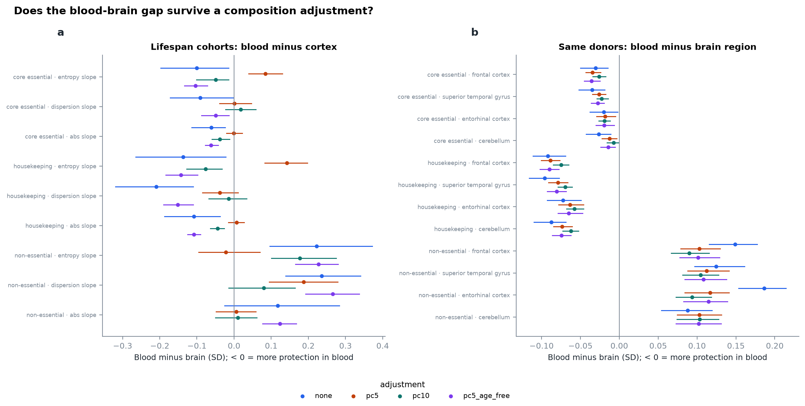

**Contrasts whose 95 % interval excludes zero in the predicted direction:**

| Adjustment | Same donors (Lunnon), of 12 | Lifespan cohorts (Hannum vs Jaffe), of 9 |
|---|---|---|
| none | 12 | 8 |
| 5 components, age-free | 12 | 9 |
| 10 components | 12 | 5 |
| 5 components | 12 | 1 (2 reversed) |

**Same donors: the gap is not the cell mix.** Blood minus brain moves by at most a fifth. Housekeeping:
−0.07 to −0.10 SD unadjusted, −0.06 to −0.08 with 10 components; core essential −0.02 to −0.04
against −0.01 to −0.03; non-essential +0.09 to +0.19 against +0.10 to +0.12, every interval on the
predicted side in every variant. One shift is informative: in the brain regions, the non-essential
excess *grows* after adjustment (frontal cortex +0.05 to +0.12, entorhinal +0.01 to +0.11), so the
neuron–glia mix was hiding part of brain's own effect.

**Lifespan slopes: not separable from coordinated aging.** With age-free components the gap is
unchanged (housekeeping entropy slope −0.14, interval −0.17 to −0.11), but that is by construction,
not a test: components orthogonal to age cannot change any age slope of entropy or of the mean
(corrected 2026-11-10; see the GTEx section). With components that keep
their age trend it shrinks or flips: blood's housekeeping entropy protection falls from −0.35 to
−0.08 SD, and cortex's to zero with 10 components. Those components are partly age itself (one of
Jaffe's correlates r = 0.60 with age), so they remove the coordinated methylation change that thousands
of CpGs share with age along with any age trend of the cell mix. From cross-sectional slopes the two
cannot be told apart. The lifespan contrast is therefore supporting evidence only; the same-donor
dispersion contrast carries the claim.

**What it means.** Essential-gene protection against methylation drift is 1.5–3 times stronger in
blood than in the brain of the same people (housekeeping 2–3 times, core essential about 1.5 times), and the difference is not blood's cell mix. Selection
among cells, which needs turnover, predicts exactly this; chromatin protection alone does not. Tables:
`data/output/tissue_contrast_cells/`.

**Other limits.** The two lifespan cohorts are different people from different studies, though both
on the 450k array. Lunnon's donors are old and mostly have Alzheimer's disease. Brain tissue mixes
post-mitotic neurons with glia that do turn over, so the contrast is renewing against mostly
post-mitotic tissue, not a clean neuron sample. Sorted neurons, or a tissue such as skeletal muscle,
would sharpen it (roadmap RM2).

## Mouse tissues: the protection is missing in cortex and hippocampus

A second species, eleven tissues of the same animals and a second array. In Huang et al.'s mice
(GSE279437, mammalian methylation array, inbred C57BL/6 males), CpGs of essential and housekeeping
genes gain entropy with age far more slowly than matched CpGs in tissues whose cells divide. In
cortex and hippocampus they do not; heart keeps as much protection as white blood cells, and
skeletal muscle about half of it (see the correction at the end of this section).

**Data and method** (`entropy-age fetch mouse-annotation`, `entropy-age fetch cohort huang`,
`entropy-age figures mouse`). Young controls (7–21 per tissue) against aged controls (4–14); GEO gives
the two age groups but no numeric ages. The human gene sets reach mouse through MGI orthologs (642
core-essential, 3,220 housekeeping and 931 non-essential genes; 2,334, 11,994 and 3,305 promoter CpGs)
and are compared, as before, with background promoter CpGs of the same island status and
young-control level decile. Intervals come from 200 bootstraps that resample animals within their
treatment group, the same animals in every tissue. Tissues are grouped by turnover: renewing (white
blood cells, colon, spleen), slow (liver, kidney, adipose) and post-mitotic (skeletal muscle, heart,
frontal cortex, hippocampus, hypothalamus).

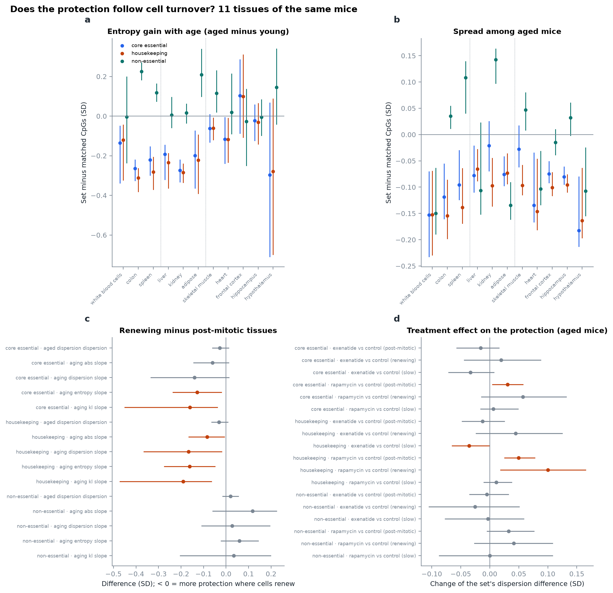

**Corrected intervals (roadmap RM9, run R19).** The bootstraps of `figures tissues`, `tissues_cells` and `mouse`
had divided each resample by its own spread, which resampling inflates, and so drew intervals toward zero. With
every resample divided by the full sample's spread (`common.rescale`), intervals widen by a sixth to a quarter.
No human conclusion moves: every blood-against-brain interval that excluded zero still does. In mouse, the
housekeeping contrasts that carry the conclusion hold (renewing − post-mitotic entropy −0.16, −0.27 to −0.05;
slow − post-mitotic −0.18, −0.28 to −0.07); five weaker contrasts, mostly core-essential, now include zero.

**Entropy gain with age, set minus matched CpGs** (SD):

| Tissue | Core essential | Housekeeping | Non-essential |
|---|---|---|---|
| white blood cells | −0.14 | −0.12 | −0.00 |
| colon | −0.26 | −0.31 | +0.23 |
| spleen | −0.22 | −0.28 | +0.12 |
| liver | −0.19 | −0.23 | +0.01 |
| kidney | −0.27 | −0.28 | +0.02 |
| adipose | −0.20 | −0.22 | +0.21 |
| skeletal muscle | −0.06 | −0.06 | +0.12 |
| heart | −0.12 | −0.12 | +0.02 |
| frontal cortex | +0.10 | +0.10 | −0.03 |
| hippocampus | −0.02 | −0.03 | −0.01 |
| hypothalamus (4 aged controls) | −0.30 | −0.28 | +0.15 |

**Renewing minus post-mitotic tissues** (SD, 95 % bootstrap interval):

| Set | Entropy gain | Change in spread | Absolute change of the mean |
|---|---|---|---|
| core essential | −0.12 (−0.20, −0.05) | −0.11 (−0.21, −0.01) | −0.06 (−0.10, −0.03) |
| housekeeping | −0.16 (−0.23, −0.09) | −0.13 (−0.23, −0.03) | −0.09 (−0.12, −0.05) |
| non-essential | +0.07 (+0.01, +0.13) | +0.03 (−0.03, +0.14) | +0.11 (+0.05, +0.18) |

Eight of the nine aging contrasts exclude zero in the predicted direction. What this adds to the
human results:

* **It replicates in another species and on another array**, with the same donors in every tissue
  and no blood-specific cell mix: the renewing tissues here include colon and spleen.
* **It is a step, not a slope.** The slow tissues are as protected as the renewing ones (entropy:
  slow minus post-mitotic −0.14 for core essential and −0.16 for housekeeping, intervals excluding
  zero). Hepatocytes, kidney tubule cells and adipocytes divide rarely but can, and their tissues
  replace cells over months. The data fit "some turnover is enough" better than a graded dose of
  turnover. Whether that is selection, or something else that sets post-mitotic tissue apart, needs a
  test that varies turnover inside one tissue.
* **The brain is where protection vanishes.** Cortex and hippocampus show none (+0.10 and −0.03);
  muscle and heart keep a little (−0.06, −0.12). The hypothalamus is the exception, with strong
  protection, but it has only 4 aged controls and the widest intervals.
* **The spread among aged mice does not separate the tissue classes** (renewing minus post-mitotic
  −0.03 and −0.04, intervals crossing zero). These mice are inbred, so the between-animal spread has
  no genetic part, and with 40 aged animals per tissue spread across five treatment groups the
  measure is weaker than the young-versus-aged contrast.

**Interventions: not interpretable yet.** Exenatide (13 aged mice per tissue against 13 controls)
changes no set's dispersion difference. Rapamycin's numbers appear to weaken the protection, which
selection would predict, but only 5 mice per tissue carry them, and a dispersion from 5 animals is
noisier than one from 13. A size check settles part of it (a one-off run, not yet part of `figures mouse`). Thirty random 5-mouse
subsets of the aged controls already lose about a fifth to a quarter of the protection (renewing
tissue, housekeeping: −0.15 with all controls, −0.11 with 5). Against those size-matched controls,
rapamycin's renewing-tissue values (−0.07 for both protected sets) sit inside the range of the
5-mouse subsets (−0.16 to −0.05). Only in post-mitotic tissue does rapamycin fall outside it
(housekeeping −0.04 against −0.09 to −0.06), the opposite of what selection predicts. With five
animals and only white blood cells and colon as renewing tissues, this does not test the prediction
either way. The rapamycin arm needs a larger cohort (roadmap RM3).

**Correction (2026-11-10).** An earlier version of this section said the protection is "missing where
cells do not divide". The per-tissue table does not carry that. Heart, whose cardiomyocytes barely
divide, shows −0.12 SD for both protected sets, as much as white blood cells (−0.14, −0.12). Skeletal
muscle shows −0.06, about half. Only cortex (+0.10) and hippocampus (−0.03) are without it, and the
hypothalamus, also neural, is strongly protected with 4 aged controls. "Neurons lack the protection"
is supported by two of three brain regions; "selection needs dividing cells" is not established,
because the non-neural post-mitotic tissues keep part or all of it. The class contrast above pools
heart and muscle with the brain regions, so its post-mitotic side is mostly carried by cortex and
hippocampus.

Tables: `data/output/mouse_tissues/`.

## Human tissues: GTEx and muscle fibres

### GTEx: muscle is weakly protected, but so are breast, ovary and testis

The test for the human side of the mouse result: in nine GTEx tissues of 424 post-mortem donors on
the EPIC array (Oliva et al. 2023, GSE213478), is skeletal muscle, the tissue with the fewest divisions, the
one without protection? (Below: GTEx cannot say how many divisions its donors' muscle had.) Methylation entropy and between-donor spread are fitted against the decade
bin midpoint (25 to 75), adjusted for sex, autolysis score and smoking. Muscle has 47 donors and no
one under 30, and fewer donors pull every SD-scaled difference toward zero, so every tissue is
resampled at 32 donors without replacement (200 resamples) and tissues are compared only on those
size-matched resamples (`entropy-age figures gtex`).

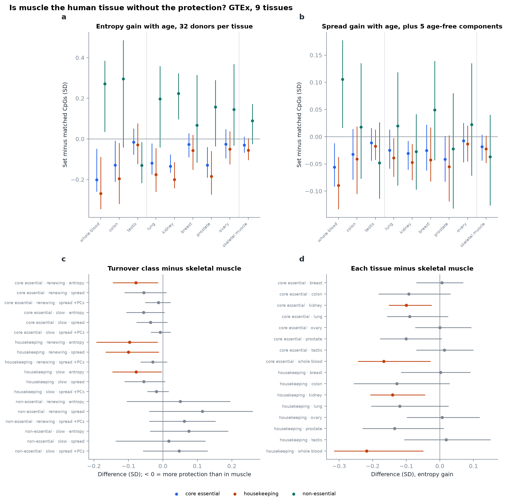

**Entropy gain with age, set minus matched CpGs** (SD, median of size-matched resamples):

| Tissue | Class | Donors | Core essential | Housekeeping | Non-essential |
|---|---|---|---|---|---|
| whole blood | renewing | 54 | −0.20 | −0.27 | +0.27 |
| colon | renewing | 224 | −0.13 | −0.20 | +0.30 |
| testis | renewing | 50 | −0.02 | −0.03 | −0.13 |
| lung | slow | 223 | −0.12 | −0.18 | +0.20 |
| kidney | slow | 50 | −0.13 | −0.20 | +0.22 |
| breast | slow | 52 | −0.03 | −0.06 | +0.07 |
| prostate | slow | 123 | −0.13 | −0.19 | +0.16 |
| ovary | slow | 164 | −0.03 | −0.05 | +0.15 |
| skeletal muscle | post-mitotic | 47 | −0.03 | −0.06 | +0.09 |

**Class contrasts** (SD, 95 % interval over the resamples; negative = more protection than muscle):

| Set | Measure | Renewing − muscle | Slow − muscle |
|---|---|---|---|
| core essential | entropy | −0.08 (−0.14, −0.02) | −0.06 (−0.11, +0.00) |
| housekeeping | entropy | −0.10 (−0.19, −0.02) | −0.08 (−0.15, −0.01) |
| core essential | spread | −0.06 (−0.11, +0.01) | −0.04 (−0.08, +0.01) |
| housekeeping | spread | −0.10 (−0.17, −0.01) | −0.06 (−0.11, +0.01) |
| core essential | spread, + 5 age-free components | −0.01 (−0.05, +0.02) | −0.01 (−0.03, +0.02) |
| housekeeping | spread, + 5 age-free components | −0.03 (−0.06, +0.01) | −0.02 (−0.04, +0.02) |

What this supports, and what it does not:

* **Muscle is among the least protected tissues** (−0.03 core essential, −0.06 housekeeping), and the
  pooled renewing and slow tissues are more protected than muscle on entropy, three of four intervals
  excluding zero. That is the direction of the mouse result.
* **But muscle is not alone, and the split does not follow turnover.** Breast, ovary and testis are as
  weakly protected as muscle; blood, colon, lung, kidney and prostate are strongly protected. Testis
  is the fastest-renewing tissue in the set. Of the single tissues, only blood and kidney differ from
  muscle with intervals excluding zero (housekeeping −0.22 and −0.14). A tissue-level property other than
  turnover separates the two groups; which one (cell mix, hormonal cycling in breast and ovary, the
  germline's own methylation programme in testis) this design cannot say.
* **Muscle is not a clean low-turnover control in GTEx.** Fibre nuclei never divide, but satellite
  cells do whenever muscle is loaded, injured or wasting, so how many divisions (and how much room
  for selection) a donor's muscle had depends on exercise, training history and illness. GTEx records
  none of these; its only related field is the Hardy scale, which says how the donor died, not how
  they lived. The muscle contrasts therefore compare protected tissues with a tissue of unknown
  turnover, and cannot test selection. The breast, ovary and testis point does not rest on muscle
  and stands.
* **Between-donor spread loses the gap once composition is adjusted.** With five composition
  components of background CpGs, every spread contrast moves to within 0.03 SD of zero. In blood
  the housekeeping spread gap halves (−0.26 to −0.13). In GTEx, unlike Lunnon's same-donor tissues
  (composition check above), the spread contrast between tissues is not robust to the cell mix.
* **Entropy and mean-slope results cannot be checked with age-free components at all.** The
  components are made orthogonal to age and the other covariates, so adding them leaves every age
  slope of the mean or of entropy unchanged in the full data, by construction. The two versions
  differ only through resampling noise. Only residual-based measures (between-donor spread) can move.
  This also applies to the lifespan line of the composition check above, corrected there.

Tables: `data/output/gtex_tissues/` (`tissues`, `point_estimates` on all donors, `contrasts` over
size-matched resamples).

### Muscle fibres: uninformative

Pooled type I fibres, pooled type II fibres and whole muscle of the same 12 adults (11 after
training), before and after 12 weeks of interval training, on EPIC v2 (GSE304045,
`entropy-age figures fibres`). Fibre nuclei never divide; whole muscle also holds satellite cells,
fibroblasts and endothelium, which do. With no ages, the measure is between-person spread at each
CpG, adjusted for sex; all three preparations come from the same people, so sample size cannot bias
the comparison. Unlike GTEx this cohort does record exercise (the training itself), but not age. Selection predicts more protection (a negative difference) in whole muscle than in
fibres.

| Set | Whole muscle − type I, before | − type II, before | − type I, 12 weeks | − type II, 12 weeks |
|---|---|---|---|---|
| core essential | −0.015 (−0.025, −0.001) | −0.019 (−0.039, −0.003) | +0.007 (−0.011, +0.025) | +0.013 (−0.003, +0.029) |
| housekeeping | +0.004 (−0.004, +0.012) | −0.006 (−0.015, +0.004) | +0.001 (−0.015, +0.016) | +0.007 (−0.010, +0.022) |
| non-essential | −0.032 (−0.069, −0.002) | −0.004 (−0.043, +0.025) | −0.030 (−0.063, +0.006) | −0.015 (−0.055, +0.041) |

Every difference is 0.03 SD or smaller and the sign does not hold from before to after training.
The measure itself has no power here: even within pure fibres the housekeeping set is only −0.01 to
−0.02 SD below matched CpGs. A dozen adults of unknown, similar age show too little between-person
divergence for a set contrast. This result is uninformative, not negative.

Tables: `data/output/muscle_fibres/`.

### What the human tissues add

The neuron result from mouse is the one still standing: cortex and hippocampus without protection in
mouse, and in humans (Lunnon, same donors) less protection in four brain regions than in blood.
"Protection needs dividing cells" is not established in either species: mouse heart keeps it, and
in GTEx three tissues with very different turnover lose it as much as muscle does. Human muscle
cannot settle it either way until a cohort records both age and physical activity. The RNA test in
GTEx's thirteen brain regions and the direct test in dividing versus arrested
cultures are the ones that can separate turnover from tissue identity.

## The direct test: does the protection grow with divisions?

The tissue comparisons cannot separate turnover from tissue identity. Cells in culture can: the same
parent culture can be made to divide or be stopped. Endicott et al. (2022, GSE197512) passaged seven
primary human lines to replicative senescence on EPIC (fetal, neonatal and adult skin fibroblasts,
neonatal keratinocytes, adult endothelial and smooth muscle cells; 14-39 samples each, 16-83
population doublings, PD), and in three lines arrested growth with mitomycin C (MMC) next to
dividing controls; one line also ran under 3 % oxygen, in reduced serum and with TERT for 136 PD
(`entropy-age fetch cohort endicott`, `entropy-age figures passage`).

**The two readings.** Chromatin protection makes every division add less error at essential
promoters than at matched CpGs, in a fixed proportion: the gap grows with drift, but as a constant
fraction of it. Selection purges cells that damaged an essential gene, and the purge accumulates
with divisions: the fraction itself should grow with PD. Under arrest there is no selection at all.

**Measure** (the per-sample score of `docs/PER_PERSON_SCORE.md`). In each experiment the reference
is the mean of its earliest samples. Per later sample and promoter CpG, the squared deviation from
the reference, minus the array noise floor (the per-CpG variance of replicate cultures measured on
the same day), scaled by `m (1 - m)`; then, as in every test here, set CpGs minus matched CpGs of the
same island status and reference decile. `C` is the matched drift, `Q` the set-minus-matched gap,
`G = Q / C` the gap as a fraction of drift. The main statistic regresses `Q` on `C` and on
`C x PD` per arm (`drift_coupling`): the first coefficient is the protection per unit of drift, the
second how it changes per 10 PD (negative = protection grows with divisions).

**Why the noise floor matters.** Without it (absolute deviations, the first version), the
housekeeping fraction fell with PD in all seven lines (−0.057 per 10 PD, interval −0.078 to −0.035)
and arrested cultures looked less protected than dividing ones in all three. That is what array
noise alone produces: the noise is the same for set and matched CpGs, so while drift is small the
fraction is pulled toward zero, and it approaches its true value as drift grows. The test suite
reproduces this artefact without any selection.

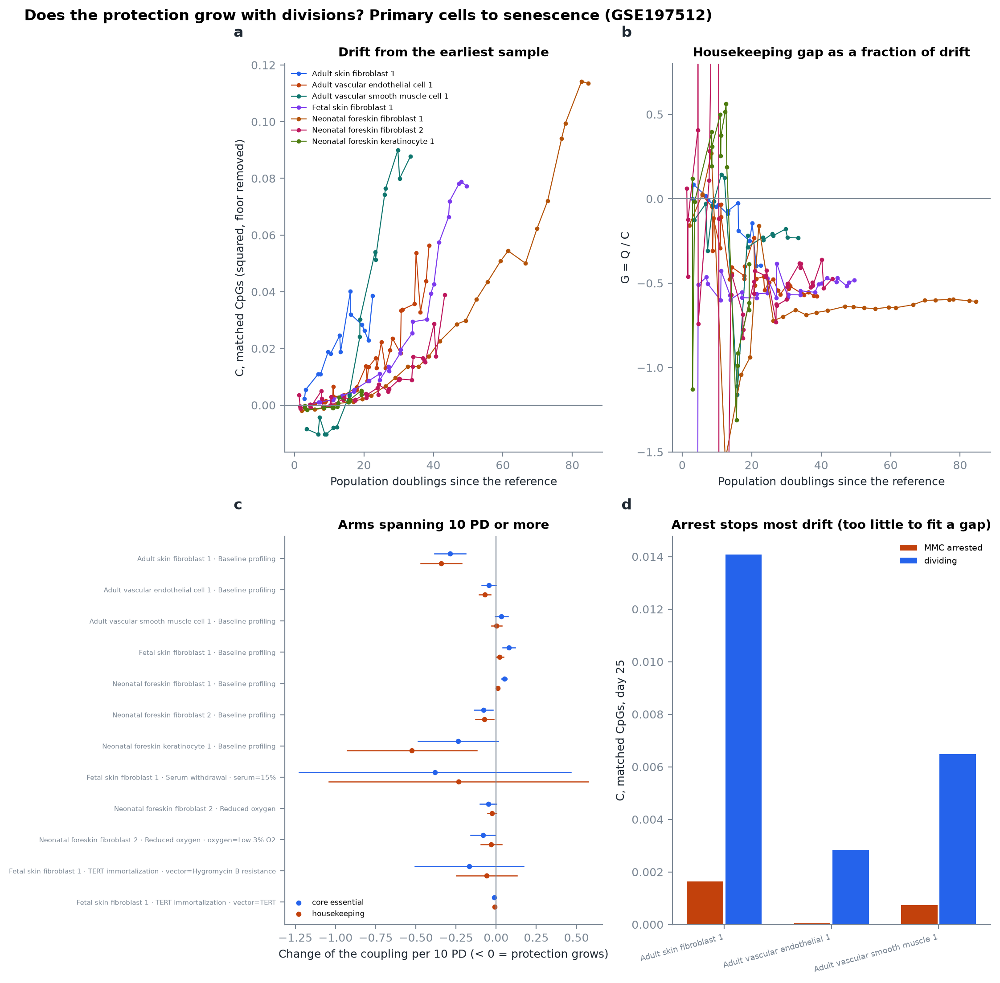

**Result, with the floor removed** (housekeeping; core essential in brackets):

| | Coupling (protection per unit drift) | Change per 10 PD |
|---|---|---|
| mean of the 7 passaged lines | −0.14 [−0.25] | −0.14, interval −0.33 to +0.06 [−0.07, −0.20 to +0.06]; negative in 4 of 7 |
| neonatal foreskin fibroblast 1 (83 PD) | −0.68 (SE 0.03) | +0.010 (SE 0.003) |
| fetal skin fibroblast (45 PD) | −0.60 (0.06) | +0.022 (0.013) |
| fetal skin fibroblast with TERT (136 PD) | −0.73 (0.02) | −0.008 (0.001) |
| neonatal foreskin fibroblast 2, 3 % oxygen | −0.34 (0.17) | −0.031 (0.033) |

* **The protection is real in culture.** Once drift is well above the floor, the housekeeping gap
  settles at −0.5 to −0.7 of matched drift in every line (panel b): set CpGs drift about half as
  much as matched CpGs, in squared units.
* **It does not grow with divisions.** The fraction is flat from about 25 PD to the end in the long
  courses; the two longest untransformed lines even weaken slightly with PD, and the 136-PD TERT
  course strengthens by 0.008 per 10 PD, about 0.1 over its whole span. Across the seven lines the
  change is as often positive as negative. A protection that is a fixed fraction of drift is what
  chromatin protection predicts; selection predicts a growing fraction, and this test does not
  show one.
* **The arrest arms are uninformative.** MMC stopped most drift (panel d: matched drift 0.0001 to
  0.0016 against 0.003 to 0.014 in dividing controls over the same 25 days), which confirms that
  drift in culture comes with division, but leaves too little drift to measure a gap.

**Limits.** Culture is not a tissue: cells are selected for growth on plastic, and Endicott's
point is that methylation loss in culture is concentrated in late-replicating, CpG-poor domains,
while promoter CpGs replicate early; matching on island status and level removes part of that
difference, not replication timing itself. The noise floor comes from replicate cultures measured on
the same day, which also carries what they diverged since splitting (in the smooth-muscle line,
measured at day 20, the corrected drift dips below zero at first); one line without replicates
uses the floor pooled over the others. Seven lines, one of each type except fibroblasts, are few.

Tables: `data/output/passaged_cells/` (`drift_coupling`, `coupling_across_lines`, `across_lines`,
`mmc_arrest`; per-sample scores in `sample_scores`).

### Replication: the Cellular Lifespan Study (GSE179847)

Sturm et al. (2022, GSE179847) grew dermal fibroblasts of six healthy donors and three SURF1 patients
for up to 265 days on EPIC, with glucocorticoid, mitochondrial and metabolic treatments, 3 % oxygen, and
contact inhibition for 120-140 days (`entropy-age fetch cohort sturm`, `entropy-age figures passage_sturm`;
paper scale, seed 42). The baseline is each healthy line's untreated 21 % oxygen course of the two
lifespan parts of the study (five lines, 5-15 samples, 24-79 PD). No arm measures one day twice; the
noise floor comes from the flasks split from one culture at a treatment's start, and the baseline
courses, which have none, use the floor pooled over the experiments that do.

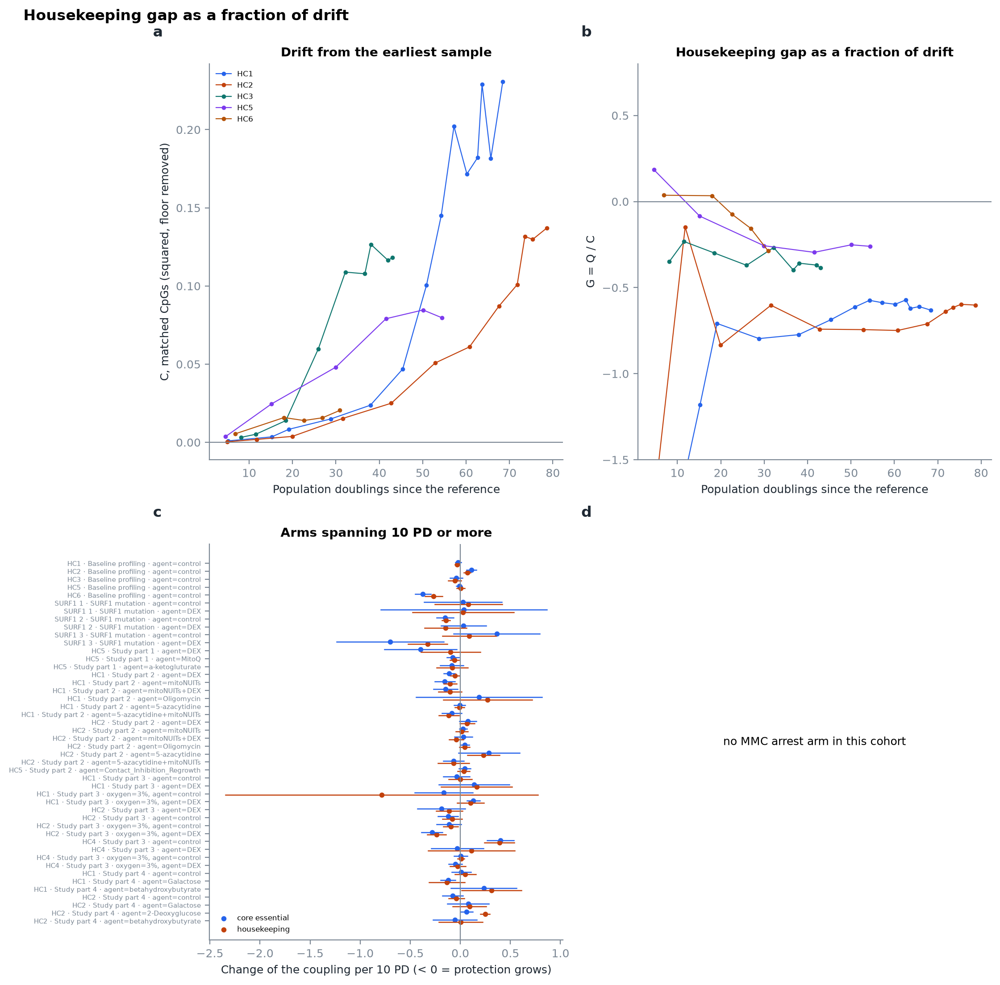

| | Housekeeping | Core essential |
|---|---|---|
| change of the coupling per 10 PD, mean of 5 lines | −0.055, interval −0.21 to +0.10; negative in 3 of 5 | −0.067, −0.29 to +0.16; 4 of 5 |
| mean coupling | −0.27 | −0.19 |
| GSE197512, for comparison (7 lines) | −0.14, −0.33 to +0.06 | −0.07, −0.20 to +0.06 |

* **The same answer.** The gap grows with drift in all five lines (`Q` per 10 PD −0.012, interval
  −0.022 to −0.001), but its share of drift does not move with divisions: per line the change is
  −0.03 (SE 0.01), +0.07 (0.02), −0.06 (0.03), +0.005 (0.02) and −0.27 (0.04), the last from the
  shortest course (5 samples, 24 PD), whose coupling is not even negative. Without the floor, the
  fraction `F` again falls with PD in every line (−0.044 per 10 PD), the noise artefact described above.
* **Contact inhibition, the long arrest GSE197512 lacked, is not decisive either.** Over 120 days the
  inhibited cultures gained 1-2 PD and drifted 1.4 to 14 times less per day than dividing controls of the
  same lines (matched drift `C` 0.0004-0.0021 per 10 days against 0.003-0.014). The gap per unit of
  their small drift (`Q`/`C`, per 10 days) is −0.86, −1.34 and −0.07 in the three lines at 21 % oxygen,
  against −0.76, −0.66 and −0.47 in their controls: protection without divisions in two lines, none in
  the third. Selection alone would give none in all three, chromatin protection the controls' share in
  all three; drift this small sits near the floor, so neither is excluded.

Tables: `data/output/passaged_cells_sturm/` (as for GSE197512; the contact-inhibition and 3 % oxygen arms
under `Study part 3` in `drift_coupling`; their slopes on days are in `arm_slopes.parquet`, not tracked).

## Across mammals: the shield is universal, and not stronger in long-lived species (roadmap RM10)

The Mammalian Methylation Consortium (GSE223748; `entropy-age fetch mammals`) measured the same conserved CpGs in
15,043 samples of 349 species. Figure `species` (run R12) keeps the 139 species-tissue groups with at least 15
animals spanning 15 % of the species' maximum lifespan: 65 species, 11,529 samples, from mouse to bowhead whale.

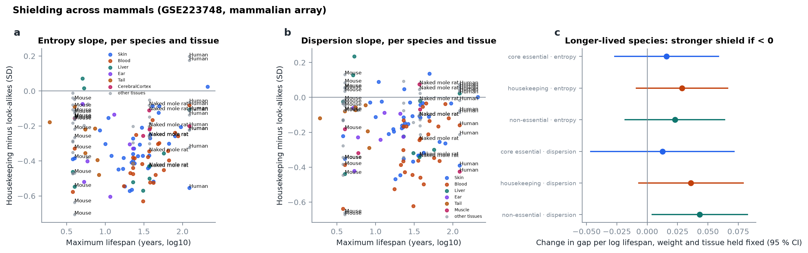

* **The shield is nearly universal.** The housekeeping entropy gap is negative in 96 % of species-tissue groups,
  with its interval below zero in 89 %, at −0.30 SD on average. Mouse, naked mole rat, bats, whales and humans
  all show it.
* **It is not stronger in long-lived species.** Against log maximum lifespan, with adult weight and tissue held
  fixed, the housekeeping gap changes by +0.029 (entropy, p 0.14) and +0.036 (dispersion, p 0.11) per log-unit:
  if anything a slightly *weaker* shield in longer-lived species, and not significantly. Core-essential genes give
  the same. Naked mole rat (37 years) shields like mouse (4 years).
* **This fits prior work.** Crofts et al. 2026 explain the lifespan scaling of methylation rates by stem-cell
  dynamics rather than maintenance; a maintenance shield tuned to lifespan would have shown here, and does not.
* **Cautions.** Species are not independent (no phylogenetic correction yet). The conserved array CpGs at essential
  promoters sit near 0 %, which floors their drift. Human bone marrow and lymph node show the reverse (+0.18 and
  +0.20), unexplained at first; R54 below explains it as small samples and a donor set.

**The marrow and lymph-node reversal is not robust (roadmap RM16, step 2).** Both come from one organ-donor
series with spleen, liver, heart and others, matched by age and sex. Figure `marrow_anomaly`:

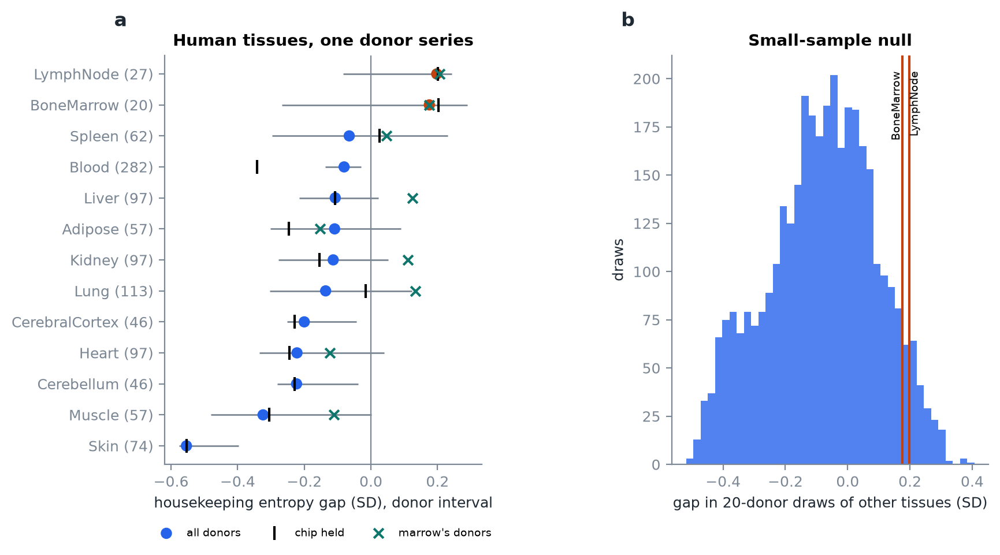

* **Within donor noise.** With donors resampled instead of genes, both intervals cross zero (marrow −0.27 to +0.29,
  lymph node −0.08 to +0.24); 20-donor draws of the other tissues reach gaps this high in 5-7 % of draws, with
  13 tissues looked at.
* **The donors, not the tissue.** Refitted on marrow's donors, seven other tissues move by +0.16 SD on average
  (from −0.15 to about 0; lung, kidney and liver turn positive). The array chip changes nothing.
* **Marrow's age signal looks like fat.** Its per-CpG age slopes follow the adipose-minus-blood direction more
  than any other tissue's (r 0.28): marrow turns fatty with age, a change of cell mix, not of selection.
* So the anomaly gives no lead for selection in renewing tissue; the evidence on selection stays where RM16 lists it.

Tables: `data/output/marrow_anomaly/` (`checks`, `null_share`, `null_draws`).

Tables: `data/output/species_shield/` (`species_gaps`, `lifespan_fits`).

**With relatedness held fixed, and within tissues (roadmap RM21).** Figure `species_phylo` refits the lifespan
regression by generalised least squares, with a covariance from the species' NCBI Taxonomy lineages (shared
depth; `entropy-age fetch taxonomy`) and Pagel's λ chosen by maximum likelihood, on all 139 groups and within
skin (36 species), blood (27) and liver (10).

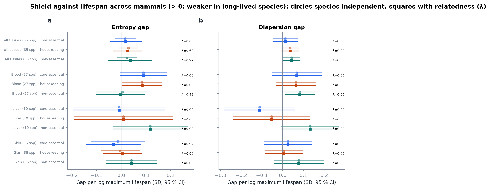

* Relatedness explains part of the gaps across tissues (λ 0.60-0.92 for entropy), and the lifespan coefficient
  stays near zero: housekeeping entropy +0.025 per log-unit (p 0.40; it was +0.029, p 0.14, with species
  independent).
* Within skin and liver nothing tracks lifespan. Within blood, long-lived species lean toward a *weaker* shield
  (housekeeping entropy +0.085, p 0.054; core-essential +0.090, p 0.08).
* The taxonomy gives every branch length one, so it captures a strong clade effect only in part; a dated
  phylogeny (TimeTree) would be the stricter test. No conclusion rests on that difference here: with or without
  it, long life is not bought with a stronger shield.

Tables: `data/output/species_phylo/lifespan_fits`.

**Do long-lived species drift less everywhere, catching up with the shield? (roadmap RM20, run R22.)** The
look-alike CpGs' own drift rate falls steeply with lifespan: about as lifespan^−1.4 per year for entropy
(−1.15 for dispersion; p < 10⁻⁶, weight and tissue fixed), so long-lived species drift less even per fraction of
their lifespan, as Crofts et al. 2026 found for methylation rates. Catch-up predicts that the protected promoters,
already near their floor, gain less, so the gap shrinks relative to the look-alikes' drift. It does not: the
relative gap stays flat for dispersion (p 0.34-0.62) and, for entropy, grows (housekeeping −2.4 per log-unit,
p 0.04): long-lived species protect essential promoters by at least the same share. The ratio is noisy where
look-alike drift is near zero, and those groups are left out (14-46 %).

**The blood lean rests largely on one species.** A drop-one-species jackknife (`species_phylo`, columns
`influential_species`, `coef_without`) shows human is the most influential species for blood's housekeeping
entropy slope: without it, +0.085 (p 0.054) falls to +0.047 (p 0.30). The consortium's human blood shows a weak
shield (−0.08 SD), unlike our human blood cohorts (Hannum −0.29); why is open (sample ages, array, cell mix).
Within species that have both tissues (12 with blood and skin, 7 with blood and liver), there are too few to test
the purging hypothesis (RM20, 2) on its own. So the evidence for a weaker shield in long-lived species is weak to
begin with; RM20's hypotheses explain a pattern that is not firmly there.

## Interventions across mouse tissues (roadmap RM12)

Figure `mmc_interventions` (run R13) scores every mouse of the consortium's intervention studies against its study's
controls (controls leave one out), at least 5 animals per arm.

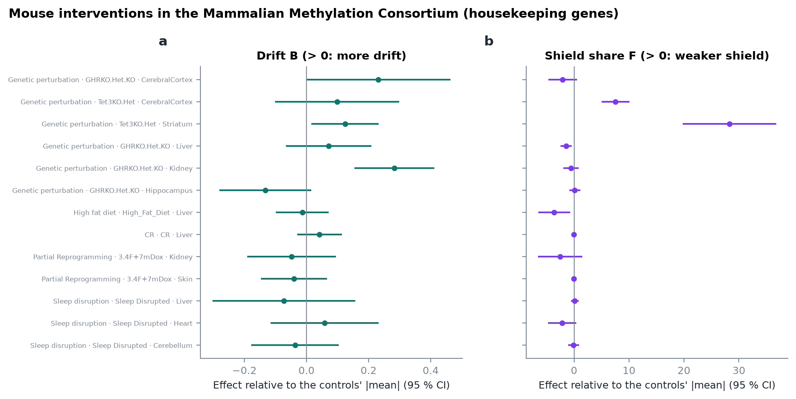

| study, tissue | treated / controls | shield share F, effect (p) | reading |
|---|---|---|---|
| CR, liver | 59 / 36 | −0.008 (0.77) | no change |
| Tet3 heterozygous, cortex | 8 / 70 | +0.16 (2·10⁻⁷) | shield lost |
| Tet3 heterozygous, striatum | 8 / 72 | +0.13 (6·10⁻⁹) | shield lost |
| GHRKO dwarf, liver | 11 / 49 | −0.10 (0.01) | shield stronger |
| GHRKO dwarf, kidney, cortex, hippocampus | 6-12 | n.s. | — |
| high-fat diet, liver | 133 / 212 | −0.05 (0.01) | stronger, before composition |
| partial reprogramming, sleep disruption | 5-8 | n.s. | too small |

* **CR does not weaken the shield in liver** (59 against 36 mice). The weakening in mouse blood (one study) is not
  replicated in a slowly renewing tissue. That is what selection would predict, but it is also what a batch effect
  in the blood study would give; it stays open.
* **Mice missing one copy of Tet3 lose the shield in brain, against their own littermates.** Tet3 is a DNA
  demethylase active in neurons. The pooled controls were the wild types of several knockouts; but the Tet3 mice
  share their array chips with eight wild types of the same age, their littermate controls. Against those, with
  the chip as a covariate (run R15), the shield share rises by +0.17 (cortex, p 0.006) and +0.25 (striatum,
  p 9·10⁻⁶) for housekeeping genes, +0.31 and +0.49 for core-essential genes (8 against 8 each). Drift at
  look-alike CpGs rises only slightly (B +0.007, +0.003). Neurons do not divide, so selection cannot do this:
  halving a demethylase lets essential promoters drift like any other CpG. This is the first causal sign that the
  shield is maintained by the methylation machinery (H1). Open: whether essential CpGs gain methylation (TET
  keeps island promoters unmethylated) or merely scatter; one study, 16 mice.
* **Which way they move (run R16).** The signed shift S (above 0: set CpGs gained methylation against their
  look-alikes) rises for core-essential genes in Tet3 heterozygous brain: +0.012 (cortex, p 3·10⁻⁴), +0.014
  (striatum, p 2·10⁻⁴). Essential promoters gain methylation, as TET's role predicts. But S rises as well in arms
  with no change of the shield (GHRKO kidney +0.028, CR liver housekeeping +0.005), and non-essential CpGs fall
  in the same arms: a compression of an array's beta values toward the middle lifts the lowest CpGs within a
  level stratum and could do this. So the direction is consistent with TET biology and not yet specific to it;
  the shield's loss (F) is.
* **The GHRKO liver effect was batch.** Against same-chip controls it vanishes (+0.01, p 0.67); the pooled
  controls carried it. CR in liver against the same controls: housekeeping −0.02 (p 0.59), core-essential −0.07
  (p 0.005), a slightly *stronger* shield if anything.

Tables: `data/output/mmc_interventions/` (`effects`, `animal_scores`).

## Do people with faster clocks have a weaker shield? (roadmap RM11)

Asked by antonkulaga: among people of the same age, does a fast clock go with a weaker shield? Figure
`shield_clocks` (runs R28, R29) correlates, per person, the shield measures with the age acceleration of 16
published clocks (Tong et al.'s stochastic clocks StocH, StocP, StocZ among them), age and technical covariates
removed, in Hannum blood (632) and Jaffe cortex (159).

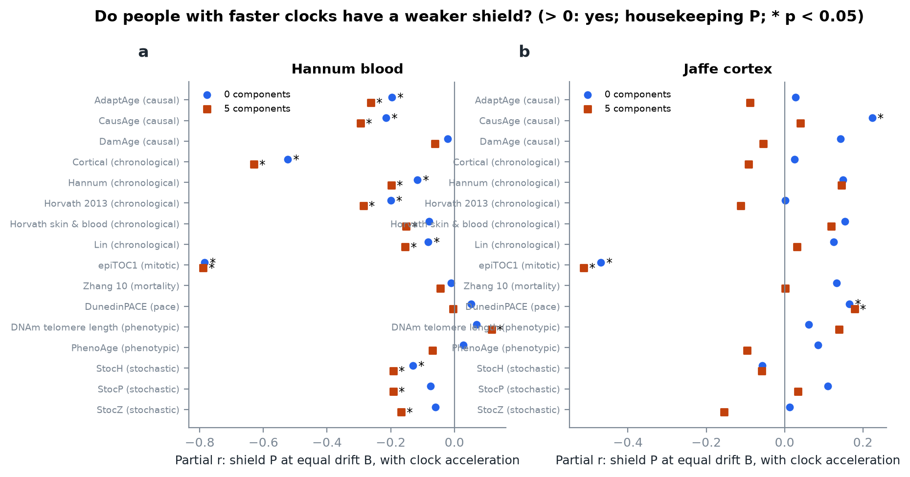

* **P itself is the wrong measure here.** P subtracts the look-alikes' drift B, and clocks are made of drifting
  CpGs, so P correlates negatively with acceleration by construction (R28). The fair measure is P at equal B.
* **Faster clocks go with more drift (B: StocZ +0.33, epiTOC1 +0.58, DunedinPACE +0.26), and, at equal drift,
  with a *stronger* shield** (Horvath −0.29, Hannum −0.20, the stochastic clocks −0.17 to −0.19, epiTOC1 −0.79).
  Clocks run fast in people whose drift falls on unprotected CpGs, where the clock CpGs sit.
* **The outcome-linked clocks do not see the shield:** at equal drift, PhenoAge −0.07, DunedinPACE 0.00, Zhang's
  mortality score −0.04. The shield is information conventional clocks leave out. Whether it predicts health
  needs a cohort with outcomes.
* Cortex is mostly null (159 donors), except epiTOC1 (−0.51).

Tables: `data/output/shield_clocks/correlations` (measures P, F, B, set drift, P given B).

**Clocks of our own (run R33).** Figure `own_clocks` trains elastic-net clocks, out of fold, on three pools of
equal size: shielded CpGs (essential and housekeeping promoters), look-alikes matched stratum by stratum, and
random background CpGs (about 38,000 each).

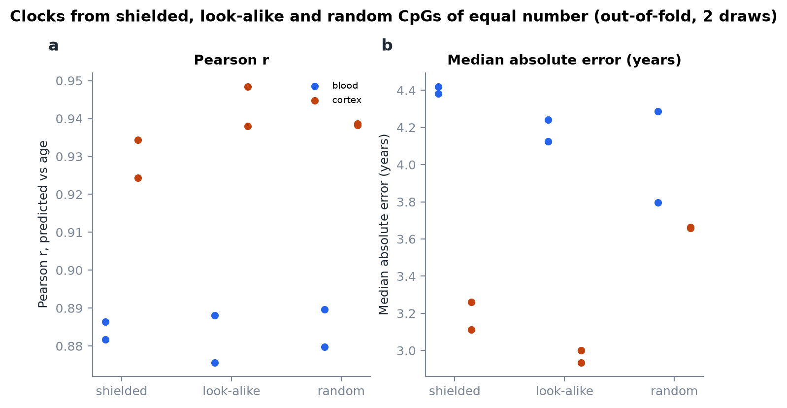

* **A clock does not need unprotected CpGs.** All three pools read age equally well (blood r 0.882-0.885; cortex
  0.929-0.943). The shield lowers the *average* drift of essential promoters, but among tens of thousands of them
  enough CpGs still change with age for a penalised regression to find. Accuracy cannot tell the pools apart.
* **What the clocks read differs.** The shielded clock's age acceleration overlaps less with the other two (blood
  r 0.63 against 0.80 between look-alike and random; cortex 0.53-0.57 against 0.62): the people whose essential
  promoters run ahead are partly different people. Whether that acceleration carries different health
  information needs an outcome cohort.

## Tet3's gain is not array compression; Dnmt3a W326R methylates the look-alikes (roadmap RM12, RM18)

**Tet3 (run R36).** Tet3 heterozygous brain gained methylation at essential promoters (S +0.012 cortex, +0.014
striatum, against same-chip littermates). One alternative was array compression: a chip that squeezes betas toward
the middle lifts CpGs near 0 % in every arm. With each animal's compression (mean |beta - 0.5|) held fixed, the gain
stays: +0.010 cortex (p 0.003), +0.013 striatum (p 0.001). Other arms shift S too, in both directions (GHRKO kidney
+0.023, GHRKO cortex -0.010), so a signed shift is not unique to Tet3, but Tet3's is not a compression artefact.

**Dnmt3a gain of function (run R37).** The opposite direction to TET loss: mice carrying Dnmt3a W326R/+, against
littermates at four ages, in bone marrow, intestine and liver (GSE324160, Sarni et al. 2026). The effects are the
largest in this project and identical in all three tissues: essential and housekeeping CpGs fall relative to their
look-alikes (S -0.06 to -0.09), non-essential CpGs rise (S +0.07 to +0.09), drift B rises everywhere (+0.06 to
+0.10), and the shield share F moves by -0.6 (essential) and +0.6 (non-essential).

Reading: this is not a stronger shield against noise. W326R sits in the PWWP domain, which normally reads
H3K36me2/3 in gene bodies; PWWP mutants lose that binding and methylate Polycomb-marked DNA methylation valleys instead, also in
Dnmt3a dwarf mice (Heyn et al. 2019, Nat Genet, doi 10.1038/s41588-018-0274-x, PMID 30478443). The look-alikes of essential CpGs are unmethylated islands, many of them Polycomb
targets, and non-essential (developmental) genes are Polycomb targets themselves; both gain methylation, so active
essential promoters look protected by comparison. A writer is aimed by chromatin, and the essential promoters'
chromatin keeps it out. That supports H1 (chromatin decides where methylation changes), and it is a warning for
the matched gap: a perturbation that hits the look-alikes moves F as much as one that hits the set.

## A second machinery model: Tet1 loss does not remove the shield (roadmap RM12)

Figure `tet1` (run R35) scores adult cortex of Tet1 knockout and Tet1 catalytic-dead (HxD) mice against wild
types (Foong et al. 2024, GSE271375; 8 each; mouse array, bisulfite), as the Tet3 mice were scored.

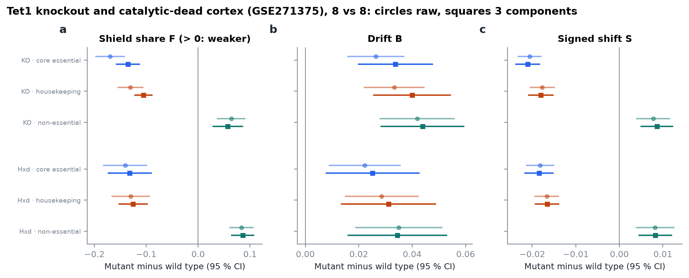

* **The opposite of Tet3.** Both mutants drift more overall (B +0.03 to +0.04), but essential promoters keep or
  gain their protection (F −0.11 to −0.17, p < 0.001) and sit lower than their look-alikes (S −0.02): the extra
  methylation lands on unprotected CpGs. The catalytic-dead mutant matches the knockout, so this is Tet1's
  enzyme activity.
* **So the shield is not "TET activity" in general.** Halving Tet3 (the TET most active in neurons, which keeps
  their promoters unmethylated) removed it; losing Tet1 adds noise elsewhere. The machinery that guards essential
  promoters is specific, or redundant except for Tet3 in neurons.
* Cautions: one study each; Tet3 was heterozygous on the mammalian array, Tet1 homozygous on the mouse array;
  ages of the Tet1 mice are not in GEO.

Tables: `data/output/tet1_cortex/effects`.

## Partial reprogramming does not restore the shield (roadmap RM17)

Figure `reprogramming` (run R32) scores the mice of Browder et al. 2022 (GSE190665; cyclic OSKM in vivo for 1, 7
or 10 months, six tissues, mammalian array) against untreated old mice of the same tissue; young mice against the
same old mice are the positive control.

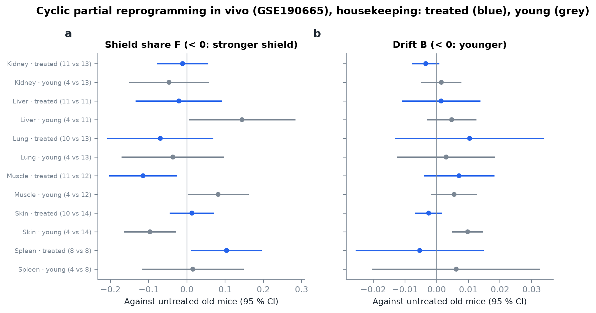

* **No consistent change of the shield.** Muscle's shield is stronger in treated mice (housekeeping F −0.12,
  p 0.02), spleen's weaker (core-essential +0.21, p 0.001; 8 against 8), the other four tissues unchanged.
* **The reset barely moves these CpGs toward youth.** Treated mice sit no further from the old controls than the
  controls themselves (B, p ≥ 0.14 everywhere), while young mice do (skin p 0.001). At promoter CpGs the cyclic
  regimen leaves methylation essentially old, so the test has little to restore; Browder et al. reported modest
  clock rejuvenation in some tissues only.
* Small groups (4-14 mice); the three durations are pooled.

Tables: `data/output/reprogramming/effects`.

## Selection in vivo: clonal haematopoiesis leaves the shield alone (roadmap RM16)

Clonal haematopoiesis (CH) is selection among blood stem cells in a living person. Figure `chip` (run R25) scores
the blood of CH carriers against non-carriers in Basrai et al. 2026 (GSE315366; 64 patients in cardiogenic
shock, EPIC; CH called as DNMT3A or TET2), as the syndromes are scored (controls leave themselves out, age and sex
covariates, raw and with 5 composition components).

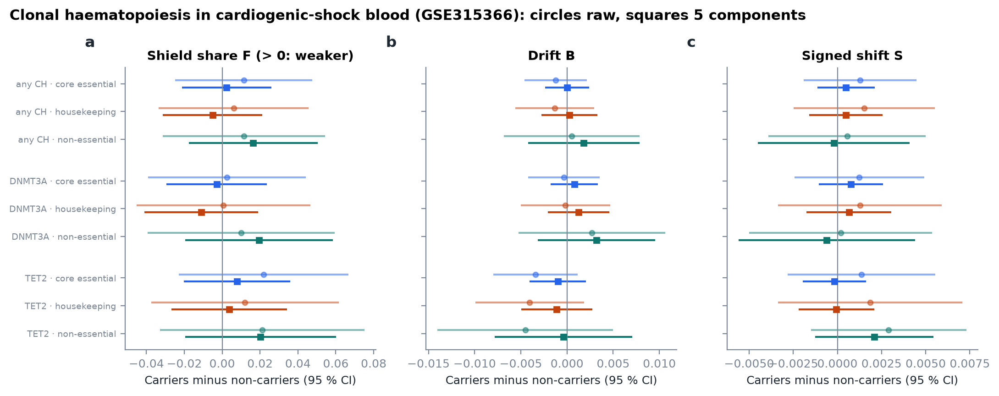

* **No arm moves the shield.** Any CH (29 against 35), DNMT3A (21) and TET2 (12): drift B, shield share F and
  signed shift S all unchanged (|F| ≤ 0.022, p ≥ 0.15).
* **Weak evidence.** No allele fractions are given; most CH clones hold 2-10 % of blood cells, so an effect inside a
  clone is diluted ten- to fifty-fold in the sample. The patients are acutely ill. The test that would decide it
  is within a person: mutant against wild-type cells (GSE158067, Nam 2022, two donors), or a cohort with allele
  fractions (controlled access; `docs/CHIP_SURVEY.md`).

Tables: `data/output/chip_methylation/effects`.

## Probe design and unreliable probes (roadmap RM18)

The 450k array's two probe designs differ in dynamic range, and essential-promoter CpGs are type I more often
(42-45 % against 35 % of promoter CpGs). Figure `probe_robustness` (run R20) recomputes the headline gaps with the
design added to the matching strata, and with Zhou et al. 2017's general mask of unreliable probes applied.

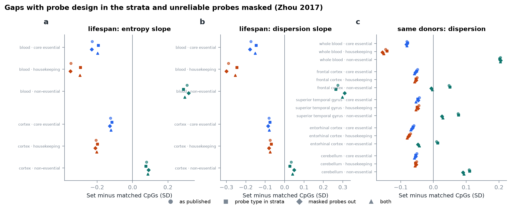

* Design explains about a sixth of blood's lifespan gaps (housekeeping entropy −0.35 → −0.30 SD, core-essential
  −0.23 → −0.19); cortex and the same-donor tissues move by under 0.01 SD.
* The mask moves no gap by more than 0.01 SD. No gap changes sign.
* Open (RM18): one cohort from raw IDATs, and each array's beta compression as a covariate for the signed shift.

Tables: `data/output/probe_robustness/` (`gaps`, `design_share`).

## Natural experiments in people: chromatin-writer syndromes keep the shield (roadmap RM14)

Tet3 heterozygous mice lose the shield in brain. Do people born with a variant in a chromatin writer lose it in
blood? Figure `syndromes` (run R18) scores the blood of carriers against the controls of two Weksberg-lab 450k
series: GSE74432 (Sotos syndrome and other NSD1 variants, the H3K36 methyltransferase; Weaver syndrome, EZH2,
the Polycomb H3K27 methyltransferase) and GSE97362 (Kabuki syndrome and other KMT2D variants, the H3K4
methyltransferase; CHARGE syndrome and other CHD7 variants, a remodeller). Composition is removed with 5
components of the controls' background CpGs. GSE97362 keeps only people inside the controls' 2-19 years, with
age as covariate; GSE74432 gives no ages, so its contrasts are not age-adjusted.

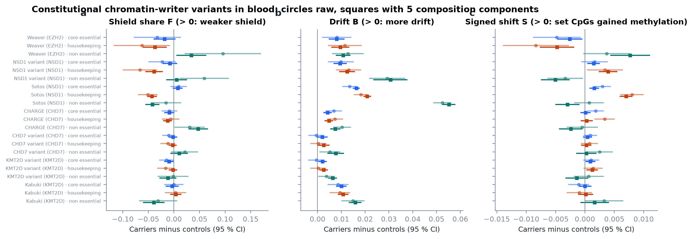

| carriers (controls) | drift B, housekeeping | shield share F, housekeeping | reading |
|---|---|---|---|
| Sotos 38 (53) | +0.021 (p 10⁻⁴²) | −0.043 (p 2·10⁻¹³) | more drift, shield holds |
| NSD1 variant 16 (53) | +0.012 | −0.039 (p 3·10⁻⁵) | the same |
| Weaver 8 (53) | +0.010 | −0.037 (p 0.003) | the same |
| Kabuki 10 (124) | +0.011 (p 3·10⁻¹⁶) | +0.003 (n.s.) | more drift, shield unchanged |
| CHARGE 17 (124) | +0.005 | −0.012 (p 0.005) | the same |
| KMT2D, CHD7 variants 20, 27 (124) | ≈ 0 | ≈ 0 | nothing |

(5 components; raw scores agree in sign.)

* **Every syndrome adds drift, none removes the shield.** Carriers' CpGs move further from the controls, as
  Martin-Herranz et al. 2019 found for clocks in Sotos, but at look-alike CpGs at least as much as at essential
  promoters: the shield's share holds or grows.
* **Unlike Tet3.** Halving Tet3 in neurons removed the protection at essential promoters themselves. NSD1 and
  EZH2 mark intergenic and Polycomb chromatin; losing them disorders the CpGs around the promoters, which is where
  the look-alikes sit. The shield sits in the machinery that keeps island promoters unmethylated (TET), not in
  the writers of the surrounding chromatin. One mouse study and four syndromes; a hypothesis to test, not a
  result.
* **What R17 had wrong.** Without the age restriction, KMT2D and CHD7 variant carriers looked as if they drifted
  more; many were infants, whose blood differs in kind. Inside the controls' ages the effect is gone.
* **Cautions.** GSE74432 has no ages; carriers are children and the ages of its controls are unknown. A
  syndrome's own methylation signature (Choufani 2015, Butcher 2017) adds to B by design; F is a ratio and
  less affected, but not immune.

Tables: `data/output/syndromes/` (`effects`, `person_scores`).

## Chromatin accessibility: a first sign of the shield in ATAC-seq (roadmap RM19)

Does chromatin opening spread apart between people with age, and less at essential promoters? Figure
`atac_variance` uses Morandini et al. 2023's bulk ATAC-seq of blood mononuclear cells (GSE193140; 157 donors aged
20-74, one library each; 42,557 peaks, hg38). Per peak: log counts per million, residuals after age and sex (and
5 leading components of all peaks, for cell mix), and the age slope of the absolute residual in units of the
peak's spread. 12,811 peaks hold a 450k promoter CpG; a set's peaks are compared with the other promoter peaks of
the same island status, mean-accessibility decile and width tertile, labels permuted within strata.

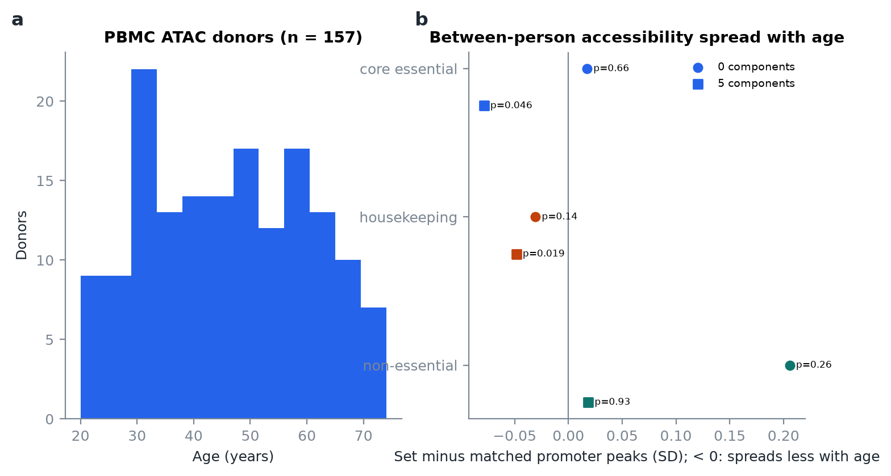

| set (peaks) | raw | 5 components |
|---|---|---|
| housekeeping (3,725) | −0.031 SD (p 0.14) | −0.048 SD (p 0.02) |
| core-essential (633) | +0.017 (p 0.66) | −0.078 (p 0.05) |
| non-essential (32) | +0.21 (p 0.26) | +0.02 (p 0.93) |

* **Essential promoters spread apart more slowly with age than matched promoters, once cell mix is removed.** The
  same direction as the methylation shield, about a fifth of its size, in another layer of chromatin.
* **Weak and first.** One bulk dataset; the raw scores do not reach significance; the components may carry part
  of age; non-essential promoters are barely open in blood (32 peaks). It needs per-cell-type data: the
  362-donor prefrontal-cortex single-nucleus set (Catching 2026) and the 40-donor hippocampus set (Zemke 2024),
  `docs/ATAC_SURVEY.md`.

Tables: `data/output/atac_variance/gaps`.

**Inside cortical cell types the sign reverses (runs R23, R24).** Figure `atac_cortex` sums the single-nucleus
ATAC counts of 357 prefrontal cortices (Catching et al. 2026; ages 15-100; Zenodo 18394349) per donor and cell
type, and repeats the test per cell type, with sex, brain bank, post-mortem interval and log nucleus count as
covariates, and four adjustments: none, 5 components, the donor's promoter read fraction (a quality score like
TSS enrichment), both.

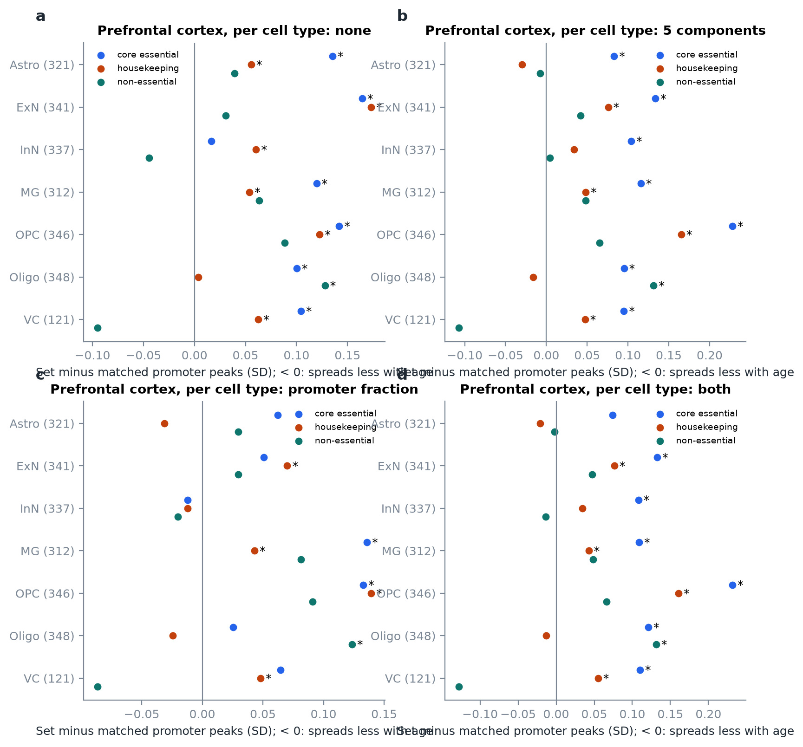

* **Essential promoters spread apart with age *more* than matched promoters.** With every adjustment,
  core-essential promoters do so in 6 of 7 cell types (+0.07 to +0.23 SD, p ≤ 0.055), housekeeping promoters in
  excitatory neurons, microglia, OPCs and vascular cells (+0.04 to +0.16 SD); astrocytes, inhibitory neurons and
  oligodendrocytes show nothing for housekeeping.
* **Sample quality explained part, not all.** Without adjustment the effect was larger in some cell types (e.g.
  excitatory neurons, housekeeping +0.17 → +0.08); the promoter read fraction took part of it.
* **So there is no general accessibility shield.** Blood (bulk, 157 people) leans toward one; brain cell types
  show the reverse at the strongest, most essential promoters. Methylation in cortex keeps a weaker shield
  (−0.05 to −0.21 SD), so the two layers part ways in brain. Possible reasons: transcriptional noise rising at
  highly expressed genes in aging neurons and glia; post-mortem or nuclear-integrity effects that hit open
  promoters hardest; or the snATAC pseudobulk's own noise, which matching on mean accessibility may not remove.
  Open.

Tables: `data/output/atac_cortex/gaps`.

**Hippocampus does not settle it (runs R26, R27).** Figure `atac_hippocampus` repeats the test in 40 hippocampi
(Zemke et al. 2024, GSE278576; ages 20-95), with genes as features because each donor has its own peaks. Five
subclasses qualify (20-40 donors). The sign depends on the adjustment: oligodendrocytes' core-essential gap is
+0.24 raw, −0.23 with the promoter read fraction, −0.01 with both; OPCs' −0.18 raw, +0.14 with both. With both
adjustments, astrocytes, OPCs and subiculum lean positive (housekeeping +0.05 to +0.15), microglia and
oligodendrocytes sit at zero. With 20-40 donors, sample quality and cell state outweigh the age signal, and the
modelling choice decides the sign. That also weakens the cortical reading, which rests on one modelling scheme
in more donors: the brain reversal is not replicated, and accessibility is no clean readout of the shield.

## Outside promoters: a directed, division-linked loss (roadmap RM15)

SvenDP asked whether aging methylation is all stochastic, or whether specific intergenic regions lose methylation
together, too little per CpG for a test but visible in a PCA. The known candidate is solo-WCGW CpGs (A or T on both
sides, no other CpG within 35 bp), which lose methylation in late-replicating, CpG-poor domains as cells divide
(Zhou et al. 2018). Figure `intergenic` (run R14) tags every 450k CpG from its flanking sequence in the manifest and
tests the open-sea CpGs outside promoters: 131,000 in Hannum blood and Jaffe cortex, about 13,100 of them solo-WCGW.

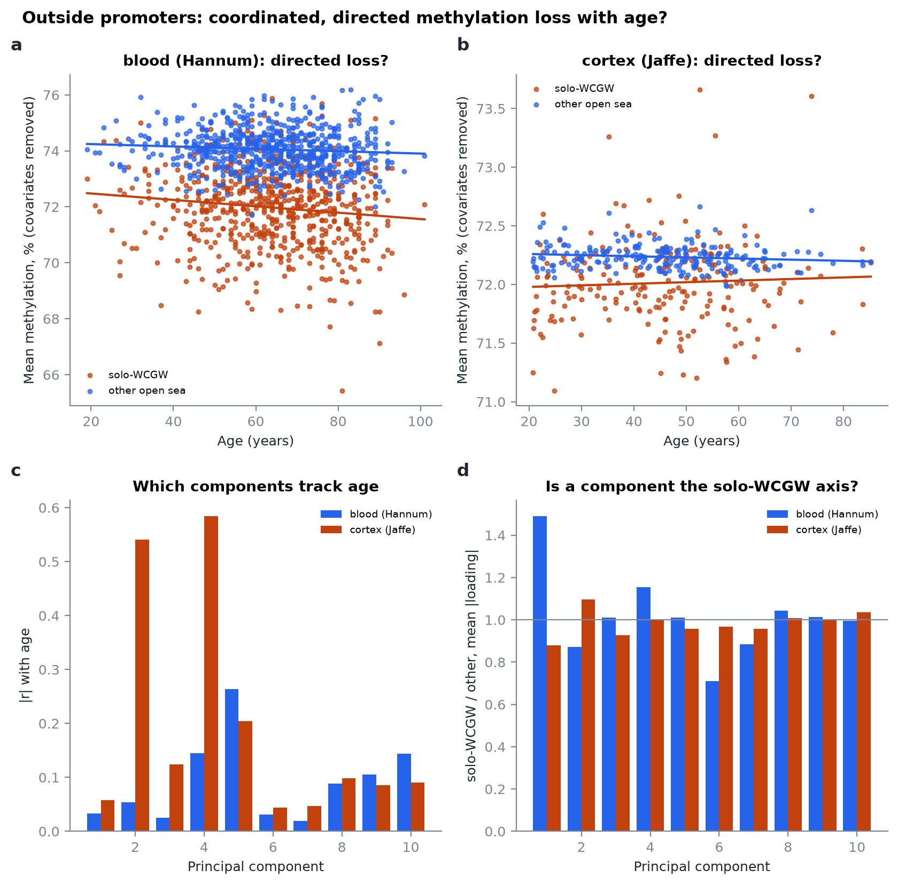

| | solo-WCGW, per decade | other open sea, per decade | difference, per decade |
|---|---|---|---|
| blood (Hannum, n = 656) | −0.21 pp (p 4·10⁻⁵) | −0.08 pp (p 0.003) | −0.13 pp (p 2·10⁻⁴) |
| cortex (Jaffe) | +0.02 pp (p 0.42) | −0.01 pp (p 0.05) | +0.03 pp (p 0.08) |

(pp: percentage points of mean methylation, technical covariates removed.)

* **Yes, a directed loss, in blood.** Solo-WCGW CpGs lose methylation steadily with age, 2.7 times as fast as the
  other open-sea CpGs. Each CpG moves little (about 1.3 points over 60 years), so a per-CpG test misses most of
  them, but the class moves together. That is not noise: noise would spread people apart without moving the mean.
* **It needs dividing cells.** Cortex, whose neurons do not divide, shows none. This is the mitotic-clock signal of
  Zhou et al. and Endicott et al., not stochastic drift.
* **The PCA does not single it out.** Blood's first component weighs solo-WCGW CpGs 1.5 times as much as other CpGs
  but does not track age (r = −0.03). The components that track age in blood (r 0.15-0.26) do not weigh them
  more. The loss is real but small, so in a PCA it hides behind larger axes.
* **Cortex has its own coordinated age axes.** Two components track age strongly (|r| 0.54 and 0.58) without
  weighing solo-WCGW CpGs: a coordinated programme in brain, not the mitotic one, still to be identified.
* **For the other results.** Blood's first component, which our cell-mix corrections remove, carries the solo-WCGW
  axis, but it does not track age, so the age-slope results are unlikely to have lost much by removing it.

So aging methylation is not all stochastic. Next to the drift the paper models (spread that grows, mean that
barely moves), dividing tissue shows a directed loss at solo-WCGW CpGs. Clocks and models should treat the two
apart. Next: the same test in the culture series (EPIC, where the loss should grow with doublings) and in the
cortex axes.

Tables: `data/output/intergenic/` (`directed_loss`, `components`).

## Interventions in mouse blood: the shield grows with age and caloric restriction weakens it (roadmap RM3)

Petkovich et al. 2017 (GSE80672) profiled mouse whole blood by RRBS. The set has 153 C57BL/6 mice on a
standard diet aged 0.7–35 months, caloric restriction (CR) in C57BL/6 and in B6D2F1, and two long-lived
dwarf models with littermate controls at 5–6 months (GHRKO, Snell). `entropy-age fetch rrbs` reads the
per-sample tables (GRCm38). It keeps 542,008 promoter CpGs, each covered at least 10 times in 90 % of the
243 samples. Promoters and CpG islands come from UCSC's mm10 tracks; gene sets are matched by Entrez ID.
Figure `interventions` (runs R7 and R8):

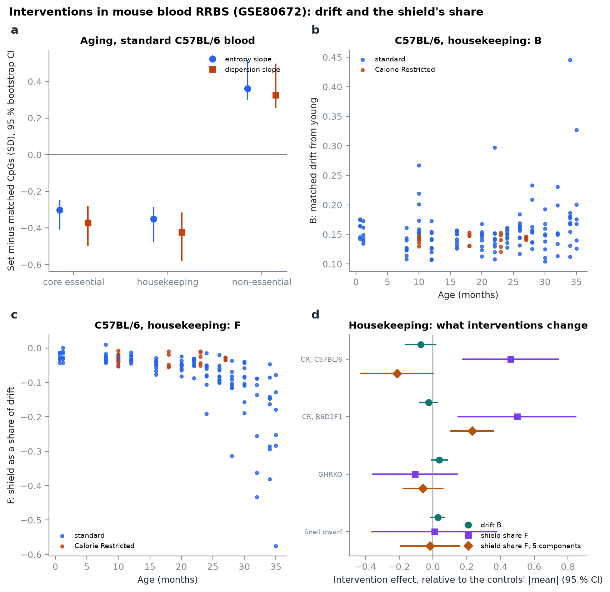

* **Mouse blood repeats the human blood shield, with exact ages.** Against matched CpGs, the age slopes
  of entropy and dispersion are lower for core-essential (−0.30, −0.37 SD) and housekeeping (−0.35,
  −0.42) CpGs. They are higher for non-essential CpGs (+0.36, +0.33). Every bootstrap interval excludes
  zero.
* **In living blood, the shield's share grows with age.** Each mouse is scored against the young standard
  mice (3–6 months): `B` is its drift, `F` the shield as a share of it. In standard C57BL/6 mice, `F`
  falls by 0.052 per 10 months (p ≈ 10⁻¹³). With five composition components removed it falls by 0.041
  (p ≈ 10⁻¹⁴). Past about 25 months some mice reach −0.2 to −0.6. In the two culture studies the share
  stayed flat (RM5).
* **Caloric restriction weakens the shield in the comparison that can be read.** In B6D2F1, CR mice
  were sequenced in one sample series with their controls (12 against 10, 20–27 months, age held
  fixed). The housekeeping `F` moves by +0.025 toward zero (p 0.012). With composition components
  removed it moves by +0.025 against a control mean of −0.107, a quarter of the shield (p 0.002).
  Core-essential genes move the same way (+0.017 to +0.018, p 0.08–0.09). Total drift `B` barely
  changes (−3 % and −7 %, not significant). In C57BL/6, CR mice were sequenced as a series of their
  own. Their effect (+0.027, p 0.002) flips to −0.016 with components, so batch or cell mix drives it,
  and it is not read.
* **Why it is surprising, and two cautions.** A maintenance shield should survive or grow under CR, which slows
  aging; a weaker one is what selection predicts. In absolute terms the look-alike drift `B` is unchanged in
  B6D2F1 (0.143 against 0.147) while the gap `P` halves (−0.0036 against −0.0073). But the study has no young
  B6D2F1 mice, so this strain is scored against young C57BL/6, which inflates `B` by the strains' genetic
  differences (the gap cancels much of it); and published work finds CR slows drift overall (Maegawa 2017,
  Petkovich 2017), which this comparison does not show. A weakening in the liver replication (R13), a tissue that
  rarely renews, would point to CR's own methylation changes (Hahn 2017) rather than selection.
* **The dwarf models show nothing,** at 5–6 months, when little drift has accumulated (`F` within
  ±0.005, p > 0.1).

Housekeeping, effect of the intervention (OLS within strain, age as a covariate where ages vary):

| comparison | mice (treated / control) | same series | B (drift) | F (shield share) | F, 5 components |
|---|---|---|---|---|---|
| CR, B6D2F1 | 12 / 10 | yes | −0.004 (p 0.37) | +0.025 (p 0.012) | +0.025 (p 0.002) |
| CR, C57BL/6 | 20 / 74 | no | −0.011 (p 0.13) | +0.027 (p 0.002) | −0.016 (p 0.06) |
| GHRKO | 15 / 11 | yes | +0.006 (p 0.15) | −0.003 (p 0.42) | −0.004 (p 0.36) |
| Snell dwarf | 10 / 12 | yes | +0.005 (p 0.20) | +0.000 (p 0.96) | −0.001 (p 0.86) |

What this does to the reading so far. In culture the shield is a fixed share of drift, and chromatin
accounts for most of it in human blood. In living mouse blood, the share grows with age, and caloric
restriction, which slows haematopoietic proliferation, weakens it without slowing drift. Selection among
blood stem cells predicts exactly that. Clonal expansions take over aged blood, a known form of selection
among cells, and culture has no such long competition. So the two readings may both hold. Chromatin sets
the shield. In a renewing tissue in a living animal, selection among stem cells adds a part that grows
with age and responds to proliferation. The evidence for the second part is one within-batch comparison
of 22 mice, in one strain. It needs a replication before it carries a claim.

Tables: `data/output/interventions/` (`aging_gaps`, `intervention_effects`, `mouse_scores`, `set_sizes`).

**With chromatin openness matched (roadmap RM12, R55).** Figure `cr_chromatin` adds to the matching how open each
CpG is in mouse blood cells: the mean ImmGen ATAC signal (Yoshida et al. 2019, GSE100738) of B cells, naive CD4
and CD8 T cells, NK cells, Ly6C-high monocytes and granulocytes within ±250 bp, in quartiles.

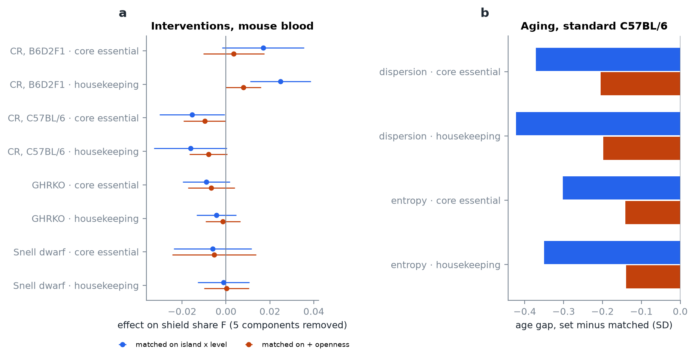

* **Openness carries most of mouse blood's shield**, as RM7 found in human blood: the housekeeping entropy gap
  falls from −0.35 to −0.14 SD, dispersion from −0.42 to −0.20; non-essential genes' excess drift vanishes
  (+0.36 to +0.02).
* **CR's effect shrinks with it.** In B6D2F1 the housekeeping `F` effect falls from +0.025 (p 0.002) to +0.008
  (p 0.07), core essential from +0.017 to +0.004 (p 0.62). Relative to the shield that is left, CR still
  weakens it by about a fifth (−18 % against −23 %), not significantly.
* **Reading.** CR acts mostly on the part of the shield that openness explains, so a chromatin change is
  enough to explain it; a residual selection part of the size seen before cannot be excluded with 22 mice.
  The matching uses young-adult openness, not openness under CR; a CR-induced change of openness would be
  absorbed only if it follows the young openness classes.

Tables: `data/output/cr_chromatin/` (`intervention_effects`, `aging_gaps`, `openness_by_set`).

**A second CR blood series does not repeat it (roadmap RM16 step 4, R56).** The only public series found with CR
and controls in blood in one batch is GSE282661 (Jayne et al. 2025): C57BL/6J mice of about 5-6 months, 8 on CR
(pair feeding at a third of intake four days a week, 12 weeks, at 32 °C), 8 on CR with a torpor-like state, 8
controls, 8 at the start, all on one array run. Figure `cr_blood_replication`:

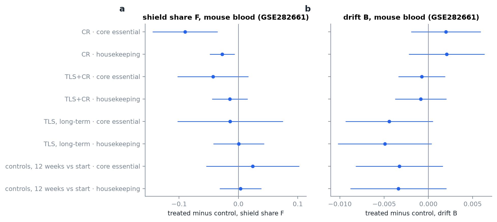

* **No drift to shield.** Controls after 12 weeks do not differ from the start (B −0.003, n.s.): in young mice
  over 12 weeks there is no aging drift, so `F` here measures how CR's own changes fall, not the aging shield.
* **CR's changes spare essential promoters.** Against controls, essential CpGs move less than look-alikes (`F`
  core essential −0.09, p 0.006; housekeeping −0.03, p 0.03), the opposite sign of the B6D2F1 result, with drift
  `B` unchanged. Non-essential CpGs shift (signed `S` −0.004, p 0.015). CR with torpor goes the same way, n.s.
* **Reading.** This is not a replication test of the aging result (no drift, young mice, 12 weeks), and it gives
  no support for it: what CR does here is kept out of essential promoters, as Dnmt3a's gain was (R37).

Tables: `data/output/cr_blood_replication/` (`effects`, `animal_scores`).

**After a stem-cell bottleneck the shield does not grow specifically (roadmap RM12, R57).** A transplant rebuilds a
recipient's blood from few donor stem cells, under competition. Holland et al. 2024 (Mendeley j5krtjfj6y) measured
donors at transplant and their recipients for up to 23 years after (450k/EPIC, 92 transplants). Within each batch,
figure `hsct_bottleneck` compares how far a recipient's blood has moved from its donor's (103 comparisons) with how
far it moves between its own later draws (196), at each set's promoters against look-alikes.

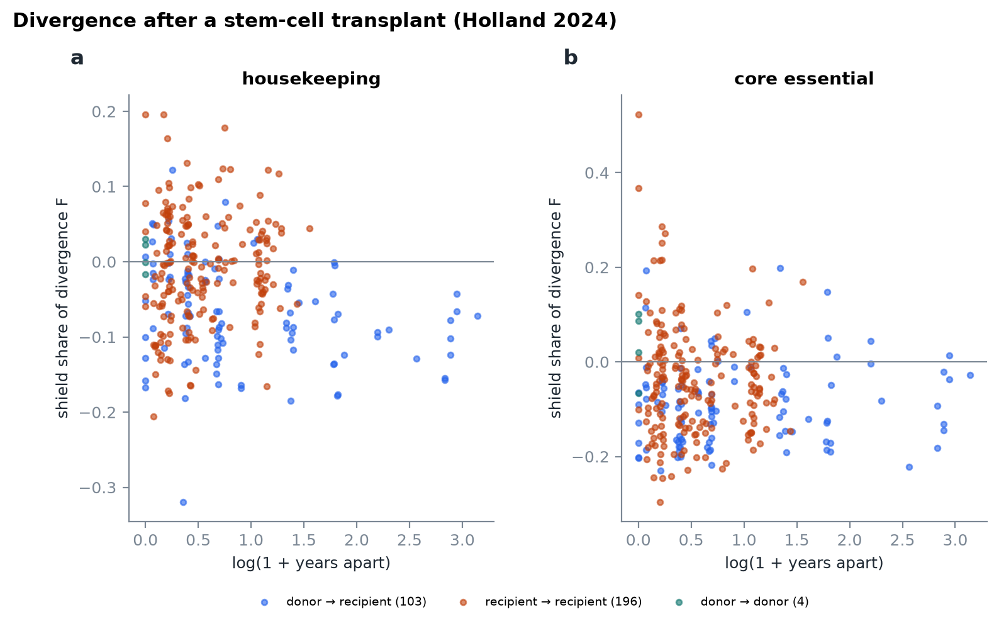

* **Across the transplant, set promoters move less than look-alikes**: the share `F` is lower than between a
  recipient's own draws by −0.058 (core essential), −0.039 (housekeeping), years and batch held.
* **But non-essential promoters do the same (−0.057).** The change is not specific to essential genes: across the
  transplant, divergence concentrates at the look-alikes (cell-mix and other non-promoter-set CpGs; divergence
  itself rises by half), which lowers `F` for every promoter set alike.
* **Reading.** Selection through a bottleneck would protect essential promoters beyond the others; it does not
  here. No support for selection; the CpGs that respond to a rebuilt blood system are not those the shield
  separates.

Tables: `data/output/hsct_bottleneck/` (`effects`, `comparisons`).

### Six tissues of the same strains: the shield does not follow turnover

Thompson et al. 2018 (GSE120132, `entropy-age fetch rrbs-tissues`) measured blood, lung, kidney, liver, adipose and
muscle of C57BL/6J and BALB/cByJ mice of both sexes at about 2, 10 and 20 months by RRBS. Figure `rrbs_tissues`
(runs R10, R11) tests each tissue's promoter CpGs, strain and sex as covariates.

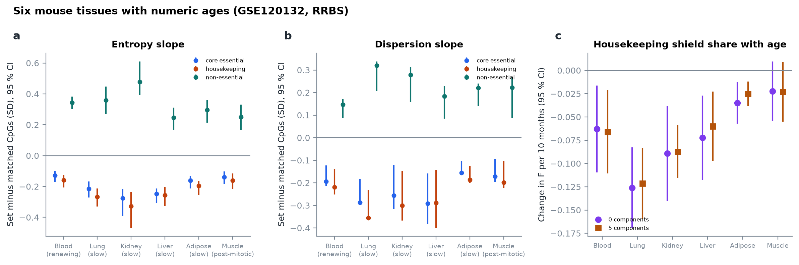

| tissue (turnover) | housekeeping, entropy slope (SD, 95 % CI) | shield share F, per 10 months |
|---|---|---|
| blood (renewing) | −0.16 (−0.21 to −0.13) | −0.06 |
| lung (slow) | −0.27 (−0.33 to −0.21) | −0.12 |
| kidney (slow) | −0.33 (−0.47 to −0.24) | −0.09 |
| liver (slow) | −0.26 (−0.33 to −0.21) | −0.06 |
| adipose (slow) | −0.20 (−0.26 to −0.17) | −0.03 |
| muscle (post-mitotic) | −0.16 (−0.21 to −0.12) | −0.02 (not significant) |

* **Every tissue shows the shield.** Non-essential genes drift more in every tissue.
* **Its size does not follow turnover.** Blood, the fastest-renewing tissue, has one of the weakest shields, no
  stronger than muscle's. Selection predicts the reverse order.
* **Its growth with age does not follow turnover either.** It is fastest in lung and kidney, about the same in
  blood and liver, and absent in muscle. Selection would put blood first.

Tables: `data/output/mouse_rrbs_tissues/` (`tissues`, `aging_gaps`, `age_effects`).

### A slowly renewing tissue: BXD mouse liver

If the shield's growth with age came from selection among dividing stem cells, a tissue whose cells rarely
divide should show little of it. Figure `bxd` (run R9) takes Roy et al.'s BXD livers (GSE199979, mammalian
array): 321 females of 45 strains, 6–33 months, on chow or a high-fat diet (HFD). Strain is held fixed
throughout; the reference is 49 chow females of at most 9 months.

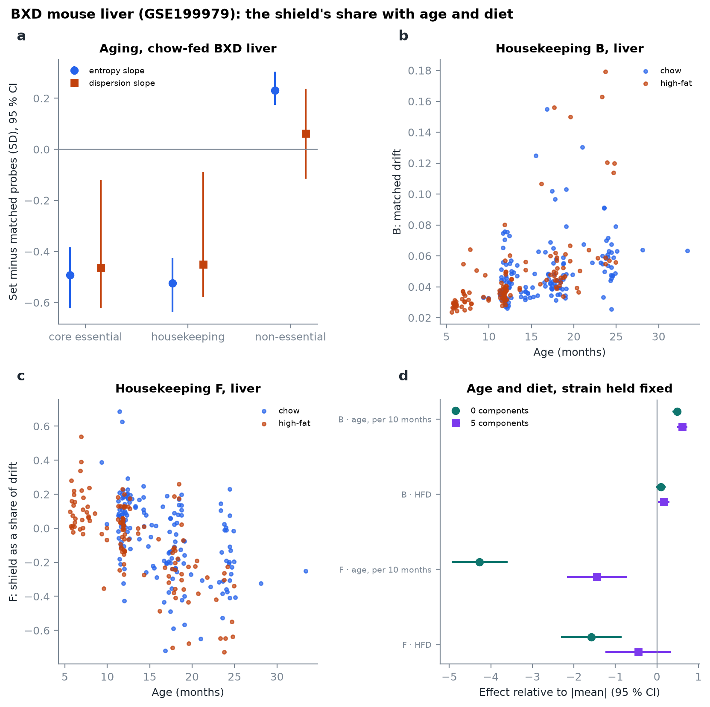

* **Liver shows the shield, strongly.** Against matched promoter probes, the entropy slope is −0.49 SD
  (core essential) and −0.52 (housekeeping); dispersion −0.46 and −0.45. Non-essential genes come out at
  +0.23 for entropy, and dispersion is not distinguishable from zero.
* **And its share grows with age there too.** Housekeeping `F` falls by 0.28 per 10 months (p < 10⁻¹⁰), and
  by 0.055 with five composition components removed (p 10⁻⁴). Core-essential genes give the same (−0.26 and
  −0.065). Liver drift is small (`B` 0.03–0.08 against 0.10–0.20 in blood), so `F` scatters widely per
  mouse, but the age trend is clear.
* **The high-fat diet's effect is the cell mix.** HFD strengthens the shield (`F` −0.105, p 3·10⁻⁵), but
  with composition components removed it is −0.017 (p 0.26). A fatty, inflamed liver changes its cell
  mix, and the components absorb it.

So the growing share is not a feature of renewing tissue: liver, whose hepatocytes rarely divide, shows it
as clearly as blood. That argues against selection among stem cells as its cause. More likely, in living
tissue, drift at unprotected CpGs accelerates with age while protected promoters hold. Culture does not
reproduce that, perhaps because it lacks the tissue's ageing environment. The CR result in blood stands as
it was: a single within-batch comparison, which liver cannot test (no CR arm).

Tables: `data/output/bxd_liver/` (`aging_gaps`, `effects`, `mouse_scores`).

## Published clocks on the protection map (roadmap RM8)

Where do the CpGs of published clocks sit, by the measures above? Figure `clocks` (run R5) takes 16 clocks
from biolearn at a pinned commit (`entropy-age fetch clocks`, each file hash-checked), all on the 450k
array's autosomes:

* chronological: Horvath 2013, Horvath skin & blood, Hannum, Lin, the cortical clock;
* phenotypic and pace: PhenoAge, DunedinPACE, DNAm telomere length, Zhang's 10 mortality CpGs;
* the mitotic clock epiTOC1;
* the stochastic clocks StocH, StocP, StocZ, which reuse the Horvath, PhenoAge and Zhang CpGs;
* the causal clocks CausAge, DamAge and AdaptAge.

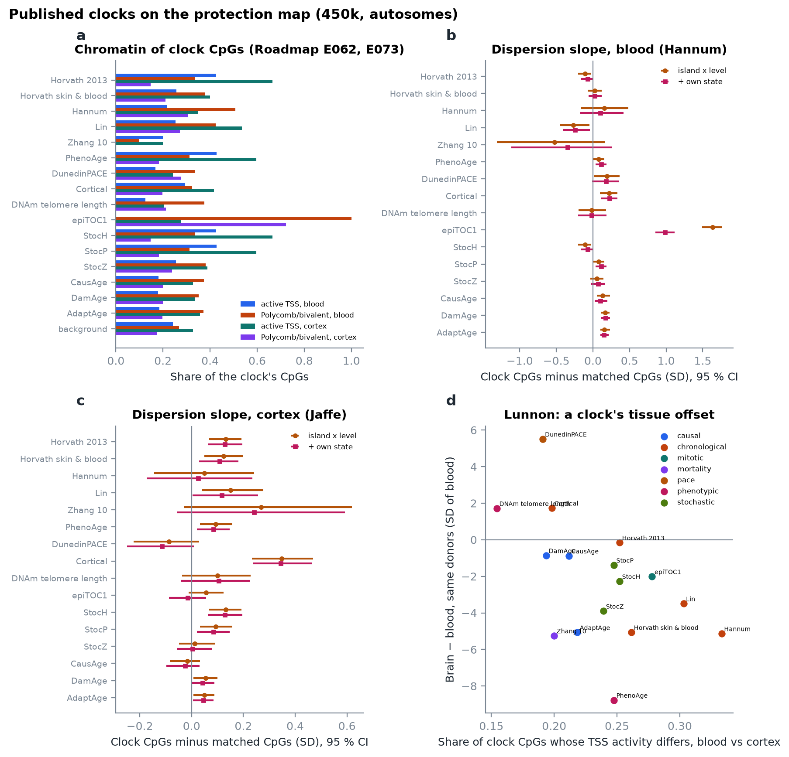

| clock | CpGs | active TSS, blood / cortex | Polycomb or bivalent, blood / cortex | TSS activity differs between tissues | in housekeeping promoters | dispersion slope vs matched, blood / cortex (SD) |
|---|---|---|---|---|---|---|
| background | 60,000 | 0.24 / 0.33 | 0.27 / 0.17 | 0.12 | 0.09 | — |
| Horvath 2013 (= StocH) | 353 | 0.42 / 0.67 | 0.34 / 0.15 | 0.25 | 0.22 | −0.11 / +0.13 |
| PhenoAge (= StocP) | 513 | 0.43 / 0.60 | 0.31 / 0.18 | 0.25 | 0.17 | +0.08 / +0.09 |
| Hannum | 69 | 0.22 / 0.35 | 0.51 / 0.30 | 0.33 | 0.06 | +0.15 / +0.05 |
| Lin | 99 | 0.25 / 0.54 | 0.42 / 0.27 | 0.30 | 0.14 | −0.27 / +0.15 |
| DunedinPACE | 173 | 0.17 / 0.24 | 0.34 / 0.28 | 0.19 | 0.02 | +0.19 / −0.09 |
| Cortical | 343 | 0.29 / 0.42 | 0.32 / 0.20 | 0.20 | 0.08 | +0.22 / +0.35 |
| epiTOC1 | 385 | 0.00 / 0.28 | 1.00 / 0.72 | 0.28 | 0.00 | +1.63 / +0.06 |
| CausAge, DamAge, AdaptAge | 581–1,089 | 0.18 / 0.33–0.36 | 0.35–0.37 / 0.20 | 0.19–0.22 | 0.05–0.06 | +0.13–0.17 / −0.02–0.05 |

* **Clocks favour CpGs whose chromatin differs between tissues.** 15–33 % of a clock's CpGs are in an active
  TSS state in one tissue and not the other, against 12 % of background CpGs; every clock exceeds it. Most
  are also enriched in Polycomb or bivalent chromatin in blood (0.31–0.51 against 0.27). epiTOC1, built
  from Polycomb-target CpGs, is all Polycomb in blood.
* **The two pan-tissue clocks of Horvath and PhenoAge do the opposite on one measure.** 22 % and 17 % of their
  CpGs sit in housekeeping promoters, against 9 % of background, and 60–67 % are active TSS in cortex.
  A clock meant to read every tissue has drawn on the gene class whose chromatin is active everywhere.
* **Clock CpGs are not, as a rule, the fastest-diverging CpGs.** Against matched CpGs, their between-person
  dispersion slope is within ±0.3 SD for every clock but one. Clocks track the mean, not the spread.
  epiTOC1 is the exception in blood (+1.63 SD; +0.99 once blood chromatin is matched), as a mitotic clock
  should be: its Polycomb CpGs diverge as blood cells divide. It is near zero in non-dividing cortex
  (+0.06).
* **A clock's tissue offset does not follow its chromatin.** In Lunnon's same donors, each clock's weighted
  sum in brain minus blood ranges from −9 to +6 SD of the blood values. It does not track the share of
  CpGs that switch state (Spearman 0.11, p 0.68, 16 clocks). Horvath 2013 has the smallest offsets (−0.2
  on average) and DunedinPACE the largest. The prediction failed at this resolution: offsets are dominated
  by each clock's weights, which a share of CpGs does not capture.

Clocks are thus drawn, as the paper argued, from CpGs that move with age. By this map those are largely
CpGs whose chromatin is set differently by tissue, Polycomb targets above all. The protected kind, active
promoters of housekeeping genes, enters the clocks built to work across tissues. Whether a clock built
from one chromatin class reads tissues alike is the next subsection.

Tables: `data/output/clock_cpgs/` (`coverage`, `composition`, `drift`, `tissue_offsets`,
`offset_vs_chromatin`).

### Clocks built from one kind of CpG

If drift follows chromatin, a clock built from one chromatin class might read tissues more alike. Figure
`chromatin_clocks` (run R6) trains elastic-net clocks on 4,000 CpGs drawn from one of three pools. Each pool
is a class in both Roadmap references (blood E062 and cortex E073):

* active TSS in both (33,786 candidates);
* Polycomb or bivalent in both (19,330);
* any CpG (149,740).

Each clock is trained on Hannum blood or Jaffe cortex and applied to the other cohort and to Lunnon's
same-donor tissues, five draws per pool. In-sample fits are near-perfect and are not read.

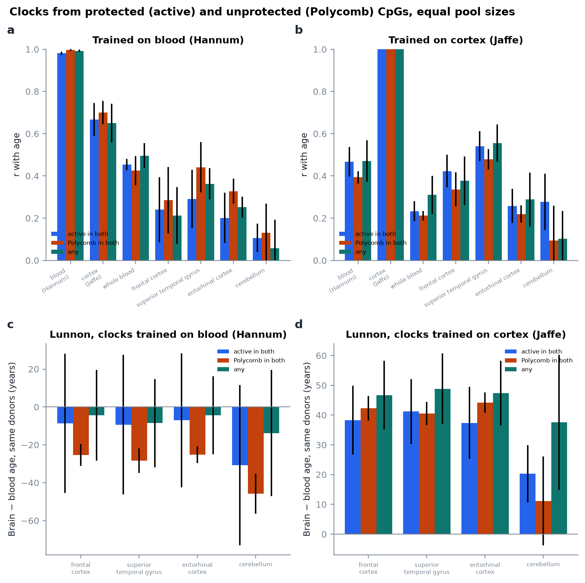

| trained on → tested on | r with age (active / Polycomb / any) | median abs. error, years (active / Polycomb / any) |
|---|---|---|
| blood → cortex (Jaffe) | 0.67 / 0.70 / 0.65 | 33 / 10 / 31 |
| blood → Lunnon blood | 0.45 / 0.43 / 0.50 | 15 / 8 / 8 |
| cortex → blood (Hannum) | 0.47 / 0.39 / 0.47 | 35 / 86 / 77 |
| cortex → Lunnon frontal cortex | 0.42 / 0.34 / 0.38 | 13 / 36 / 28 |

* **No pool gives a clock that reads tissues alike.** Out of the training tissue, correlations fall to
  0.06–0.70 and errors run to tens of years with every pool. A single-tissue clock does not transfer,
  whatever its CpGs' chromatin.
* **Which pool transfers best depends on the direction.** A blood-trained clock reads cortex best from
  Polycomb CpGs (10 years against 31–33). A cortex-trained clock reads blood and Lunnon's brain regions best
  from active CpGs (10–35 years against 25–86).
* **Polycomb CpGs give the most reproducible tissue offset.** In Lunnon's donors, a blood-trained Polycomb
  clock reads brain 25–28 years younger than the same donor's blood (cerebellum 46). The offset varies
  little between draws of CpGs (SD 4–6 years). Active and random pools give smaller mean offsets that vary
  five to eight times as much (SD 20–42). Polycomb CpGs age alike across tissues up to a constant shift.
  That is what a shared, chromatin-set drift predicts, and a constant shift can be calibrated away.

So chromatin class is a lever for clock design, not a fix. The Polycomb CpGs that published clocks already
favour carry the most tissue-consistent ageing signal. Active, protected CpGs carry less of it, and what
they carry is less reproducible. The rule for a pan-tissue clock, from these data: draw on Polycomb CpGs
and calibrate each tissue's offset.

Tables: `data/output/chromatin_clocks/` (`accuracy`, `lunnon_offsets`, `pools`).

## Chromatin accounts for blood's protection (roadmap RM7)

The cohort tests match gene-set CpGs to background CpGs of the same island status and starting level. If
essential genes drift less because their promoters sit in active chromatin, adding the chromatin state to
the matching should remove the gap. Figure `chromatin` (run R3, `--scale paper --seed 42`) gives each
450k promoter CpG the state of a Roadmap Epigenomics 15-state chromHMM segmentation (`entropy-age fetch
chromatin`). The references are blood mononuclear cells (E062) for blood, with neutrophils (E030) as a
second blood reference, and dorsolateral prefrontal cortex (E073) for brain. The gaps are those of
`figures tissues`, in SDs of the metric. Their 95 % intervals come from resampling the set's genes (not
people), with the same draws under every matching.

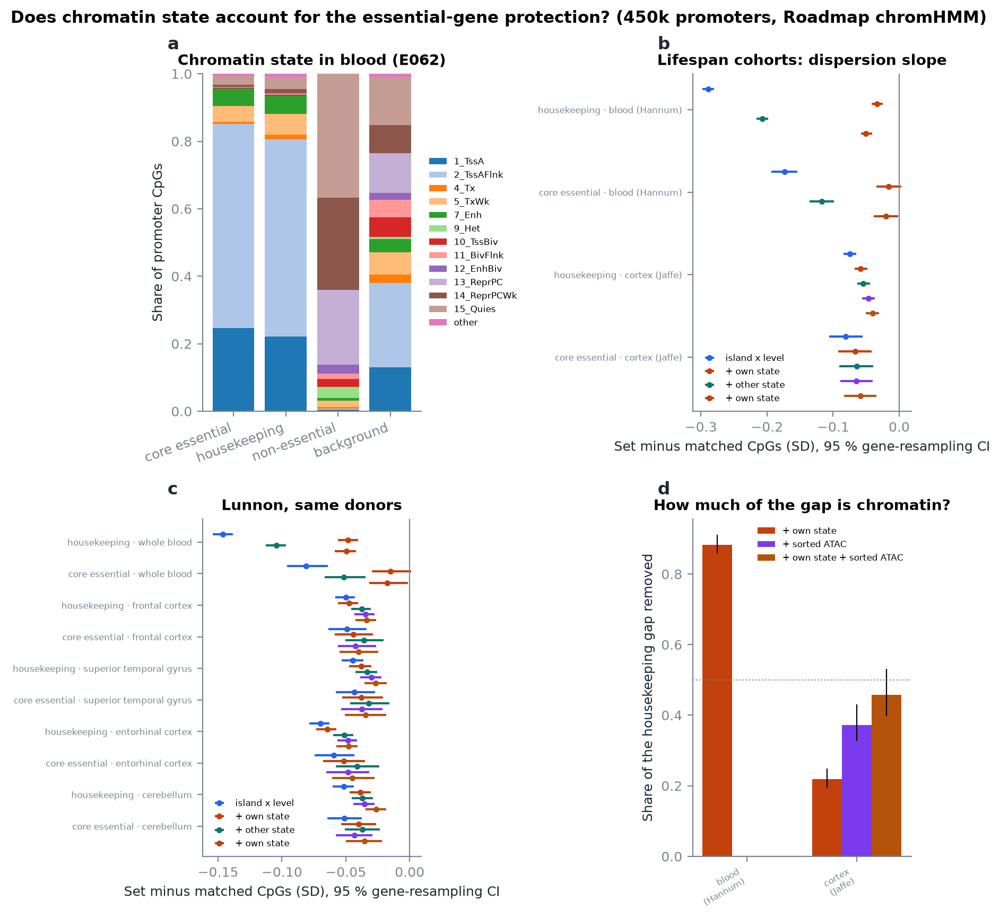

Housekeeping set, set minus matched CpGs (SD):

| tissue, metric | island × level | + own chromatin | + the other tissue's chromatin | share removed by own |
|---|---|---|---|---|
| blood (Hannum), dispersion slope | −0.289 | −0.034 (E062), −0.050 (E030) | −0.207 | 0.88 (0.86–0.91) |
| blood (Hannum), entropy slope | −0.348 | −0.055 | −0.255 | 0.84 |
| cortex (Jaffe), dispersion slope | −0.075 | −0.058 | −0.054 | 0.22 (0.19–0.25) |
| Lunnon blood, dispersion | −0.146 | −0.048 | −0.104 | 0.67 (0.64–0.71) |
| Lunnon brain regions, dispersion | −0.044 to −0.070 | −0.038 to −0.064 | −0.033 to −0.051 | 0.05–0.26 |

Core-essential genes give the same picture: blood −0.173 becomes −0.016 (share removed 0.91), and
Lunnon blood −0.081 becomes −0.015 (0.81).

* **In blood, chromatin accounts for most of the protection.** Matching on the blood epigenome's own
  states removes 67–91 % of the gap, in both blood cohorts and with either blood reference. Brain's
  states remove only 28–36 % in blood. It is the tissue's own chromatin that matters, not promoter
  activity in general. Panel a shows why: 80–85 % of essential and housekeeping CpGs sit in active TSS
  states (TssA, TssAFlnk) in blood, against 38 % of background CpGs.
* **After matching, blood is no more protected than brain.** Blood's remaining gap (−0.02 to −0.05)
  is no larger than brain's (−0.04 to −0.06). The blood-over-brain excess, the result of prediction 2
  that pointed to selection, is explained by blood's chromatin. It needs no turnover.
* **In brain, finer chromatin removes more, but about half the gap stays.** The bulk cortex segmentation
  puts 79–86 % of set CpGs and 47 % of background CpGs in one state (TssA). It removes only 5–26 % of the
  gap. A second run (R4) adds neuron and glia accessibility, measured separately in sorted NeuN+ and NeuN−
  nuclei of prefrontal cortex (Rizzardi et al. 2019, GSE96614). Each CpG is binned by quartile of
  accessibility, or no peak, in each cell type:

  | brain tissue (housekeeping) | island × level | + bulk state | + neuron and glia ATAC | + both | share removed by both |
  |---|---|---|---|---|---|
  | cortex (Jaffe), dispersion slope | −0.075 | −0.058 | −0.047 | −0.041 | 0.46 (0.40–0.53) |
  | Lunnon frontal cortex | −0.050 | −0.048 | −0.035 | −0.034 | 0.32 |
  | Lunnon superior temporal gyrus | −0.044 | −0.038 | −0.030 | −0.026 | 0.40 |
  | Lunnon entorhinal cortex | −0.070 | −0.064 | −0.048 | −0.048 | 0.32 |
  | Lunnon cerebellum | −0.052 | −0.039 | −0.035 | −0.026 | 0.49 |

  Cell-type-resolved chromatin removes two to six times as much as the bulk map. Core-essential genes give
  13–31 %. What stays in brain (−0.026 to −0.048 SD) is now about the size of what stays in blood after
  blood's own chromatin (−0.034 to −0.050). Accessibility in two sorted cell types is still coarser than
  the five-mark states of purified blood cells, so part of the remaining gap may yet be chromatin. Brain's
  cells do not divide, so whatever is left there cannot come from selection among dividing cells.

**What is left beyond chromatin (the novelty review's first question).** After matching on each tissue's own
chromatin, the remainder (SD, 95 % interval over genes) is:

| tissue | core essential | housekeeping |
|---|---|---|
| blood (Hannum, E062 / E030) | −0.016 (−0.034 to +0.003) / −0.020 (−0.038 to −0.001) | −0.034 (−0.042 to −0.025) / −0.050 (−0.058 to −0.041) |
| Lunnon blood | −0.015 (−0.030 to +0.001) | −0.048 (−0.056 to −0.041) |
| brain, bulk state + sorted ATAC | −0.035 to −0.058 | −0.026 to −0.048 |

In blood, essentiality in the CRISPR sense adds almost nothing once chromatin is matched; being expressed in every
tissue (housekeeping) keeps a small, clear remainder. In brain both remain, which may be chromatin the maps still
miss. A referee's "active chromatin relabelled" is thus mostly right for core-essential genes in blood, and not
the whole story for housekeeping genes or for brain. Finer maps of the same individuals, or a DepMap gradient within
broadly expressed genes, would separate the two further.

Together with the culture test (the gap is a constant fraction of drift, not growing with divisions),
this moves the explanation from selection to chromatin. Essential genes drift less where, and to the
extent that, their promoters are held in active chromatin in that tissue. Tissues differ because their
chromatin differs. The residual left after matching is about the same in blood and brain. Matching uses
states from reference epigenomes of other people. Matching on a
person's own chromatin would be tighter and would remove more, not less.

Tables: `data/output/chromatin_match/matched_gaps.csv` (every set, metric, tissue and matching) and
`state_composition.csv`.

## A per-person protection score (roadmap RM6)

Every result above is a property of a cohort: an age slope needs many people. The score of
`docs/PER_PERSON_SCORE.md`, built as `entropy_age.protection`, asks the same question of one sample. Each
CpG's deviation from a reference state is `d = |x - m| / sqrt(m (1 - m))`. A set's score `P` is the mean
`d` of its promoter CpGs minus that of other CpGs of the same island status and reference decile, in
the same sample; `F = P / B` is the same gap relative to the matched background deviation `B`. Figure
`per_person` (`--scale paper --seed 42`, run R2) checks three of the design's validation steps on the
450k cohorts already used here.

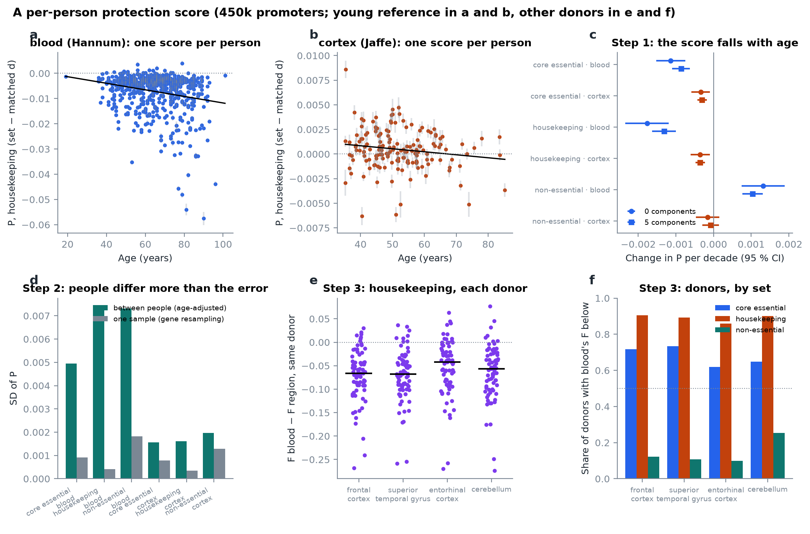

| check | blood | cortex |
|---|---|---|
| step 1: housekeeping `P` per decade (SE) | −0.0018 (0.0003) | −0.00036 (0.00013) |
| step 1: core essential `P` per decade (SE) | −0.0011 (0.0002) | −0.00034 (0.00013) |
| step 1: non-essential `P` per decade (SE) | +0.0013 (0.0003) | −0.00015 (0.00016), ns |
| step 2: reliability of housekeeping `P` | 0.997 | 0.955 |
| samples scored (reference, aged 20-35) | 632 (24) | 159 (54) |

* **Step 1, the cohort result per person.** In both tissues the score falls with age for the essential
  sets, about five times faster in blood than in cortex, and it rises for non-essential genes in
  blood. These are the signs and the order of the cohort test (`figures tissues`), from one number per
  sample. 97 % of the blood samples and 38 % of the cortex samples have a negative housekeeping `P`.
  Five composition components, fitted on the young reference's background CpGs and removed from each
  sample, change none of the signs (blood −0.0013, cortex −0.00036 per decade). The covariates are
  plate, sex, ancestry and site (blood), and plate, sex, race and neuron fraction (cortex).
* **Step 2, people differ more than the score's own error.** The error of one sample's `P`, from
  resampling the set's genes, is small against the spread between people of the same age: the
  reliability is 0.94-0.997 in blood and 0.58-0.96 in cortex, lower with five components, where less
  spread is left. This is sampling error only. Technical replicates and repeated draws, the design's
  real test, are not in these cohorts.
* **Step 3, inside one person.** Lunnon's donors, 71-75 per brain region, are each scored against the
  other donors of the same tissue, so `d` here measures distance from the old population's centre. For
  housekeeping genes, blood's `F` is below the same donor's `F` in 86-91 % of donors in each of the four
  regions (sign tests p < 10⁻⁹), and in 93-100 % with five components. Core-essential genes give
  62-73 %, and non-essential genes go the other way (10-25 %). The blood-versus-brain difference of
  the cohort test therefore holds within most people, not just on average.

What this does and does not show. The score works as a per-person measure: it reproduces the cohort
results and resolves individuals well beyond its sampling error. It does not separate selection from
chromatin any better than the cohort tests. Blood's lower `F` within a person is what turnover-driven
selection predicts, but blood and brain also differ in chromatin and in cell mix. The culture test,
step 4 of the design, already scores each sample this way, and there the gap is a constant fraction
of drift, not one that grows with divisions. Next are repeatability on replicate arrays and, only
after it, outcomes (steps 2 and 5).

Tables: `data/output/per_person/age_fits.csv` (every set, measure and variant),
`same_donor_turnover.csv` and `same_donor_scores.csv`; the lifespan scores are in the untracked
`lifespan_scores.parquet`.

## RNA: transcriptional drift by turnover class (GTEx, mouse, rat)

The same question in transcripts. For each tissue, protein-coding genes with at least 1 CPM in 80 %
of its samples, as log2(CPM + 1). The noise measure is between-individual spread: the age slope of
each gene's absolute residual after its mean trend and the technical covariates are removed
(`stochasticity.expression_drift`). RNA spread depends strongly on the mean, so every gene set is
compared with genes of the same expression decile, in SDs of the metric, as CpGs are matched on
level. A second version adds five age-free composition components of the genes outside every set.
Those components cannot change an age slope of the mean, but they can change spread, so here the
check is informative. Each tissue is resampled at the same size, without replacement. The human gene
sets reach Ensembl IDs through HGNC (Entrez first, then current, previous and unique alias symbols;
99–100 % of each set), and rodent genes reach them through their upper-case symbol (16,474 of 25,113
mouse and 16,752 of 30,454 rat symbols map, ambiguous ones dropped).

* **GTEx v10** (`entropy-age figures rna_gtex`): 47 tissues with 100 or more donors, 70 donors per
  resample, decade-bin ages, covariates sex, Hardy death scale, RIN, ischemic time and library size.
  Classes: renewing (10 tissues: blood, spleen, gut mucosa, skin, oesophagus mucosa, vagina, testis),
  slow (21), heart & muscle (3), brain (13 regions). The GTEx counts are read from an external parsed
  copy (`ENTROPY_AGE_GTEX_RNA`, `ENTROPY_AGE_GTEX_ATTRIBUTES`).
* **Mouse and rat atlases** (GSE314817, GSE314970; `entropy-age fetch rodent-rna`,
  `entropy-age figures rna_rodents`): inbred mice (24 tissues, 80–104 animals) and rats (23 tissues
  used, 47–85 animals), males and females at six ages from 6 to 27 months, covariates sex and library
  size, 56 mice and 32 rats per resample. Rat eye tissues of unclear turnover are left out; the rat
  retina counts as neural.

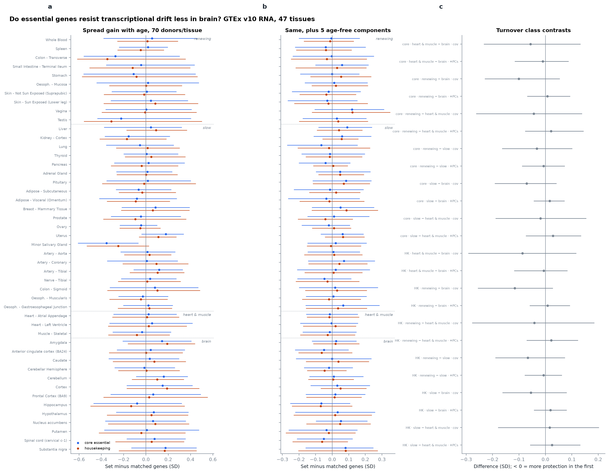

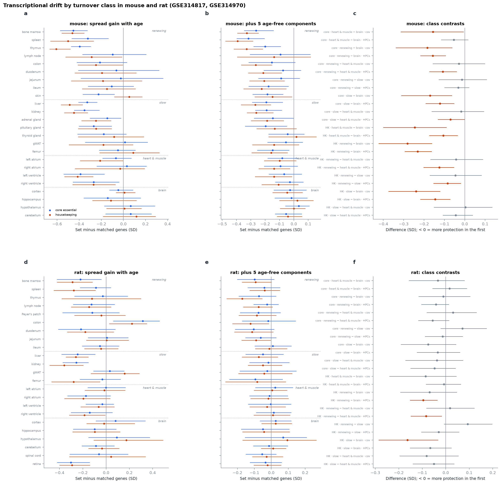

**Spread gain with age, housekeeping minus matched genes** (SD, mean over the class's tissues):

| Class | GTEx | Mouse | Rat |
|---|---|---|---|
| renewing | −0.08 | −0.29 | −0.10 |
| slow | −0.00 | −0.23 | −0.19 |
| heart & muscle | −0.02 | −0.23 | −0.12 |
| brain | +0.06 | +0.01 | −0.04 (retina −0.29) |

**Each class minus brain, housekeeping** (SD, 95 % interval over size-matched resamples):

| Contrast | GTEx | GTEx + PCs | Mouse | Mouse + PCs | Rat | Rat + PCs |
|---|---|---|---|---|---|---|
| renewing − brain | −0.12 (−0.26, +0.03) | +0.01 (−0.06, +0.09) | −0.28 (−0.42, −0.16) | −0.23 (−0.29, −0.16) | −0.07 (−0.19, +0.05) | −0.10 (−0.15, −0.04) |
| slow − brain | −0.06 (−0.16, +0.08) | +0.02 (−0.04, +0.08) | −0.24 (−0.37, −0.12) | −0.15 (−0.22, −0.07) | −0.16 (−0.29, −0.03) | −0.07 (−0.15, +0.02) |
| heart & muscle − brain | −0.09 (−0.29, +0.12) | −0.01 (−0.12, +0.08) | −0.25 (−0.40, −0.09) | −0.11 (−0.17, −0.04) | −0.09 (−0.24, +0.05) | −0.01 (−0.08, +0.06) |

Core-essential genes follow housekeeping genes in mouse (renewing − brain −0.18, −0.34 to −0.06;
with components −0.16, −0.22 to −0.10) and are within noise in rat and GTEx. Non-essential genes go
the other way in both rodents (mouse renewing − brain +0.54, interval +0.18 to +0.89; rat +0.32,
+0.03 to +0.61), the hitchhiking pattern prediction 3 describes.

What this supports, and what it does not:

* **Mouse: the methylation result holds in RNA.** Housekeeping and core-essential genes gain
  between-animal spread with age more slowly than matched genes in every class but brain, and the
  brain is without the protection. Heart keeps it, as in methylation, and the gap to brain survives
  the composition components for renewing and slow tissues. So in mouse "neurons lack the
  protection" now rests on two kinds of data from two cohorts.
* **Rat: same direction, weaker.** Slow tissues minus brain excludes zero, and renewing minus brain
  does once composition is adjusted; the other contrasts do not. The retina, neural but strongly
  protected (−0.29), pulls the brain class toward protection; without it the rat brain regions are
  −0.10 to +0.17.
* **GTEx: no turnover effect in spread.** Renewing tissues lean protected and brain leans the other
  way, but every interval includes zero, and with composition components every contrast is within
  0.03 SD of zero. Per-tissue intervals are about ±0.3 SD at 70 donors: post-mortem human RNA, with
  genetic differences between donors and only decade bins of age, carries too little age-related
  spread for a set contrast. The one GTEx contrast that excludes zero is in the mean, not the spread:
  housekeeping genes change their level with age less outside brain than in it (renewing − brain
  −0.09, −0.17 to −0.005; slow − brain −0.07, −0.14 to −0.01).
* **Not a turnover gradient in any species.** Where the protection shows (mouse, rat), slow and
  heart tissues have about as much as renewing ones. As in the mouse methylation data, the step is
  between brain and everything else, not along cell turnover.

Tables: `data/output/rna_gtex/`, `data/output/rna_rodents/` (`tissues`, `point_estimates`,
`contrasts`, `tissue_intervals`; gene mapping in `set_mapping` and `genes`).

## Which tissues age fastest? Orders across species and layers (roadmap RM25)

Asked by antonkulaga (2026-11-12) for questions beyond the shield; idea 5 of `docs/BEYOND_SHIELD.md`. From the
result tables of earlier runs, each tissue's pace is the median age slope of the features outside the gene sets,
of two kinds: directed change (how far the mean moves) and noise (how much more people differ). Run R40.

- **Directed change ranks tissues alike in mouse and rat** (RNA, 20 shared tissues, rho 0.56, p 0.011): femur,
  kidney, liver and heart chambers move most; hippocampus, hypothalamus and gut least.
- **Noise does not** (rho -0.27, p 0.25). Which tissue grows noisiest with age is not shared between two
  rodents profiled in one atlas.
- **Human methylation and human RNA give unrelated orders** over 9 GTEx tissues (directed 0.03, noise 0.35).
  Human against mouse methylation has 4 shared tissues: too few to read.

Reading: a shared directed programme, a private noise. Caveat that matters: a median |slope| over mostly
unchanged features scales with each tissue's measurement noise and sample size, and one atlas profiled both
rodents, so part of the shared order may be technical (tissue-specific RNA quality). A test with slopes divided by
their standard errors (from raw data) would separate the two; not done. Literature (docs/LITERATURE_COVERAGE.md): the
rodent data are Shavlakadze et al. 2026 (Sci Adv), which with Tyshkovskiy 2026 (Nature) covers tissue differences in
directed change; Ibañez-Solé 2022 (eLife) found no consistent rise of transcriptional noise with age, in line with
the unshared noise order. Only the explicit rank comparison is ours.

## The shield holds molecule by molecule (roadmap RM22, read-level WGBS)

Arrays average each CpG over many cells. Whole-genome bisulfite reads keep several neighbouring CpGs of one
molecule from one cell, so they show whether a promoter stays uniform across a person's cells or turns into a
mixture of epialleles. Loyfer et al. 2023 (GSE186458) sequenced white blood cells of 23 donors aged 21-75. For the
4-CpG window at each 450k promoter probe (73,885 windows with enough reads; their methylation matches Hannum's
array at r 0.96), run R50 measured per donor the entropy of the epialleles and the share of discordant reads, and
how each rises with age.

- **Essential and housekeeping promoters gain molecular disorder more slowly than look-alikes**: entropy -0.05 to
  -0.075 SD, discordant reads -0.03 to -0.06 SD (permutation p <= 0.002).
- **Non-essential promoters gain more** (+0.15 and +0.22 SD), as on the arrays.
- **Not a difference in where they start**: at matched methylation, the level of disorder is nearly equal
  (|0.02| SD or less); the gap is in how fast it grows.

**Replicated in cfDNA (run R51).** The donors' plasma DNA (51,902 windows) gives the same molecule-level shield:
entropy slope -0.063 and -0.058 SD, discordance slope -0.054 and -0.033 SD for housekeeping and core-essential
promoters (p <= 0.02). cfDNA of healthy people comes mostly from blood cells, so it is not an independent tissue,
but it is an independent library and molecule source. The non-essential excess of white blood cells does not
replicate (-0.02, +0.06, n.s.).

**In sorted cell types (run R53).** The atlas's purified cell types remove the mixture caveat: 101 samples in 27
cell-type and tissue groups (neurons, cardiomyocytes, hepatocytes, colon and lung epithelium, endothelium, pancreatic
cells, T-cell subsets and more; ages 19-83), the age slope fitted within each group. Entropy rises more slowly at
housekeeping (-0.084 SD) and core essential promoters (-0.044), discordant reads too (-0.060, -0.029; all p <= 0.002),
and faster at non-essential genes (+0.19, +0.23), the same pattern as white blood cells. Caveat: a few donors give
several cell types, so the effective number of donors is smaller than 101.

Reading: the shield is not an averaging artefact of arrays; the molecules at essential promoters stay alike from
cell to cell as people age, more than those at matched sites. Caveat: white blood cells are a mixture whose myeloid
share grows with age, so cell-to-cell and cell-type-to-cell-type disorder are not separated there; the sorted cell
types (R53) separate them, and the shield holds within one cell type. No published single-molecule test of this was found
(docs/LONGREAD_SURVEY.md).

## The shield within one person over time (RM28, SATSA)

Every other test compares people of different ages. SATSA (S-BSST1206) drew blood from the same 596 Swedes up to
eight times over 20 years (48-99 years old; 873 pairs of consecutive draws, median 4.9 years apart). Run R52 split
each person's change between two draws into the change everyone makes (directed) and the person's own departure
from it; that departure's square grows with the years between draws (a random walk), and its intercept is the
measurement floor. The slope, divergence per year, is stochastic drift free of array noise and of birth-cohort
differences.

- **CpG level:** housekeeping CpGs diverge slightly more slowly than look-alikes (-0.017 SD, p 0.001); core
  essential CpGs do not (+0.013, p 0.10). The control (R52b) shows why this is weak: SATSA's betas were deposited
  with cell counts and batch regressed out, and on them the usual cross-sectional comparison keeps only a third of
  the dispersion gap seen elsewhere (-0.12 SD) and none of the entropy gap. Within-person divergence is smaller
  than that between-person gap, but both are small here; SATSA cannot settle the CpG-level question.
- **Person level:** a person's own shield share grows as they age: F falls by 0.14 SD per decade within a person
  (housekeeping; 95 % -0.23 to -0.05), matching the -0.13 between people of different ages, while B (drift at
  look-alikes) barely moves within a person over 5 years (+0.03, interval spans 0). The signed shift S falls too
  (-0.19): essential CpGs lose methylation relative to look-alikes over a person's own aging.

Reading: the rise of the shield's share with age, seen cross-sectionally in mouse liver (RM3), holds within one
person, so it is not a survivor or cohort effect. Raw IDATs (E-MTAB-7309, 450k only) would allow a cleaner
CpG-level test without the depositors' cell-count regression.

## Death in childhood-cancer survivors: drift and the shield add nothing beyond the pace clock (RM28, SJLIFE)

SJLIFE (GSE314261): blood of 4,179 childhood-cancer survivors (and 340 controls, none of whom died) on the EPIC
array, 277 later deaths (runs R48, R48b). Logistic model of having died, with age at the draw, sex, diagnosis and
four treatment exposures held; then also mean methylation, 11 cell fractions and chip.

- **The positive control holds**: DunedinPACE 1.70 per SD (p 2e-11), PhenoAge 1.45 (p 7e-5), adjusted.
- **Alone, drift B (1.24) and the shield's share F (0.76) also associate with death, adjusted**, F in the
  unexpected direction (a stronger shield, more deaths).
- **But neither adds anything beyond DunedinPACE**: fitted together, B 1.01 and F 1.00, both p > 0.8. B tracks
  DunedinPACE here (r 0.31), and F is partly B's mirror (r -0.45).

Contrast with EPIC-Italy (C12): there B is unrelated to DunedinPACE (r 0.02) and keeps its breast-cancer odds ratio
of 1.44 with both outcome clocks in the model. So B is not a general mortality marker; in women's blood it marks
breast-cancer risk specifically, beyond what the clocks see. The shield itself has not predicted any outcome.

## Drift at unprotected promoters predicts breast cancer years ahead (roadmap RM28, EPIC-Italy)

The first prospective test (runs R46, R46b). EPIC-Italy (GSE51032): blood of 845 people drawn at enrolment, 421 of
them diagnosed with cancer up to 14 years later (235 breast, 166 colorectal). Per person, the shield's share F, the
drift of look-alike promoter CpGs B (each against everyone else) and eight published clocks; logistic regression
of later cancer on each, with age and sex, then also with mean methylation over all array CpGs, 11 blood-cell
fractions and the array chip held.

- **The shield's share does not predict cancer** (odds ratio per SD 0.95-1.11, all p > 0.3).
- **Drift B predicts breast cancer, and more strongly the earlier the blood was drawn**: per SD 1.43 for all
  cases, 1.62 for cases diagnosed over 2 years later, 1.66 over 5 years later (women only, p 3e-4 to 1e-5). A
  tumour already present at the draw would give the opposite pattern.
- **It survives the adjustments**: with mean methylation, cell mix and chip held, 1.44 (1.17-1.76, p 6e-4) for
  cases diagnosed over 2 years later. Cases are balanced over the 72 chips. Of 168 effects, only these pass a 5 %
  false discovery rate.
- **The clocks' signals here do not survive**: DunedinPACE for breast (1.21 -> 1.04) and Horvath for colorectal
  (1.27 -> 1.01) were cell mix, chip or global methylation. Colorectal cancer has no B signal once adjusted.

Prior work on this cohort: clock acceleration and later breast cancer (Durso et al. 2017, doi
10.18632/oncotarget.15573); genome-wide hypomethylation before breast cancer (van Veldhoven et al. 2015, doi
10.1186/s13148-015-0104-2; not replicated in NOWAC). B is neither: it survives mean methylation and beats the clocks.

Reading: how far a woman's promoter CpGs have drifted from the population, at the unprotected look-alikes, marks
breast-cancer risk years ahead, while the shield itself does not. One cohort; it needs a second (NOWAC or the
Breakthrough Generations Study, both controlled access; SJLIFE open, but with a different population).

## Rapamycin pulls back the noise, exenatide nothing (roadmap RM27, RM12)

Idea 3 of `docs/BEYOND_SHIELD.md`. A 2024 preprint (Perevoshchikova et al., doi 10.1101/2024.02.25.581928) reports
that in mouse, caloric restriction and parabiosis move the directed ("dynamic") part of methylation aging and not
the noisy ("entropic") part. Run R47 asks the same of exenatide (13 per tissue) and rapamycin (5 per tissue) in the
11 tissues of Huang et al. Aging is split, per tissue, into directed CpGs (the mean moves) and noisy CpGs (the
mice spread apart while the mean stays), chosen on half the aged controls and measured on the other half, against
a permutation null (a test checks that an inert treatment gets no credit).

- **Exenatide reverses neither part in any tissue.**
- **Rapamycin pulls the noisy part back toward youth** in 7 of 8 tissues: significantly in colon, adipose and
  hippocampus (p 0.015-0.04), trends in blood, frontal cortex and muscle (p 0.07-0.08); heart goes the other way.
  The directed part moves only in adipose and muscle.
- **Not ordered by turnover**: hippocampus and colon alike, so not selection among dividing cells (RM12).

Reading: the opposite emphasis to the preprint's CR result. Rapamycin (an mTOR inhibitor that also slows the
cell cycle and changes chromatin compaction) narrows how far old mice differ from each other, in dividing and
non-dividing tissue alike. With 5 mice per tissue this is a lead, not a result; a rapamycin cohort with more
animals per tissue would settle it.

## Survival in people aged 90+: too small to tell (roadmap RM28, first cohort)

Vitality 90+ (GSE68194): 115 nonagenarians, PBMC on the 450k array, 39 deaths in about 2.5 years (run R42). Neither
the shield (hazard ratio per SD 1.08), drift (0.84) nor the signed shift (1.02-1.19) predicts death or cognition,
with or without the share of senescent CD8 T cells. But neither do the clocks built to predict mortality (PhenoAge
0.98, DunedinPACE 1.03): the positive control fails, so this cohort cannot separate a real effect from none at
this size and age. It is uninformative, not a negative. EPIC-Italy (cancer, 845 people) is next (R46).

## Noise builds from early life; it does not switch on at maturity (roadmap RM29)

Idea 6 of `docs/BEYOND_SHIELD.md`, open in the literature as a change-point question. If maintenance held until
reproduction and lapsed after (the disposable-soma reading), methylation noise would stay flat until sexual
maturity and rise after it. Run R45, 68 species and tissue groups of the Mammalian Methylation Consortium (8,671
animals), development removed by a flexible trend in log age (a test checks that development alone gives no onset).

- **Noise rises with age in 84 % of groups**, steadily: across the pooled groups it climbs from well before
  maturity with no bend at it.
- **A switch-on is rare and late.** Only 6 of 68 groups show noise flat and then rising, and in them the bend sits
  at 2.4-18 times the age of maturity (late life: three mouse tissues, minipig and marmot blood, beluga skin). Too
  few to relate to maturity across species.
- **Housekeeping CpGs gain noise more slowly in the same animals** (median rank correlation with age 0.14 against
  0.28): the shield is there from the start.

Reading: no support for maintenance that lapses at reproduction. Noise accumulates through the whole life, with an
occasional late acceleration. That fits a steady error rate kept low at essential promoters, not a programme that
stops. The drift rate scaling with lifespan (Bertucci-Richter 2023) is then a rate, not an onset.

## Does the shield track health? Four conditions at hand (roadmap RM24)

Asked by antonkulaga (2026-11-12). Cross-sectional: cases against controls of the same age, each person scored
against everyone else in the contrast, raw and with 5 composition components (run R39; 522 effects, 19 pass a
false discovery rate of 5 %).

- **Alzheimer's: nothing.** Neither Alzheimer's status nor Braak stage moves drift, the shield or the signed shift
  in blood or any of four brain regions (Lunnon; per Braak stage at most 0.12 SD, none significant). No regional
  gradient either, so the pathology's spread does not show in promoter drift (idea 4 of BEYOND_SHIELD.md
  answered: no).
- **Schizophrenia: a weaker shield in cortex.** In prefrontal cortex (Jaffe, 192 cases, 232 controls, neuron
  fraction held) the shield's share of drift is weaker by 0.57 SD with composition removed (p 1e-7). In blood
  (GSE41037, 27k array) the same direction appears only after composition is removed (F +0.45), and the signed shift
  flips sign with the adjustment: medication changes blood's cell mix, and that is not separated here. Schizophrenia
  is a published field for methylation variability (Kiltschewskij 2024); what is new is the shield score itself.
- **Smoking: essential CpGs in smokers' lung lose methylation against their look-alikes** (S -0.67 SD raw, -0.50
  adjusted, 89 current against 61 never smokers), the tissue the smoke reaches. Elsewhere small and mixed.
- **Slow against sudden death (GTEx Hardy scale, open in the literature): a weaker shield in skeletal muscle**
  after a long illness (F +1.3 to +1.45 SD, but 12 against 12 donors), the opposite in prostate (-0.48, n.s.),
  nothing consistent across eight tissues.

Reading: no single direction. The shield is not a general health gauge in these data: Alzheimer's leaves it, and
the illnesses that move it do so in one tissue each, where the exposure acts (smoke in lung, wasting in muscle,
the disease's own organ in schizophrenia). Cross-sectional, so a weaker shield may follow illness or its
treatment rather than precede it. Together with R42 (no effect on death in people aged 90+) and R44 (plaque tracks
DunedinPACE, not the shield), the shield so far describes how tissues age, not who stays healthy.

## One cell type at a time: sorted monocytes and T cells (roadmap RM31)

Asked by antonkulaga (2026-11-12): does a changing cell mix hide or fake what is stochastic? MESA sorted CD14+
monocytes of 1,202 people and CD4+ T cells of 214, aged 44-83 (run R44); in one cell type a changing mix cannot
make drift, the shield or a clock's age signal.

- **The shield is there in a single cell type**: housekeeping CpGs gain entropy and spread 0.14 SD less with age
  than their look-alikes in monocytes, 0.22 SD less entropy in T cells (permutation p 0.001). That is about half
  of whole blood's gap (-0.29): the cell mix adds to the shield in blood, but does not make it.
- **Clocks read age in a pure cell type** (Zhang 2019 r 0.92, Horvath 0.78-0.82), and the leftover
  contamination explains under 2 % of their acceleration in monocytes. Clocks do not need a changing mix either.
- **Subclinical atherosclerosis tracks DunedinPACE, not the shield.** In monocytes, a 1-SD faster DunedinPACE goes
  with 0.37 more carotid plaques and 0.37 higher log coronary calcium (p 1e-7); PhenoAge weakly (p 0.04). The
  shield's measures are not associated (best: housekeeping F with plaque -0.14 per SD, p 0.054, in the direction
  of more plaque with a stronger shield, and one of 12 tests). Whether DunedinPACE in MESA monocytes is published
  is not yet checked.

**In silico, by lineage (run R49).** Splitting Hannum's mixed blood by lineage (each CpG's age slope within myeloid
cells, T cells, and B and NK cells, from R38's cell fractions, CellDMC-style) gives the same order as the sorted
cells: essential and housekeeping CpGs change less with age than their look-alikes most in T cells (-0.09 to -0.10
SD), less in B and NK cells (-0.04 to -0.05), least in myeloid cells (-0.02), all p <= 0.008. This measures directed
change within a lineage (|mean slope|), not spread; the non-essential set is also below its look-alikes here, unlike
in whole blood, so part of whole blood's non-essential excess is lineage shifts.

Reading: the shield is a cell-intrinsic property, partly amplified by composition in mixed tissue. Like the
clocks that read directed change, the pace clock tracks disease; the shield, so far, does not.

## A person-wide pace in clocks, not in drift (roadmap RM26)

Idea 1 of `docs/BEYOND_SHIELD.md`. Clock coupling across a donor's tissues is published (Horvath 2022, 11 tissues;
Richardson 2025 on this GTEx set), so the clock half is a replication; the clock-free half is new. Run R41: for
each pair of tissues from the same donors (Lunnon blood and four brain regions; GTEx nine tissues), the
correlation of their age accelerations, each residualised on age, sex and (Lunnon) Alzheimer's status.

- **Clock acceleration is shared** across a donor's organs, modestly: median r over tissue pairs 0.13-0.31 in
  GTEx (Zhang 2019 positive in all 22 pairs), 0.07-0.33 in Lunnon. It is strongest between neighbouring cortical
  regions and weak between blood and brain, so a blood clock speaks only a little for the brain.
- **Clock-free drift is not shared.** The drift of look-alike promoter CpGs (B) and the shield's share (F)
  correlate across a donor's tissues at -0.03 and +0.04 in GTEx (no pair significant), 0.07 and 0.02 in Lunnon.
  A batch shared by a donor's samples would couple B as readily as the clocks; it does not, so the clocks'
  coupling is not batch.

Reading: what is person-wide is directed change, the part clocks read (R38). Undirected drift, the part the shield
acts on, is private to each tissue, as the tissue-pace noise order was private to each species (R40). Two kinds
of aging, one systemic and directed, one local and stochastic.

## Stochastic clocks are directed clocks with random timing (roadmap RM23)

Tong et al. 2024 (Nature Aging) report that a clock retrained on simulated stochastic change keeps 66-89 % of its
accuracy, and read that share as the clock's stochastic component. Their simulation is stochastic only in timing:
each CpG moves at a rate set by its real age effect, always in the direction of that effect. Run R38 repeats it in
Hannum blood for Horvath, PhenoAge and Zhang 2019 and strips information one piece at a time.

| model | Horvath | PhenoAge | Zhang 2019 |
|---|---|---|---|
| published Stoc clocks | 0.67 | 0.65 | 0.89 |
| Tong's model (own rate, own direction) | 0.64 | 0.85 | 0.86 |
| one common rate, own direction | 0.71 | 0.70 | 0.80 |
| one common rate, random direction (noise) | 0.02 | 0.10 | 0.00 |
| noise, damped at shielded promoters | 0.07 | 0.03 | 0.00 |

(share of the original clock's R² with age kept by the stochastic clock, RR2)

- **We reproduce their numbers** (Horvath 0.64 against their 0.67).
- **Direction carries it all.** Knowing only which way each CpG moves with age, at a common rate, keeps 70-80 % of
  the clocks' accuracy. Undirected noise (Meyer and Schumacher's model, ours in the shield work) keeps 0-10 %, and
  so does noise with the shield on top. A clock is a directed clock with random timing; undirected drift is
  invisible to it, as it is to our own clocks (R33) and to the outcome clocks (R29).
- **PhenoAge's non-stochastic part is not mainly composition (C9).** Eleven blood-cell fractions explain 15.5 % of
  PhenoAge's acceleration (Horvath 4.9 %, Hannum 13.8 %, DunedinPACE 17 %), against 4.9 % for its stochastic twin
  StocP; removing them leaves the agreement of the two accelerations where it was (0.44 -> 0.45). Composition is a
  larger part of PhenoAge than of the clocks built for age, but a minor one.

Reading for the programme: the noise the shield guards against is not what clocks count. Clocks count directed
change, and the shield acts on undirected drift. The two are separable, which is why the shield can be strong
where clocks tick fast (R29).

## Does methylation noise reach expression? Same GTEx donors (roadmap RM30)

Idea 7 of `docs/BEYOND_SHIELD.md`; mean-level methylation-expression coupling in GTEx is published (Oliva 2023), the
spread-to-spread question was open (`docs/LITERATURE_COVERAGE.md`). Run R43, five tissues with 45-161 donors who
gave both layers, about 10,000 genes each.

- **The control works, weakly.** Promoter methylation and expression residuals correlate negatively, as
  silencing predicts, in lung, prostate, colon and ovary (mean r -0.01 to -0.035; 54-61 % of genes negative).
  Blood (45 donors) fails it (+0.058): its layers are not usable at this size.
- **A donor unusual in methylation at a promoter is barely more unusual in that gene's expression.** Mean
  |r| exceeds the donor-permutation null by 0.015-0.022 in lung (p 0.025), prostate and ovary (p 0.06 each), not
  in colon. Real, but tiny: the spread of one layer explains well under 1 % of the other's.
- **Genes whose methylation spreads faster with age do not consistently spread faster in expression.** Across
  genes the two age slopes correlate +0.05 (prostate), +0.03 (colon), +0.02 (ovary) and -0.02 (lung).

Reading: methylation noise at promoters mostly stays in methylation. Age-related epigenetic drift, at the
resolution of a bulk array, is largely silent for transcription, which fits a shield that matters for the clock
more than for the cell. Caveats: bulk tissue (cell mix differs per donor in both layers alike, which would
inflate, not hide, coupling), one array CpG set per promoter, and expression noise dominated by technical and
post-transcriptional sources. A single-cell multi-omic test would be sharper.

## How to test the hypothesis on real data

```python
import polars as pl
from entropy_age.data.matrix import FeatureMatrix
from entropy_age.stochasticity import compare_groups, drift_metrics, fit_relaxation, paired_comparison

betas = pl.read_parquet("my_betas.parquet")          # cpg column + one column per sample
samples = pl.read_parquet("my_samples.parquet")      # sample, age, cell_type
genes = pl.read_csv("essential_cpgs.csv")            # feature, group  (e.g. promoter CpGs of essential genes)

per_type = {}
for (cell_type,), sub in samples.group_by("cell_type"):
    m = FeatureMatrix.from_frame(betas, feature_col="cpg", samples=sub["sample"].to_list(), max_missing=0.05)
    ages = sub["age"].to_numpy()
    per_type[cell_type] = fit_relaxation(m.values, ages, m.features).join(
        drift_metrics(m.values, ages, m.features), on="feature")

# prediction 1: constrained genes drift less than level-matched CpGs, within each cell type
for cell_type, metrics in per_type.items():
    print(cell_type, compare_groups(metrics, genes, metric="entropy_slope"))

# prediction 2: the same CpGs drift more in post-mitotic than in renewing cells
print(paired_comparison(per_type["neuron"], per_type["blood"], metric="window_change", names=("neuron", "blood")))
```

The CLI does the per-cohort part: `uv run entropy-age stochasticity betas.parquet samples.parquet --groups genes.csv`.

### Data that would make this decisive

| Need | Candidates |
|---|---|
| Same donors, several purified cell types, age range | sorted blood subsets (e.g. Reinius et al. 2012, GSE35069; Tserel et al. 2015); BLUEPRINT; neurons vs glia from FANS-sorted brain (e.g. Kozlenkov et al.) |
| Post-mitotic vs renewing tissue from the same individuals | GTEx methylation (EPIC, 8+ tissues), the Mammalian Methylation Consortium multi-tissue data |
| Single-cell resolution (lineage-level selection) | scBS-seq / scNMT-seq aging studies; clonal haematopoiesis cohorts with methylation |
| Gene classes | DepMap common-essential genes, housekeeping genes (Eisenberg & Levanon 2013), PRC2 targets, cell-type identity TFs |
| Transcriptome version | single-cell expression noise across ages (Tabula Muris Senis), with the bulk model and per-gene σ |

Expected signatures if the hypothesis holds: a negative `matched_diff` for essential genes in blood,
gut and skin, about zero in neurons; a positive neuron-minus-blood `window_change` that is larger
for essential than for other genes; and higher neutral-site dispersion slopes in renewing tissues.

## Related work

Checked on 2026-11-09 (PubMed, the authors' GitHub, and Meyer's thesis read in full). Each entry is
described from its own abstract or text, not from a citing source.

### Stochastic clocks beyond the 2024 paper, by the same group

- **No stochastic clock has yet been validated on mammalian RNA.** David H. Meyer's stochastic RNA
  clocks are built and tested on *C. elegans*; his mammalian stochastic clocks are DNA methylation.
  The one application to mammalian RNA is in Ostermann et al., *JCI Insight* 2025
  ([doi:10.1172/jci.insight.190445](https://doi.org/10.1172/jci.insight.190445)). An "ensemble of
  100 independently trained stochastic clocks" scored human fibroblasts, iPSCs and directly induced
  neurons from 13 donors. Induced neurons kept a higher stochastic age than iPSCs, in line with 16
  RNAAgeCalc clocks. Its build details are in a supplement not read here, and the main text reports
  no accuracy on human chronological age.
- Gallrein, Meyer et al., *Nature Aging* 2026
  ([doi:10.1038/s43587-026-01067-5](https://doi.org/10.1038/s43587-026-01067-5)) applies BiT age and
  the stochastic clock to single neuron types of *C. elegans* (CeNGEN and Calico data). Neuron types of
  chronologically young worms differ almost twofold in predicted age, and the older-predicted types
  degenerate first. It is the cell-type version of our question in worms. Human and mouse enter only
  through correlations of gene-expression trends (GTEx, Tabula Muris Senis), not as clocks.
- Meyer D. H., *Development and Application of Aging Clocks*, PhD thesis, University of Cologne
  (2024), [kups.ub.uni-koeln.de/73668](https://kups.ub.uni-koeln.de/73668/). Its chapters are the
  published papers. Discussion §5.2.2 argues for our hypothesis in prose: "a specific subset of genes
  accumulates stochastic variation at a faster rate than others" is called conceivable, and such
  gene-set-specific noise may be hidden when noise is measured over the whole transcriptome. It notes that the stochastic clock's predictor genes in the neuron study overlap
  H3K27me3-bound regions (ChIP-Atlas), calls this anecdotal, and asks for a systematic test.
- Meyer, Maklakov & Schumacher, *Nature Aging* 2025
  ([doi:10.1038/s43587-025-00975-2](https://doi.org/10.1038/s43587-025-00975-2)): a review arguing that
  clocks reflect stochastic damage accumulation under insufficient maintenance and repair, not a
  program.

### Evidence that stochasticity differs between genes

- Lee et al., *Science Advances* 2021
  ([doi:10.1126/sciadv.abj9111](https://doi.org/10.1126/sciadv.abj9111)): genes lacking CpG islands,
  normally heterochromatic when inactive, are globally activated in aged cells and tissues of mice and
  humans, and this drives inflammatory secretion. Meyer reads it as CGI− genes becoming noisier with age
  while CGI+ genes do not. Our gene-set test matches on CpG-island status for this reason.
- Cheung et al., *Cell* 2018 ([doi:10.1016/j.cell.2018.03.079](https://doi.org/10.1016/j.cell.2018.03.079)):
  mass cytometry of chromatin modifications in human immune cells. Older adults show higher
  cell-to-cell variability and more between-person heterogeneity, driven mostly by non-heritable
  influences.
- Weidemann et al., *Science Advances* 2023
  ([doi:10.1126/sciadv.adh5138](https://doi.org/10.1126/sciadv.adh5138)): several constitutively
  expressed cell-division genes in fission yeast have mRNA noise below the Poisson limit, reached
  through multi-step transcription and degradation and fast mRNA export. Expression noise can be
  pushed down for genes that matter, which is a mechanism of protection other than selection.
- Jenkinson et al., *Nature Genetics* 2017 ([doi:10.1038/ng.3811](https://doi.org/10.1038/ng.3811)):
  methylation stochasticity quantified genome-wide as Shannon entropy from whole-genome bisulfite
  data, with methylation maintenance treated as a communication channel. This is the
  information-theoretic frame for site-specific maintenance that our per-site entropy rates build on.

### Protection across species

- McLain & Faulk, *Aging* 2018 ([doi:10.18632/aging.101413](https://doi.org/10.18632/aging.101413)):
  about 1,000 conserved promoters across 131 mammals have CpG density correlated with maximum lifespan,
  95 % positively. The authors suggest that these genes need more buffering against age-related
  methylation dysregulation in long-lived species.
- Mayne et al., *Scientific Reports* 2019
  ([doi:10.1038/s41598-019-54447-w](https://doi.org/10.1038/s41598-019-54447-w)): CpG density in
  42 promoters predicts maximum lifespan across 252 vertebrate genomes (R = 0.76).

### How these bear on our results

The blood gene-set result (essential and housekeeping CpGs drift more slowly than CpGs of the same
island status and start level) is consistent with all three protective routes these papers suggest:
buffering by CpG density, active chromatin, and selection among cells. CpG density and chromatin act
in every cell; selection needs turnover. Prediction 2 found the protection larger in blood than in
brain, which only selection (or blood's variable cell mix, not yet ruled out) predicts.
