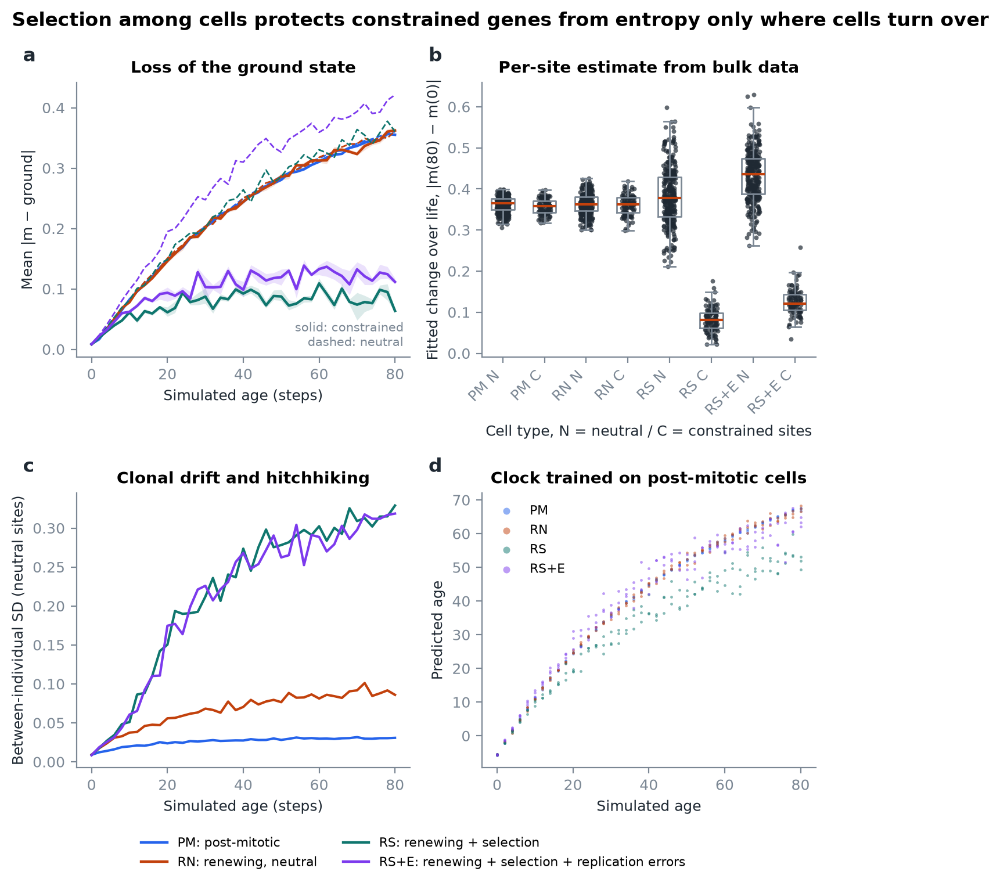
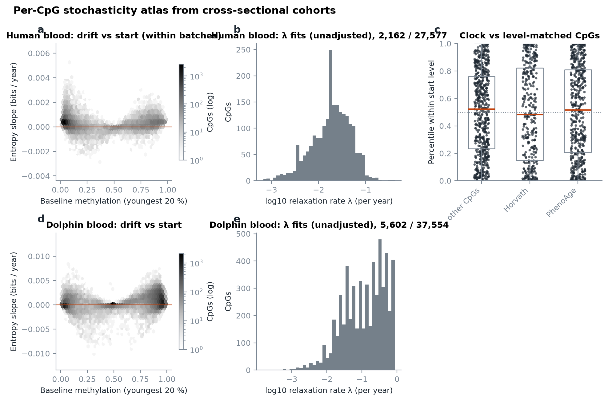
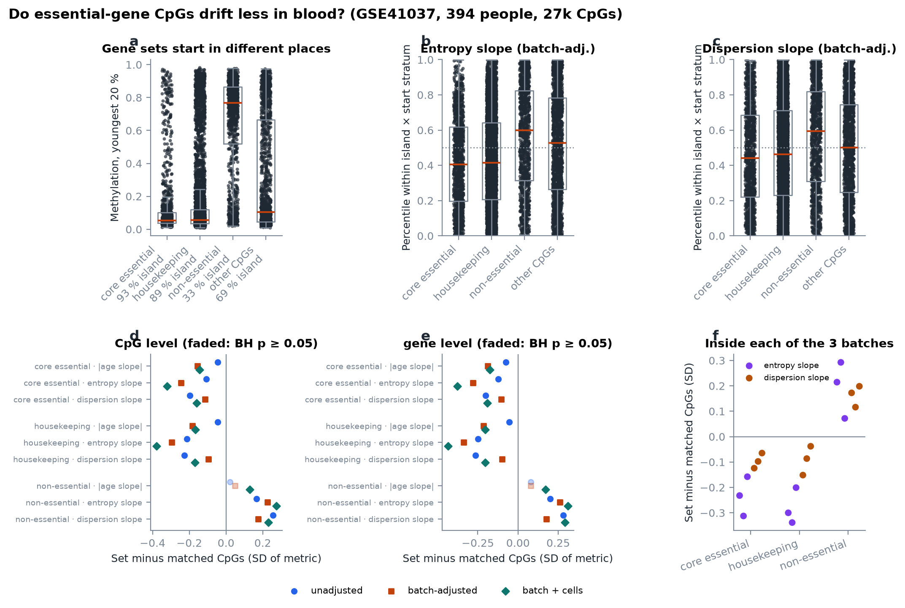
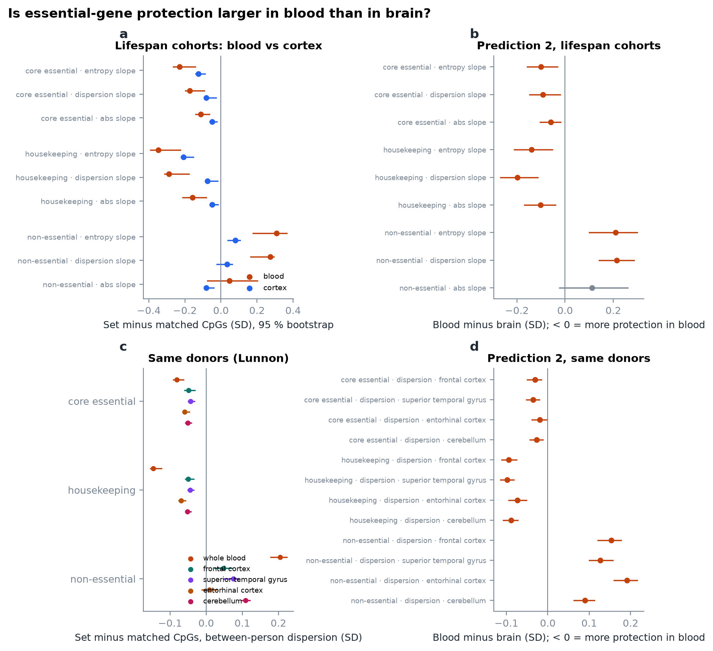

# Extension: is stochasticity gene- and cell-type-specific because of selection?

## Hypothesis

The paper treats stochastic variation as one knob per dataset (σ, or one $E_m$) or as a per-site
rate inferred from one old sample. It then argues that clock CpGs drift fastest because they matter
least for the cell. We want to turn that remark into a testable model:

> **Stochasticity differs between genes and between cell types, because selection among cells can
> protect fitness-relevant loci from entropy, and selection can only act where cells turn over.**

Testable predictions:

1. **Gene level.** In tissues with cell turnover, loci whose state matters for fitness
   (essential and housekeeping genes, cell-identity genes) drift *less* than baseline-matched
   loci. Their bulk level is held near the ground state at a mutation–selection balance.
2. **Cell-type level.** The protection disappears in post-mitotic cells (neurons, cardiomyocytes,
   most muscle). There, epimutations accumulate at the intrinsic maintenance rate wherever they fall.
3. **Hitchhiking.** Where selection acts, neutral loci gain *between-individual* variance as
   fitter clones expand (clonal drift; compare clonal haematopoiesis). Dispersion at neutral sites
   rises faster in renewing tissues than in post-mitotic ones.
4. **Clock pace.** A clock trained on unprotected (post-mitotic-like) dynamics reads protected
   tissues as younger. The tissue's "pace of aging" partly reflects how much of its methylome is
   under selection.
5. **Replication errors cut the other way.** Each division is another chance for a maintenance
   error (the mitotic-clock idea), so high turnover also *raises* drift at unprotected sites. Turnover
   is not uniformly protective.

## Model

`entropy_age.simulate.selection` adds two things to the paper's single-cell Markov model:
cell turnover and fitness-proportional replacement. The equations are in
[model.md §4](model.md#4-extension-selection-among-cells). Knobs:

| Knob | Meaning | Biological reading |
|---|---|---|
| `MaintenanceRates(em, ed)` per site | intrinsic stochasticity | DNMT1 fidelity, chromatin context, replication timing |
| `SelectionModel.weights` per site | fitness relevance | essential / identity genes > 0, passengers = 0 |
| `strength` | fitness cost per deviating site | how deleterious an epimutation is |
| `turnover` | fraction of cells replaced per step | blood, gut, skin high; neurons ≈ 0 |
| `division_error` | extra epimutation in daughters | replication-coupled maintenance errors |
| `reference="founder"` or `"target"` | what counts as deviation | change from the lineage state, or from a fixed functional state |

## Virtual experiment (known ground truth)

`uv run entropy-age figures extension` takes 400 CpGs from the 16-year-old blood sample (bimodal
levels <0.1 or >0.9) and marks 100 of them as constrained. All sites share $E_m = 99\,\%$, so every
site has the same *intrinsic* stochasticity. The methylome is then aged in four cell types:
PM (post-mitotic), RN (renewing, no selection), RS (renewing with selection), and RS+E (RS plus
replication errors).



| Observation (panel) | PM | RN | RS | RS+E |
|---|---|---|---|---|
| Fitted change over life, constrained / neutral (b) | 0.36 / 0.37 | 0.36 / 0.36 | **0.08 / 0.38** | **0.12 / 0.44** |
| Cliff's δ constrained vs neutral, permutation p | −0.15, p = 0.09 | ≈ 0 | **−1.0, p ≤ 0.001** | **−1.0, p ≤ 0.001** |
| Between-individual SD of neutral sites at step 80 (c) | 0.03 | 0.09 | **0.33** | **0.32** |
| Slope of a post-mitotic-trained clock (d) | 0.88 | 0.95 | **0.70** | 0.79 |

All five predictions appear in the simulation. Two lessons matter for real data:

* **Protection does not look like a slower rate.** Constrained sites under selection reach their
  mutation–selection plateau *quickly*, so their fitted relaxation rate λ is *higher* (median 0.072 vs
  0.022 per step) while they move much less. Rank genes by the amount of change (`window_change`,
  entropy slope, dispersion slope), and read λ only together with the fitted equilibrium.
* **Neutral turnover alone already adds dispersion** (RN: 0.09 vs PM: 0.03); selection makes it far
  larger. Dispersion slopes distinguish post-mitotic from renewing tissues even without knowing
  which genes are constrained.

The parameters (selection strength, turnover per step, 200 cells per sample) are illustrative, not
calibrated. The figure shows that the effects exist and that the estimators recover them from
cross-sectional bulk data, which is all real cohorts offer.

## First look at real data: are clock CpGs the fast-drifting ones?

`uv run entropy-age figures atlas` computes every metric for all 27,577 CpGs of the 394 GSE41037
controls (16–88 y) and for the 37,554 CpGs of the 50 dolphins. It then compares clock CpGs with
CpGs *that start at the same level* (deciles of the young-adult baseline). For the human cohort,
slopes are estimated within processing batches (see the confound below). The λ histogram comes
from `fit_relaxation`, which takes no covariates, so it is unadjusted.



Human blood, clock CpGs vs level-matched CpGs, batch-adjusted slopes (2,000 stratified permutations,
p not corrected for the six tests):

| Group | Metric | Matched difference | p |
|---|---|---|---|
| Horvath (353) | entropy slope | +1.6 × 10⁻⁵ bits / year | 0.60 |
| PhenoAge (513) | entropy slope | +5.0 × 10⁻⁵ bits / year | 0.07 |
| Horvath | dispersion slope | +1.3 × 10⁻⁵ | 0.58 |
| PhenoAge | dispersion slope | +4.8 × 10⁻⁵ | 0.01 |

**Not supported.** An earlier version of this page reported that clock CpGs gain entropy faster
than level-matched CpGs (p = 0.004 for Horvath). That came from unadjusted slopes across a cohort
whose processing batches are confounded with age. With batch as a covariate the difference
disappears for Horvath's CpGs and is weak for PhenoAge's. On this data, clock CpGs are typical
drifting CpGs, not the fastest ones.

Dolphins have no clock-CpG contrast. The human clock probes present on the mammalian array do not
hybridise in dolphin DNA: they sit at about 0.5 with almost no variance, so any comparison would
measure probe failure, not biology.

**Caveat on matching.** The baseline used for matching should be measured independently of the
drift being compared: a separate young or fetal reference, or a sorted cell type at its youngest.
A baseline taken from the cohort already contains early drift. Fast-drifting CpGs then fall into
other strata than slow ones, and matching removes part of the effect.
`compare_groups` reports `n_matched` so this shows up, and a test in the suite documents it.

## Prediction 1 on real data: essential genes drift less in blood

`uv run entropy-age fetch annotation` downloads the Illumina 27k probe manifest (GEO GPL8490,
which gives the gene, Entrez ID, RefSeq accession and CpG-island flag per probe) and three
curated gene sets:

* Hart et al. core-essential genes (CEGv2) and non-essential genes (NEGv1) from CRISPR screens,
  pinned at a commit of hart-lab/bagel and matched by Entrez ID;
* Eisenberg & Levanon (2013) housekeeping genes, matched by RefSeq accession, then by symbol.

`uv run entropy-age figures genesets` then compares each set with every other CpG in the same
**stratum**: CpG-island status (fixed by sequence, so drift cannot move it) crossed with the decile
of young-adult methylation. Without matching the sets are not comparable: 93 % of core-essential
CpGs sit in islands near 0 % methylation, but only 33 % of non-essential CpGs do (panel a).



| Set | CpGs (genes) on the array |
|---|---|
| core essential | 1,140 (603) |
| housekeeping | 5,825 (3,087) |
| non-essential | 1,063 (605) |

**A confound we found and removed.** GSE41037 was run in three processing datasets whose ages
barely overlap: dataset 1 is mostly under 50 and dataset 3 mostly over 50. A slope across the whole
cohort partly measures that batch; the clock-CpG result above is one casualty. Every gene-set
contrast was therefore repeated with batch as a covariate (`drift_metrics(..., covariates=...)` gives
partial slopes), with batch plus the seven blood-cell fractions, and separately inside each batch.

Set minus matched CpGs, in SD of the metric (CpG level; * = BH-adjusted p < 0.05 over all 72 tests,
1,000 stratified permutations each, so the smallest p is 0.001):

| Set · metric | unadjusted | batch-adjusted | batch + cells | inside batch 1 / 2 / 3 |
|---|---|---|---|---|
| core essential · entropy slope | −0.11 * | −0.25 * | −0.32 * | −0.23 / −0.31 / −0.16, all * |
| housekeeping · entropy slope | −0.21 * | −0.30 * | −0.38 * | −0.30 / −0.34 / −0.20, all * |
| non-essential · entropy slope | +0.17 * | +0.23 * | +0.27 * | +0.21 / +0.29 / +0.07, all * |
| core essential · dispersion slope | −0.20 * | −0.11 * | −0.16 * | −0.12 / −0.10 / −0.06, all * |
| housekeeping · dispersion slope | −0.23 * | −0.10 * | −0.17 * | −0.15 / −0.09 / −0.04, all * |
| non-essential · dispersion slope | +0.26 * | +0.18 * | +0.23 * | +0.17 / +0.12 / +0.20, all * |
| core essential · \|age slope\| | −0.04 * | −0.16 * | −0.14 * | |
| housekeeping · \|age slope\| | −0.04 * | −0.18 * | −0.17 * | |
| non-essential · \|age slope\| | +0.02 | +0.05 | +0.13 * | |

Gene-level aggregation (median per gene, so genes with many probes do not dominate) gives the
same signs and similar sizes (`data/output/gene_sets/contrasts.csv`).

**Reading.** In whole blood, a renewing tissue, CpGs of essential and housekeeping genes gain
entropy and between-person dispersion more slowly than CpGs that start at the same level in the
same kind of sequence. CpGs of genes no cell line needs drift faster. This holds after removing the
batch confound and cell composition, and it replicates inside each processing batch. The effects
are modest (0.1–0.4 SD), as one would expect if most drift is neutral.

**What this does not show yet.** It is the gene-level half of the hypothesis (prediction 1). The
same pattern would arise without any selection if active, open promoters are simply better
maintained: H3K4me3 and transcription keep DNMT3 away whatever the cell's fitness. The
discriminating test is prediction 2. If selection does the protecting, the essential-gene advantage
should shrink or vanish in post-mitotic cells such as neurons, where no cell can be replaced by a
fitter neighbour. If chromatin does it, the advantage should stay the same size. That needs a
cohort with a post-mitotic tissue next to a renewing one; the next section tests it.

## Prediction 2 on real data: the protection is larger in blood than in brain

The essential-gene advantage is larger in blood than in brain, in two independent designs. That is
what selection among cells predicts. One alternative is not yet ruled out: blood's variable mix of
cell types, set out below.

**Data** (Illumina 450k, run on a cluster: `entropy-age fetch cohort hannum jaffe lunnon`, then
`entropy-age figures tissues`):

| Design | Tissue | People | Ages | Measure, adjusted for |
|---|---|---|---|---|
| Lifespan cohorts | blood, Hannum et al. 2013 (GSE40279) | 656 | 19–101 | age slopes; plate, site, sex, ancestry |
| Lifespan cohorts | prefrontal cortex, Jaffe et al. 2016 (GSE74193), adult controls | 213 | 21–85 | age slopes; plate, sex, ancestry, neuron fraction |
| Same donors | Lunnon et al. 2014 (GSE59685): blood and four brain regions | 71–80 per tissue | 70–105 | between-person dispersion; age, sex, Alzheimer's status |

Each tissue uses about 109,000 autosomal promoter CpGs: every CpG in a promoter of a gene in the three
sets (6,891 core-essential, 42,173 housekeeping, 4,945 non-essential), plus a fixed random background
of 60,000 promoter CpGs for matching. As in prediction 1, each set is compared with CpGs of the same
island status and starting-level decile, in SD of the metric. Blood minus brain gets a 95 % interval
from 200 bootstraps: independent resamples in the two lifespan cohorts, the same resampled donors in
all five Lunnon tissues.



**Set minus matched CpGs, by tissue** (SD; all differ from zero at BH-adjusted p < 0.05 except
where marked):

| Set | Blood (Hannum), entropy slope | Cortex (Jaffe), entropy slope | Blood (Lunnon), dispersion | Four brain regions (Lunnon), dispersion |
|---|---|---|---|---|
| core essential | −0.23 | −0.12 | −0.08 | −0.04 to −0.06 |
| housekeeping | −0.35 | −0.21 | −0.15 | −0.04 to −0.07 |
| non-essential | +0.31 | +0.08 | +0.20 | +0.01 (ns, entorhinal) to +0.11 |

**Blood minus brain** (SD, 95 % bootstrap interval). Negative for the protected sets means more
protection in blood:

| Set | Lifespan: entropy slope | Lifespan: dispersion slope | Same donors: dispersion, four regions |
|---|---|---|---|
| core essential | −0.10 (−0.16, −0.03) | −0.09 (−0.15, −0.02) | −0.02 to −0.04, every interval below 0 |
| housekeeping | −0.14 (−0.21, −0.05) | −0.20 (−0.27, −0.11) | −0.07 to −0.10, every interval below 0 |
| non-essential | +0.21 (+0.10, +0.30) | +0.21 (+0.14, +0.29) | +0.09 to +0.19, every interval above 0 |

Of the 21 blood-minus-brain contrasts, 20 have intervals that exclude zero in the predicted
direction. The exception is the non-essential |age slope|, whose interval crosses zero. The
protection exists in brain too, at a third to two thirds of its size in blood. That also fits the
model: neurons cannot be replaced, but glia turn over, and chromatin protection acts in every cell. Full tables:
`data/output/tissue_contrast/`.

**The alternative explanation that is still open: cell mixture.** Blood is a mix of cell types whose
proportions differ a lot between people. Genes switched on in only some cell types, as many
"non-essential" genes are, gain between-person spread and age trends from that mix. Essential genes
are unmethylated in every cell type, so the mix hardly moves them. Neither blood cohort here is
adjusted for cell fractions, while cortex is adjusted for neuron fraction. In GSE41037 blood,
adding EpiDISH cell fractions as covariates did not shrink the essential-gene effect (prediction 1),
so the mix does not create the effect within blood. But the size of the blood-minus-brain gap could
still be partly composition. The check is to adjust
both tissues for estimated cell fractions, or for the top principal components of the background
CpGs, and see whether the gap survives.

**Other limits.** The two lifespan cohorts are different people from different studies, though both
on the 450k array. Lunnon's donors are old and mostly have Alzheimer's disease. Brain tissue mixes
post-mitotic neurons with glia that do turn over, so the contrast is renewing against mostly
post-mitotic tissue, not a clean neuron sample. Sorted neurons, or a tissue such as skeletal muscle
in GTEx, would sharpen it.

## How to test the hypothesis on real data

```python
import polars as pl
from entropy_age.data.matrix import FeatureMatrix
from entropy_age.stochasticity import compare_groups, drift_metrics, fit_relaxation, paired_comparison

betas = pl.read_parquet("my_betas.parquet")          # cpg column + one column per sample
samples = pl.read_parquet("my_samples.parquet")      # sample, age, cell_type
genes = pl.read_csv("essential_cpgs.csv")            # feature, group  (e.g. promoter CpGs of essential genes)

per_type = {}
for (cell_type,), sub in samples.group_by("cell_type"):
    m = FeatureMatrix.from_frame(betas, feature_col="cpg", samples=sub["sample"].to_list(), max_missing=0.05)
    ages = sub["age"].to_numpy()
    per_type[cell_type] = fit_relaxation(m.values, ages, m.features).join(
        drift_metrics(m.values, ages, m.features), on="feature")

# prediction 1: constrained genes drift less than level-matched CpGs, within each cell type
for cell_type, metrics in per_type.items():
    print(cell_type, compare_groups(metrics, genes, metric="entropy_slope"))

# prediction 2: the same CpGs drift more in post-mitotic than in renewing cells
print(paired_comparison(per_type["neuron"], per_type["blood"], metric="window_change", names=("neuron", "blood")))
```

The CLI does the per-cohort part: `uv run entropy-age stochasticity betas.parquet samples.parquet --groups genes.csv`.

### Data that would make this decisive

| Need | Candidates |
|---|---|
| Same donors, several purified cell types, age range | sorted blood subsets (e.g. Reinius et al. 2012, GSE35069; Tserel et al. 2015); BLUEPRINT; neurons vs glia from FANS-sorted brain (e.g. Kozlenkov et al.) |
| Post-mitotic vs renewing tissue from the same individuals | GTEx methylation (EPIC, 8+ tissues), the Mammalian Methylation Consortium multi-tissue data |
| Single-cell resolution (lineage-level selection) | scBS-seq / scNMT-seq aging studies; clonal haematopoiesis cohorts with methylation |
| Gene classes | DepMap common-essential genes, housekeeping genes (Eisenberg & Levanon 2013), PRC2 targets, cell-type identity TFs |
| Transcriptome version | single-cell expression noise across ages (Tabula Muris Senis), with the bulk model and per-gene σ |

Expected signatures if the hypothesis holds: a negative `matched_diff` for essential genes in blood,
gut and skin, about zero in neurons; a positive neuron-minus-blood `window_change` that is larger
for essential than for other genes; and higher neutral-site dispersion slopes in renewing tissues.

## Related work

Checked on 2026-11-09 (PubMed, the authors' GitHub, and Meyer's thesis read in full). Each entry is
described from its own abstract or text, not from a citing source.

### Stochastic clocks beyond the 2024 paper, by the same group

- **No stochastic clock has yet been validated on mammalian RNA.** David H. Meyer's stochastic RNA
  clocks are built and tested on *C. elegans*; his mammalian stochastic clocks are DNA methylation.
  The one application to mammalian RNA is in Ostermann et al., *JCI Insight* 2025
  ([doi:10.1172/jci.insight.190445](https://doi.org/10.1172/jci.insight.190445)). An "ensemble of
  100 independently trained stochastic clocks" scored human fibroblasts, iPSCs and directly induced
  neurons from 13 donors. Induced neurons kept a higher stochastic age than iPSCs, in line with 16
  RNAAgeCalc clocks. Its build details are in a supplement not read here, and the main text reports
  no accuracy on human chronological age.
- Gallrein, Meyer et al., *Nature Aging* 2026
  ([doi:10.1038/s43587-026-01067-5](https://doi.org/10.1038/s43587-026-01067-5)) applies BiT age and
  the stochastic clock to single neuron types of *C. elegans* (CeNGEN and Calico data). Neuron types of
  chronologically young worms differ almost twofold in predicted age, and the older-predicted types
  degenerate first. It is the cell-type version of our question in worms. Human and mouse enter only
  through correlations of gene-expression trends (GTEx, Tabula Muris Senis), not as clocks.
- Meyer D. H., *Development and Application of Aging Clocks*, PhD thesis, University of Cologne
  (2024), [kups.ub.uni-koeln.de/73668](https://kups.ub.uni-koeln.de/73668/). Its chapters are the
  published papers. Discussion §5.2.2 argues for our hypothesis in prose: "a specific subset of genes
  accumulates stochastic variation at a faster rate than others" is called conceivable, and such
  gene-set-specific noise may be hidden when noise is measured over the whole transcriptome. It notes that the stochastic clock's predictor genes in the neuron study overlap
  H3K27me3-bound regions (ChIP-Atlas), calls this anecdotal, and asks for a systematic test.
- Meyer, Maklakov & Schumacher, *Nature Aging* 2025
  ([doi:10.1038/s43587-025-00975-2](https://doi.org/10.1038/s43587-025-00975-2)): a review arguing that
  clocks reflect stochastic damage accumulation under insufficient maintenance and repair, not a
  program.

### Evidence that stochasticity differs between genes

- Lee et al., *Science Advances* 2021
  ([doi:10.1126/sciadv.abj9111](https://doi.org/10.1126/sciadv.abj9111)): genes lacking CpG islands,
  normally heterochromatic when inactive, are globally activated in aged cells and tissues of mice and
  humans, and this drives inflammatory secretion. Meyer reads it as CGI− genes becoming noisier with age
  while CGI+ genes do not. Our gene-set test matches on CpG-island status for this reason.
- Cheung et al., *Cell* 2018 ([doi:10.1016/j.cell.2018.03.079](https://doi.org/10.1016/j.cell.2018.03.079)):
  mass cytometry of chromatin modifications in human immune cells. Older adults show higher
  cell-to-cell variability and more between-person heterogeneity, driven mostly by non-heritable
  influences.
- Weidemann et al., *Science Advances* 2023
  ([doi:10.1126/sciadv.adh5138](https://doi.org/10.1126/sciadv.adh5138)): several constitutively
  expressed cell-division genes in fission yeast have mRNA noise below the Poisson limit, reached
  through multi-step transcription and degradation and fast mRNA export. Expression noise can be
  pushed down for genes that matter, which is a mechanism of protection other than selection.
- Jenkinson et al., *Nature Genetics* 2017 ([doi:10.1038/ng.3811](https://doi.org/10.1038/ng.3811)):
  methylation stochasticity quantified genome-wide as Shannon entropy from whole-genome bisulfite
  data, with methylation maintenance treated as a communication channel. This is the
  information-theoretic frame for site-specific maintenance that our per-site entropy rates build on.

### Protection across species

- McLain & Faulk, *Aging* 2018 ([doi:10.18632/aging.101413](https://doi.org/10.18632/aging.101413)):
  about 1,000 conserved promoters across 131 mammals have CpG density correlated with maximum lifespan,
  95 % positively. The authors suggest that these genes need more buffering against age-related
  methylation dysregulation in long-lived species.
- Mayne et al., *Scientific Reports* 2019
  ([doi:10.1038/s41598-019-54447-w](https://doi.org/10.1038/s41598-019-54447-w)): CpG density in
  42 promoters predicts maximum lifespan across 252 vertebrate genomes (R = 0.76).

### How these bear on our results

The blood gene-set result (essential and housekeeping CpGs drift more slowly than CpGs of the same
island status and start level) is consistent with all three protective routes these papers suggest:
buffering by CpG density, active chromatin, and selection among cells. CpG density and chromatin act
in every cell; selection needs turnover. Prediction 2 found the protection larger in blood than in
brain, which only selection (or blood's variable cell mix, not yet ruled out) predicts.
