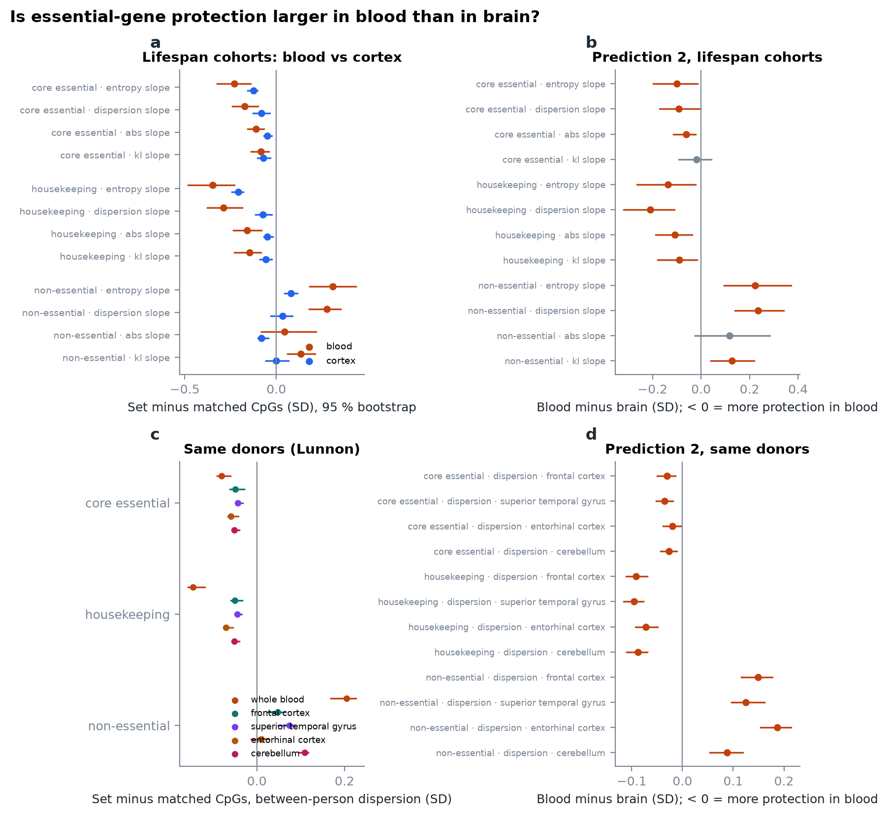
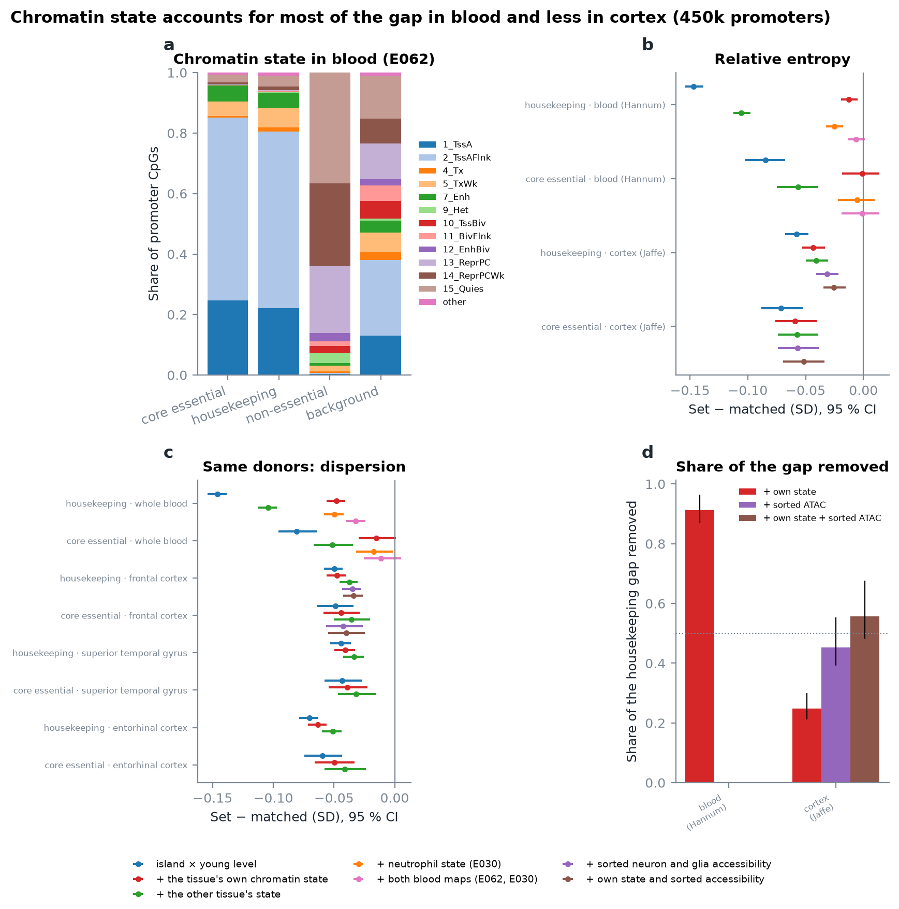
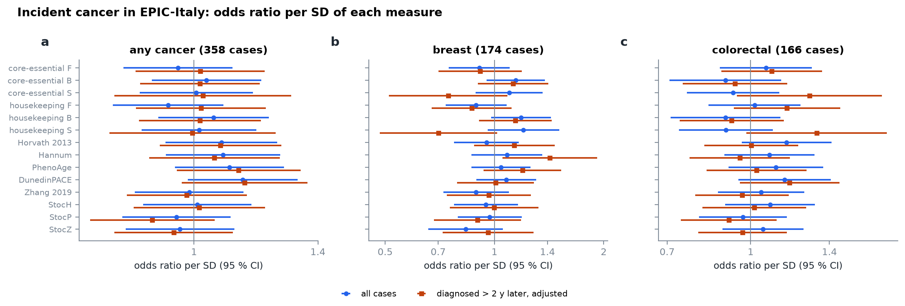

<!--
DECISION FOR THE AUTHORS (title): the old working title "Epigenetic clocks tick where chromatin lets them" is not
proposed. Its first half is refuted by the project's own clock tests (clocks read directed change, not the undirected
drift the shield acts on; CLAIMS C8), and the corrected measure shrinks the chromatin share in cortex to a quarter to
a half. The title below states what the corrected results support. Alternatives: "A matched measure of the
essential-promoter shield against age-related methylation drift"; "Faster demethylation shields essential promoters
from methylation drift across mammals".
-->

# Essential gene promoters are shielded from age-related DNA methylation drift by chromatin and faster demethylation

<!-- Author list and affiliations are for the authors to fill. -->
Anton Kulaga, …

## Abstract

Age-related DNA methylation drift is often modelled as uniform noise, and qualitative work has suggested that
housekeeping and highly connected genes are spared from it. We quantified this protection, which we call the
shield, by comparing CpGs in promoters of essential and housekeeping genes with CpGs of the same CpG-island status
and starting methylation level. Using relative entropy from the young state as the drift measure, essential
promoters drift less than matched CpGs in human blood (−0.15 SD for housekeeping genes), cortex (−0.06 SD),
GTEx tissues, renewing mouse tissues, cultured cells and 89 % of 139 species-tissue groups of 65 mammals. The gap is
not produced by the matching (200 placebo gene sets), blood-cell composition, probe design or preprocessing from raw
IDATs, and survives one false-discovery correction over 7,626 tests. Kinetically, essential island promoters gain
methylation no faster than look-alikes but lose it faster, even within active-TSS chromatin, and so rest lower.
Heterozygous Tet3 loss removes the shield in mouse brain; Tet1 knockout does not. Reference chromatin
states account for 83-91 % of the gap in blood and a quarter to a half in cortex. Within one person over time, housekeeping CpGs change less in direction than look-alikes. The shield does
not look like selection among cells, is not tuned to species lifespan, persists through transient reprogramming and
has no clear RNA counterpart. In one prospective cohort, drift at unprotected look-alike promoters predicted incident
breast cancer years ahead (odds ratio 1.44 per SD, adjusted); this lead needs replication.

## Introduction

DNA methylation changes with age in every mammalian tissue studied, and clocks built from a few hundred CpGs predict
chronological age closely (Horvath 2013; Hannum et al. 2013). Meyer and Schumacher (2024) showed that random
maintenance errors at sites bounded between 0 and 100 % methylation are enough to produce an age predictor; their
model treats the noise as the same at every CpG. Whether it is the same is an old question.
Teschendorff, West and Beck (2013) proposed that genes doing core housekeeping functions are protected from drift,
and West, Widschwendter and Teschendorff (2013) showed that highly connected, essential-enriched genes are spared.
Day et al. (2013) tied resistance to drift to tissue expression and chromatin, and age-related gain of methylation
at Polycomb targets is well established (Teschendorff et al. 2010; Rakyan et al. 2010; Slieker et al. 2016).

The idea that essential genes are protected is therefore not new. What has been missing is a quantitative
measurement that separates a gene set's own behaviour from the properties that travel with it. Essential promoters
are mostly unmethylated CpG islands: in our 27k reference set, 93 % of core-essential CpGs sit in islands near 0 %,
against 33 % of non-essential CpGs. A site near 0 % cannot drift down and moves differently from a site at 50 %,
whatever gene it belongs to. A comparison that does not match on island status and starting level measures mostly
that difference.

Two broad explanations of a real shield make different predictions. Selection among cells would purge cells that
corrupt an essential promoter; it needs cell turnover and should accumulate with divisions. Chromatin maintenance
would hold active promoters unmethylated in every cell, divide or not; it should follow the tissue's own chromatin
and act on a fixed share of the errors. A third possibility emerged while this work was in progress: Krepelova et
al. (2025) showed that age-related drift in the mouse intestine is driven by impaired TET-mediated demethylation,
cell-intrinsically, which points to the removal side of methylation turnover.

Here we measure the shield with a matched design across human and mouse tissues, cultured cells, read-level
bisulfite data and 65 mammal species, and test it against placebo gene sets, cell composition, probe design,
preprocessing and multiple testing. During the work an audit changed our drift measure: binary entropy counts a loss
of methylation at a low-methylated site as a gain in order, and essential promoters turned out to lose methylation
faster than their look-alikes. All sizes reported here use the corrected measure, relative entropy from the young
state, which gives roughly half of the entropy sizes. We then ask how the shield is produced, whether it is visible
within one person over time, what it is not, and whether drift outside it carries health information.

## Results

### Essential promoters drift less than matched CpGs in human blood and cortex

**In blood and cortex, CpGs in essential and housekeeping promoters drift less with age than CpGs of the same island
status and starting level.** We compared every promoter CpG of three gene sets (core-essential genes from CRISPR
screens, broadly expressed housekeeping genes, and non-essential genes) with CpGs in the same stratum of island
status and young-adult methylation decile, and expressed the difference in standard deviations (SD) of the drift
measure across CpGs (Methods). The drift measure is the age slope of each CpG's relative entropy from the young state,
which counts a move up or down alike.

In 656 blood donors aged 19-101 (Hannum et al. 2013), housekeeping promoter CpGs drifted 0.15 SD less than matched
CpGs and core-essential CpGs 0.09 SD less; non-essential CpGs drifted 0.13 SD more (all permutation p ≤ 0.001;
Fig. 1a). In prefrontal cortex of 213 adult controls (Jaffe et al. 2016), the housekeeping and core-essential gaps
were −0.06 and −0.07 SD, and non-essential CpGs did not differ from their look-alikes (−0.00, p 0.94). The
housekeeping gap was larger in blood than in cortex by 0.09 SD (95 % interval −0.19 to −0.02); for core-essential
genes the difference was not resolved (−0.02, −0.09 to +0.04). Other drift measures gave the same signs: the absolute
age slope of the mean (blood housekeeping −0.16 SD, cortex −0.05) and between-person dispersion (−0.29, −0.08).

In the same donors' blood and four brain regions (Lunnon et al. 2014; 71-80 donors per tissue), between-person
dispersion was lower at housekeeping promoters than at matched CpGs in every tissue (blood −0.15 SD, brain regions
−0.04 to −0.07), and blood exceeded each brain region by 0.07-0.10 SD, every interval excluding zero (Fig. 1c, d).
A per-person version of the comparison (Methods) found the same donor's blood more shielded than each brain region
in 86-91 % of donors.

Binary entropy had given about twice these sizes (blood −0.35 SD, cortex −0.21; Supplementary Note 1).

**Figure 1. Essential and housekeeping promoters drift less than matched CpGs in human blood and cortex.** (a) Set
minus matched CpGs (same island status and young-level decile), in SD of four drift measures (entropy slope,
dispersion slope, absolute age slope, relative-entropy slope "kl slope"), Hannum blood (656 donors) and Jaffe cortex
(213 adult controls); 95 % donor-bootstrap intervals. (b) Blood minus cortex for each set and measure. (c) Same
donors (Lunnon): between-person dispersion gap in blood and four brain regions. (d) Blood minus each brain region.
Sizes in the text are the relative-entropy rows; entropy overstates the gap.

### The gap is not made by the matching, the cell mix, the array or its preprocessing

**Placebo gene sets, held cell fractions, probe design and reprocessing from raw IDATs leave the gap in place.**
We drew 200 random gene sets of the same sizes from genes outside all three sets and ran them through the same
matching on all autosomal promoter CpGs (192,719 in blood, 192,998 in cortex). Placebo sets came out at or slightly
above zero (means +0.01 to +0.05 SD); none of 200 draws reached any essential set's gap, in blood or cortex, on any
of four measures (Fig. 2). Measured from the placebo mean, the blood housekeeping gap is −0.143 SD against +0.019
(95 % of placebos −0.001 to +0.036) and the cortex gap −0.053 against +0.013 (−0.001 to +0.028).

Holding 11 of 12 reference-based blood-cell fractions (EpiDISH; Houseman projection) as covariates of every age
slope left the blood housekeeping gap unchanged on relative entropy (−0.152 → −0.152 SD) and on the absolute age
slope (−0.159 → −0.177); only the dispersion gap shrank, by a third (−0.29 → −0.20), as expected when people differ
in cell mix. In sorted CD14+ monocytes of 1,202 people (MESA), the housekeeping gap was −0.10 SD; in CD4+ T cells of
214 people it was small (−0.015 SD, p 0.005). The shield is therefore present inside a single cell type, but its
size varies between cell types.

The two probe designs of the 450k array differ in range, and essential-promoter CpGs are type I more often (42-45 %
against 35 %). Adding design to the matching strata reduced blood's gap by about a sixth, moved cortex's by under
0.01 SD and changed no sign; masking unreliable probes (Zhou et al. 2017) moved no gap by more than 0.01 SD. We
rebuilt Jaffe's cortex series from its 675 raw IDAT files with a SeSAMe-like pipeline; the housekeeping
relative-entropy gap moved from −0.07 (deposited) to −0.09 SD (reprocessed), although single CpGs' slopes agreed
only at r 0.56-0.82 between the two versions. Matching each set to look-alikes cancels such shifts; a gap's size
carries roughly ±0.05 SD of preprocessing uncertainty.

In whole-genome bisulfite reads (Loyfer et al. 2023), the share of discordant reads rose more slowly with age at
housekeeping and core-essential promoters than at look-alikes, in white blood cells of 23 donors (−0.059, −0.034 SD)
and within 27 purified cell-type groups (−0.060, −0.029; all p ≤ 0.002): the shield is not an averaging artefact of
arrays.

Finally, we pooled every raw p-value in every result table of the project (7,626 tests in 53 output folders) and
applied one Benjamini-Hochberg correction. 3,662 tests survived; the largest surviving p was 0.024. Every shield
gap survived (Supplementary Fig. S1).

**Figure 2. Placebo gene sets do not produce a shield.** For each essential set and tissue (Hannum blood, Jaffe
cortex), 200 random gene sets of the same size, drawn from genes outside all three sets, were passed through the same
island × young-level matching. Distribution of placebo gaps against the real set's gap, on four drift measures.

### The shield across tissues, platforms and species

**The shield is present in most tissues and species tested, and on the corrected measure it is ordered by cell
turnover in mouse.** In nine GTEx tissues on the EPIC array (Oliva et al. 2023), the housekeeping gap was −0.14 SD
in whole blood, −0.19 in colon, −0.09 in lung and kidney, about −0.01 in skeletal muscle and about 0 in testis; on
the earlier entropy measure breast and ovary were as weakly protected as muscle. Which tissues lack the gap does not
follow turnover in humans: testis renews fastest.

In 11 tissues of the same C57BL/6 mice on the mammalian array (GSE279437), the corrected measure separated the
tissues sharply. The housekeeping gap was negative in white blood cells (−0.08 SD), colon (−0.18), spleen (−0.19),
kidney (−0.18) and liver (−0.05), and positive in skeletal muscle (+0.09), heart (+0.08), frontal cortex (+0.07),
hippocampus (+0.03) and adipose tissue (+0.03); the hypothalamus, with four aged controls, was the exception
(−0.08). Renewing minus post-mitotic tissues was −0.19 SD (−0.47 to −0.06). In post-mitotic tissues essential
promoters still shifted their mean less (|mean change| −0.05 to −0.09 SD) but scattered more between animals. By
RRBS, which covers far more promoter CpGs, cortex kept a small shield (−0.06 SD, interval excluding zero) and heart
−0.07, against −0.22 in liver and −0.14 in lung (Meer et al. 2018; about 20 mice, heart, liver and lung intervals
include zero); other RRBS series gave −0.03 (adipose) to −0.21 SD (lung) in six tissues (Thompson et al. 2018), −0.30
in whole blood (Petkovich et al. 2017) and −0.32 in BXD liver. Both platforms thus rank the shield by turnover; they disagree on whether post-mitotic tissue keeps a little of
it or none.

In seven primary human cell lines passaged to senescence (Endicott et al. 2022), with the replicate-culture noise
floor removed, set CpGs drifted about half as much as matched CpGs once drift was well above the floor, and this
share did not change with population doublings (−0.14 per 10 doublings, −0.33 to +0.06; one line to 136 doublings);
a second study (Sturm et al. 2023) agreed (−0.055, −0.21 to +0.10).

Across mammals (Mammalian Methylation Consortium, GSE223748; Lu et al. 2023; Haghani et al. 2023), 139
species-tissue groups of 65 species had at least 15 animals spanning 15 % of the species' maximum lifespan. The
housekeeping gap was negative in 89 % of groups (mean −0.13 SD; Fig. 3). Conserved array CpGs at essential promoters
sit near 0 %, where drift is floored; with only CpGs whose young level lies between 10 and 90 %, the gap stayed
negative in 73 % of groups (−0.10 SD).

**Figure 3. The shield across 65 mammals.** (a, b) Housekeeping minus look-alike gap per species-tissue group against
log10 maximum lifespan, on the entropy and dispersion slopes (139 groups; Mammalian Methylation Consortium array).
(c) Change of the gap per log lifespan, weight and tissue held (95 % interval). The all-CpG relative-entropy
coefficient (+0.032, p 0.04) vanishes off the 0 % floor (+0.004, p 0.84; Supplementary Fig. S7).

### Essential promoters lose methylation faster and rest lower

**Essential island promoters gain methylation no faster than look-alikes but lose it faster, so they rest at a lower
level.** Entropy assumes every site drifts toward 50 %. To read direction, we fitted the two-state model in which a
site gains methylation at rate k_gain and loses it at rate k_loss, relaxing toward its own resting level
z = k_gain / (k_gain + k_loss) (Methods). Pooled per gene set in island promoters, the gain rate of core-essential and
housekeeping CpGs in blood was 0.0012 per decade lower than look-alikes' (95 % −0.0017 to −0.0008), and their loss
rate higher (core-essential +0.0025, +0.0012 to +0.0037; housekeeping +0.0018, +0.0009 to +0.0026). In cortex the
gain rates hardly differed (−0.0002) and the loss rates were higher (+0.0054, +0.0035 to +0.0072; +0.0042, +0.0027
to +0.0058). Non-essential island promoters showed the opposite: faster gain (blood +0.0039, cortex +0.0014; Fig. 4).

Per CpG, matched on island status and young level, the fitted resting level was lower at essential promoters (blood
−0.24 SD core-essential, −0.33 housekeeping; cortex −0.08, −0.15) and closer to where the site started (blood −0.28,
−0.42; cortex −0.03, −0.11; p ≤ 0.02 except cortex core-essential loss). The fits identified a resting level for
76-84 % of CpGs.

To ask whether this is only a property of active chromatin, we refitted the rates on CpGs in the active-TSS state
of each tissue's own reference epigenome (set and look-alikes alike). Within active TSS, essential island promoters
still lost methylation faster than other active promoters: blood core-essential +0.0063 per decade (+0.0031 to
+0.0097), housekeeping +0.0015 (+0.0001 to +0.0034); cortex +0.0070 (+0.0041 to +0.0097) and +0.0057 (+0.0034 to
+0.0083). The lower resting level, by contrast, was largely chromatin: adding the state to the per-CpG strata shrank
it by about four fifths in blood (housekeeping −0.335 → −0.060 SD; core −0.243 → −0.062) and by half in cortex
(housekeeping −0.145 → −0.071). Where essential promoters sit in the genome's chromatin explains most of why they
rest low; within that chromatin they are still cleaned faster.

**Figure 4. Gain and loss rates by gene set.** Pooled two-state model fits in Hannum blood (a, b) and Jaffe cortex
(c, d): age slope regressed on young level per set, giving the gain rate (intercept) and loss rate, for CpG-island
(blue) and non-island (orange) promoter CpGs of each set and of look-alikes. Per decade; 95 % intervals from 200
donor resamples.

### TET3, not TET1, is needed for the shield in mouse brain

**Heterozygous loss of Tet3 removes the shield in cortex and striatum, while Tet1 knockout strengthens it.** If faster
removal maintains the shield, losing the remover should make essential promoters gain methylation and lose their
advantage. In the consortium's Tet3 heterozygous mice, scored against eight same-age wild-type littermates that
shared their array chips, the per-animal shield share F (set deviation as a share of look-alike deviation from the
controls; Methods) rose toward zero by +0.17 in cortex (p 0.006) and +0.25 in striatum (p 9·10⁻⁶) for housekeeping
genes (8 against 8 per tissue). Essential promoters gained methylation against their look-alikes (signed shift S
+0.012 and +0.014); with each animal's array compression held fixed the gain remained (+0.010, p 0.003; +0.013,
p 0.001). Drift at look-alike CpGs barely changed. Neurons do not divide, so selection among cells cannot explain
the loss.

Tet1 knockout and Tet1 catalytic-dead cortex (Foong et al. 2024; eight per genotype) did the opposite. Both drifted
more overall (look-alike drift +0.03 to +0.04), but essential promoters kept or strengthened their shield (F −0.11 to
−0.17, p ≤ 0.014) and lost methylation against look-alikes (S −0.021 and −0.018, p < 10⁻⁷). The remover at essential
promoters in neurons is therefore consistent with Tet3, whose CXXC isoform binds unmethylated CpG islands, and not
with Tet1. These are single studies on different arrays (Tet3 heterozygous on the mammalian array, Tet1 homozygous on
the mouse array), each with eight mutants per tissue, and knockouts show a state, not a rate. The result agrees with
Krepelova et al. (2025), who found impaired TET activity driving drift in the mouse intestine; what our data add is
that the effect falls on essential promoters specifically, against littermates (Supplementary Figs. S3, S4).

Two other perturbations act on the look-alikes instead. A DNMT3A gain-of-function mutation (W326R; Sarni et al.
2026), which retargets methylation to Polycomb-marked regions (Heyn et al. 2019), moved essential sets' look-alikes
(F about −0.6 in bone marrow, intestine and liver), and children with constitutional variants in chromatin writers
(NSD1, EZH2, KMT2D, CHD7) drifted more while keeping the shield share (Supplementary Note 3). A perturbation of the
look-alikes moves F as much as one of the set.

### Chromatin accounts for most of the shield in blood and less in cortex

**Matching on the tissue's own reference chromatin state removes 83-91 % of the blood gap and a quarter to a half of
the cortex gap.** We added each promoter CpG's 15-state chromHMM state (Roadmap Epigenomics) to the matching. In blood,
80-85 % of essential and housekeeping CpGs sit in active TSS states against 38 % of background CpGs. On relative
entropy, blood's own state (E062 mononuclear cells, or E030 neutrophils) removed 83-91 % of the housekeeping gap;
cortex's state removed only 28 % of blood's gap (Fig. 5). In cortex, the bulk state removed 25 % and sorted neuron
and glia accessibility (Rizzardi et al. 2019) together with the state 56 %. On dispersion, the shares were 83-88 %
in blood and 22-46 % in cortex.

What remains after chromatin? We regressed each promoter CpG's drift on its gene's DepMap essentiality among broadly
expressed genes, holding chromatin state, expression in the tissue and expression breadth. On relative entropy no
remainder was left in blood (−0.007 SD per unit, −0.021 to +0.008, p 0.33); in cortex a small one was (+0.022,
+0.009 to +0.040). Matching on chromatin may be partly circular, because active chromatin and an unmethylated
promoter can both be outcomes of the same protection, and the reference epigenomes come from other people.

Where does the drift go instead? Among the 5 % of autosomal CpGs whose between-person spread rises fastest with age,
Polycomb-repressed CpGs in blood carried 2.1 times their expected share (bivalent promoters 2.0×, bivalent
enhancers 1.5×), active states a fifth to two fifths of theirs, and housekeeping and core-essential promoters 0.42×
and 0.46× (Supplementary Fig. S2). In cortex every class lay between 0.71× and 1.32×, the largest deficit again at
essential promoters. Rising spread in cortex is close to broad; in blood it is concentrated in the known Polycomb
programme and kept out of active chromatin, of which the shield is the essential-gene side.

**Figure 5. Chromatin matching.** Housekeeping, core-essential and non-essential gaps (SD) matched on island × young
level, then with the tissue's own Roadmap chromHMM state, another tissue's state, and (cortex) sorted neuron and glia
accessibility; Hannum blood, Jaffe cortex and Lunnon's tissues. Intervals resample the set's genes. Inset: state
composition of set and background CpGs.

### The shield within one person over time

**Within the same people followed for up to 20 years, housekeeping CpGs change less in direction than look-alikes.**
SATSA (E-MTAB-7309) drew blood from the same Swedish twins up to eight times. The deposited betas had cell counts and
batch regressed out; on them the cross-sectional shield almost vanished (|mean change| +0.00 SD), so we rebuilt the
series from its 1,072 raw arrays (444 people, 628 consecutive within-person pairs). Each person's change between two
draws was split into the change everyone makes and the person's own departure from it (Methods). Housekeeping CpGs
changed less in direction than look-alikes (−0.14 SD, p 0.001; deposited betas −0.002, p 0.67), sat closer to the
measurement floor (−0.073) and diverged slightly more slowly (−0.014, p 0.016) (Fig. 6). Across people, the rebuilt
series showed a cross-sectional shield like other blood cohorts (relative entropy −0.23 SD, dispersion −0.36,
|mean| −0.11). On the deposited betas, the per-person shield share F fell by 0.14 per decade within a person
(−0.23 to −0.05), matching the between-person slope (−0.13), so the growth of the share with age is not a cohort or
survivor effect. Processing and the pairs retained both differ between versions, so the size within a person is not
settled; its direction agrees with every cross-sectional cohort.

**Figure 6. SATSA rebuilt from IDATs.** Within-person gaps (housekeeping and core-essential minus look-alikes, SD) for
directed change, divergence per year and the measurement floor, deposited betas against betas rebuilt from raw
arrays; and the cross-sectional gaps on first draws.

### What the shield is not

**The shield behaves like a property of each cell's chromatin and methylation turnover, not of competition among
cells, lifespan, reprogramming state or transcription.**

*Selection among cells.* In culture the shield is a constant share of drift over up to 136 doublings (above);
selection would make the share grow, although steady selection per doubling in long-term, increasingly oligoclonal
cultures could also keep it constant (Hollmann et al. 2020). Clonal haematopoiesis, a form of selection in living
blood, did not move the shield (64 patients, any clone, DNMT3A or TET2; |F| ≤ 0.022, p ≥ 0.15), although clones
without allele fractions are diluted in bulk blood. Across a stem-cell transplant (92 transplants, up to 23 years),
essential and non-essential promoters moved alike (F −0.058, −0.039, −0.057 for core-essential, housekeeping and
non-essential): a bottleneck did not protect essential promoters specifically. Caloric restriction, which slows
haematopoietic proliferation, weakened the shield in one mouse blood series (B6D2F1, 12 against 10, F +0.025,
p 0.002), but with blood-cell chromatin openness matched the effect fell to +0.008 (p 0.07), it was absent in liver
(59 against 36 mice, F −0.008, p 0.77), and a second, short CR series in young mice went the other way (core-essential
F −0.090, p 0.006). The turnover ordering in mouse (above) is the one observation in this family that a selection
account would predict; a division-dependent removal process predicts it too.

*Tuning to lifespan.* Long-lived species drift less at unprotected CpGs: the look-alikes' dispersion rate fell as
about lifespan^−1.15 (weight and tissue held). But the gap itself did not track lifespan off the 0 % floor (relative
entropy +0.004 per log-unit, p 0.84), and a phylogenetic generalised least-squares fit gave no lifespan relation
either. A statement we made earlier, that the shield's share of drift grows with lifespan, rested on binary entropy
and does not hold on the corrected measure (+1.43, p 0.23); it is withdrawn. This agrees with Crofts et al. (2026),
who explain lifespan scaling of methylation rates by stem-cell dynamics rather than maintenance efficiency. Noise
also builds from early life rather than switching on at maturity: in 68 species-tissue groups, look-alike noise rose
with age in 84 %, with a late change point in only 6, and housekeeping CpGs gained noise more slowly in the same
animals (median rank correlation with age 0.14 against 0.28).

*Restoration by reprogramming.* Transient OSKM reprogramming of fibroblasts from three donors (Gill et al. 2022;
rebuilt from IDATs) about doubled promoter drift against cells that failed to reprogram (housekeeping look-alike drift
+0.045, p 0.0002), and essential promoters kept the same share of it (F −0.016, p 0.25; core −0.015, p 0.35). A large
reset of the methylome respected the shield, as aging does; the series has no young donors, so restoration toward a
young shield is untested. Cyclic OSKM in mouse tissues (Browder et al. 2022) changed the shield inconsistently, and
one cycle in one-year-old mice (Chondronasiou et al. 2022) left too little aging to test.

*A transcriptional counterpart.* Housekeeping genes gained less between-individual expression spread with age than
expression-matched genes outside brain in a large mouse atlas, but the rat signal was weak, GTEx showed no turnover
effect, and in Tabula Muris Senis bulk RNA the gap's interval included zero in 15 of 17 organs. In the same GTEx
donors, unusual promoter methylation was barely reflected in expression (mean |r| above a permutation null by
0.015-0.022). Chromatin accessibility gave no clean readout either: a weak shield in bulk blood ATAC (−0.048 SD,
p 0.02), a reversal in cortical cell types and adjustment-dependent signs in hippocampus (Supplementary Note 3).

*What clocks read.* Clocks retrained on simulated change keep 70-80 % of their accuracy from each CpG's direction
alone and 0-10 % from undirected noise; they read directed change and are largely blind to the shield
(Supplementary Note 3).

### A lead: drift at unprotected promoters and incident breast cancer

**In one prospective cohort, drift at look-alike promoters in blood predicted breast cancer diagnosed years later.**
EPIC-Italy (GSE51032) holds blood drawn at enrolment from 845 people, 421 later diagnosed with cancer (235 breast,
166 colorectal). Per person we scored drift B at look-alike promoter CpGs (each person against everyone else), the
shield share F and eight published clocks. With age and sex held, B predicted breast cancer (odds ratio per SD 1.43,
1.19-1.71, p 10⁻⁴), more strongly among women diagnosed over 2 and over 5 years after the draw (1.62 and 1.66), the
opposite of what a tumour present at the draw would produce (Fig. 7). With mean methylation, 11 cell fractions and
chip held, the odds ratio for cases diagnosed over 2 years later was 1.44 (1.17-1.76, p 6·10⁻⁴); cases were balanced
over the 72 chips. B kept 1.44 with DunedinPACE and PhenoAge in the model, and was uncorrelated with DunedinPACE
(r 0.02). The clocks' own signals did not survive adjustment (DunedinPACE for breast 1.21 → 1.04), and B had no
colorectal signal once adjusted. The shield share F did not predict cancer (0.95-1.11). Of 168 effects in this
analysis only the eight breast-cancer B variants passed a 5 % false discovery rate, and they survived the
project-wide correction.

In childhood-cancer survivors (SJLIFE, 277 deaths among 4,518), B added nothing to DunedinPACE for death (1.01), so it
is not a general mortality marker. Genome-wide hypomethylation before breast cancer reported in EPIC-Italy (van
Veldhoven et al. 2015) did not replicate in NOWAC; B survives adjustment for mean methylation, but a cohort-specific
finding remains possible until a second prospective cohort is tested.

**Figure 7. Incident cancer in EPIC-Italy.** Odds ratio per SD of the shield share F, look-alike drift B and the
signed shift S (core-essential and housekeeping sets) and of published clocks, for any cancer (421 cases), breast
(235) and colorectal cancer (166). Circles: all cases, age and sex held. Squares: cases diagnosed over 2 years after
the draw, with mean methylation, 11 blood-cell fractions and chip held. 95 % intervals.

## Discussion

We set out to measure, rather than assert, the protection of essential genes from age-related methylation drift.
With island status and starting level matched, essential promoters drift less than look-alike CpGs in most tissues
and species tested, by a modest margin (about 0.15 SD in blood, 0.06 SD in cortex, near zero in some tissues and cell
types) that the matching, cell composition, probe design and normalisation do not produce.

The qualitative claim belongs to Teschendorff, West and Beck (2013) and West et al. (2013), and Day et al. (2013)
already linked resistance to drift with chromatin. Our contribution is quantitative and mechanistic. First, the
matched design gives a size, with intervals, that can be compared across tissues and species and checked against a
null. Second, the kinetic reading: essential island promoters are not slower to change; they remove methylation
faster, which keeps them at a lower resting level. Their gain rate is no higher than that of look-alikes. This faster
loss persists among promoters that share the active-TSS state, which is the first sign of something beyond the
chromatin label a reference map records. Third, a genetic test: halving Tet3 in mouse brain makes essential
promoters gain methylation and lose the shield against littermates, while losing Tet1 does not. Krepelova et al.
(2025) showed that impaired TET activity drives intestinal drift; our data are consistent with it and specify that
the effect falls on essential promoters, in post-mitotic tissue, where selection cannot act.

Chromatin accounts for most of the shield in blood and for a quarter to a half in cortex. The binary-entropy
measure had overstated the cortex share and suggested an essentiality effect beyond chromatin in blood; on the
corrected measure the blood remainder is gone and the small remainder is cortex's. Where drift concentrates is the
mirror image: in blood the CpGs whose spread rises fastest are Polycomb targets, the known age-hypermethylated
programme (Teschendorff et al. 2010; Rakyan et al. 2010; Slieker et al. 2016). Calling blood drift "stochastic" is
therefore accurate only for the part outside that programme; in cortex rising spread is close to uniform.

Selection among cells is unlikely to be the main source: the share is constant through many divisions in culture,
survives reprogramming that acts in days, does not change specifically across a transplant bottleneck or with clonal
haematopoiesis, and is lost in non-dividing neurons when Tet3 is halved. Nor is the shield tuned to species lifespan
once the 0 % floor is accounted for, in line with Crofts et al. (2026).

The EPIC-Italy lead is the result with the most direct use and the least support: drift at unprotected look-alike
promoters, not the shield itself, predicted breast cancer up to five years ahead, beyond cell mix, chip, global
methylation and two outcome clocks. One cohort and possible hormonal or reproductive confounding make it a hypothesis
for a second prospective cohort.

**Where prior work and our own data cut against us.** Several points limit the conclusions. (i) On the mouse array,
the corrected measure orders the shield by turnover: present in all five renewing tissues, reversed in four of five
post-mitotic ones. Our chromatin-maintenance reading predicted no dependence on turnover. RRBS in the same species
keeps a small shield in cortex and heart, and human GTEx tissues do not follow turnover, but the mouse array result
stands. One reconciliation is that faster removal at essential promoters is partly passive, requiring replication to
dilute methylation, which would make the shield larger where cells divide without any selection; we have not tested
this. Vaidya et al. (2023) tie methylation entropy to stem-cell division across mouse tissues, which points the same
way. (ii) Matching on chromatin may be circular: an active, unmethylated promoter and its chromatin state may both be
outcomes of the same protection, and the reference epigenomes come from other individuals. (iii) Long-term cultures
become oligoclonal (Hollmann et al. 2020), and steady selection per doubling would also give a constant share. (iv)
The Tet3 result is one study of 16 mice per tissue on one array; the Tet1 comparison uses another array and
homozygous mutants; and some weaker Tet3 contrasts did not survive the project-wide correction. (v) Seeboth et al.
(2020) found per-person methylation outlier burdens to be driven by smoking, batch and cell mix; our within-sample
contrast removes about half of the slide-batch excess, not all, so batch must be held in every per-person use. (vi) Effects in the shield share of 0.02-0.1 are near the ±0.05 SD preprocessing
uncertainty of a gap, which is why we rebuilt three datasets from raw IDATs; most deposited datasets were used as the
authors processed them, and comparisons are always within one dataset and platform. (vii) Read-level epiallele
entropy has not yet been recomputed under the corrected measure. (viii) Three of our
earlier statements did not survive the metric audit and are not made here: an essentiality effect beyond chromatin in
blood, a shield share growing with species lifespan, and a large shield in CD4+ T cells.

In sum, essential promoters are protected from age-related methylation drift by a modest, reproducible margin, held
by faster removal of methylation that is concentrated in, but not fully explained by, active chromatin, and that
depends on Tet3 in neurons. Whether drift outside this protection marks disease risk is now a testable question.

## Methods

### Datasets

All data are public; Supplementary Table S1 lists every dataset with its accession, platform, whether deposited
or rebuilt values were used, and the analyses that read it. The main human cohorts are Hannum blood (GSE40279, 450k,
656 donors aged 19-101), Jaffe prefrontal cortex (GSE74193, 450k, 213 adult controls aged 21-85), Lunnon blood and
four brain regions (GSE59685), GTEx nine tissues (GSE213478, EPIC), SATSA (E-MTAB-7309), EPIC-Italy (GSE51032) and
SJLIFE (GSE314261); read-level WGBS is from GSE186458. Mouse and mammal data are the Mammalian Methylation Consortium
(GSE223748), Huang et al. (GSE279437) and RRBS series GSE80672, GSE120132, GSE121141 and GSE199979; Tet1 mutants are
GSE271375. Chromatin references are Roadmap 15-state chromHMM (E062, E030, E073) and sorted neuron and glia ATAC
(GSE96614). SHA-256 checksums of all 753 downloaded archive files are kept in the repository.

### Gene sets and promoter CpGs

Core-essential (CEGv2) and non-essential (NEGv1) genes are from Hart et al.'s CRISPR screen sets, matched by Entrez
ID; housekeeping genes from Eisenberg and Levanon (2013), matched by RefSeq accession, then symbol. Mouse genes were
reached through MGI orthologs. For the 450k cohorts each tissue used about 109,000 autosomal promoter CpGs: every
CpG in a promoter of a gene in the three sets (6,891 core-essential, 42,173 housekeeping, 4,945 non-essential) and a
fixed random background of 60,000 promoter CpGs; placebo, hotspot and composition analyses used all autosomal
promoter CpGs. For DepMap essentiality we used the mean CRISPR gene effect (24Q4) among genes at 1+ TPM in 50+ of 54
GTEx tissues.

### Preprocessing

Deposited betas (or counts) were read as served. Three array series were rebuilt from raw IDAT files with
methylprep 1.7.1 in SeSAMe-like mode: noob background correction, non-linear dye-bias correction, channel-switch
inference and pOOBAH detection masking (Triche et al. 2013; Zhou et al. 2018). No analysis pools datasets or
platforms. Technical covariates were removed in every age slope (blood: plate, site, sex, ancestry; cortex: plate,
sex, ancestry, neuron fraction; other cohorts as available). RRBS CpGs were kept when covered at least 10 times in 90 %
of a tissue's samples.

### Drift measures

For each CpG we fitted, with covariates, the age slope of (i) relative entropy from the young state, (ii) binary
entropy H(m) = −m log2 m − (1−m) log2(1−m), (iii) between-individual dispersion |residual| / sqrt(m̄(1−m̄)), and (iv)
the absolute age slope of the mean. Relative entropy is the Kullback-Leibler divergence KL(x ‖ m_young), in bits,
between a sample's methylation level x and the young reference level m_young at the same CpG, treated as Bernoulli
probabilities; its age slope ("kl_slope") is the headline measure. It counts a move up or down alike, assumes no
destination, weighs a move away from an extreme level more, as binomial sampling does, and is close to the squared
standardised deviation, so it carries both mean change and spread. Binary entropy was the first measure used; because
it reads a loss of methylation at a low-methylated site as a gain in order, it overstated gaps by 1.7-3.6×
(Supplementary Note 1). Every analysis whose headline rested on entropy was rerun with all four measures side by side
on the same seeds.

### Matched comparison

Each set's CpGs were compared with all other CpGs in the same stratum of CpG-island status (fixed by sequence) and
young-reference methylation decile; the set-minus-matched difference was averaged over strata weighted by the set's
count and divided by the measure's SD across CpGs. Significance came from 1,000 permutations of set labels within
strata (smallest p 0.001). Intervals came from 200 donor bootstraps, each resample divided by the full sample's
spread (an earlier version divided by each resample's own spread and drew intervals toward zero). For blood minus
brain, the two lifespan cohorts were resampled independently and Lunnon's tissues with the same resampled donors.
Probe design (type I/II), reference chromatin state, or cell-type accessibility quartiles were added to the strata
where stated. Effects across tissues and species were compared only on size-matched resamples where group sizes
differed (GTEx: 32 donors per resample).

### Per-person scores

For a sample and a reference state m (the young controls, or the other people in the contrast), each CpG's deviation
is d = |x − m| / sqrt(m(1−m)). P is the mean d of a set's promoter CpGs minus that of matched CpGs in the same
sample; B is the matched (look-alike) deviation; F = P / B is the shield share (negative: the set deviates less); S is
the signed shift of set CpGs against look-alikes (positive: gained methylation). Reliability was estimated by
resampling the set's genes. In culture, squared deviations from the earliest samples minus the replicate-culture
noise floor were used, and the gap was regressed on drift and drift × population doublings. Within SATSA, each
person's change between consecutive draws was split into the cohort-wide directed change and the person's departure
from it, whose square was regressed on the interval between draws (slope: divergence per year; intercept: measurement
floor).

### Gain and loss rates

In the two-state model a CpG gains methylation at rate k_gain and loses it at k_loss, relaxing toward
z = k_gain / (k_gain + k_loss). Pooled per set, the age slopes of donors outside the youngest fifth were regressed on
the young levels (youngest fifth): the intercept estimates k_gain and the negative slope k_gain + k_loss; sets were
compared with look-alikes of the same island status, with 95 % intervals from 200 donor resamples. Per CpG,
m(t) = z + (m0 − z) e^(−λt) was fitted with z in [0, 1] on a log grid of λ (z and m0 by linear least squares at each
λ); CpGs whose fit fixed λ (76-84 %) were compared within island × young-level strata. To hold chromatin, the pooled
fit was repeated on active-TSS CpGs (state 1_TssA of E062 or E073), and the per-CpG strata were extended with the state.

### Chromatin matching and essentiality gradient

Each promoter CpG received its tissue's Roadmap 15-state chromHMM state (blood E062, second blood reference E030,
cortex E073); for cortex, accessibility quartiles (or no peak) in sorted NeuN+ and NeuN− nuclei were added. The share
removed is 1 − (matched gap / island × level gap), with intervals from resampling genes. The essentiality gradient
regressed promoter CpG drift on DepMap gene effect with island status and level held, then chromatin state, then
expression level and breadth (200 gene resamples).

### Placebo sets, cell composition and multiple testing

Placebo sets drew random genes with a promoter CpG on the array and in none of the three sets, as many as each real set,
200 draws per set and tissue, and passed them through the same matching. Twelve blood-cell fractions per donor were
estimated with EpiDISH's cent12CT450k reference by Houseman projection, and 11 were added to the covariates of every
age slope. Where no reference exists, leading principal components of background CpGs were used, and only for
residual-based measures, since components orthogonal to age cannot change an age slope. A single Benjamini-Hochberg correction was applied over every
raw p-value in every result table (7,626 tests in 53 folders); tests overlap and are positively dependent, which the
procedure allows.

### Outcome models

Incident cancer (EPIC-Italy) and death (SJLIFE) were modelled by logistic regression per SD of each score, with age and
sex (SJLIFE: diagnosis and four treatment exposures), then with mean methylation over all array CpGs, 11 cell fractions
and the score centred within chip. Lag analyses restricted cases to diagnoses over 2 or 5 years after the draw.

### Software and reproducibility

The analysis is a Python 3.13 package with pinned dependencies; every figure and table is regenerated by one command
per figure with seed 42. It includes a reimplementation of Meyer and Schumacher's (2024) stochastic clock model, which
reproduces their noise-trained clock on blood (r 0.88 against 0.87). Published clock coefficients come from biolearn
at a pinned commit.

## Data and code availability

All datasets are public; accessions are listed in Methods and Supplementary Table S1. Code, result tables and
figures are at https://github.com/longevity-genie/entropy-age (AGPL-3.0; ported functions of Meyer and Schumacher's
MIT-licensed code keep their attribution).

## References

Bertucci-Richter EM, et al. 2023. Nat Commun. doi:10.1038/s41467-023-43417-6.
Browder KC, et al. 2022. In vivo partial reprogramming (GSE190665). [verify]
Catching A, et al. 2026. Single-nucleus ATAC of human prefrontal cortex (Zenodo 18394349). [verify]
Chondronasiou D, et al. 2022. One OSKM cycle (GSE156557). [verify]
Crofts SJC, et al. 2024. PMID 38049585. [verify]
Crofts SJC, et al. 2026. Nat Aging. PMID 42156953.
Day K, et al. 2013. Genome Biol. PMID 24034465.
Durso DF, et al. 2017. Oncotarget. doi:10.18632/oncotarget.15573.
Eisenberg E, Levanon EY. 2013. Human housekeeping genes, revisited. Trends Genet. [verify]
Endicott JL, et al. 2022. Nat Commun. doi:10.1038/s41467-022-34268-8.
Foong et al. 2024. Tet1 knockout and catalytic-dead cortex (GSE271375). [verify]
Gill D, et al. 2022. Multi-omic rejuvenation of human cells by maturation phase transient reprogramming (GSE165179). [verify]
Haghani A, et al. 2023. Science. doi:10.1126/science.abq5693.
Hannum G, et al. 2013. Mol Cell. [verify]
Hart T, et al. Core-essential (CEGv2) and non-essential (NEGv1) gene sets, hart-lab/bagel. [verify]
Heyn P, et al. 2019. Nat Genet. doi:10.1038/s41588-018-0274-x.
Holland et al. 2024. Haematopoietic stem-cell transplant methylation series (Mendeley Data j5krtjfj6y). [verify]
Hollmann J, et al. 2020. PMID 32138773.
Horvath S. 2013. Genome Biol. doi:10.1186/gb-2013-14-10-r115.
Houseman EA, et al. 2012. Reference-based cell-mixture deconvolution. [verify]
Huang et al. 2025. Cell Metab. doi:10.1016/j.cmet.2025.10.014.
Jaffe AE, et al. 2016. Nat Neurosci. doi:10.1038/nn.4181.
Krepelova A, et al. 2025. Nat Aging 5:2432. doi:10.1038/s43587-025-01021-x.
Loyfer N, et al. 2023. A DNA methylation atlas of normal human cell types (GSE186458). Nature. [verify]
Lu AT, et al. 2023. Nat Aging. doi:10.1038/s43587-023-00462-6.
Lunnon K, et al. 2014. Nat Neurosci. doi:10.1038/nn.3782.
Meer MV, et al. 2018. Mouse four-tissue RRBS (GSE121141). [verify]
Meyer DH, Schumacher B. 2024. Aging clocks based on accumulating stochastic variation. Nat Aging 4:871-885. doi:10.1038/s43587-024-00619-x.
Oliva M, et al. 2023. Nat Genet. doi:10.1038/s41588-022-01248-z.
Petkovich DA, et al. 2017. Mouse blood RRBS clock (GSE80672). Cell Metab. [verify]
Rakyan VK, et al. 2010. Polycomb-target hypermethylation with age. Genome Res. [verify]
Rizzardi LF, et al. 2019. Sorted neuron and glia chromatin (GSE96614). [verify]
Roadmap Epigenomics Consortium. 2015. Reference epigenomes. [verify]
Sarni D, et al. 2026. Nat Genet. doi:10.1038/s41588-026-02633-8.
Seeboth A, et al. 2020. PMID 32216821.
Slieker RC, et al. 2016. Genome Biol. doi:10.1186/s13059-016-1053-6.
Sturm G, et al. 2023. Commun Biol. doi:10.1038/s42003-022-04303-x.
Teschendorff AE, et al. 2010. Polycomb-target hypermethylation with age. Genome Res. [verify]
Teschendorff AE, West J, Beck S. 2013. Hum Mol Genet. PMID 23918660.
Teschendorff AE, et al. EpiDISH, cent12CT450k reference. [verify]
Thompson MJ, et al. 2018. Six mouse tissues RRBS (GSE120132). [verify]
Triche TJ, et al. 2013. Nucleic Acids Res. doi:10.1093/nar/gkt090.
Vaidya H, et al. 2023. PMID 36797759.
van Veldhoven K, et al. 2015. Clin Epigenetics. doi:10.1186/s13148-015-0104-2.
West J, Widschwendter M, Teschendorff AE. 2013. PNAS. PMID 23940324.
Zhou W, Laird PW, Shen H. 2017. Nucleic Acids Res. doi:10.1093/nar/gkw967.
Zhou W, et al. 2018. SeSAMe. Nucleic Acids Res. doi:10.1093/nar/gky691.
