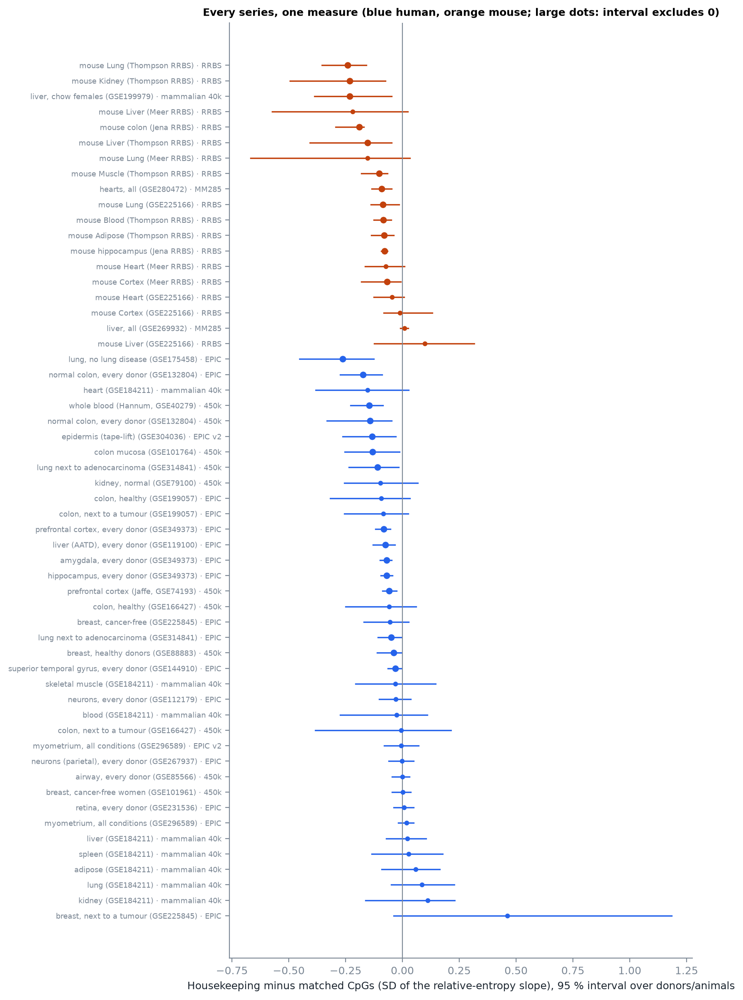
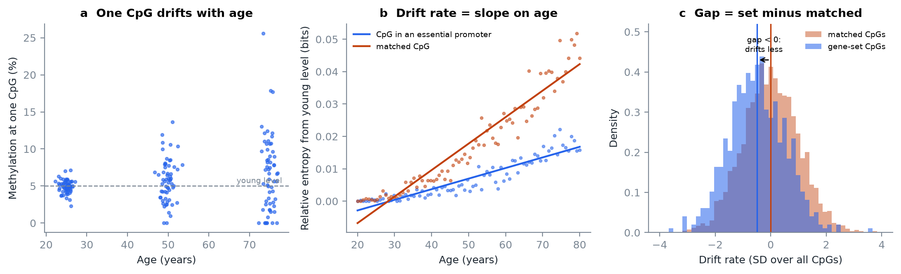
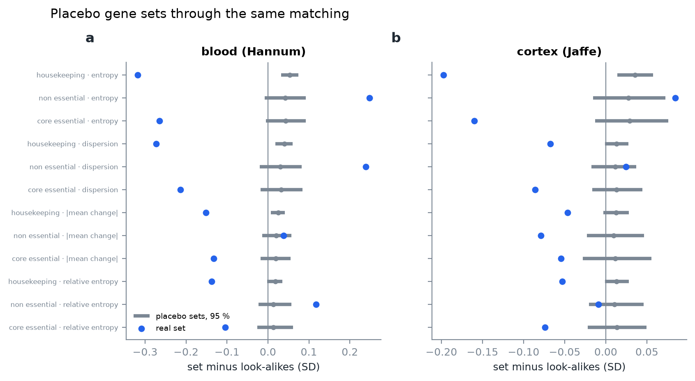
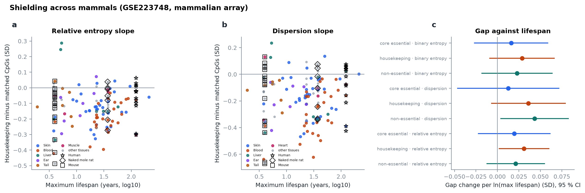
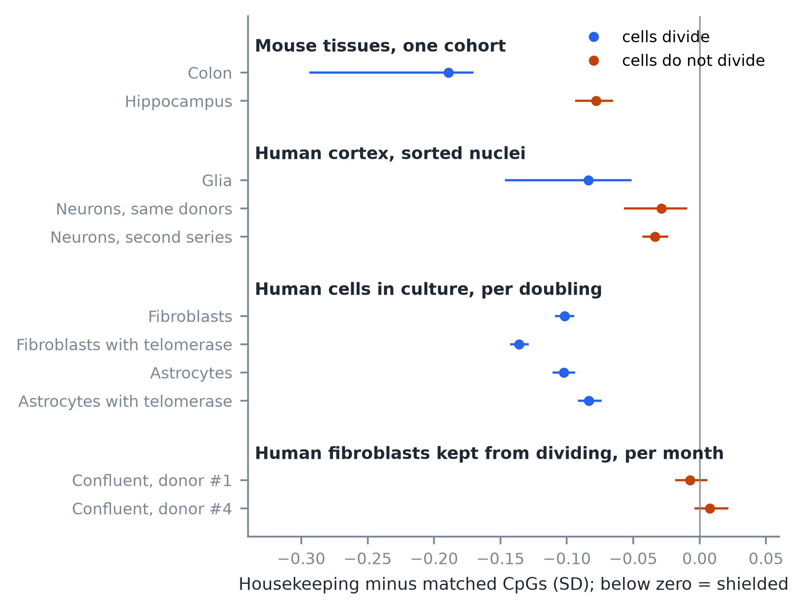
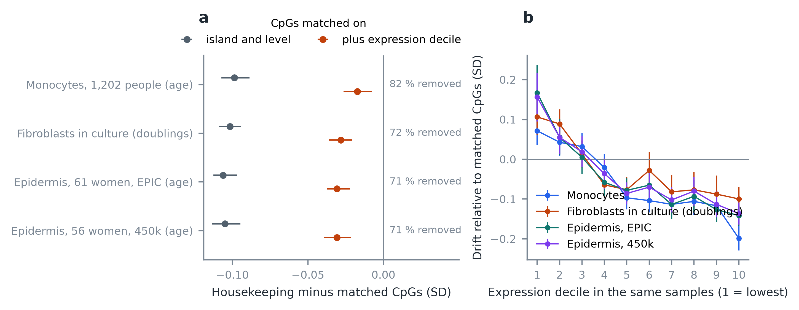
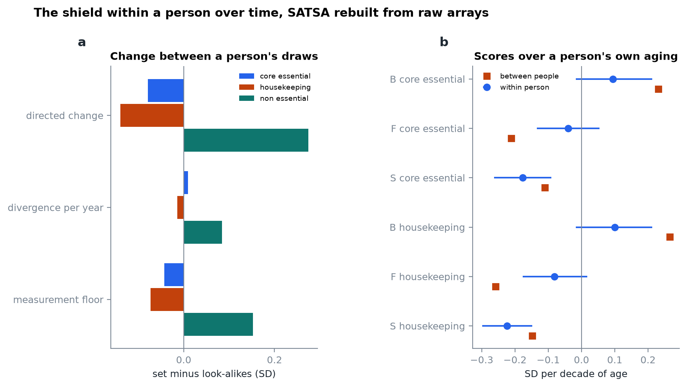
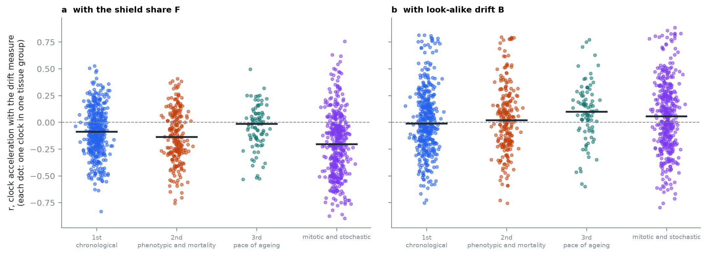
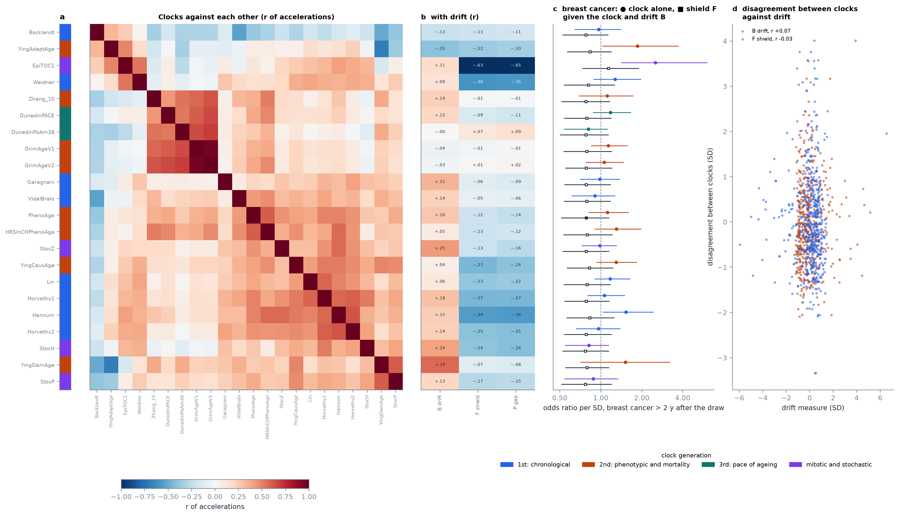

# Promoters of essential genes drift less with age, in step with their expression and with cell division

<!-- Author list and affiliations are for the authors to fill. -->
Anton Kulaga, …

## Abstract

DNA methylation drifts with age, and epigenetic clocks read that drift. Whether drift strikes every CpG alike has
been suspected but never measured with a fair comparison: promoters of essential genes sit at unmethylated CpG islands, which
move differently from other sites whatever genes they serve. We matched each promoter CpG of essential and
housekeeping genes with CpGs of the same island status and starting level, and measured drift as the distance of
methylation from its young state. In most human tissues, in most mouse organs and in 88 % of species-tissue groups of
65 mammals, essential promoters drift less than their matches: they are shielded. No control we built (placebo gene
sets, cell composition, probe design, raw-data reprocessing) produces the shield. It follows how strongly a promoter
is used, and in culture it accrues with cell division. Clocks read it unevenly. Six clocks that count
cell divisions, among them one built on CpGs in partially methylated domains that share none with the others, call
people whose promoters are better protected from drift older for their age in nearly every dividing tissue where they
could be scored, and the promoter-based ones reverse in sorted neurons, which do not divide. Other promoters matched to
the housekeeping ones carry nearly the same link, so these clocks read how well a person's promoters as a class are
protected, which the housekeeping shield shares. Some chronological and phenotypic clocks do so more weakly, and
pace-of-ageing clocks such as DunedinPACE do not see it. Stochastic ageing therefore has a structure that clocks
capture unevenly, and the part of it tied to cell division is the part clocks of cell division read best.

**Graphical abstract.** The shield in 42 independent series: housekeeping promoters minus matched CpGs, in SD of the
drift rate; below zero, the promoters drift less (Box 1 shows how the measure is built).

## Introduction

DNA methylation changes with age across mammalian tissues (Lu et al. 2023), and clocks built from a few hundred CpGs predict
chronological age closely (Horvath 2013; Hannum et al. 2013). Later clocks were trained on phenotypic age
(Levine et al. 2018) or on the pace of ageing (Belsky et al. 2022), and clocks built on the same arrays
need not agree about who is ageing fast. What they read is drift, and Meyer and Schumacher (2024) showed that random
maintenance errors at sites bounded between 0 and 100 % methylation are enough to produce an age predictor. Their
basic model gives every CpG the same maintenance efficiency, although they also fitted site-specific rates estimated from data. Whether drift is the same at every CpG is an old question.
Teschendorff, West and Beck (2013) suggested that genes doing core housekeeping functions are more protected from drift.
West, Widschwendter and Teschendorff (2013) showed that age-associated drift falls preferentially on genes of low connectivity in the protein interaction network, sparing highly connected ones.
Day et al. (2013) linked age-related methylation change to tissue expression and chromatin, and age-related gain and variability of methylation
at Polycomb targets are well established (Teschendorff et al. 2010; Rakyan et al. 2010; Slieker et al. 2016).

The idea that essential genes are protected is therefore not new; it has lacked a quantitative
measurement that separates a gene set's own behaviour from the properties that travel with it. Essential promoters
are mostly unmethylated CpG islands: in our 27k reference set, 93 % of core-essential CpGs sit in islands near 0 %,
against 33 % of non-essential CpGs. A site near 0 % cannot drift down and moves differently from a site at 50 %,
whatever gene it belongs to. A comparison that does not match on island status and starting level measures mostly
that difference.

Two broad explanations of a real shield make different predictions. Selection among cells would purge cells that
corrupt an essential promoter; it needs cell turnover and should accumulate with divisions. Chromatin maintenance
would hold active promoters unmethylated in every cell, divide or not; it should follow the tissue's own chromatin
and act on a fixed share of the errors. A third possibility concerns removal: Krepelova et
al. (2025) showed that age-related drift in the mouse intestine is driven by impaired TET activity, arises
cell-intrinsically in stem cells and spreads through crypt clonality. That finding points to the removal side of methylation turnover.

Here we measure how far each CpG drifts with age and ask whether CpGs in essential promoters drift less than
comparable CpGs. Drift at a CpG is measured as relative entropy from the young state: in every sample, how far the
methylation level has moved from its level in young people, counting a move up or down alike and weighting a move
away from 0 % or 100 % more, because chance variation is smallest there. Its slope on age is the drift rate of that
CpG. For a gene set we compare these drift rates with those of matched CpGs, the CpGs outside the set that have the
same CpG-island status and the same young level, so that a set made of unmethylated islands is compared with other
unmethylated islands. The difference, in standard deviations of the drift rate over all CpGs, is the gap; a gap below
zero means the set drifts less than comparable CpGs, and throughout the paper "shield" means a negative gap (Box 1
lists the measures and how to read them). Binary entropy, the usual measure, instead counts how close a level is to
50 %, so a loss of methylation at a low-methylated site reads as a gain in order; because essential promoters lose
methylation faster than matched CpGs, it roughly doubles the gap, and all sizes reported here are on relative
entropy.

We measure the gap across human and mouse tissues, cultured cells, read-level bisulfite data and 65 mammal
species, and test it against placebo gene sets, cell composition, probe design and preprocessing. We then ask how the
shield is produced, whether it is visible within one person over time, what it is not, whether drift outside it
carries health information, and which clocks read it. The shield turns out to follow promoter activity, to accrue
with division where batch cannot make the contrast, and to be read most strongly by a clock of cell division (Fig. 10, Fig. 11).

## Results

**Box 1. How to read the drift measures.** At each CpG, a tissue sample gives a methylation level between 0 % (no cell
methylated) and 100 % (every cell methylated). With age the level moves, and people come to differ from each other.
We summarise this per CpG as an age slope of one of four measures, then ask whether the CpGs of a gene set change
less than comparable CpGs (the gap).

| Measure | What it counts | Higher slope means | Use it for |
|---|---|---|---|
| Relative entropy (headline) | How far a sample has moved from the young level at that CpG, up or down alike; a move away from 0 % or 100 % counts more, as chance variation is smallest there | The CpG leaves its young state faster | All main comparisons, across tissues and species |
| Binary entropy | How close the level is to 50 % (most mixed) | The level moves toward 50 % | Comparison with earlier work only: a CpG falling from 2 % to 0 % reads as more ordered, which overstated our gaps |
| Dispersion | How much people differ from each other at that CpG | People diverge faster | Random, person-to-person drift |
| Absolute mean change | How much the average level shifts | The shared shift is faster | Directed change, the kind that clocks read |

The gap is the gene set's slope minus that of matched CpGs (same CpG-island status and young level), in standard
deviations of the slope over all CpGs. In every figure, a gap below zero means the gene set drifts less than
comparable CpGs (protected), above zero more. A gap of −0.1 SD is a modest shift of the whole distribution,
detectable because thousands of CpGs are averaged. Gaps from relative entropy and dispersion read as
"drifts less"; on binary entropy a negative gap can also come from CpGs pinned at 0 %, which is why we test CpGs
starting between 10 and 90 % separately ("off the floor").

**Box 1 figure. From one CpG to a gap (illustrative, simulated values).** (a) The methylation level of one CpG in
people of three ages; the dashed line is its young level. (b) Relative entropy of each sample's level from the young
level, against age; the slope is the CpG's drift rate, smaller for a CpG in an essential promoter (blue) than for a
matched CpG (orange). (c) Drift rates of all CpGs of a gene set and of matched CpGs, in SD over all CpGs; the gap is
the difference of their means, here drawn larger than the real gaps (−0.06 to −0.26 SD) for clarity. Below zero, the
set drifts less than comparable CpGs.

### Essential promoters drift less than matched CpGs in human blood and cortex

**In blood and cortex, CpGs in essential and housekeeping promoters drift less with age than CpGs of the same island
status and starting level.** We compared every promoter CpG of three gene sets (core-essential genes from CRISPR
screens, broadly expressed housekeeping genes, and non-essential genes) with CpGs in the same stratum of island
status and young-adult methylation decile (matched CpGs, or look-alikes), and expressed the difference in standard deviations (SD) of the drift
measure across CpGs (Methods). The drift measure is the age slope of each CpG's relative entropy from the young state,
which counts a move up or down alike.

In 656 blood donors aged 19-101 (Hannum et al. 2013), housekeeping promoter CpGs drifted 0.15 SD less than matched
CpGs and core-essential CpGs 0.09 SD less; non-essential CpGs drifted 0.13 SD more (95 % intervals from resampling donors: −0.23 to −0.09, −0.14 to −0.04
and +0.06 to +0.21;
Fig. 1a). In prefrontal cortex of 213 adult controls (Jaffe et al. 2016), the housekeeping and core-essential gaps
were −0.06 and −0.07 SD, and non-essential CpGs did not differ from their look-alikes (−0.00; −0.06 to +0.07). The
housekeeping gap was larger in blood than in cortex by 0.09 SD (95 % interval −0.19 to −0.02); for core-essential
genes the difference was not resolved (−0.02, −0.09 to +0.04; Fig. 1b). These are two studies, processed by different
pipelines, over different age ranges (19-101 and 21-85 years), with neuron fraction held in cortex but no cell fractions
in blood; the difference is therefore descriptive. Restricted to the ages both cohorts cover and with blood-cell
fractions held, it is −0.07 (−0.13 to −0.01); with the cortex arrays rebuilt from raw files, −0.07 (−0.15 to +0.01). Essential promoters start near 0 % methylation, where there is little room to drift. On one common scale (the
SD over all CpGs), the blood housekeeping gap among CpGs starting between 10 and 90 % was −0.10 SD (−0.20 to −0.04),
and between 20 and 80 % it was 0.00 (−0.08 to +0.07). In cortex the same bands gave −0.08 (−0.14 to +0.00) and −0.06
(−0.14 to +0.07): the estimate keeps its size, but neither interval excludes zero. The blood gap therefore does not
extend to CpGs of intermediate methylation, and the cortex gap off the floor is not resolved. Other drift measures gave the same signs: the absolute
age slope of the mean (blood housekeeping −0.16 SD, cortex −0.05) and between-person dispersion (−0.29, −0.07).

Further cortex series gave housekeeping gaps of the same sign. A second cortex series (GSE252501; dorsolateral prefrontal cortex of 52 donors on the EPIC array, processed from
raw files, depression diagnosis held) gave −0.005 SD (−0.017 to +0.006), and −0.013 (−0.024 to −0.003) with chip
intercepts. A third cortex series, bulk orbitofrontal cortex of 90 people aged 24 to 84 on the EPIC array (GSE254293, rebuilt
from raw files, diagnosis held), gave a small housekeeping gap of the same sign: −0.017 SD (−0.030 to −0.008), and
−0.010 (−0.022 to −0.001) with chip intercepts, a separate term for each array slide (chip) on which samples were hybridised together, which removes differences between slides (Supplementary Note 3). The largest replication is a fourth series of three brain
regions from about 300 donors aged 16 to 80 (GSE349373; EPIC, processed from raw files; controls and donors with
depression or post-traumatic stress disorder, diagnosis held; donors of the first cortex cohort left out). With chip intercepts the housekeeping gap was −0.081 SD in prefrontal cortex (−0.119 to −0.052 resampling
donors; 294 donors), −0.070 in amygdala (−0.098 to −0.047; 297) and −0.069 in hippocampus (−0.094 to −0.043; 300); in the about 100 controls of each region it was −0.043, −0.036 and −0.078, each donor interval excluding zero. Between 10 and 90 % starting methylation the three gaps were −0.061,
−0.055 and −0.045, each interval excluding zero.

In blood and four brain regions from the same donors (Lunnon et al. 2014; 71-80 donors per tissue), between-person
dispersion was lower at housekeeping promoters than at matched CpGs in every tissue (blood −0.15 SD, brain regions
−0.04 to −0.07), and blood exceeded each brain region by 0.07-0.10 SD, every interval excluding zero (Fig. 1c, d).
A per-person version of the comparison (Methods) found the same donor's blood more shielded than each brain region
in 86-91 % of donors. In this series tissue cannot be separated from array batch: the blood arrays sit on slides
that hold only blood, the authors normalised each tissue separately, and blood was drawn in life (70-99 years) while
brain was taken at death (71-105). The separate normalisation did not make the difference: with all 531 arrays
normalised together from the deposited raw intensities, blood exceeded each brain region by 0.08-0.10 SD (frontal
cortex −0.105, 95 % interval −0.127 to −0.081, against −0.092 on the authors' values). Slide still goes with tissue,
so the contrast stays confounded with batch.

**Figure 1. Essential and housekeeping promoters drift less than matched CpGs in human blood and cortex.** (a) Set
minus matched CpGs (same island status and young-level decile), in SD of four drift measures (binary entropy,
dispersion, |mean change| and relative entropy, each as an age slope), Hannum blood (656 donors) and Jaffe cortex
(213 adult controls); 95 % donor-bootstrap intervals. (b) Blood minus cortex for each set and measure; grey marks a
difference whose interval includes zero. (c) Same donors (Lunnon): between-person dispersion gap in blood and four
brain regions. (d) Blood minus each brain region. Sizes in the text are the relative-entropy rows; binary entropy
overstates the gap. How to read: each point is a gene set's gap, its CpGs' drift rate (age slope of relative entropy unless the panel says otherwise) minus that of matched CpGs of the same island status and young level, in SD of the drift rate over all CpGs; below zero = the set drifts less than comparable CpGs (Box 1).

### The gap is not made by the matching, the cell mix, the array or its preprocessing

**Placebo gene sets, held cell fractions, probe design and reprocessing from raw array files (IDATs) leave the gap
in place.**
We drew 200 random gene sets of the same sizes from genes outside all three sets and ran them through the same
matching on all autosomal promoter CpGs (192,719 in blood, 192,998 in cortex). Placebo sets came out at or slightly
above zero (means +0.01 to +0.05 SD); none of 200 draws reached any essential set's gap, in blood or cortex, on any
of four measures (Fig. 2). Measured from the placebo mean, the blood housekeeping gap is −0.143 SD against +0.019
(95 % of placebos −0.001 to +0.036) and the cortex gap −0.053 against +0.013 (−0.001 to +0.028).

Holding 11 of 12 reference-based blood-cell fractions (EpiDISH; Houseman projection) as covariates of every age
slope left the blood housekeeping gap unchanged on relative entropy (−0.152 → −0.152 SD) and on the absolute age
slope (−0.159 → −0.177). Only the dispersion gap shrank, by a third (−0.29 → −0.20), as expected when people differ
in cell mix (Supplementary Fig. S5). In sorted CD14+ monocytes of 1,202 people (MESA; Reynolds et al. 2014), the housekeeping gap was −0.10 SD; in CD4+ T cells of
214 people it was small (−0.015 SD, −0.024 to −0.006 over genes; no donor resampling interval computed; Supplementary Fig. S10). The shield is therefore present inside a single cell type, but its
size varies between cell types. Whether its size follows promoter activity is tested below with expression from the same samples.

Adding probe design to the matching changed no sign, masking unreliable probes moved no essential-set gap by more
than 0.012 SD, and rebuilding Jaffe's cortex series from its raw arrays did not weaken the gap. On the same 208 donors and the
89,446 CpGs measured in every donor by every route, R SeSAMe and methylprep agreed within 0.004 SD. Both strengthened the gap over the deposited values: the
housekeeping gap on relative entropy was −0.064 (95 % interval −0.091 to −0.034) deposited against −0.081 (−0.125 to
−0.046) rebuilt, and on spread −0.072 against −0.119 (paired difference
−0.047, −0.081 to −0.003; Supplementary Note 3; Supplementary Figs. S12, S13). Judging from this rebuild, a gap's
size carries a few hundredths of an SD of preprocessing uncertainty, in the direction of a weaker gap in the
deposited data.

In whole-genome bisulfite reads (Loyfer et al. 2023), the share of discordant reads rose more slowly with age at
housekeeping and core-essential promoters than at look-alikes, in white blood cells of 23 donors (−0.059, −0.034 SD)
and within 27 purified cell-type groups (−0.060, −0.029; no resampling interval computed; Supplementary Fig. S11). The shield is therefore not an averaging artefact of
arrays.

The p-values in the result tables are mostly set-label tests computed with the samples fixed, which do not test an
association with age (Methods); a false-discovery correction over them would count the wrong tests, so claims rest
instead on intervals that resample donors, animals or cultures, and on the placebo sets above.

**Figure 2. Placebo gene sets do not produce a shield.** For each gene set, 200 random gene sets of the same size,
drawn from genes outside all three sets, were passed through the same
island × young-level matching in (a) Hannum blood and (b) Jaffe cortex. Grey: mean and central 95 % of the 200 placebo gaps; blue: the real set's gap, for core-essential, housekeeping and non-essential genes on four drift measures. How to read: each point is a gene set's gap, its CpGs' drift rate (age slope of relative entropy unless the panel says otherwise) minus that of matched CpGs of the same island status and young level, in SD of the drift rate over all CpGs; below zero = the set drifts less than comparable CpGs (Box 1).

### The shield across tissues, platforms and species

**The shield is present in most tissues and species tested.** Across 42 independent cohort-tissue series on one
measure (23 human, 19 mouse; Supplementary Fig. S22), the housekeeping gap was negative in 33; 22 intervals over
donors or animals lie below zero and none above it. An apparent
ordering by cell turnover in mouse cannot be separated from array chip.

In nine GTEx tissues on the EPIC array (Oliva et al. 2023; 47-224 donors per tissue, ages in decade bins; deposited values, since the raw arrays are under controlled access), the housekeeping gap was −0.13 SD
in whole blood, −0.18 in colon, −0.08 in lung and kidney, about 0 in skeletal muscle (−0.003) and testis (+0.001; Supplementary Fig. S8). On
binary entropy, breast and ovary were as weakly protected as muscle. Two breast cohorts rebuilt from raw arrays agree
that breast carries little of the gap: −0.04 SD (−0.11 to −0.01) in 100 healthy donors aged 18 to 82 (GSE88883) and
+0.00 (−0.05 to +0.04) in 119 cancer-free women aged 17 to 76 (GSE101961), chip intercepts held. Normal kidney of 30 adults aged
18 to 78 (GSE79100, one array per kidney of three) gave −0.10 (−0.26 to +0.07), the size GTEx kidney shows (−0.08) but
not resolved at this sample size. Which tissues lack the gap does not follow turnover in humans: testis renews fastest. Two further human tissue series,
processed from raw files with chip intercepts and intervals from resampling donors, came from tissue next to a tumour.
In normal colon mucosa of 146 colorectal-cancer patients aged 22 to 89 (GSE101764) the housekeeping gap was −0.13 SD
(−0.25 to −0.01), and −0.17 (−0.32 to −0.00) off the floor.

Lung carried the gap in every source. Lung of post-mortem GTEx donors gave −0.08, and 143 donor and other
non-diseased lungs aged 14 to 88 (GSE175458, EPIC, rebuilt) gave −0.26 (−0.45 to −0.13, chip held), a strong gap of
the usual sign. Tissue resected next to adenocarcinoma in 114 non-smokers aged 39 to 82 (GSE314841, 450k part) gave
−0.11 (−0.24 to −0.02, chip held), and the same study's 31 lungs on the EPIC array −0.05 (−0.11 to −0.00). Tissue
next to a tumour can carry the tumour's methylation changes; leaving out the CpGs whose mean level differs between
TCGA lung adenocarcinomas and TCGA normal lung kept the gap: −0.07 (−0.16 to −0.01) without the 24,287 CpGs that
differ by at least 0.2 in beta, and −0.05 (−0.13 to −0.01) without the 86,809 that differ by at least 0.1.

**The shield weakens in diseased lung.** Normal tissue resected next to lung tumours carried a weaker gap than lung
without disease: in TCGA, rebuilt from the raw arrays with ages from the GDC, −0.07 (−0.17 to −0.01) next to squamous
carcinomas (42 donors) and −0.09 (−0.19 to −0.02) next to adenocarcinomas (32), and −0.11 in GSE314841, against
−0.26. Smoking does not account for it. Within the disease-free lungs of GSE175458 the gap was −0.26 (−0.42 to −0.12)
in 83 never-smokers and −0.19 (−0.32 to −0.10) in 56 ever-smokers, and the GSE314841 donors next to a tumour had never
smoked. The same
series' 344 lungs with idiopathic pulmonary fibrosis, from the same centres, carried a gap of −0.08 (−0.22 to +0.05),
as weak as tissue next to a tumour. Elsewhere the tissue next to a tumour kept the gap of its healthy counterpart:
breast −0.01 (96 donors; healthy −0.04 and +0.00), colon −0.08 (38; mucosa −0.13) and kidney −0.13 (160; normal
kidney −0.10). In lung, disease goes with the loss of the shield and smoking does not; whether fibrosis and the tumour
field share a cause is not tested here.

Human post-mortem tissues on the mammalian array (GSE184211; heart, muscle, liver, kidney, lung, spleen, fat, blood; 32 to
112 per tissue) cover only about 1,400 promoter CpGs and resolve no tissue. Myometrium, a smooth muscle that renews slowly,
showed no gap: in 62 women aged 29 to 52 on the EPIC array (GSE296589; fibroid-free and fibroid-associated specimens,
condition held) the housekeeping gap was +0.00 SD (−0.05 to +0.03), and +0.03 (−0.02 to +0.05) in the 30 fibroid-free
women alone; this narrow and young age range gives slopes over 23 years only. The study's 30 women on EPIC v2 did not
resolve the gap (−0.01, −0.08 to +0.07).

On the mammalian array, relative entropy separated 11 tissues of the same male C57BL/6 mice sharply (GSE279437;
Huang et al. 2025). The mice were the untreated young and aged controls of an exenatide and rapamycin study, compared as aged minus young because GEO gives no numeric ages. The housekeeping gap was negative in the three renewing tissues and in kidney and liver (−0.05 to −0.19 SD) and
positive in four of five post-mitotic tissues and in adipose tissue (+0.03 to +0.09); the hypothalamus, with four
aged controls, was the exception (−0.08; values per tissue in Supplementary Note 3). Renewing tissues (blood cells, colon, spleen) minus post-mitotic tissues was −0.19 SD (−0.45 to −0.07; Supplementary Fig. S6), and slowly renewing liver, kidney and adipose tissue minus post-mitotic −0.10 (−0.20 to −0.02). Neither contrast holds once array chip is held. Aged and young controls shared no chip in spleen and adipose and one in colon and kidney, so in those tissues age cannot be separated from chip (Supplementary Note 3). Restricted to animals on chips shared by both ages, and with a chip intercept, the renewing contrast was +0.02 (−0.06 to +0.19) and the slowly renewing one +0.03 (−0.04 to +0.18). White blood cells were the one renewing tissue left, and their gap moved from −0.08 to +0.04. On the same tissues without the chip terms the renewing contrast was −0.13 (−0.94 to +0.08), so losing tissues widens the interval and holding chip moves the estimate to zero. In post-mitotic tissues, essential
promoters still shifted their mean less (|mean change| −0.05 to −0.09 SD) but scattered more between animals. By
reduced-representation bisulfite sequencing (RRBS), which covers far more promoter CpGs, cortex kept a small shield (−0.06 SD, interval excluding zero) and heart
−0.07, against −0.22 in liver and −0.15 in lung (Meer et al. 2018; about 20 mice; the heart, liver and lung intervals
include zero). Other RRBS series gave −0.08 (adipose, blood) to −0.24 SD (lung) in six tissues (Thompson et al. 2018) and −0.30
in whole blood (Petkovich et al. 2017), and the mammalian array gave −0.30 in BXD liver (Mozhui et al. 2022; −0.28, −0.45 to −0.14, re-processed from the IDATs). In a further RRBS series of the same mice at 3, 15 and 24 months, with sex and sequencing lane held and every
lane mixing the ages (GSE225166; 30 to 32 mice per tissue), on the CpGs covered at least 10 times in every library, the housekeeping gap was −0.09 SD in lung (−0.14 to −0.02;
28,727 CpGs), −0.05 in heart (−0.13 to +0.01; 30,312) and −0.01 in cortex (−0.08 to +0.13; 12,335; intervals from
resampling mice); liver kept only 518 such CpGs and gives no estimate. Off the floor (10-90 %, all-CpG scale) none of the four was
resolved: lung −0.08 (−0.19 to +0.00), heart +0.05 (−0.04 to +0.12), cortex +0.02 (−0.24 to +0.16). These are different platforms and CpG sets, so they are reported side by side and not ranked against one another; within Meer's four tissues the shield is smaller in cortex and heart, and in Thompson's six tissues muscle (−0.10) matched blood (−0.08). Meer's RRBS and the array disagree on whether post-mitotic tissue keeps a little of
the shield or none. Two further mouse series on the MM285 mouse array, rebuilt from raw files with sex held and islands taken
from the genome's island map, differed. Hearts of 36 young and old mice (GSE280472; treatment held) carried the gap:
−0.10 (−0.16 to −0.07), −0.09 (−0.14 to −0.05) with chip intercepts. Livers of 90 mice aged 26 to 532 days, most
kept in an outdoor enclosure (GSE269932), did not: −0.01 (−0.07 to +0.04), +0.01 (−0.01 to +0.03) with chip
intercepts. The liver null reflects its ages: the median mouse was 135 days old and only 7 of 90 were older than
302 days, so the slopes mostly cover maturation; restricted to mice up to 10 months, BXD liver also shows no gap
(−0.01, against −0.30 over 6 to 33 months). Run through the same program, BXD liver gave −0.28 (−0.44 to −0.13),
matching its own analysis (−0.28), so the program reproduces a known mouse result.

Across mammals (Mammalian Methylation Consortium, GSE223748; Lu et al. 2023; Haghani et al. 2023), 139
species-tissue groups of 65 species had at least 15 animals spanning 15 % of the species' maximum lifespan. The
housekeeping gap was negative in 88 % of groups (mean −0.12 SD; Fig. 3a). Conserved array CpGs at essential promoters
sit near 0 %, where drift is floored; with only CpGs whose young level lies between 10 and 90 %, the gap stayed
negative in 73 % of groups (−0.10 SD).

**Figure 3. The shield across 65 mammals.** (a) The housekeeping gap (relative-entropy slope) of each species
within each tissue, tissues with at least four species shown separately and the rest pooled; black bars are tissue
medians, labels give the number of species and the share below zero (Mammalian Methylation Consortium array). (b)
All 139 species-tissue groups: 88 % lie below zero. (c) Change of the gap per natural-log unit of maximum lifespan,
weight and tissue held (95 % interval); the housekeeping coefficient (+0.031, or +0.071 per tenfold lifespan; p 0.04)
vanishes off the 0 % floor (+0.004, p 0.83; Supplementary Fig. S7). How to read: each point is a gene set's gap, its CpGs' drift rate (age slope of relative entropy unless the panel says otherwise) minus that of matched CpGs of the same island status and young level, in SD of the drift rate over all CpGs; below zero = the set drifts less than comparable CpGs (Box 1).

### Essential promoters lose methylation faster and rest lower

**Essential island promoters rest at a lower methylation level than look-alikes, and in pooled fits they lose
methylation faster.** Binary entropy assumes every site drifts toward 50 %. To read direction, we fitted the two-state model in which a
site gains methylation at rate k_gain and loses it at rate k_loss, relaxing toward its own resting level
z = k_gain / (k_gain + k_loss) (Methods). Pooled per gene set in island promoters, the gain rate of core-essential and
housekeeping CpGs in blood was 0.0012 per decade lower than look-alikes' (95 % −0.0017 to −0.0008), and their loss
rate higher (core-essential +0.0025, +0.0012 to +0.0037; housekeeping +0.0018, +0.0009 to +0.0026). In cortex the
gain rates hardly differed (−0.0002) and the loss rates were higher (+0.0054, +0.0034 to +0.0077; +0.0042, +0.0025
to +0.0060). Non-essential island promoters showed the opposite: faster gain (blood +0.0039, cortex +0.0014; Fig. 4).

Per CpG, matched on island status and young level, the fitted resting level was lower at essential promoters (blood
−0.24 SD core-essential, −0.33 housekeeping; cortex −0.08, −0.15) and closer to where the site started (blood −0.28,
−0.42; cortex −0.03, −0.11; 95 % donor intervals blood −0.31 to −0.12 and −0.47 to −0.17, cortex −0.11 to −0.02 and −0.16 to −0.07). Per CpG, the loss rate was higher at essential promoters in blood (+0.07 core-essential, +0.11 housekeeping SD; +0.02 to +0.10 and +0.05 to +0.15) but not in cortex (−0.02 and −0.02; 95 % donor intervals −0.05 to +0.05 and −0.03 to +0.04), where only the pooled fit shows faster loss. The fits identified a resting level for
76-84 % of CpGs.

To ask whether this is only a property of active chromatin, we refitted the rates on CpGs in the active-TSS state
of each tissue's own reference epigenome (set and look-alikes alike). Within active TSS, essential island promoters
still lost methylation faster than other active promoters: blood core-essential +0.0063 per decade (+0.0031 to
+0.0097), housekeeping +0.0015 (+0.0001 to +0.0034); cortex +0.0070 (+0.0041 to +0.0097) and +0.0057 (+0.0034 to
+0.0083). The lower resting level, by contrast, was largely chromatin: adding the state to the per-CpG strata shrank
it by about four fifths in blood (housekeeping −0.335 → −0.060 SD; core-essential −0.243 → −0.062) and by half in cortex
(housekeeping −0.145 → −0.071).

**Figure 4. Gain and loss rates by gene set.** Pooled two-state model fits in Hannum blood (a, b) and Jaffe cortex
(c, d): age slope regressed on young level per set, giving the gain rate (intercept) and loss rate, for CpG-island
(blue) and non-island (orange) promoter CpGs of each set and of look-alikes. Rates are fitted estimates and can fall below zero; the text compares each set with its look-alikes. Per decade; 95 % intervals from 200
donor resamples. How to read: a gain rate is how fast unmethylated copies of a CpG become methylated, a loss rate the reverse, per decade from the fitted two-state model; a set is compared with its matched CpGs, and a higher loss rate with a lower gain rate keeps a promoter nearer 0 % (Box 1).

### The shield goes with cell division

**Where batch cannot make the contrast, the shield goes with division: the housekeeping gap is larger in colon than
in hippocampus of one mouse cohort and in one glial fraction than in paired neurons of one human cohort, and a gap
per doubling recurs in cultured cells (Fig. 5).** The series in this section provide raw data, use one platform per contrast and spread the contrast
across chips or flowcells (Supplementary Table S4); the array series were processed from raw files, except the
mammalian consortium's, which has none.

*A renewing and a post-mitotic tissue.* Colon and hippocampus of one cohort of male C57BL/6J mice aged 3 to 28 months
(82 and 83 animals; RRBS) ran on the same four flowcells, each holding every age (a fifth held colon only). The housekeeping gap was −0.19 SD
in colon (−0.29 to −0.17) and −0.08 in hippocampus (−0.09 to −0.07): a difference of −0.11 (−0.22 to −0.09). The
core-essential gap differed likewise (−0.17 against −0.07), and non-essential promoters drifted more than their
matched CpGs in both, most in colon (+0.54 against +0.16). Off the 0 % floor the two tissues part further: among
CpGs starting between 10 and 90 % (on the all-CpG scale, mice resampled), the housekeeping gap was −0.30 in colon
(−0.61 to −0.23; 35,349 CpGs) and +0.00 in hippocampus (−0.05 to +0.05; 40,712). The hippocampal gap lies entirely
at CpGs near the floor; the colon gap does not. On the mammalian consortium's array, a different series from the 11 tissues above, with chip
intercepts in every age slope, mouse tissues separated brain from the other tissues, though not by turnover class: lung −0.49, spleen −0.45, liver −0.35, blood −0.32
and skin −0.22, against cortex −0.06, heart −0.04, kidney −0.04, hippocampus +0.03, cerebellum +0.04 and striatum
+0.10 (19 to 903 animals per tissue). Across tissues, the measured gaps do not follow a consistent turnover ranking.

*Glia and neurons of the same brains.* In nuclei sorted from human cortex (EPIC; ages 18-95), the shield replicated
in unsorted nuclei (housekeeping −0.053 SD, −0.062 to −0.043; 148 donors) and was −0.077 in NeuN−/SOX10− glia
(−0.086 to −0.068; 89 donors), −0.034 in the oligodendrocyte lineage (−0.045 to −0.020; 127) and −0.021 in neurons
(−0.032 to −0.009; 130), where it was not distinguishable from zero once chip was held (−0.008, −0.019 to +0.003). In the
65 donors with both fractions, glia exceeded neurons by −0.055 (−0.121 to −0.007; donor bootstrap of both fractions
together, p 0.025); the oligodendrocyte lineage did not (−0.003). A second sorted series on the 450k array (31 donors, only two under 60) gave −0.044 (−0.108 to +0.015). By whole-genome bisulfite
sequencing of NeuN+ and OLIG2+ nuclei of the same 41 prefrontal cortices (GSE107729; aged 25 to 85; diagnosis held;
reduced to the 450k probe positions), both fractions carried a housekeeping gap (oligodendrocyte lineage −0.049,
−0.132 to −0.020; neurons −0.076, −0.183 to −0.012; donors resampled) and they did not differ (+0.027, −0.081 to
+0.116). This agrees with the oligodendrocyte lineage on arrays; the larger glial gap is confined to the NeuN−/SOX10−
fraction of one series. A third series holds neurons only: NeuN+ nuclei from the
frontal cortex of 82 donors aged 23 to 77 (GSE112179; EPIC; one array per donor; 28 controls, the others with
schizophrenia or bipolar disorder, diagnosis held). Their housekeeping gap was −0.051 SD (−0.060 to −0.042), and
−0.030 (−0.040 to −0.020) with chip intercepts; the core-essential gap, −0.043, was not distinguishable from zero
with chip held (−0.009, −0.028 to +0.014). Those intervals resample genes. Resampling donors, the gap without chip intercepts stays below zero (−0.091 to
−0.008), but with chip intercepts it is not resolved (−0.102 to +0.037). Neurons therefore show a small gap that
cannot be separated from chip in this series. In the 28 controls alone, age is largely fixed by chip (18 % of
its variance is left within chips), so their gap cannot be estimated with chip held.

*Division against arrest in culture.* In fibroblasts laid out so that each of 12 chips held untreated cultures and
cultures made senescent by replication, by X-rays and by oncogenic RAS, replicative senescence moved matched CpGs far
from the untreated state, and essential and housekeeping promoters carried less than half of that squared drift
(share −0.58, −0.60 to −0.55, on 12 of 12 chips, after subtracting a noise floor estimated from each chip's untreated
pair). The X-ray and RAS cultures showed no drift beyond that floor, so no shield could be measured in them. A second
series repeats this in other cells: skin fibroblasts of two donors and mesenchymal stromal cells of four, each as a
young culture, in replicative senescence and made senescent early by irradiation or doxorubicin, with every donor
on each of 8 chips (GSE227160; one model per CpG with donor and chip held). Squared drift from the young state,
with array noise removed, was 0.014 in replicative senescence against 0.0006 after irradiation and none after
doxorubicin, and in replicative senescence housekeeping promoters carried 39 % less of it than matched CpGs (share
−0.39; −0.36 to −0.46 with each donor left out in turn). In a
separate series, fibroblasts held confluent and non-dividing were sampled monthly for six months: the two donors
whose arrays were not ordered by time along the chip showed no drift (0.88 and 0.86 of the value under reordered
months), and no gap exceeded 0.02 SD. The approach to senescence is not needed. Two further cultured series gave a housekeeping gap per doubling of the same sign as untreated fibroblasts and of similar size, with one exception we cannot explain, the mortal
cells of the telomerase line, (−0.102 SD; see the section on expression): −0.134 SD (95 % interval −0.141 to −0.127) in a foreskin fibroblast line
immortalised with telomerase (GSE268145, 21 cultures), which divides without approaching senescence (the line's
mortal cells, 14 cultures on the same chips and an earlier batch on other chips, both gave −0.029, −0.038 to −0.020), and −0.102
(−0.111 to −0.094) in fetal astrocytes (GSE202554, 45 cultures of two donors, 37 from one, over 15 doublings); chip intercepts left the astrocytes' gap unchanged (−0.101). Those intervals resample genes with the cultures held fixed; resampling cultures within each line
gives −0.150 to −0.079 for the telomerase line and −0.128 to −0.052 for the astrocytes. Astrocytes immortalised with telomerase (GSE226079; 43 cultures in three
replicate lines, 29 to 72 doublings) gave −0.083 (−0.092 to −0.074; −0.089 to −0.080 resampling cultures), and −0.084 with chip
intercepts; 81 % of the
spread in doublings lies within line and chip. None of the three series has an arrested control, and each is one cell line, three replicate lines of one immortalisation, or two donors (Supplementary Note 3).

*Renewing tissues of the same adults.* Among tissues that all renew, no ordering was resolved. Buccal swabs, dried
blood spots and blood mononuclear cells of the same adults aged 19 to 70 (GSE280465, EPIC v2, rebuilt; tissues of
a person spread over shared chips; saliva left out, 16 of 37 arrays failing detection) had housekeeping gaps on
between-person dispersion of −0.04 to −0.11 SD. Mononuclear cells exceeded buccal swabs without chip in the model
(difference +0.064, +0.012 to +0.095; 43 donors), but with chip intercepts no pair differed (+0.012, +0.042 and
+0.039, every interval including zero; 32 to 43 donors per pair). Swabs mix epithelial cells and leukocytes in
proportions that were not held.

In these series promoter drift in culture follows division and not time, and where there is drift the shield is
there. It was larger in the dividing member of each contrast, but across all tissue series of this paper its size
does not order by turnover (testis and muscle in GTEx, muscle and blood in Thompson's series, Huang's tissues
within chip). Each has limits (two tissues of one strain; one glial fraction of two
separating from neurons; replicative and arrested cultures from different experiments, with donors and doublings
not recorded; one immortalised line and two astrocyte donors), and none separates selection among dividing cells from maintenance that is coupled to replication.

**Figure 5. The housekeeping gap in dividing and non-dividing cells.** Housekeeping promoter CpGs minus matched CpGs
(SD of the relative-entropy slope; 95 % intervals), in series where the compared groups share chips or flowcells.
Blue: cells that divide; orange: cells that do not. Mouse colon and hippocampus of one cohort (mice resampled);
NeuN−/SOX10− glia and neurons sorted from the same human cortices (donors resampled together) and neurons of a
second series with chip intercepts (donors resampled); the oligodendrocyte lineage and neurons of the same cortices
by whole-genome bisulfite sequencing (donors resampled together); cells in culture (cultures resampled within line,
except untreated fibroblasts, whose interval resamples genes); confluent fibroblasts kept from dividing (the two
donors whose arrays are not ordered by time along the chip; genes resampled). Slopes are on age in tissues and
nuclei, on population doublings in culture and on months in confluent cultures, so sizes are compared within a
block. The glial excess is not seen in the oligodendrocyte lineage by either platform. How to read: each point is a gene set's gap, its CpGs' drift rate (age slope of relative entropy unless the panel says otherwise) minus that of matched CpGs of the same island status and young level, in SD of the drift rate over all CpGs; below zero = the set drifts less than comparable CpGs (Box 1).

### Tet3 loss weakens the shield in mouse brain; Tet1 loss, in another study, does not

**Heterozygous loss of Tet3 weakens the shield in cortex and striatum; in a separate study on another array, Tet1
knockout strengthens it.** If faster
removal maintains the shield, losing the remover should make essential promoters gain methylation and lose their
advantage. We scored the consortium's Tet3 heterozygous mice against eight same-age wild types that
shared their array chips (GEO does not record litters) (8 against 8 per tissue). For housekeeping genes, the per-animal shield share F (set deviation as a share of look-alike deviation from the
controls; Methods) rose toward zero by +0.17 in cortex (p 0.006) and +0.25 in striatum (p 9·10⁻⁶). Essential promoters gained methylation against their look-alikes (signed shift S
+0.012 and +0.014), also with each animal's array compression held fixed (Supplementary Note 3). Drift at look-alike
CpGs (B, their deviation from the controls) also rose against the same-chip wild types (housekeeping look-alikes, B +0.009 in cortex, p 0.0008, and +0.005 in striatum, p 2·10⁻⁵, on control means of 0.021 and 0.022). Part of the rise in F therefore comes from its denominator; the signed shift S does not depend on it. The samples are bulk cortex and striatum, so the
change cannot be assigned to neurons: glia, some of which divide, and a shift in the neuron-glia mix were not held.

Tet1 knockout and Tet1 catalytic-dead cortex (Foong et al. 2024; eight per genotype) did the opposite. Both drifted
more overall (look-alike drift +0.03 to +0.04), but essential promoters kept or strengthened their shield (F −0.11 to
−0.17, p ≤ 3·10⁻⁵) and lost methylation against look-alikes (S −0.021 and −0.018, p < 10⁻⁷). The remover at essential
promoters in brain tissue is therefore consistent with Tet3, whose full-length CXXC isoform binds unmethylated CpGs and sits at transcription start sites in neuronal cells (Jin
et al. 2016); the Tet1 study, on another array and with homozygous mutants, does not exclude Tet1. These are single studies on different arrays (Tet3 heterozygous on the mammalian array, Tet1 homozygous on
the mouse array), each with eight mutants per tissue, and a knockout shows a state, which says nothing of a rate. The result agrees with
Krepelova et al. (2025), who found impaired TET activity driving drift in the mouse intestine; our data add
that the effect falls on essential promoters specifically, against same-chip wild types (Supplementary Figs. S3, S4).
Re-processed from the raw IDATs, five of the 24 Tet1 arrays fail detection; on the remaining six or seven animals
per genotype the Tet1 result holds (F −0.09 to −0.17, p ≤ 0.002; S −0.015 to −0.020). The two arrays share only 150
CpG positions in the mouse genome (42 at promoters), so the two models cannot be compared on the same CpGs. Scored
on the 314 genes with promoter CpGs on both arrays, the signs stay opposite: housekeeping F −0.19 in both Tet1 arms
(p ≤ 3·10⁻⁵) against +0.17 in Tet3 heterozygous cortex and +0.25 in striatum (p ≤ 0.009).

Because F is a ratio, a perturbation of the look-alikes moves it as much as one of the set, and two other
perturbations act on the look-alikes instead. A DNMT3A gain-of-function mutation (W326R; Sarni et al.
2026), which retargets methylation to Polycomb-marked regions (Heyn et al. 2019), moved essential sets' look-alikes
(F about −0.6 in bone marrow, intestine and liver; −0.54 to −0.68 re-processed from the IDATs). Children with constitutional variants in chromatin writers
(NSD1, EZH2, KMT2D, CHD7) drifted more while keeping the shield share (Supplementary Note 3; Supplementary Fig. S21).
In both syndrome series the arrays' bisulfite-conversion index differs between cases and controls, a sign that they
were not processed alike; the effects do not change when the index is held (Supplementary Note 4).

### Chromatin accounts for most of the shield in blood and less in cortex

**Matching on a reference chromatin state removes 83-91 % of the gap in blood and 25 to 44 % in cortex
(deposited values and arrays processed from raw files), where the reference acts as a generic label of promoter
activity.** We added each promoter CpG's 15-state chromHMM state (Roadmap Epigenomics Consortium 2015) to the matching. In blood,
80-85 % of essential and housekeeping CpGs sit in active TSS states against 38 % of background CpGs. On relative
entropy, blood's own state (E062 mononuclear cells, or E030 neutrophils) removed 83-91 % of the housekeeping gap;
cortex's state removed only 28 % of blood's gap (Fig. 6). The reverse did not hold: blood's state removed as much of the cortex gap as cortex's own (29 % against 25 %). In Lunnon's brain regions, each matched with its nearest Roadmap brain map (frontal cortex E073, superior temporal
gyrus E072, entorhinal cortex E071; the cerebellum, which has no map, left out), the region's own state removed 5-10 %
of the dispersion gap and blood's state 25-27 % (12-18 % and 35-40 % with the tissues normalised together). Blood's reference is mononuclear cells (E062), which lack the
neutrophils that make up most of whole blood; E030 (neutrophils) is the second blood reference, and with both maps
held at once 96 % of the housekeeping gap was removed (−0.006 SD left, interval reaching zero). The gain and loss rates, the drift hotspots and
the essentiality gradient in blood read the same with the neutrophil map in place of the mononuclear one
(Supplementary Note 3). In cortex, the bulk state removed 25 % and sorted neuron
and glia accessibility (Rizzardi et al. 2019) together with the state 56 %. With the decile of the gene's expression in GTEx frontal cortex also held, on the
arrays processed from raw files, the gap fell from −0.082 to −0.019 SD (−0.030 to −0.005; 77 % removed). On dispersion, the shares were 83-88 %
in blood and 22-46 % in cortex.

To test for a remainder beyond chromatin, we regressed each promoter CpG's drift on its gene's DepMap essentiality among broadly
expressed genes, holding chromatin state, expression in the tissue and expression breadth. On relative entropy no
remainder was left in blood (−0.007 SD per unit, −0.021 to +0.008 over genes; no donor resampling interval computed); in cortex a small one was (+0.022,
+0.009 to +0.040; Supplementary Fig. S15). Matching on chromatin may be partly circular, because active chromatin and an unmethylated
promoter can both be outcomes of the same protection, and the reference epigenomes come from other people.

Where drift concentrates is the mirror image of the shield. Among the 5 % of autosomal CpGs whose between-person
spread rises fastest with age, Polycomb-repressed CpGs in blood carried 2.1 times their expected share (bivalent promoters 2.0×, bivalent
enhancers 1.5×), active states a fifth to three fifths of theirs, and housekeeping and core-essential promoters 0.42×
and 0.46× (Supplementary Fig. S2). In cortex every class lay between 0.71× and 1.32×, the largest deficit again at
essential promoters. Rising spread in cortex is close to uniform; in blood it is concentrated in the known Polycomb
programme and kept out of active chromatin, of which the shield is the essential-gene side.

**Figure 6. Chromatin state accounts for most of the gap in blood and less in cortex.** Housekeeping and
core-essential gaps (SD) matched on island × young level, then with the tissue's own Roadmap chromHMM state, the
other tissue's state, blood's second map (neutrophils, E030) and, in cortex, sorted neuron and glia accessibility.
(a) State composition of set and background promoter CpGs in blood (E062). (b) Hannum blood and Jaffe cortex,
relative-entropy slope. (c) Lunnon's tissues of the same donors, between-person dispersion (no age slope).
(d) Share of the housekeeping relative-entropy gap removed by the own state, sorted accessibility and both. 95 %
intervals resample the set's genes; all shares are listed in Supplementary Table S2. How to read: each point is a gene set's gap, its CpGs' drift rate (age slope of relative entropy unless the panel says otherwise) minus that of matched CpGs of the same island status and young level, in SD of the drift rate over all CpGs; below zero = the set drifts less than comparable CpGs (Box 1).

### The shield follows promoter expression measured in the same samples

**Where expression and methylation come from the same samples, the gene's own expression accounts for 71 to 82 % of
the housekeeping gap, and genes outside every gene set are shielded in step with their expression (Fig. 7).** Reference
chromatin maps come from other people's cells. Three data sets carry both layers from the same material: sorted
monocytes, cultured fibroblasts and epidermis. The CD14+ monocytes of 1,202 people (MESA; Reynolds et al. 2014) have
expression arrays of the same samples. Adding the decile of each gene's own expression to the matching
removed 82 % of the monocyte housekeeping gap (−0.099 → −0.017 SD; 77 to 91 % resampling people; the gap itself −0.12
to −0.08) and all of the core-essential one
(−0.035 → +0.020, interval including zero). Among the 11,678 genes outside every gene set, drift relative to
matched CpGs fell step by step with expression, from +0.07 SD in the lowest decile to −0.20 in the highest (rank
correlation −0.12 over genes; no resampling interval computed). In these cells the shield follows how strongly a promoter is used, whether or not
the gene is essential. CD4+ T cells of 214 of the same people, which have almost no gap on this measure (−0.015 SD; −0.05 to +0.02 resampling people), show no
such gradient (Supplementary Note 3). In fibroblasts grown for up to 79 population doublings (Sturm et al. 2022;
89 untreated cultures of six healthy lines, arrays rebuilt from raw files, RNA-seq of the same cultures), drift per
doubling showed the monocyte pattern: the housekeeping gap of −0.102 SD fell to −0.028 with the expression decile
in the matching (72 % removed; 68 to 76 % resampling cultures within line), the core-essential gap from −0.055 to −0.006, and outside the gene sets drift
relative to matched CpGs fell with expression (rank correlation −0.06 over genes; no resampling interval computed). With chip intercepts in the
slopes the numbers were the same (−0.102 to −0.024; a third of the spread in doublings is left within line and chip).
In epidermis of healthy women aged 21 to 79 (Holzscheck et al. 2020; 117 arrays rebuilt from raw files, RNA-seq of
the same samples), analysed as two groups by array type (56 women on 450k; 61 on EPIC three years later, up to 31
of them women of the first group measured again, so the two groups are not independent), the housekeeping gap was −0.106 and
−0.105 SD and fell to −0.031 in both with the expression decile in the matching (71 % removed; 64 to 80 % on 450k and
60 to 84 % on EPIC resampling women); the core-essential
gap went from −0.058 and −0.054 to zero, and outside the gene sets drift fell with expression (rank correlation
−0.07 and −0.09). The chromatin state of keratinocytes removed about half of the gap (51 % and 47 %), expression and
state together 82 % and 80 %. Chip intercepts changed nothing (−0.102 to −0.028; −0.110 to −0.034).

**Figure 7. The shield follows expression measured in the same samples.** (a) Housekeeping promoter CpGs minus
matched CpGs (SD of the relative-entropy slope; 95 % intervals from resampling the set's genes), with CpGs matched
on island status and starting level (grey) and with the decile of the gene's own expression in the same samples
added (orange); the share of the gap removed is printed. Slopes are on age in monocytes and epidermis and on
population doublings in fibroblasts. (b) Genes outside every gene set: drift of their promoter CpGs relative to
matched CpGs, by decile of the gene's expression in the same samples (mean and 95 % interval). How to read: each point is a gene set's gap, its CpGs' drift rate (age slope of relative entropy unless the panel says otherwise) minus that of matched CpGs of the same island status and young level, in SD of the drift rate over all CpGs; below zero = the set drifts less than comparable CpGs (Box 1).

Between single cells the pattern repeats. In muscle stem cells of three young and three old mice, with methylation
and RNA from the same cells (GSE121437), age added less cell-to-cell variation at housekeeping promoters than at
matched promoters (−0.056 SD, −0.094 to −0.027 resampling cells within mice, an interval conditional on these six mice;
−0.03 to −0.09 leaving out one mouse at a time; −0.085 with old cells' reads thinned to the young depth), about half of it accounted for by the gene's expression in those cells (−0.031, −0.062 to +0.005).
With three mice per age this is a first indication.

### The shield within one person over time

**Within the same people followed for up to 20 years, housekeeping CpGs change less in direction than look-alikes.**
SATSA (E-MTAB-7309; Wang et al. 2018) drew blood from the same Swedish twins up to eight times. The deposited betas had cell counts and
batch regressed out, and on them the cross-sectional shield almost vanished (|mean change| +0.00 SD). We therefore rebuilt the
series from its 1,072 raw arrays (444 people, 628 consecutive within-person pairs). Each person's change between two
draws was split into the change everyone makes and the person's own departure from it (Methods). Housekeeping CpGs
changed less in direction than look-alikes (−0.14 SD; deposited betas −0.002), sat closer to the
measurement floor (−0.073) and diverged slightly more slowly (−0.014; Fig. 8). Across people, the rebuilt
series showed a cross-sectional shield like other blood cohorts (relative entropy −0.22 SD, dispersion −0.36,
|mean| −0.11). On the deposited betas, the per-person shield share F fell by 0.14 per decade within a person
(−0.23 to −0.05), matching the between-person slope (−0.13). On the rebuilt betas it fell by 0.08 (−0.18 to +0.02), against
−0.26 between people. On the deposited series, which pools the 450k and EPIC waves with a chip-change term, the within-person slope matches the between-person one; on the rebuilt series it is smaller (−0.08 against −0.26)
and not resolved, so a cohort or survivor effect is not excluded. Processing and the pairs retained both differ between versions, so the size within a person is not
settled; its direction agrees with every cross-sectional cohort.

**Figure 8. Change within one person in SATSA.** (a) Within-person gaps in the series rebuilt from raw arrays: core-essential, housekeeping and non-essential CpGs minus look-alikes (SD) for directed change, divergence per year and the measurement floor. (b) Per-person drift B, shield share F and signed shift S per decade of age, within a person (circles, 95 % interval) and between people (squares), rebuilt series. How to read: each point is a gene set's gap, its CpGs' drift rate (age slope of relative entropy unless the panel says otherwise) minus that of matched CpGs of the same island status and young level, in SD of the drift rate over all CpGs; below zero = the set drifts less than comparable CpGs (Box 1).

### What the shield is not

**The shield is not reset by transient reprogramming, has no clear counterpart in RNA and shows no resolved relation
to species lifespan; the tests of selection among cells in this section are inconclusive.**

*Single-cell clones.* In two strains of human fetal fibroblasts cloned from single cells and grown about 20
doublings each (Flunkert et al. 2018; GSE112812, GSE112873; rebuilt), housekeeping promoter CpGs of the untreated
clones stayed closer to their starting culture than matched CpGs: −0.08 SD (−0.10 to −0.06; 12 clones) and −0.06
(−0.07 to −0.06; 20 clones), resampling clones, while the two arrays of each starting culture differed 25 to 30
times less than the clones did. A clone carries its founder cell's own state, which selection before cloning may
have shaped, and only clones that grew out were arrayed, so this shows the gap inside lineages without separating
maintenance from selection; that needs sister branches of the same founders followed over doublings with their
abundance, which no open dataset provides.

*Selection among cells.* Selection among cells should accumulate with divisions, so the shield's share of drift
should grow along a culture. In seven primary human cell lines passaged to senescence (Endicott et al. 2022), with the
replicate-culture noise floor removed, set CpGs drifted about half as much as matched CpGs once drift was well above the floor. The change of this
share with population doublings was −0.14 per 10 doublings (95 % interval −0.33 to +0.06, seven lines; negative means stronger protection; one line reached 136 doublings),
and −0.055 (−0.21 to +0.10, five lines) in a second study (Sturm et al. 2022, 2023; Supplementary Fig. S14). Neither differs detectably from zero, but the intervals also admit changes of the size selection could produce, so they do not show the share to be constant. With batch intercepts the first estimate is −0.14 (−0.34 to +0.05). In the second study, plate adjustment is possible in four lines, which give −0.003 unadjusted and +0.003 adjusted (intervals about ±0.08); all five of its baseline lines used a pooled noise floor. Rebuilt from raw IDATs and scored on the same
samples, Endicott's lines lose their shield at the reference (housekeeping coupling −0.20 deposited, −0.00
rebuilt) and the change per 10 doublings becomes −0.18 (−0.39 to +0.04), the direction selection predicts; Sturm's
four lines with enough samples keep their shield (−0.37) and show no change (−0.025, −0.08 to +0.03). The culture
test is therefore sensitive to processing and does not separate the two accounts.
Selection would make the share grow, although steady selection per doubling could also keep it constant in long-term cultures that lose clonal diversity,
as mesenchymal stromal cells and iPSCs do (Hollmann et al. 2020). Clonal haematopoiesis, a form of selection in living
blood, did not move the shield (64 patients of Basrai et al. 2026, any clone, DNMT3A or TET2; |F| ≤ 0.022, p ≥ 0.15; re-processed from the IDATs |F| ≤ 0.031, p ≥ 0.19), although clones
without allele fractions are diluted in bulk blood. Across a stem-cell transplant (92 transplants, up to 23 years; Holland 2024),
essential and non-essential promoters moved alike (F −0.058, −0.039, −0.057 for core-essential, housekeeping and
non-essential): a bottleneck did not protect essential promoters specifically (Supplementary Fig. S17). Caloric restriction slows
haematopoietic proliferation. It weakened the shield in one mouse blood series, by less once blood-cell chromatin
openness was matched, and the effect was absent in liver. A second, short series in young mice pointed the other way without reaching significance once
the test reassigned treatment within array chips and refitted each animal's reference (core-essential shield share
−0.09, p 0.16; on arrays rebuilt from IDATs −0.08, p 0.36; Supplementary Note 3); its start and end controls sat on different chips, so its 12-week aging
contrast cannot be told from chip. The turnover ordering in Huang's 11 mouse tissues, which a selection account would predict, did not hold once array
chip was held (section on tissues, platforms and species). None of the observations in this paragraph favours selection and none excludes it; the
contrasts in which the shield goes with division are those of the section on cell division.

*Tuning to lifespan.* Long-lived species drift less at unprotected CpGs, as found for epigenetic disorder and methylation rates
(Bertucci-Richter and Parrott 2023; Crofts et al. 2024): the look-alikes' dispersion rate fell as
about lifespan^−1.15 (weight and tissue held). But a relation of the gap itself to lifespan was not resolved off the 0 % floor (relative
entropy +0.004 per log-unit, 95 % interval −0.036 to +0.044, p 0.84). A phylogenetic generalised least-squares fit, run on the binary-entropy and dispersion slopes, gave no lifespan relation
either. The shield's share of drift does not grow with lifespan on relative entropy either (+0.59, p 0.29). This agrees with Crofts et al. (2026),
who explain lifespan scaling of methylation rates by stem-cell dynamics rather than maintenance efficiency.

*Restoration by reprogramming.* Transient OSKM reprogramming of fibroblasts from three donors (Gill et al. 2022;
rebuilt from IDATs) about doubled promoter drift against cells that failed to reprogram (housekeeping look-alike drift
+0.045, p 0.0002), and essential promoters' share of it did not change detectably (F −0.016, p 0.25; core-essential −0.015, p 0.35; Supplementary Fig. S16). A large
reset of the methylome respected the shield, as aging does; the series has no young donors, so restoration toward a
young shield is untested.

*A transcriptional counterpart.* Housekeeping genes gained less between-individual expression spread with age than
expression-matched genes outside brain in a large mouse atlas, but the rat signal was weak, GTEx showed no turnover
effect, and in Tabula Muris Senis bulk RNA the gap's interval included zero in 15 of 17 organs. In the same GTEx
donors, unusual promoter methylation was barely reflected in expression (mean |r| above a permutation null by
0.015-0.022). Chromatin accessibility gave no counterpart either. In single-nucleus data of human prefrontal cortex (121 to 348
donors per cell type), the spread of log counts rose faster with age at essential promoters than at matched ones,
but that measure depends on read depth; between-donor variation in excess of counting noise showed no difference in
any of seven cell types (gaps within ±0.012 SD; Supplementary Note 3).

*Exercise training.* In thigh muscle of 67 young adults before and after 4 weeks of interval training (GSE171140;
person and chip held), the squared change from baseline beyond array noise was about a hundredth of that in replicative
senescence (0.0001 against 0.014). Within it, housekeeping promoters carried a fifth less than matched CpGs (share
−0.22; −0.29 to −0.16 leaving one person out), but a control period without training gave a similar share (−0.15),
so the pattern is not specific to training. In eight men after loading, unloading and reloading (GSE114763), the
change was too small to give a share.

### Drift at unprotected promoters and incident breast cancer: no robust association

**In one prospective cohort, drift at look-alike promoters in blood was not robustly associated with breast cancer
diagnosed years later: an apparent association came largely from arrays whose raw signal had failed, and what remains
depends on preprocessing.**
EPIC-Italy (GSE51032; Durso et al. 2017) holds blood drawn at enrolment from 845 people. In the raw files, 127 arrays
read at about a tenth of the series' median signal yet passed the usual detection check; all 127 belong to the breast
part of the study (61 women later diagnosed with breast cancer, 64 without cancer, on 15-16 chips), so breast cases
carry a failed array twice as often as controls (Methods, "Analysis practices"; Supplementary Note 4).
These arrays drove an odds ratio of 4.5 per SD for drift B when cases were matched to controls on the same chip, and
none of it remained on chips with normal signal. We leave them out of every analysis. That leaves 718 people: 358
later diagnosed with cancer (174 breast, 166 colorectal; median 5.2 years after the draw) and 360 without a cancer
diagnosis, 113 of the breast cancers more than 2 years after the draw. Per person we scored drift B at look-alike
promoter CpGs (each person against everyone else), the shield share F and published clocks.

On the authors' processed data, B for breast cancer over 2 years after the draw had an odds ratio of 1.29 per SD
(1.04-1.60) with age and sex held, and 1.14 (0.91-1.44) with mean methylation, 11 cell fractions and chip held. In
women matched on age (within 3 years, same chip first; 113 sets) the adjusted odds ratio was 1.49 (1.04-2.69). On the
same arrays rebuilt from the raw files with one SeSAMe recipe, B gave 1.01 (0.75-1.36) adjusted, and the shield share F
0.79 (0.60-1.05). DunedinPACE (1.01) and PhenoAge (1.19, 0.93-1.53) did not predict breast cancer either, and B had no
colorectal signal (0.92). An association of drift with later breast cancer is therefore not supported by this cohort
once failed arrays are removed; the small residual estimate on the processed data is not robust to how the arrays are
processed.

In childhood-cancer survivors (SJLIFE, 277 deaths among 4,518), B added nothing to DunedinPACE for death (1.01; Supplementary Fig. S20), so in this cohort it adds nothing to DunedinPACE for death. Genome-wide hypomethylation before breast cancer reported in EPIC-Italy (van
Veldhoven et al. 2015) did not replicate in NOWAC; B survives adjustment for mean methylation, but a cohort-specific
finding remains possible until a second prospective cohort is tested. A second series, not prospective (GSE283951; 32 cases
and 53 controls on the EPIC array, rebuilt from raw files, scores centred within chip; blood not shown to precede
diagnosis), gave an odds ratio of 1.11 per SD of B (0.71 to 1.73): no association, with an interval too wide to
refute the first (Supplementary Table S4).

**Figure 9. Incident cancer in EPIC-Italy, arrays with failed signal left out.** Odds ratio per SD of the shield share F, look-alike drift B and the
signed shift S (core-essential and housekeeping sets) and of published clocks, for any cancer (358 cases), breast
(174) and colorectal cancer (166). Blue circles: all cases, age and sex held. Orange squares: cases diagnosed over 2 years after
the draw (274, 113 and 146 cases), with mean methylation, 11 blood-cell fractions and chip held. 95 % intervals; log scale. How to read: an odds ratio above 1 means people with a higher value of the measure (per SD) were more often later diagnosed with cancer; B is drift at comparable promoters, F the share of it that essential promoters avoid (more negative = stronger shield), S their signed shift (Box 1).

### Clocks of cell division read promoter protection

**Clocks that count cell divisions call people whose promoters are better protected from drift older for their age in
dividing tissues, and the promoter-based ones reverse in neurons; the link is shared by housekeeping and other matched
promoters, and pace-of-ageing clocks do not see it (Fig. 10, Fig. 11).**

*Every clock on every rebuilt series.* We scored every clock in the biolearn gallery that keeps at least 90 % of its
weight measured on every rebuilt series with donor ages (40 tissue groups, 44 clocks; scored on the clock track, without the design-flag mask; clocks taken outside the tissue
they were trained on kept as negative controls; Supplementary Fig. S23). The pan-tissue clock of Horvath tracked age in
every group (median r 0.86, up to 0.96; median error 5.2 years; lowest 0.50 in prostate next to a tumour and 0.56 in
myometrium of women aged 29 to 52). Blood clocks taken into solid tissues still ranked donors by age (PhenoAge median r
0.68, Hannum 0.80) but missed their age by a median 24 and 8 years. Once age was removed, the valid clocks of a group
agreed only partly on who was ageing fast: the median correlation between their accelerations was 0.48 (0.84 in heart;
0.04 in liver).

*Clocks by generation in the same women.* On arrays rebuilt without the design-flag probe mask (which removes a
fifth of GrimAge's weight; clocks scored both ways agree at r ≥ 0.997), 44 published clocks kept at least 90 % of their
weight measured; 22 are age clocks of four kinds (Fig. 10): chronological (first generation: Horvath, Hannum, Lin,
Weidner and others), phenotypic and mortality (second: PhenoAge, GrimAge v1 and v2, Zhang, the Ying causal clocks),
pace of ageing (third: DunedinPACE, DunedinPoAm38), and mitotic and stochastic clocks. Their accelerations agreed
only within generation: the first-generation clocks formed one block, GrimAge, DunedinPACE and Zhang another (Fig.
10a). What each generation read of drift differed (Fig. 10b): first-generation accelerations went with a stronger
shield share (r −0.23 to −0.36 for Horvath, Hannum, Lin and Weidner), the mitotic clock epiTOC1 tracked it closely
(r −0.63), while GrimAge and DunedinPACE were unrelated to it (|r| ≤ 0.09). How far the clocks disagreed in a woman
went with her look-alike drift B when accelerations were adjusted for age alone (r 0.44) or also for chip, signal
intensity, detection and cell mix (0.28), and was unrelated to it once her mean methylation level was held as well
(r 0.07 with B, −0.03 with F; Fig. 10d); across 33 non-overlapping tissue groups the median was 0.16. For breast cancer over 2 years after the draw,
no clock and no generation added the shield: given any clock and B, F had odds ratios of 0.77 to 0.83, none resolved
(Fig. 10c). Of 45 clocks and scores, three had intervals above one on their own (epiTOC1 2.51, 1.41-6.02; Hannum 1.53,
1.04-2.42; Ying adaptation 1.85, 1.03-3.71), as expected by chance among this many exploratory tests; the
pre-specified PhenoAge did not (1.12, 0.81-1.59).

*Across tissues.* In 37 rebuilt tissue groups with ages (the series above, the TCGA tissues next to tumours and the
mammalian-array human tissues), we scored each person's drift at look-alike promoters (B) and shield share (F)
against everyone else in the group, with every CpG any mitotic clock reads left out of both, and correlated them,
within each group, with each clock's acceleration (its prediction minus the group's age trend). Six mitotic clocks were
scored: epiTOC1 (Yang et al. 2016), epiTOC2 and its successor epiTOC3 (Teschendorff 2020), which estimate cumulative
stem-cell divisions from promoter CpGs that gain methylation; epiCMIT (Duran-Ferrer et al. 2020); RepliTali (Endicott
et al. 2022), a replicative-age model measured only on the EPIC array; and HypoClock (Zhou, Dinh et al. 2018), the mean
methylation of 678 solo-WCGW CpGs in partially methylated domains, which falls with division and shares no CpG with
the epiTOC clocks. Outside the brain every one went with a stronger shield: epiTOC1 in all 18 groups where it passed
coverage (14 studies; median r −0.50, from −0.10 in normal kidney to −0.88 in prostate next to a tumour), epiTOC2 in
20 of 21 (−0.50), epiTOC3 in 20 of 21 (−0.44), epiCMIT in 19 of 20 (−0.45), RepliTali in all 7 (−0.48; lung and
myometrium from three studies), and HypoClock, read in its own direction, in 15 of 18 (+0.31). Medians taken per study
were the same (−0.44 to −0.50; HypoClock +0.29). In bulk brain regions the links were weak (−0.18 to +0.03 for the
epiTOC clocks). In sorted cortical neurons, which do not divide, the epiTOC clocks reversed (+0.25 to +0.50) and so did
HypoClock in the 82-donor group (−0.31; it failed coverage in the 28 controls); RepliTali did not reverse (−0.21 and
−0.43), and epiCMIT reversed in one group only (+0.26 and −0.02). Clocks of other kinds went the same way more weakly:
Hannum (median −0.14, negative in 74 % of 34 groups) and PhenoAge (−0.18, 81 % of 37). Horvath's pan-tissue clock
(−0.01, 54 % of 37) and DunedinPACE (−0.05, 62 % of 26) showed no consistent link, and trait predictors used as
negative controls (body-mass index, smoking and the like) sat at −0.01. These are within-group associations of
age-adjusted scores; where a series has a pooled and a stratified group, both are shown. Two checks address whether a
shared array effect could move a clock and F together. Both use the largest group of each series outside the brain
(15 to 18 groups per clock; RepliTali 4). First, with clock, B and F all adjusted alike for age, log intensity,
detection, chip where it is recorded (not in the TCGA groups) and two global measures taken on about 20,000 CpGs that
the mitotic clocks and B and F do not use (mean level and compression of betas toward the middle), the links held or
grew: epiTOC2 −0.50 raw and −0.58 adjusted (−0.57 in the 10 groups with chip), epiTOC1 −0.49 and −0.56, HypoClock
+0.31 and +0.32. The clocks also predicted housekeeping drift at a given look-alike drift (epiTOC2 −0.52), so the
link does not come from F's denominator alone. Cell composition was not measured in these tissues and remains a
possible shared source. Second, placebo sets of non-housekeeping promoters, matched to housekeeping promoters on island status, baseline
level, variability across people and probe chemistry, were each scored against the same background and with the same
stratum weights as a housekeeping subset filled to the same quotas (20 draws per group; one primary group per study).
They carried nearly the same link: for epiTOC2 the matched housekeeping subsets gave −0.61 against a placebo median
of −0.58 (95th percentile −0.62), for epiTOC1 −0.57 against −0.56, for HypoClock +0.35 against +0.33. Within a draw
the housekeeping subset was usually the stronger of the pair (the placebo reached it in 2 to 10 % of draws for
epiTOC1, epiTOC2 and HypoClock), but it exceeded the placebos' 95th percentile in only 5 of 15 groups for epiTOC2 and 4 of 13 for
HypoClock. The mitotic clocks therefore read how well a person's promoters as a class are protected from drift relative
to the rest of the array; the housekeeping shield shares that protection with a small additional margin. Clocks were scored on the
clock track (protocol change 4); drift on the standard rebuild.

**Figure 11. What clocks read of drift, tissue by tissue.** Each dot is one clock in one rebuilt tissue group (37
groups): the correlation of the clock's acceleration (prediction minus the age trend in the group) with each person's
shield share F (a) and drift at look-alike promoters B (b), both scored against everyone else in the group; clocks
coloured by generation, bars at the median. How to read: a dot below zero in a means the clock calls people with a
stronger shield older for their age in that tissue. Correlations of ±1 come from clocks that are constant or nearly
so in small groups.

*What clocks read in simulation.* Retrained on simulated change, clocks read directed change and are largely blind
to a shield simulated as damped undirected noise, which suggests that the first-generation clocks' link to the shield
in people (Fig. 10b) comes from directed change at shielded promoters: they keep 70-80 % of their accuracy from each CpG's direction alone and 0-10 % from undirected noise
(Supplementary Note 3).

**Figure 10. Clocks of four generations in the same women (EPIC-Italy, arrays rebuilt without the design-flag
mask, failed arrays left out).** a, correlation between clocks' accelerations (prediction minus the age trend), clocks
ordered by clustering, generation in the side strip. b, each clock's acceleration against drift at look-alike
promoters (B), the shield share (F) and the absolute gap (P). c, odds ratio per SD for breast cancer diagnosed over 2
years after the draw: circles, the clock alone (coloured by generation); squares, the shield share F once that clock
and B are in the model (filled for the pre-specified PhenoAge); 109 matched sets, 95 % intervals over matched sets.
d, per woman, how far the adult clocks disagree (SD of their standardised accelerations) against B and F. How to read:
a red block in a is a group of clocks that call the same women old for their age; a blue cell in b means the clock
calls women with a stronger shield old for their age.

## Discussion

Age-related methylation drift is not uniform. With island status and starting level matched, essential promoters
drift less than look-alike CpGs in most tissues and species tested, by a modest margin (about 0.15 SD in blood, 0.06 SD in cortex, near zero in some tissues and cell
types) that the matching, cell composition, probe design and normalisation do not produce.

The qualitative suggestion belongs to Teschendorff, West and Beck (2013), who drew on the finding of West et al.
(2013) that drift falls on genes of low network connectivity, and Day et al. (2013)
already linked age-related methylation change with tissue-specific expression and chromatin state. What was missing
was a fair comparison, and with it three findings. Matched on island status and starting level, the protection
becomes a size that can be compared across tissues and species and tested against a null. That size follows how
strongly a promoter is used and whether the cells divide. And clocks read it unevenly: clocks of cell division call
people whose promoters are better protected from drift older for their age in nearly every dividing tissue tested, a
link that housekeeping promoters share with other matched promoters, while pace-of-ageing clocks do not see it, so part of what makes clocks disagree is which part of stochastic drift each one reads.

**The shield belongs to active promoters.** Reference chromatin states account for
most of the gap in blood and 25 to 44 % in cortex, and with expression and sorted-nuclei accessibility also
held about a quarter of the cortex gap is left. The sharper test uses expression measured in the samples whose methylation is
measured. In sorted monocytes, in epidermis and in cultured fibroblasts, three systems from different laboratories
and on different measures of time (age in two, population doublings in one), matching on the decile of the gene's
own expression removed 71 to 82 % of the housekeeping gap and all of the core-essential one, and genes that belong
to no gene set were shielded in step with their expression. Essential and housekeeping genes are therefore shielded in proportion to their expression, and in these three
systems a gene set adds little beyond promoter activity; whether expression causes the protection or only marks it
is not shown (Limits, iv). This is close to what Day et
al. (2013) described; what the matched design adds is the share explained and the gradient outside the sets. Where
drift concentrates is the mirror image: in blood the CpGs whose spread rises fastest are Polycomb targets, the known
age-hypermethylated programme (Teschendorff et al. 2010; Rakyan et al. 2010; Slieker et al. 2016). Calling blood
drift "stochastic" is therefore accurate only for the part outside that programme; in cortex rising spread is close
to uniform.

**The shield is larger in some dividing cells and tissues.** In series where batch cannot make the contrast, the gap
is more than twice as large in colon as in hippocampus of the same mouse cohort, larger in glia than in the same
donors' neurons, large in fibroblasts driven to replicative senescence, and absent, with drift itself, in cultures
kept from dividing for six months. It accrues per doubling in fibroblasts immortalised with telomerase, so the
approach to senescence is not needed, and at the same rate in passaged astrocytes as in fibroblasts. Vaidya et al.
(2023) tie methylation entropy to stem-cell division across mouse tissues, which points the same way. The support is
partial, and division is not a general rule: human testis, which renews fastest, shows no gap; in Huang's 11 mouse
tissues the ordering vanishes within chip; muscle equals blood in one mouse series; one cultured series lost its
shield on arrays processed from raw files; and the mortal cells of the telomerase line show little or none. Two
readings fit the contrasts that hold. Cells whose active
promoters have drifted may be lost from a dividing population (selection), or maintenance at active promoters may be
coupled to replication, so that each division both creates errors elsewhere and corrects them here. Nothing in hand
separates the two: long-term cultures of mesenchymal stromal cells and iPSCs lose clonal diversity (Hollmann et al. 2020), steady selection per doubling
and replication-coupled maintenance both predict a constant gap per doubling, and the series that track lineages
or clone sizes are under controlled access. The two readings are not exclusive of the first finding: expression may
mark the promoters at which either process acts. Among tissues that all renew (buccal epithelium and two blood
preparations of the same adults) we could not resolve an ordering once chip was held, with 32 to 43 donors per pair.

**Kinetics and Tet3.** Essential island promoters gain methylation no faster than look-alikes but, in pooled fits,
lose it faster, and so rest at a lower level; the faster loss persists among promoters that share the active-TSS
state. Halving Tet3 in mouse brain makes essential promoters gain methylation and weakens the shield against
same-chip wild types, while losing Tet1 in another study does not. Krepelova et al. (2025) showed that impaired TET
activity drives intestinal drift; our data are consistent with it and specify that the effect falls on essential
promoters in bulk brain tissue. Faster removal that needs replication to dilute methylation would be one form of
replication-coupled maintenance, and would make the shield larger where cells divide without any selection; we have
not tested this.

**What the shield is not.** Off the 0 % floor no relation to species lifespan is resolved (a change as large as
the gap itself across the range of species is not excluded), in line with
Crofts et al. (2026); it persists through transient reprogramming; and it has no clear RNA counterpart.

**No robust association with breast cancer.** In EPIC-Italy, an association of drift at unprotected look-alike
promoters with breast cancer diagnosed years after the blood draw came largely from arrays whose raw signal had failed
and which sat mostly with breast cases. Without them, the adjusted estimate was 1.14 (0.91 to 1.44) on the authors'
processed data and 1.01 on arrays rebuilt from raw files; only a matched analysis of the processed data kept an
interval above one (1.49, 1.04 to 2.69). A second, small series gave no association. Drift B is not a marker of
breast-cancer risk on this evidence.

**Clocks of cell division read promoter protection.** Across 37 tissue groups, six mitotic clocks called people whose
promoters were better protected from drift older for their age in nearly every dividing tissue where they could be
scored, including HypoClock, whose CpGs lie outside promoters in partially methylated domains; the promoter-based ones
reversed in sorted neurons. Matched non-housekeeping promoters carried nearly the same link, so what these clocks read
is protection of promoters as a class, of which the housekeeping shield is one part.
Hannum and PhenoAge did so more weakly, and Horvath's clock and DunedinPACE did not (Fig. 11); in the blood of one cohort, GrimAge was unrelated to
it as well and accelerations agreed only within generation (Fig. 10). Since protection from drift accrues with division in culture, a clock
that counts divisions is the one expected to read it, and in cells that no longer divide it does not. Across the rebuilt series, too, the valid clocks of a tissue
agreed only partly on who was ageing fast. Which part of drift a clock reads is therefore one source of that
disagreement. How far one woman's clocks disagree tracked her drift only while her mean methylation level was free to
vary, so that link may run through global level. Clocks
retrained on simulated change drew little of their accuracy from undirected noise (Supplementary Note 3), so how
chronological clocks come to track the shield where they do is open.

**Limits.** (i) Processing moves results of this size. Effects of 0.02 to 0.1 in a gap are near the ±0.05 SD
preprocessing uncertainty, a shield in one cultured series vanished on rebuilt arrays, and the breast-cancer
association came from arrays with failed signal that the usual detection check passes; every array series with public raw IDATs was therefore rebuilt, but the cohorts without them
(Hannum, Lunnon, GTEx, MESA, the mammalian consortium) keep the authors' processing, and the mouse array series were rebuilt with SeSAMe's recipes for those platforms (Supplementary Note 4). (ii) Array chip, the slide on which samples are hybridised together, confounds several contrasts. Contrasts that
chip fully determines are reported as unidentifiable; in Huang's 11 mouse tissues the ordering by turnover vanishes among animals on shared chips, while on the
consortium's array it is seen with chip intercepts, and the evidence for
division rests on the series named above. (iii) Each line of that evidence is narrow: two tissues of one mouse strain;
one glial fraction of two, with a second sorted series that agrees in sign only (−0.044, interval including zero);
replicative and arrested cultures from different experiments; one immortalised line; astrocytes of two donors.
(iv) Matching on chromatin or expression may be circular: an active, unmethylated promoter and its chromatin state
may both be outcomes of the same protection, the reference epigenomes come from other individuals, and expression in
epidermis is the depositors' table. That expression explains the gap does not say that transcription causes the
protection. (v) The Tet3 result is one study of 16 mice per tissue on one array; the Tet1 comparison uses another
array and homozygous mutants; and some weaker Tet3 contrasts are small against their intervals. (vi)
Seeboth et al. (2020) found cell mix, body mass index, smoking and batch to confound per-person methylation outlier
burdens; our within-sample contrast removes about half of the slide-batch excess and leaves the rest, so batch must be held in
every per-person use. (vii) Read-level epiallele entropy was not analysed with relative entropy. (viii) The follow-up analyses were not run everywhere: chromatin state was matched in blood, cortex and
epidermis only, expression from the same samples was available in monocytes, T cells, epidermis, cultured
fibroblasts and single muscle stem cells, and gain and loss rates were fitted in blood and cortex; most tissues have
only the gap itself (Supplementary Table S5). (ix) Bisulfite arrays and RRBS read
5-hydroxymethylcytosine as methylation. It is abundant in neurons and is the product of the TET enzymes, so the
Tet1 and Tet3 shifts, the loss rates in cortex and the neuron-glia difference cannot be assigned to
5-methylcytosine alone.

In sum, promoters of essential and housekeeping genes drift less with age than matched CpGs by a modest,
reproducible margin. Most of that margin is what the promoter's own activity predicts. It is larger where cells
divide, small and unresolved in neurons and absent, with drift itself, in cultures kept from dividing; in one study
of bulk mouse brain it was weaker in Tet3 heterozygous animals. A clock of cell division reads it in every dividing tissue tested and loses it in neurons; pace-of-ageing clocks do not. Whether selection among dividing cells or maintenance
coupled to replication produces it is the question the next experiment should answer, with lineage-tracked or
clonal cultures in which promoter activity is measured in the same cells.

## Methods

### Analysis practices

The same rules apply to every series; the subsections below give the details.

- **Raw data, one preprocessing.** Every array series with public raw (IDAT) files is rebuilt from them with one
  pinned SeSAMe recipe; deposited beta values are used only where no raw files are public (GTEx, whose raw arrays are
  under controlled access, and the older cohorts listed under Preprocessing), and such results are labelled as
  deposited wherever they appear.
- **One platform per estimate.** Arrays of different platforms (450k, EPIC, EPIC v2, mouse and mammalian arrays) are
  never pooled; a study measured on several platforms is analysed as separate series. EPIC v2 replicate probes are
  averaged per CpG.
- **Sample and CpG quality.** Arrays detected below 90 % are excluded, and so are arrays whose mean signal is below a
  quarter of the series median (a failed hybridisation can still pass detection); one array per donor and group (the first when a
  donor was arrayed more than once); only CpGs measured in every array of a group are used, so nothing is imputed and
  the set and its controls share one quality-passing universe.
- **Batch and chip.** Batch, centre and other technical variables are held where given; every age slope is fitted a
  second time with chip intercepts, and how far age is confounded with chip is tabulated for every series. A contrast
  that chip fully determines is reported as unidentifiable.
- **Matching and scale.** Each gene set is compared with CpGs of the same island status and young-level decile, in SD
  of the drift measure over all CpGs; results are also given off the measurement floor (CpGs starting between 10 and
  90 %), on the all-CpG scale.
- **Uncertainty.** Intervals resample donors (or animals, or cultures), each resample scaled by the full sample's
  spread; an interval is not given when fewer than half the resamples leave enough degrees of freedom. A second interval
  resamples genes. Claims rest on the donor intervals. P-values that permute or cluster set labels over CpGs or genes
  hold the samples fixed; they reached small values with ages shuffled, so they do not test an association with age
  and are not used as evidence.
- **One analysis for all series.** The age-slope series run through one shared program driven by a description file
  per dataset (sample fields, covariates, groups), so no series is processed its own way.
- **Controls and review.** Random gene sets of the same size go through the same matching (placebo sets); code and
  claims were reviewed by independent agents of two model families before results were relied on.
- **Epigenetic clocks.** Clocks are scored on a lighter preprocessing of the same raw files, without detection masking,
  so that no clock CpG is dropped and imputed; the share of each clock's weight that is measured is reported, EPIC v2
  uses shared-probe clocks, and clock ages are compared as acceleration within a series, never across platforms.

### Datasets

All data are public; Supplementary Table S1 lists every dataset with its accession, platform, whether deposited
or rebuilt values were used, and the analyses that read it. The main human cohorts are Hannum blood (GSE40279, 450k,
656 donors aged 19-101), Jaffe prefrontal cortex (GSE74193, 450k, 213 adult controls aged 21-85), Lunnon blood and
four brain regions (GSE59685), GTEx nine tissues (GSE213478, EPIC), SATSA (E-MTAB-7309), EPIC-Italy (GSE51032) and
SJLIFE (GSE314261; Eulalio et al. 2026); read-level WGBS is from GSE186458. Series added from the repository search, all rebuilt from
raw files, are epidermis with RNA-seq of the same women (E-MTAB-8993, E-MTAB-8992, E-MTAB-8995), fibroblasts with
and without telomerase (GSE268145), four tissues of the same adults (GSE280465; Apsley et al. 2025), orbitofrontal cortex (GSE254293; Fröhlich et al. 2024),
passaged astrocytes (GSE202554; Higgins-Chen et al. 2022), astrocytes immortalised with telomerase (GSE226079; Minteer et al. 2023), three brain regions of about 300 donors (GSE349373), sorted cortical neurons
(GSE112179; Pai et al. 2019) and senescent fibroblasts and stromal cells (GSE227160; Kwiatkowska et al. 2023). Further series are sorted cortical nuclei
(GSE279509, Walker et al. 2025; GSE66351, Gasparoni et al. 2018), a second cortex series (GSE252501; White et al. 2024), fibroblasts made senescent in three ways (GSE197723),
arrested fibroblasts (E-MTAB-15859), mouse colon and hippocampus by RRBS (GSE233734, Olecka et al. 2024; GSE304754), MESA monocytes and
T cells with expression (GSE56046, GSE56045, GSE56581, GSE56580), fibroblast cultures with RNA-seq (GSE179847,
GSE179848; Sturm et al. 2022) and a breast case-control series (GSE283951; Sokolowska et al. 2025). Mouse and mammal data are the Mammalian Methylation Consortium
(GSE223748), Huang et al. 2025 (GSE279437), RRBS series GSE80672, GSE120132 and GSE121141, and BXD liver on the mammalian array
(GSE199979; Mozhui et al. 2022); Tet1 mutants are
GSE271375. Chromatin references are Roadmap 15-state chromHMM (E062, E030, E073) and sorted neuron and glia ATAC
(GSE96614). SHA-256 checksums of all 753 downloaded archive files are kept in the repository.

### Gene sets and promoter CpGs

Promoter windows, annotation sources, genome builds and the SATSA quality rules are given after Supplementary Table S1. Core-essential (CEGv2; Hart et al. 2017) and non-essential (NEGv1; Hart et al. 2014) genes are from the Hart lab's
CRISPR screen reference sets, matched by Entrez
ID; housekeeping genes from Eisenberg and Levanon (2013), matched by RefSeq accession, then symbol. Mouse genes were
reached through MGI orthologs. For the 450k cohorts each tissue used about 109,000 autosomal promoter CpGs: every
CpG in a promoter of a gene in the three sets (6,891 core-essential, 42,173 housekeeping and 4,945 non-essential in cortex; 6,884, 42,133 and 4,935 in blood) and a
fixed random background of 60,000 promoter CpGs. Placebo, hotspot and composition analyses used all autosomal
promoter CpGs. For DepMap essentiality we used the mean CRISPR gene effect (DepMap 24Q4 Public, CRISPRGeneEffect.csv) among genes at 1+ TPM in 50+ of 54
GTEx v8 tissues (gene median TPM).

### Preprocessing

Every array series with raw IDAT files on GEO is rebuilt with one pinned recipe (SATSA and Gill earlier with methylprep 1.7.1), R SeSAMe 1.24.0 (R 4.4.3,
sesameData 1.24.0): `prepSesame("QCDPB")` for human arrays (the mouse and mammalian arrays use SeSAMe's recipes for those platforms, TQCDPB and SHCDPB), that is the quality mask, channel-switch inference, non-linear dye-bias
correction, pOOBAH detection masking and noob background correction (Triche et al. 2013; Zhou et al. 2017, 2018);
samples detected below 90 % are excluded (counts per series in Supplementary Note 3). Three series were first rebuilt with methylprep 1.7.1 in
SeSAMe-like mode; on Jaffe's cortex the two implementations agreed within 0.004 SD. Results from cohorts with no
raw IDATs on GEO (Hannum, Lunnon, GTEx, the sorted-cell MESA series, GSE41037 and the mammalian consortium's
superseries) rest on the authors' processing and are marked as not rebuilt wherever they are reported; their
normalisation is the authors' (GTEx noob and BMIQ; SATSA functional normalisation). Rebuilt arrays receive only
SeSAMe's per-sample steps, with no between-sample normalisation (no quantile, BMIQ or functional normalisation);
each sample's beta distribution is compared with its series' median (R103). Effects are estimated
within one dataset and platform, with two exceptions that pool platforms inside one study with a term for it:
SATSA's 450k and EPIC waves (a chip-change term per pair of draws; the 450k-only rebuild is reported beside it) and
the transplant series' batches (batch terms; each donor-recipient pair within one batch). Supplementary Table S4 lists,
for every analysis, the platform, processing, the source of any second track (chromatin, expression, outcome) and
whether it comes from the same samples, the same study or another study. Quality control follows one written practice (Supplementary Note 4): every series has a sample flow from deposited
samples to IDAT pairs, QC and model rows; arrays are excluded on detection, with the bisulfite-conversion index,
intensities and each sample's beta distribution recorded beside it; set and background CpGs share one quality-passing
universe fixed before any group comparison, so missingness cannot differ between them; within each series the leading
principal components are decomposed by chip, row and position, and each design variable's confounding with chip is
measured; a contrast that chip fully determines is reported as unidentifiable and left unadjusted. Technical covariates were removed in every age slope (blood: plate, site, sex, ancestry; cortex: plate,
sex, ancestry, neuron fraction; other cohorts as available). RRBS CpGs were kept when covered at least 10 times in 90 %
of a tissue's samples.

### Drift measures

No differentially methylated positions or regions are called. For each CpG we fitted, with covariates, the age slope of (i) relative entropy from the young state, (ii) binary
entropy H(m) = −m log2 m − (1−m) log2(1−m), (iii) between-individual dispersion |residual| / sqrt(m̄(1−m̄)), and (iv)
the absolute age slope of the mean. Relative entropy is the Kullback-Leibler divergence KL(x ‖ m_young), in bits,
between a sample's methylation level x and the young reference level m_young at the same CpG, treated as Bernoulli
probabilities: KL = x log2(x / m_young) + (1 − x) log2((1 − x) / (1 − m_young)); its age slope ("kl_slope") is the headline measure. The young reference m_young is the mean of the youngest fifth of donors by age in each cohort; these donors stay in the slope fit, and the same reference sets the young-level deciles used for matching. Relative entropy counts a move up or down alike, assumes no
destination, weighs a move away from an extreme level more, as binomial sampling does, and is close to the squared
standardised deviation, so it carries both mean change and spread. Binary entropy was the first measure used; because
it reads a loss of methylation at a low-methylated site as a gain in order, it overstated the gaps
(Supplementary Note 1, Table S2). Every analysis whose headline rested on entropy was rerun with all four measures side by side
on the same seeds.

### Matched comparison

Each set's CpGs were compared with all other CpGs in the same stratum of CpG-island status (fixed by sequence) and
young-reference methylation decile, the matched control CpGs ("look-alikes"). With s_k the set's CpGs in stratum k,
c_k the controls there, n_k = |s_k| and v̄ a mean of the per-CpG measure v (an age slope), the gap is
G = Σ_k n_k (v̄(s_k) − v̄(c_k)) / (Σ_k n_k · SD(v)), SD(v) taken over all CpGs analysed. P-values computed with the samples fixed, by permuting set labels among CpGs or by summing residuals per gene with a
cluster-robust error, measure how consistently a set differs from its look-alikes and say nothing on whether the
difference comes with age: with ages randomly shuffled they still reached small values (field mouse liver, five shuffles, p from
3·10⁻¹⁷ to 0.012). They are therefore not used as evidence; every claim rests on intervals that resample donors,
animals or cultures. Intervals came from 200 donor bootstraps, each resample divided by the full sample's
spread (an earlier version divided by each resample's own spread and drew intervals toward zero). Series run through the shared program carry both a donor (or animal) interval and a gene-resampling interval; the expression-matched analyses resample the set's genes 200 times with the samples held fixed, which shows stability over genes, not the sampling of donors. For the three per-doubling series without expression data, a second interval resamples cultures within each line (200 resamples). Donors are resampled, both arrays of a donor together, in the glia-neuron and tissue-pair contrasts (400 resamples), and mice in colon and hippocampus (200 per tissue, independently). For blood minus
brain, the two lifespan cohorts were resampled independently and Lunnon's tissues with the same resampled donors.
Probe design (type I/II), reference chromatin state, or cell-type accessibility quartiles were added to the strata
where stated. Effects across tissues and species were compared only on size-matched resamples where group sizes
differed (GTEx: 32 donors per resample). Tissues were grouped by cell turnover as renewing (mouse: white blood cells, colon, spleen; GTEx: whole blood, colon, testis), slowly renewing (mouse: liver, kidney, adipose; GTEx: lung, kidney, breast, prostate, ovary) and post-mitotic (mouse: skeletal muscle, heart, frontal cortex, hippocampus, hypothalamus; GTEx: skeletal muscle).

### Per-person scores

For a sample and a reference state m (the young controls, or the other people in the contrast), each CpG's deviation
is d = |x − m| / sqrt(m(1−m)). With the same strata weights as above, P = Σ_k n_k (d̄(s_k) − d̄(c_k)) / Σ_k n_k is the
set's deviation minus its matched controls' in the same sample; B = Σ_k n_k d̄(c_k) / Σ_k n_k is the matched controls'
deviation; F = P / B is the shield share (negative: the set deviates less); S is the same weighted difference of the
signed deviation (x − m) / sqrt(m(1−m)) (positive: the set gained methylation against its controls). Strata holding no
set CpG or no control CpG are dropped. Reliability was estimated by
resampling the set's genes. Group differences in per-sample scores (consortium interventions including Tet3, Tet1, Dnmt3a, chromatin-writer syndromes) were estimated by ordinary least squares with group and covariates, with two-sided t-test p-values. In the reprogramming series, p came from permuting labels within donors. In culture, squared deviations from the earliest samples minus the replicate-culture
noise floor were used, and the gap was regressed on drift and drift × population doublings. Within SATSA, each
person's change between consecutive draws was split into the cohort-wide directed change and the person's departure
from it, whose square was regressed on the interval between draws (slope: divergence per year; intercept: measurement
floor). Within-person slopes of B, F and S carry intervals from 1,000 bootstraps that resample people. The within-person gaps' p-values take genes as units, as for the cross-sectional gaps, and neither they nor the bootstraps resample twin pairs together.

### Gain and loss rates

In the two-state model a CpG gains methylation at rate k_gain and loses it at k_loss, relaxing toward
z = k_gain / (k_gain + k_loss). Pooled per set, the age slopes of donors outside the youngest fifth were regressed on
the young levels (youngest fifth): the intercept estimates k_gain and the negative slope k_gain + k_loss; sets were
compared with look-alikes of the same island status, with 95 % intervals from 200 donor resamples. Per CpG,
m(t) = z + (m0 − z) e^(−λt) was fitted with z in [0, 1] on a log grid of λ (z and m0 by linear least squares at each
λ); CpGs whose fit fixed λ (76-84 %) were compared within island × young-level strata. To hold chromatin, the pooled
fit was repeated on active-TSS CpGs (state 1_TssA of E062 or E073), and the per-CpG strata were extended with the state.

### Chromatin matching and essentiality gradient

Each promoter CpG received its tissue's Roadmap 15-state chromHMM state (blood E062, second blood reference E030,
cortex E073); for cortex, accessibility quartiles (or no peak) in sorted NeuN+ and NeuN− nuclei were added. The share
removed is 1 − (matched gap / island × level gap), with intervals from resampling genes. The essentiality gradient
regressed promoter CpG drift on DepMap gene effect with island status and level held, then chromatin state, then
expression level and breadth (200 gene resamples).

### Expression, division and culture analyses

Expression matching added to the strata the decile of the gene's mean expression in the same samples (monocytes:
the expression-array probe with the highest mean; fibroblasts: mean log2(TPM + 1) over the untreated RNA-seq samples
of the same lines; epidermis: the depositors' TPM table, per array group); CpGs of genes without expression formed
their own class. Outside the gene sets, each gene's mean slope relative to its stratum was correlated with its
decile across genes (Spearman, two-sided). In culture, slopes were fitted on population doublings with a line, donor
or trajectory intercept. Chip intercepts, one term per array slide, were added to every slope as a sensitivity
analysis. For colon and hippocampus, mice were resampled within each tissue. For glia minus neurons, donors with
both fractions were used with sex held; the bootstrap p is two-sided. In the series with four treatments on every
chip (GSE197723), each culture was scored against its chip's two untreated cultures on squared deviations minus a
noise floor estimated from that untreated pair, giving one value per chip and treatment, with a t interval and an
exact sign-flip test over the 12 chips. In the series with every donor on every chip (GSE227160), methylation was
regressed per CpG on donor, chip and treatment, and the squared treatment coefficient minus its squared standard
error estimated the squared change without array noise. In the arrested cultures (E-MTAB-15859), the mean squared
slope per month was compared, per donor, with its value under every reordering of the months. The EPIC-Italy
analysis on arrays processed from raw files matched each case to cancer-free women within 3 years of age, on the
same chip where possible, and used conditional logistic regression with intervals from resampling matched sets.

### Placebo sets, cell composition and multiple testing

Placebo sets drew random genes with a promoter CpG on the array and in none of the three sets, as many as each real set,
200 draws per set and tissue, and passed them through the same matching. Twelve blood-cell fractions per donor were
estimated with EpiDISH's cent12CT450k reference (Teschendorff et al. 2017; Luo et al. 2023) by Houseman projection
(Houseman et al. 2012), and 11 were added to the covariates of every
age slope. Where no reference exists, leading principal components of background CpGs were used, and only for
residual-based measures, since components orthogonal to age cannot change an age slope. No study-wide false-discovery correction is reported: most tabulated p-values are set-label tests with the samples
fixed (see Matched comparison), and resampling intervals carry the inference.

### Outcome models

Incident cancer (EPIC-Italy) and death (SJLIFE) were modelled by logistic regression per SD of each score, with age and
sex (SJLIFE: diagnosis and four treatment exposures), then with mean methylation over all array CpGs, 11 cell fractions
and the score centred within chip. Lag analyses restricted cases to diagnoses over 2 or 5 years after the draw. In EPIC-Italy, controls were the participants without a cancer diagnosis. As a check on the breast-cancer result, the models were also fitted in women only. Arrays whose mean intensity was below a quarter of the series median among arrays passing detection were left out of every analysis, deposited or rebuilt (127 EPIC-Italy arrays; none in any other series).

### Software and reproducibility

The analysis is a Python 3.13 package with dependencies pinned in its lock file (the IDAT reprocessing runs as a separate script under Python 3.11 with methylprep 1.7.1). Every figure and table is regenerated by one command
per figure with seed 42, except the joint outcome models of Supplementary Table S3, which were fitted from the per-person tables. It includes a reimplementation of Meyer and Schumacher's (2024) stochastic clock model, which
reproduces their noise-trained clock on blood (r 0.88 against 0.87). Published clock coefficients come from biolearn
at commit 0d714f5 (each file checked against its hash).

## Ethics

This study reanalyses public, de-identified data. Ethical approval and consent were obtained by the original
studies; no new samples were collected.

## Data and code availability

All datasets are public; GTEx raw array files are under controlled access and were not used. Accessions are listed in Methods and Supplementary Table S1, and Supplementary Table S3 traces each claim to its run and output table. Code, result tables and
figures are at https://github.com/longevity-genie/entropy-age (AGPL-3.0; ported functions of Meyer and Schumacher's
MIT-licensed code keep their attribution).

## References

Apsley AT, et al. 2025. Cross-tissue comparison of epigenetic aging clocks in humans. Aging Cell 24:e14451. doi:10.1111/acel.14451.

Basrai S, et al. 2026. Blood-based epigenetic instability linked to human aging and disease. Nat Commun 17:2754. doi:10.1038/s41467-026-69430-z.

Belsky DW, et al. 2022. DunedinPACE, a DNA methylation biomarker of the pace of aging. eLife 11:e73420. doi:10.7554/eLife.73420.

Bertucci-Richter EM, Parrott BB. 2023. The rate of epigenetic drift scales with maximum lifespan across mammals. Nat Commun 14:7731. doi:10.1038/s41467-023-43417-6.

Browder KC, et al. 2022. In vivo partial reprogramming alters age-associated molecular changes during physiological aging in mice. Nat Aging 2:243-253. doi:10.1038/s43587-022-00183-2.

Catching A, et al. 2026. Single-nucleus multiome analysis in the human prefrontal cortex identifies gene expression and cis-regulatory elements associated with aging. Cell Rep 45:117110. doi:10.1016/j.celrep.2026.117110. Data: Zenodo, doi:10.5281/zenodo.18394349.

Chondronasiou D, et al. 2022. Multi-omic rejuvenation of naturally aged tissues by a single cycle of transient reprogramming. Aging Cell 21:e13578. doi:10.1111/acel.13578.

Crofts SJC, Latorre-Crespo E, Chandra T. 2024. DNA methylation rates scale with maximum lifespan across mammals. Nat Aging 4:27-32. doi:10.1038/s43587-023-00535-6.

Crofts SJC, et al. 2026. A unifying model of stem cell dynamics explains age-related methylation patterns across mammals. Nat Aging 6:1319-1329. doi:10.1038/s43587-026-01125-y.

Day K, et al. 2013. Differential DNA methylation with age displays both common and dynamic features across human tissues that are influenced by CpG landscape. Genome Biol 14:R102. doi:10.1186/gb-2013-14-9-r102.

Durso DF, et al. 2017. Acceleration of leukocytes' epigenetic age as an early tumor and sex-specific marker of breast and colorectal cancer. Oncotarget 8:23237-23245. doi:10.18632/oncotarget.15573.

Eisenberg E, Levanon EY. 2013. Human housekeeping genes, revisited. Trends Genet 29:569-574. doi:10.1016/j.tig.2013.05.010.

Duran-Ferrer M, et al. 2020. The proliferative history shapes the DNA methylome of B-cell tumors and predicts clinical outcome. Nat Cancer 1:1066-1081. doi:10.1038/s43018-020-00131-2.

Endicott JL, et al. 2022. Cell division drives DNA methylation loss in late-replicating domains in primary human cells. Nat Commun 13:6659. doi:10.1038/s41467-022-34268-8.

Eulalio T, et al. 2026. Epigenome-wide analysis identifies DNA methylation mediators of treatment-related cardiometabolic risk in survivors of childhood cancer. Nat Commun 17:1979. doi:10.1038/s41467-026-68689-6.

Foong YH, et al. 2024. TET1 displays catalytic and non-catalytic functions in the adult mouse cortex. Epigenetics 19:2374979. doi:10.1080/15592294.2024.2374979.

Fröhlich AS, et al. 2024. Single-nucleus transcriptomic profiling of human orbitofrontal cortex reveals convergent effects of aging and psychiatric disease. Nat Neurosci 27:2021-2032. doi:10.1038/s41593-024-01742-z.

Gasparoni G, et al. 2018. DNA methylation analysis on purified neurons and glia dissects age and Alzheimer's disease-specific changes in the human cortex. Epigenetics Chromatin 11:41. doi:10.1186/s13072-018-0211-3.

Gill D, et al. 2022. Multi-omic rejuvenation of human cells by maturation phase transient reprogramming. eLife 11:e71624. doi:10.7554/eLife.71624.

Haghani A, et al. 2023. DNA methylation networks underlying mammalian traits. Science 381:eabq5693. doi:10.1126/science.abq5693.

Hannum G, et al. 2013. Genome-wide methylation profiles reveal quantitative views of human aging rates. Mol Cell 49:359-367. doi:10.1016/j.molcel.2012.10.016.

Hart T, et al. 2014. Measuring error rates in genomic perturbation screens: gold standards for human functional genomics. Mol Syst Biol 10:733. doi:10.15252/msb.20145216.

Hart T, et al. 2017. Evaluation and design of genome-wide CRISPR/SpCas9 knockout screens. G3 (Bethesda) 7:2719-2727. doi:10.1534/g3.117.041277.

Heyn P, et al. 2019. Gain-of-function DNMT3A mutations cause microcephalic dwarfism and hypermethylation of Polycomb-regulated regions. Nat Genet 51:96-105. doi:10.1038/s41588-018-0274-x.

Higgins-Chen AT, et al. 2022. A computational solution for bolstering reliability of epigenetic clocks: implications for clinical trials and longitudinal tracking. Nat Aging 2:644-661. doi:10.1038/s43587-022-00248-2.

Holland P. 2024. DNA methylation data of hematopoietic transplantation patients. Mendeley Data, version 1. doi:10.17632/j5krtjfj6y.1.

Hollmann J, et al. 2020. Genetic barcoding reveals clonal dominance in iPSC-derived mesenchymal stromal cells. Stem Cell Res Ther 11:105. doi:10.1186/s13287-020-01619-5.

Holzscheck N, et al. 2020. Multi-omics network analysis reveals distinct stages in the human aging progression in epidermal tissue. Aging (Albany NY) 12:12393-12409. doi:10.18632/aging.103499.

Horvath S. 2013. DNA methylation age of human tissues and cell types. Genome Biol 14:R115. doi:10.1186/gb-2013-14-10-r115.

Horvath S, et al. 2018. Epigenetic clock for skin and blood cells applied to Hutchinson Gilford Progeria Syndrome and ex vivo studies. Aging 10:1758-1775. doi:10.18632/aging.101508.

Houseman EA, et al. 2012. DNA methylation arrays as surrogate measures of cell mixture distribution. BMC Bioinformatics 13:86. doi:10.1186/1471-2105-13-86.

Huang J, et al. 2025. Body-wide multi-omic counteraction of aging with GLP-1R agonism. Cell Metab 37:2362-2380.e8. doi:10.1016/j.cmet.2025.10.014.

Jaffe AE, et al. 2016. Mapping DNA methylation across development, genotype and schizophrenia in the human frontal cortex. Nat Neurosci 19:40-47. doi:10.1038/nn.4181.

Jin SG, et al. 2016. Tet3 reads 5-carboxylcytosine through its CXXC domain and is a potential guardian against neurodegeneration. Cell Rep 14:493-505. doi:10.1016/j.celrep.2015.12.044.

Krepelova A, et al. 2025. Iron homeostasis and cell clonality drive cancer-associated intestinal DNA methylation drift in aging. Nat Aging 5:2432-2448. doi:10.1038/s43587-025-01021-x.

Kwiatkowska KM, et al. 2023. Heterogeneity of cellular senescence: cell type-specific and senescence stimulus-dependent epigenetic alterations. Cells 12:927. doi:10.3390/cells12060927.

Levine ME, et al. 2018. An epigenetic biomarker of aging for lifespan and healthspan. Aging 10:573-591. doi:10.18632/aging.101414.

Loyfer N, et al. 2023. A DNA methylation atlas of normal human cell types. Nature 613:355-364. doi:10.1038/s41586-022-05580-6.

Lu AT, et al. 2023. Universal DNA methylation age across mammalian tissues. Nat Aging 3:1144-1166. doi:10.1038/s43587-023-00462-6.

Lunnon K, et al. 2014. Methylomic profiling implicates cortical deregulation of ANK1 in Alzheimer's disease. Nat Neurosci 17:1164-1170. doi:10.1038/nn.3782.

Luo Q, et al. 2023. A meta-analysis of immune-cell fractions at high resolution reveals novel associations with common phenotypes and health outcomes. Genome Med 15:59. doi:10.1186/s13073-023-01211-5.

Meer MV, et al. 2018. A whole lifespan mouse multi-tissue DNA methylation clock. eLife 7:e40675. doi:10.7554/eLife.40675.

Meyer DH, Schumacher B. 2024. Aging clocks based on accumulating stochastic variation. Nat Aging 4:871-885. doi:10.1038/s43587-024-00619-x.

Minteer CJ, et al. 2023. More than bad luck: cancer and aging are linked to replication-driven changes to the epigenome. Sci Adv 9:eadf4163. doi:10.1126/sciadv.adf4163.

Morandini F, et al. 2024. ATAC-clock: an aging clock based on chromatin accessibility. GeroScience 46:1789-1806. doi:10.1007/s11357-023-00986-0.

Mozhui K, et al. 2022. Genetic loci and metabolic states associated with murine epigenetic aging. eLife 11:e75244. doi:10.7554/eLife.75244.

Olecka M, et al. 2024. Nonlinear DNA methylation trajectories in aging male mice. Nat Commun 15:3074. doi:10.1038/s41467-024-47316-2.

Oliva M, et al. 2023. DNA methylation QTL mapping across diverse human tissues provides molecular links between genetic variation and complex traits. Nat Genet 55:112-122. doi:10.1038/s41588-022-01248-z.

Pai S, et al. 2019. Differential methylation of enhancer at IGF2 is associated with abnormal dopamine synthesis in major psychosis. Nat Commun 10:2046. doi:10.1038/s41467-019-09786-7.

Petkovich DA, et al. 2017. Using DNA methylation profiling to evaluate biological age and longevity interventions. Cell Metab 25:954-960.e6. doi:10.1016/j.cmet.2017.03.016.

Rakyan VK, et al. 2010. Human aging-associated DNA hypermethylation occurs preferentially at bivalent chromatin domains. Genome Res 20:434-439. doi:10.1101/gr.103101.109.

Reynolds LM, et al. 2014. Age-related variations in the methylome associated with gene expression in human monocytes and T cells. Nat Commun 5:5366. doi:10.1038/ncomms6366.

Rizzardi LF, et al. 2019. Neuronal brain-region-specific DNA methylation and chromatin accessibility are associated with neuropsychiatric trait heritability. Nat Neurosci 22:307-316. doi:10.1038/s41593-018-0297-8.

Roadmap Epigenomics Consortium, Kundaje A, et al. 2015. Integrative analysis of 111 reference human epigenomes. Nature 518:317-330. doi:10.1038/nature14248.

Sarni D, et al. 2026. A progeria syndrome links DNA hypermethylation to age-related pathology. Nat Genet 58:1632-1642. doi:10.1038/s41588-026-02633-8.

Seeboth A, et al. 2020. DNA methylation outlier burden, health, and ageing in Generation Scotland and the Lothian Birth Cohorts of 1921 and 1936. Clin Epigenetics 12:49. doi:10.1186/s13148-020-00838-0.

Slieker RC, et al. 2016. Age-related accrual of methylomic variability is linked to fundamental ageing mechanisms. Genome Biol 17:191. doi:10.1186/s13059-016-1053-6.

Sokolowska KE, et al. 2025. Synergic effect of arsenic exposure related methylation changes in three cohorts exposed to levels of this toxicant. Int Arch Occup Environ Health 98:515-523. doi:10.1007/s00420-025-02147-6.

Sturm G, et al. 2022. A multi-omics longitudinal aging dataset in primary human fibroblasts with mitochondrial perturbations. Sci Data 9:751. doi:10.1038/s41597-022-01852-y.

Sturm G, et al. 2023. OxPhos defects cause hypermetabolism and reduce lifespan in cells and in patients with mitochondrial diseases. Commun Biol 6:22. doi:10.1038/s42003-022-04303-x.

Teschendorff AE. 2020. A comparison of epigenetic mitotic-like clocks for cancer risk prediction. Genome Med 12:56. doi:10.1186/s13073-020-00752-3.

Teschendorff AE, et al. 2010. Age-dependent DNA methylation of genes that are suppressed in stem cells is a hallmark of cancer. Genome Res 20:440-446. doi:10.1101/gr.103606.109.

Teschendorff AE, West J, Beck S. 2013. Age-associated epigenetic drift: implications, and a case of epigenetic thrift? Hum Mol Genet 22:R7-R15. doi:10.1093/hmg/ddt375.

Teschendorff AE, Breeze CE, Zheng SC, Beck S. 2017. A comparison of reference-based algorithms for correcting cell-type heterogeneity in Epigenome-Wide Association Studies. BMC Bioinformatics 18:105. doi:10.1186/s12859-017-1511-5.

Thompson MJ, et al. 2018. A multi-tissue full lifespan epigenetic clock for mice. Aging 10:2832-2854. doi:10.18632/aging.101590.

Tong H, et al. 2024. Quantifying the stochastic component of epigenetic aging. Nat Aging 4:886-901. doi:10.1038/s43587-024-00600-8.

Triche TJ, et al. 2013. Low-level processing of Illumina Infinium DNA Methylation BeadArrays. Nucleic Acids Res 41:e90. doi:10.1093/nar/gkt090.

Vaidya H, et al. 2023. DNA methylation entropy as a measure of stem cell replication and aging. Genome Biol 24:27. doi:10.1186/s13059-023-02866-4.

van Veldhoven K, et al. 2015. Epigenome-wide association study reveals decreased average methylation levels years before breast cancer diagnosis. Clin Epigenetics 7:67. doi:10.1186/s13148-015-0104-2.

Walker EM, et al. 2025. Guidance for the design and analysis of cell-type-specific DNA methylation epidemiology studies. Brief Bioinform 26:bbaf427. doi:10.1093/bib/bbaf427.

Wang Y, et al. 2018. Epigenetic influences on aging: a longitudinal genome-wide methylation study in old Swedish twins. Epigenetics 13:975-987. doi:10.1080/15592294.2018.1526028.

West J, Widschwendter M, Teschendorff AE. 2013. Distinctive topology of age-associated epigenetic drift in the human interactome. Proc Natl Acad Sci USA 110:14138-14143. doi:10.1073/pnas.1307242110.

White JD, et al. 2024. Alcohol use disorder-associated DNA methylation in the nucleus accumbens and dorsolateral prefrontal cortex. Biol Psychiatry Glob Open Sci 4:100375. doi:10.1016/j.bpsgos.2024.100375.

Yang Z, et al. 2016. Correlation of an epigenetic mitotic clock with cancer risk. Genome Biol 17:205. doi:10.1186/s13059-016-1064-3.

Ying K, et al. 2024. Causality-enriched epigenetic age uncouples damage and adaptation. Nat Aging 4:231-246. doi:10.1038/s43587-023-00557-0.

Zhang Q, et al. 2019. Improved precision of epigenetic clock estimates across tissues and its implication for biological ageing. Genome Med 11:54. doi:10.1186/s13073-019-0667-1.

Zhou W, Laird PW, Shen H. 2017. Comprehensive characterization, annotation and innovative use of Infinium DNA methylation BeadChip probes. Nucleic Acids Res 45:e22. doi:10.1093/nar/gkw967.

Zhou W, Dinh HQ, Ramjan Z, et al. 2018. DNA methylation loss in late-replicating domains is linked to mitotic cell division. Nat Genet 50:591-602. doi:10.1038/s41588-018-0073-4.

Zhou W, et al. 2018. SeSAMe: reducing artifactual detection of DNA methylation by Infinium BeadChips in genomic deletions. Nucleic Acids Res 46:e123. doi:10.1093/nar/gky691.
