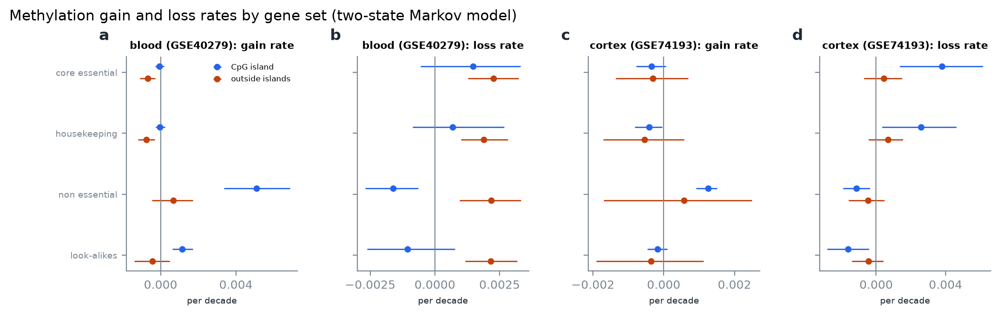

<!--
DECISION FOR THE AUTHORS (title): the old working title "Epigenetic clocks tick where chromatin lets them" is not
proposed. Its first half is refuted by the project's own clock tests (clocks read directed change, not the undirected
drift the shield acts on; CLAIMS C8), and the corrected measure shrinks the chromatin share in cortex to a quarter to
a half. The title below states what the corrected results support. Alternatives: "A matched measure of the
essential-promoter shield against age-related methylation drift"; "Faster demethylation shields essential promoters
from methylation drift across mammals".
-->

# Essential gene promoters are shielded from age-related DNA methylation drift by chromatin and faster demethylation

<!-- Author list and affiliations are for the authors to fill. -->
Anton Kulaga, …

## Abstract

Age-related DNA methylation drift is often modelled as uniform noise, and qualitative work has suggested that
housekeeping and highly connected genes are spared from it. We quantified this protection, which we call the
shield, by comparing CpGs in promoters of essential and housekeeping genes with CpGs of the same CpG-island status
and starting methylation level (look-alikes). Using relative entropy from the young state as the drift measure, essential
promoters drift less than matched CpGs in human blood (−0.15 SD for housekeeping genes), cortex (−0.06 SD),
most GTEx tissues, renewing (but not most post-mitotic) mouse tissues, cultured cells and 89 % of 139 species-tissue groups of 65 mammals. The gap is
not produced by the matching (200 placebo gene sets), blood-cell composition, probe design or preprocessing from raw
IDATs, and survives one false-discovery correction over 7,626 tests. Kinetically, essential island promoters gain
methylation no faster than look-alikes but, in pooled fits, lose it faster, and so rest lower; the faster loss persists within active-TSS chromatin.
In mouse brain, heterozygous Tet3 loss made essential promoters gain methylation against look-alikes and weakened the shield; Tet1 knockout did not. Reference chromatin
states account for 83-91 % of the gap in blood and a quarter to a half in cortex. Within one person over time, housekeeping CpGs change less in direction than look-alikes. The shield showed
no detectable sign of selection among cells in culture or blood, though the estimates are imprecise, is not tuned to species lifespan, persists through transient reprogramming and
has no clear RNA counterpart. In one prospective cohort, drift at unprotected look-alike promoters was associated with
breast cancer diagnosed years later (odds ratio 1.44 per SD with cell mix, chip and mean methylation held, on the authors' processed data); on the same arrays rebuilt from raw files the unadjusted association held (1.84) but the adjusted one did not (1.11, 0.69-2.18), so the lead cannot yet be separated from global methylation and cell mix and needs replication.

## Introduction

DNA methylation changes with age across mammalian tissues (Lu et al. 2023), and clocks built from a few hundred CpGs predict
chronological age closely (Horvath 2013; Hannum et al. 2013). Meyer and Schumacher (2024) showed that random
maintenance errors at sites bounded between 0 and 100 % methylation are enough to produce an age predictor. Their
basic model gives every CpG the same maintenance efficiency, although they also fitted site-specific rates estimated from data. Whether drift is the same at every CpG is an old question.
Teschendorff, West and Beck (2013) suggested that genes doing core housekeeping functions are more protected from drift.
West, Widschwendter and Teschendorff (2013) showed that age-associated drift falls preferentially on genes of low connectivity in the protein interaction network, sparing highly connected ones.
Day et al. (2013) linked age-related methylation change to tissue expression and chromatin, and age-related gain and variability of methylation
at Polycomb targets are well established (Teschendorff et al. 2010; Rakyan et al. 2010; Slieker et al. 2016).

The idea that essential genes are protected is therefore not new; it has lacked a quantitative
measurement that separates a gene set's own behaviour from the properties that travel with it. Essential promoters
are mostly unmethylated CpG islands: in our 27k reference set, 93 % of core-essential CpGs sit in islands near 0 %,
against 33 % of non-essential CpGs. A site near 0 % cannot drift down and moves differently from a site at 50 %,
whatever gene it belongs to. A comparison that does not match on island status and starting level measures mostly
that difference.

Two broad explanations of a real shield make different predictions. Selection among cells would purge cells that
corrupt an essential promoter; it needs cell turnover and should accumulate with divisions. Chromatin maintenance
would hold active promoters unmethylated in every cell, divide or not; it should follow the tissue's own chromatin
and act on a fixed share of the errors. A third possibility emerged while this work was in progress: Krepelova et
al. (2025) showed that age-related drift in the mouse intestine is driven by impaired TET activity, arises
cell-intrinsically in stem cells and spreads through crypt clonality. That finding points to the removal side of methylation turnover.

Here we measure the shield with a matched design across human and mouse tissues, cultured cells, read-level
bisulfite data and 65 mammal species, and test it against placebo gene sets, cell composition, probe design,
preprocessing and multiple testing. As the drift measure we use relative entropy from the young state, which counts a
move up or down alike. An audit during the work replaced binary entropy, which counts a loss of methylation at a
low-methylated site as a gain in order; because essential promoters turned out to lose methylation faster than
matched CpGs, the corrected measure gives roughly half of the entropy sizes, and all sizes reported here use it. We
then ask how the shield is produced, whether it is visible within one person over time, what it is not, and whether
drift outside it carries health information.

## Results

### Essential promoters drift less than matched CpGs in human blood and cortex

**In blood and cortex, CpGs in essential and housekeeping promoters drift less with age than CpGs of the same island
status and starting level.** We compared every promoter CpG of three gene sets (core-essential genes from CRISPR
screens, broadly expressed housekeeping genes, and non-essential genes) with CpGs in the same stratum of island
status and young-adult methylation decile (matched CpGs, or look-alikes), and expressed the difference in standard deviations (SD) of the drift
measure across CpGs (Methods). The drift measure is the age slope of each CpG's relative entropy from the young state,
which counts a move up or down alike.

In 656 blood donors aged 19-101 (Hannum et al. 2013), housekeeping promoter CpGs drifted 0.15 SD less than matched
CpGs and core-essential CpGs 0.09 SD less; non-essential CpGs drifted 0.13 SD more (all permutation p ≤ 0.001;
Fig. 1a). In prefrontal cortex of 213 adult controls (Jaffe et al. 2016), the housekeeping and core-essential gaps
were −0.06 and −0.07 SD, and non-essential CpGs did not differ from their look-alikes (−0.00, p 0.94). The
housekeeping gap was larger in blood than in cortex by 0.09 SD (95 % interval −0.19 to −0.02); for core-essential
genes the difference was not resolved (−0.02, −0.09 to +0.04; Fig. 1b). Other drift measures gave the same signs: the absolute
age slope of the mean (blood housekeeping −0.16 SD, cortex −0.05) and between-person dispersion (−0.29, −0.07).

In blood and four brain regions from the same donors (Lunnon et al. 2014; 71-80 donors per tissue), between-person
dispersion was lower at housekeeping promoters than at matched CpGs in every tissue (blood −0.15 SD, brain regions
−0.04 to −0.07), and blood exceeded each brain region by 0.07-0.10 SD, every interval excluding zero (Fig. 1c, d).
A per-person version of the comparison (Methods) found the same donor's blood more shielded than each brain region
in 86-91 % of donors.

**Figure 1. Essential and housekeeping promoters drift less than matched CpGs in human blood and cortex.** (a) Set
minus matched CpGs (same island status and young-level decile), in SD of four drift measures (entropy slope,
dispersion slope, absolute age slope, relative-entropy slope "kl slope"), Hannum blood (656 donors) and Jaffe cortex
(213 adult controls); 95 % donor-bootstrap intervals. (b) Blood minus cortex for each set and measure. (c) Same
donors (Lunnon): between-person dispersion gap in blood and four brain regions. (d) Blood minus each brain region.
Sizes in the text are the relative-entropy rows ("kl slope"); binary entropy overstates the gap. In (b), grey marks a difference whose interval includes zero.

### The gap is not made by the matching, the cell mix, the array or its preprocessing

**Placebo gene sets, held cell fractions, probe design and reprocessing from raw IDATs leave the gap in place.**
We drew 200 random gene sets of the same sizes from genes outside all three sets and ran them through the same
matching on all autosomal promoter CpGs (192,719 in blood, 192,998 in cortex). Placebo sets came out at or slightly
above zero (means +0.01 to +0.05 SD); none of 200 draws reached any essential set's gap, in blood or cortex, on any
of four measures (Fig. 2). Measured from the placebo mean, the blood housekeeping gap is −0.143 SD against +0.019
(95 % of placebos −0.001 to +0.036) and the cortex gap −0.053 against +0.013 (−0.001 to +0.028).

Holding 11 of 12 reference-based blood-cell fractions (EpiDISH; Houseman projection) as covariates of every age
slope left the blood housekeeping gap unchanged on relative entropy (−0.152 → −0.152 SD) and on the absolute age
slope (−0.159 → −0.177). Only the dispersion gap shrank, by a third (−0.29 → −0.20), as expected when people differ
in cell mix (Supplementary Fig. S5). In sorted CD14+ monocytes of 1,202 people (MESA; Reynolds et al. 2014), the housekeeping gap was −0.10 SD; in CD4+ T cells of
214 people it was small (−0.015 SD, p 0.005; Supplementary Fig. S10). The shield is therefore present inside a single cell type, but its
size varies between cell types.

Adding probe design to the matching changed no sign, masking unreliable probes moved no essential-set gap by more
than 0.012 SD, and rebuilding Jaffe's cortex series from its raw arrays did not weaken the gap. On the same 208 donors and the
89,446 CpGs measured in every donor by every route, R SeSAMe and methylprep agreed within 0.004 SD, and both
strengthened the gap over the deposited betas: housekeeping relative entropy −0.064 (95 % interval −0.091 to
−0.034) deposited against −0.081 (−0.125 to −0.046) rebuilt, spread −0.072 against −0.119 (paired difference
−0.047, −0.081 to −0.003; Supplementary Note 3; Supplementary Figs. S12, S13). Judging from this rebuild, a gap's
size carries a few hundredths of an SD of preprocessing uncertainty, in the direction of a weaker gap in the
deposited data.

In whole-genome bisulfite reads (Loyfer et al. 2023), the share of discordant reads rose more slowly with age at
housekeeping and core-essential promoters than at look-alikes, in white blood cells of 23 donors (−0.059, −0.034 SD)
and within 27 purified cell-type groups (−0.060, −0.029; all p ≤ 0.002; Supplementary Fig. S11). The shield is therefore not an averaging artefact of
arrays.

Finally, we pooled every raw p-value in every result table of the project (7,626 tests in 53 output folders) and
applied one Benjamini-Hochberg correction. Of these, 3,662 survived; the largest surviving p was 0.024. Every shield
gap survived (Supplementary Fig. S1).

**Figure 2. Placebo gene sets do not produce a shield.** For each gene set, 200 random gene sets of the same size,
drawn from genes outside all three sets, were passed through the same
island × young-level matching in (a) Hannum blood and (b) Jaffe cortex. Grey: mean and central 95 % of the 200 placebo gaps; blue: the real set's gap, for core-essential, housekeeping and non-essential genes on four drift measures.

### The shield across tissues, platforms and species

**The shield is present in most tissues and species tested, and on the corrected measure it is ordered by cell
turnover in mouse.** In nine GTEx tissues on the EPIC array (Oliva et al. 2023; 47-224 donors per tissue, ages in decade bins), the housekeeping gap was −0.14 SD
in whole blood, −0.19 in colon, −0.09 in lung and kidney, about 0 in skeletal muscle (−0.005) and testis (−0.002; Supplementary Fig. S8). On
binary entropy, breast and ovary were as weakly protected as muscle. Which tissues lack the gap does not
follow turnover in humans: testis renews fastest.

On the mammalian array, the corrected measure separated 11 tissues of the same male C57BL/6 mice sharply (GSE279437;
Huang et al. 2025). The mice were the untreated young and aged controls of an exenatide and rapamycin study, compared as aged minus young because GEO gives no numeric ages. The housekeeping gap was negative in the three renewing tissues and in kidney and liver (−0.05 to −0.19 SD) and
positive in four of five post-mitotic tissues and in adipose tissue (+0.03 to +0.09); the hypothalamus, with four
aged controls, was the exception (−0.08; values per tissue in Supplementary Note 3). Renewing tissues (blood cells, colon, spleen) minus post-mitotic tissues was −0.19 SD (−0.45 to −0.07; Supplementary Fig. S6), and slowly renewing liver, kidney and adipose tissue minus post-mitotic −0.10 (−0.20 to −0.02). Neither survives holding array chip. Aged and young controls shared no chip in spleen and adipose and one in colon and kidney, so in those tissues age cannot be separated from chip (Supplementary Note 3). Among animals on chips shared by both ages, with a chip intercept, the two contrasts were +0.02 (−0.06 to +0.19) and +0.03 (−0.04 to +0.18); white blood cells, the one renewing tissue left, turned from −0.08 to +0.04. On the same tissues without the chip terms the renewing contrast was −0.13 (−0.94 to +0.08), so losing tissues widens the interval and holding chip moves the estimate to zero. In post-mitotic tissues, essential
promoters still shifted their mean less (|mean change| −0.05 to −0.09 SD) but scattered more between animals. By
reduced-representation bisulfite sequencing (RRBS), which covers far more promoter CpGs, cortex kept a small shield (−0.06 SD, interval excluding zero) and heart
−0.07, against −0.22 in liver and −0.14 in lung (Meer et al. 2018; about 20 mice; the heart, liver and lung intervals
include zero). Other RRBS series gave −0.03 (adipose) to −0.21 SD (lung) in six tissues (Thompson et al. 2018) and −0.30
in whole blood (Petkovich et al. 2017), and the mammalian array gave −0.32 in BXD liver (Mozhui et al. 2022). Meer's four tissues and the array thus rank the shield by turnover, although in Thompson's six tissues muscle (−0.08) matched blood (−0.08). Meer's RRBS and the array disagree on whether post-mitotic tissue keeps a little of
the shield or none.

Culture follows the shield through cell divisions, along which selection among cells should accumulate
(Introduction). In seven primary human cell lines passaged to senescence (Endicott et al. 2022), with the
replicate-culture noise floor removed, set CpGs drifted about half as much as matched CpGs once drift was well above the floor. The change of this
share with population doublings was −0.14 per 10 doublings (95 % interval −0.33 to +0.06, seven lines; negative means stronger protection; one line reached 136 doublings),
and −0.055 (−0.21 to +0.10, five lines) in a second study (Sturm et al. 2023; Supplementary Fig. S14). Neither differs detectably from zero, but the intervals also admit changes of the size selection could produce, so they do not show the share to be constant. With batch intercepts the first estimate is −0.14 (−0.34 to +0.05); in the second, plate adjustment is possible in four lines, which give −0.003 unadjusted and +0.003 adjusted (intervals about ±0.08), and all five of its baseline lines used a pooled noise floor. Rebuilt from raw IDATs and scored on the same
samples, Endicott's lines lose their shield at the reference (housekeeping coupling −0.20 deposited, −0.00
rebuilt) and the change per 10 doublings becomes −0.18 (−0.39 to +0.04), the direction selection predicts; Sturm's
four lines with enough samples keep their shield (−0.37) and show no change (−0.025, −0.08 to +0.03). The culture
test is therefore sensitive to processing and does not separate the two accounts.

Across mammals (Mammalian Methylation Consortium, GSE223748; Lu et al. 2023; Haghani et al. 2023), 139
species-tissue groups of 65 species had at least 15 animals spanning 15 % of the species' maximum lifespan. The
housekeeping gap was negative in 89 % of groups (mean −0.13 SD; Fig. 3 draws the same groups on binary entropy and dispersion). Conserved array CpGs at essential promoters
sit near 0 %, where drift is floored; with only CpGs whose young level lies between 10 and 90 %, the gap stayed
negative in 73 % of groups (−0.10 SD).

**Figure 3. The shield across 65 mammals.** (a, b) Housekeeping minus look-alike gap per species-tissue group against
log10 maximum lifespan, on the binary-entropy and dispersion slopes (139 groups; Mammalian Methylation Consortium array); the relative-entropy share quoted in the text (89 % of groups negative) is not drawn. Below zero, housekeeping CpGs drift less than look-alikes.
(c) Change of the gap per log lifespan, weight and tissue held (95 % interval). The all-CpG relative-entropy
coefficient (+0.032, p 0.04) vanishes off the 0 % floor (+0.004, p 0.84; Supplementary Fig. S7).

### Essential promoters lose methylation faster and rest lower

**Essential island promoters gain methylation no faster than look-alikes but lose it faster, so they rest at a lower
level.** Binary entropy assumes every site drifts toward 50 %. To read direction, we fitted the two-state model in which a
site gains methylation at rate k_gain and loses it at rate k_loss, relaxing toward its own resting level
z = k_gain / (k_gain + k_loss) (Methods). Pooled per gene set in island promoters, the gain rate of core-essential and
housekeeping CpGs in blood was 0.0012 per decade lower than look-alikes' (95 % −0.0017 to −0.0008), and their loss
rate higher (core-essential +0.0025, +0.0012 to +0.0037; housekeeping +0.0018, +0.0009 to +0.0026). In cortex the
gain rates hardly differed (−0.0002) and the loss rates were higher (+0.0054, +0.0034 to +0.0077; +0.0042, +0.0025
to +0.0060). Non-essential island promoters showed the opposite: faster gain (blood +0.0039, cortex +0.0014; Fig. 4).

Per CpG, matched on island status and young level, the fitted resting level was lower at essential promoters (blood
−0.24 SD core-essential, −0.33 housekeeping; cortex −0.08, −0.15) and closer to where the site started (blood −0.28,
−0.42; cortex −0.03, −0.11; p ≤ 0.02). Per CpG, the loss rate was higher at essential promoters in blood (+0.07 core-essential, +0.11 housekeeping SD) but not in cortex (−0.02 and −0.02; p 0.24 and 0.02), where only the pooled fit shows faster loss. The fits identified a resting level for
76-84 % of CpGs.

To ask whether this is only a property of active chromatin, we refitted the rates on CpGs in the active-TSS state
of each tissue's own reference epigenome (set and look-alikes alike). Within active TSS, essential island promoters
still lost methylation faster than other active promoters: blood core-essential +0.0063 per decade (+0.0031 to
+0.0097), housekeeping +0.0015 (+0.0001 to +0.0034); cortex +0.0070 (+0.0041 to +0.0097) and +0.0057 (+0.0034 to
+0.0083). The lower resting level, by contrast, was largely chromatin: adding the state to the per-CpG strata shrank
it by about four fifths in blood (housekeeping −0.335 → −0.060 SD; core-essential −0.243 → −0.062) and by half in cortex
(housekeeping −0.145 → −0.071).

**Figure 4. Gain and loss rates by gene set.** Pooled two-state model fits in Hannum blood (a, b) and Jaffe cortex
(c, d): age slope regressed on young level per set, giving the gain rate (intercept) and loss rate, for CpG-island
(blue) and non-island (orange) promoter CpGs of each set and of look-alikes. Rates are fitted estimates and can fall below zero; the text compares each set with its look-alikes. Per decade; 95 % intervals from 200
donor resamples.

### Losing Tet3, not Tet1, weakens the shield in mouse brain

**Heterozygous loss of Tet3 weakens the shield in cortex and striatum, while Tet1 knockout strengthens it.** If faster
removal maintains the shield, losing the remover should make essential promoters gain methylation and lose their
advantage. We scored the consortium's Tet3 heterozygous mice against eight same-age wild types that
shared their array chips (GEO does not record litters) (8 against 8 per tissue). For housekeeping genes, the per-animal shield share F (set deviation as a share of look-alike deviation from the
controls; Methods) rose toward zero by +0.17 in cortex (p 0.006) and +0.25 in striatum (p 9·10⁻⁶). Essential promoters gained methylation against their look-alikes (signed shift S
+0.012 and +0.014), also with each animal's array compression held fixed (Supplementary Note 3). Drift at look-alike
CpGs (B, their deviation from the controls) also rose against the same-chip wild types (housekeeping look-alikes, B +0.009 in cortex, p 0.0008, and +0.005 in striatum, p 2·10⁻⁵, on control means of 0.021 and 0.022). Part of the rise in F therefore comes from its denominator; the signed shift S does not depend on it. The samples are bulk cortex and striatum, so the
change cannot be assigned to neurons: glia, some of which divide, and a shift in the neuron-glia mix were not held.

Tet1 knockout and Tet1 catalytic-dead cortex (Foong et al. 2024; eight per genotype) did the opposite. Both drifted
more overall (look-alike drift +0.03 to +0.04), but essential promoters kept or strengthened their shield (F −0.11 to
−0.17, p ≤ 0.014) and lost methylation against look-alikes (S −0.021 and −0.018, p < 10⁻⁷). The remover at essential
promoters in brain tissue is therefore consistent with Tet3, whose full-length CXXC isoform binds unmethylated CpGs and sits at transcription start sites in neuronal cells (Jin
et al. 2016), and not with Tet1. These are single studies on different arrays (Tet3 heterozygous on the mammalian array, Tet1 homozygous on
the mouse array), each with eight mutants per tissue, and knockouts show a state, not a rate. The result agrees with
Krepelova et al. (2025), who found impaired TET activity driving drift in the mouse intestine; our data add
that the effect falls on essential promoters specifically, against same-chip wild types (Supplementary Figs. S3, S4).

Because F is a ratio, a perturbation of the look-alikes moves it as much as one of the set, and two other
perturbations act on the look-alikes instead. A DNMT3A gain-of-function mutation (W326R; Sarni et al.
2026), which retargets methylation to Polycomb-marked regions (Heyn et al. 2019), moved essential sets' look-alikes
(F about −0.6 in bone marrow, intestine and liver). Children with constitutional variants in chromatin writers
(NSD1, EZH2, KMT2D, CHD7) drifted more while keeping the shield share (Supplementary Note 3; Supplementary Fig. S21).

### Chromatin accounts for most of the shield in blood and less in cortex

**Matching on the tissue's own reference chromatin state removes 83-91 % of the blood gap and a quarter to a half of
the cortex gap.** We added each promoter CpG's 15-state chromHMM state (Roadmap Epigenomics Consortium 2015) to the matching. In blood,
80-85 % of essential and housekeeping CpGs sit in active TSS states against 38 % of background CpGs. On relative
entropy, blood's own state (E062 mononuclear cells, or E030 neutrophils) removed 83-91 % of the housekeeping gap;
cortex's state removed only 28 % of blood's gap (Fig. 5). The reverse did not hold: blood's state removed as much of the cortex gap as cortex's own (29 % against 25 %). In each of Lunnon's four brain regions it also removed more of the dispersion gap than the brain state did. In cortex, the bulk state removed 25 % and sorted neuron
and glia accessibility (Rizzardi et al. 2019) together with the state 56 %. On dispersion, the shares were 83-88 %
in blood and 22-46 % in cortex.

To test for a remainder beyond chromatin, we regressed each promoter CpG's drift on its gene's DepMap essentiality among broadly
expressed genes, holding chromatin state, expression in the tissue and expression breadth. On relative entropy no
remainder was left in blood (−0.007 SD per unit, −0.021 to +0.008, p 0.33); in cortex a small one was (+0.022,
+0.009 to +0.040; Supplementary Fig. S15). Matching on chromatin may be partly circular, because active chromatin and an unmethylated
promoter can both be outcomes of the same protection, and the reference epigenomes come from other people.

Where drift concentrates is the mirror image of the shield. Among the 5 % of autosomal CpGs whose between-person
spread rises fastest with age, Polycomb-repressed CpGs in blood carried 2.1 times their expected share (bivalent promoters 2.0×, bivalent
enhancers 1.5×), active states a fifth to three fifths of theirs, and housekeeping and core-essential promoters 0.42×
and 0.46× (Supplementary Fig. S2). In cortex every class lay between 0.71× and 1.32×, the largest deficit again at
essential promoters. Rising spread in cortex is close to uniform; in blood it is concentrated in the known Polycomb
programme and kept out of active chromatin, of which the shield is the essential-gene side.

**Figure 5. Chromatin matching.** Housekeeping, core-essential and non-essential gaps (SD) matched on island × young
level, then with the tissue's own Roadmap chromHMM state, another tissue's state, and (cortex) sorted neuron and glia
accessibility. (a) State
composition of set and background promoter CpGs in blood (E062). (b) Hannum blood and Jaffe cortex, dispersion slope; (c) Lunnon's tissues, between-person dispersion; (d) share of the housekeeping dispersion-slope gap removed. 95 % intervals resample the set's genes. Panels b-d show the dispersion measures; the relative-entropy shares in the text (blood 83-91 %, cortex 25 % and 56 %) differ from them and are listed in Supplementary Table S2.

### The shield within one person over time

**Within the same people followed for up to 20 years, housekeeping CpGs change less in direction than look-alikes.**
SATSA (E-MTAB-7309; Wang et al. 2018) drew blood from the same Swedish twins up to eight times. The deposited betas had cell counts and
batch regressed out, and on them the cross-sectional shield almost vanished (|mean change| +0.00 SD). We therefore rebuilt the
series from its 1,072 raw arrays (444 people, 628 consecutive within-person pairs). Each person's change between two
draws was split into the change everyone makes and the person's own departure from it (Methods). Housekeeping CpGs
changed less in direction than look-alikes (−0.14 SD, p 0.001; deposited betas −0.002, p 0.67), sat closer to the
measurement floor (−0.073) and diverged slightly more slowly (−0.014, p 0.016; Fig. 6). Across people, the rebuilt
series showed a cross-sectional shield like other blood cohorts (relative entropy −0.23 SD, dispersion −0.36,
|mean| −0.11). On the deposited betas, the per-person shield share F fell by 0.14 per decade within a person
(−0.23 to −0.05), matching the between-person slope (−0.13). On the rebuilt betas it fell by 0.08 (−0.18 to +0.02), against
−0.26 between people. On the deposited series, a cohort or survivor effect is therefore unlikely to explain the growth of the share with age, although the
rebuilt series does not resolve the within-person decline. Processing and the pairs retained both differ between versions, so the size within a person is not
settled; its direction agrees with every cross-sectional cohort.

**Figure 6. SATSA rebuilt from IDATs.** (a) Within-person gaps in the series rebuilt from raw arrays: core-essential, housekeeping and non-essential CpGs minus look-alikes (SD) for directed change, divergence per year and the measurement floor (permutation p in the text). (b) Per-person drift B, shield share F and signed shift S per decade of age, within a person (circles, 95 % interval) and between people (squares), rebuilt series.

### What the shield is not

**The shield behaves like a property of each cell's chromatin and methylation turnover, not of competition among
cells, lifespan, reprogramming state or transcription.**

*Selection among cells.* In culture the shield's share of drift changed by −0.14 (−0.33 to +0.06) and −0.055 (−0.21 to +0.10)
per 10 doublings (above): no detectable growth, but intervals that do not exclude growth of the size selection might give.
Selection would make the share grow, although steady selection per doubling could also keep it constant in long-term cultures that lose clonal diversity,
as mesenchymal stromal cells and iPSCs do (Hollmann et al. 2020). Clonal haematopoiesis, a form of selection in living
blood, did not move the shield (64 patients of Basrai et al. 2026, any clone, DNMT3A or TET2; |F| ≤ 0.022, p ≥ 0.15), although clones
without allele fractions are diluted in bulk blood. Across a stem-cell transplant (92 transplants, up to 23 years; Holland 2024),
essential and non-essential promoters moved alike (F −0.058, −0.039, −0.057 for core-essential, housekeeping and
non-essential): a bottleneck did not protect essential promoters specifically (Supplementary Fig. S17). Caloric restriction, which slows
haematopoietic proliferation, weakened the shield in one mouse blood series, by less once blood-cell chromatin
openness was matched; the effect was absent in liver, and a second, short series in young mice pointed the other way without reaching significance once
the test reassigned treatment within array chips and refitted each animal's reference (core-essential shield share
−0.09, p 0.16; Supplementary Note 3); its start and end controls sat on different chips, so its 12-week aging
contrast cannot be told from chip. The turnover ordering in mouse (above) is the one observation in this family that a selection
account would predict; a division-dependent removal process predicts it too.

*Tuning to lifespan.* Long-lived species drift less at unprotected CpGs, as found for epigenetic disorder and methylation rates
(Bertucci-Richter et al. 2023; Crofts et al. 2024): the look-alikes' dispersion rate fell as
about lifespan^−1.15 (weight and tissue held). But the gap itself did not track lifespan off the 0 % floor (relative
entropy +0.004 per log-unit, 95 % interval −0.036 to +0.044, p 0.84). A phylogenetic generalised least-squares fit, run on the binary-entropy and dispersion slopes, gave no lifespan relation
either. A statement we made earlier, that the shield's share of drift grows with lifespan, rested on binary entropy
and does not hold on the corrected measure (+1.43, p 0.23); it is withdrawn. This agrees with Crofts et al. (2026),
who explain lifespan scaling of methylation rates by stem-cell dynamics rather than maintenance efficiency.

*Restoration by reprogramming.* Transient OSKM reprogramming of fibroblasts from three donors (Gill et al. 2022;
rebuilt from IDATs) about doubled promoter drift against cells that failed to reprogram (housekeeping look-alike drift
+0.045, p 0.0002), and essential promoters' share of it did not change detectably (F −0.016, p 0.25; core-essential −0.015, p 0.35; Supplementary Fig. S16). A large
reset of the methylome respected the shield, as aging does; the series has no young donors, so restoration toward a
young shield is untested.

*A transcriptional counterpart.* Housekeeping genes gained less between-individual expression spread with age than
expression-matched genes outside brain in a large mouse atlas, but the rat signal was weak, GTEx showed no turnover
effect, and in Tabula Muris Senis bulk RNA the gap's interval included zero in 15 of 17 organs. In the same GTEx
donors, unusual promoter methylation was barely reflected in expression (mean |r| above a permutation null by
0.015-0.022). Chromatin accessibility gave no clean readout either (Supplementary Note 3).

*What clocks read.* Clocks read directed change and are largely blind to the shield: retrained on simulated change,
they keep 70-80 % of their accuracy from each CpG's direction alone and 0-10 % from undirected noise
(Supplementary Note 3).

### A lead: drift at unprotected promoters and incident breast cancer

**In one prospective cohort, drift at look-alike promoters in blood predicted breast cancer diagnosed years later.**
EPIC-Italy (GSE51032; Durso et al. 2017) holds blood drawn at enrolment from 845 people, 421 later diagnosed with cancer (235 breast,
166 colorectal) and 424 without a cancer diagnosis (340 women, 84 men). Cases were diagnosed a median 5.4 years after the draw (range 0.02-14.4), and 169 and 115 of the 235 breast cancers more than 2 and 5 years after it. Per person we scored drift B at look-alike promoter CpGs (each person against everyone else), the
shield share F and eight published clocks. With age and sex held, B predicted breast cancer (odds ratio per SD 1.43,
1.19-1.71, p 10⁻⁴), and more strongly for cases diagnosed over 2 years after the draw (1.59, 1.31-1.93), the
opposite of what a tumour present at the draw would produce. In a women-only model with B centred within chip, the odds ratios were 1.62 over 2 and 1.66 over 5 years. With mean methylation, 11 cell fractions and
chip held, the odds ratio for cases diagnosed over 2 years later was 1.44 (1.17-1.76, p 6·10⁻⁴; Fig. 7); cases were balanced
over the 72 chips. B kept 1.44 with DunedinPACE (Belsky et al. 2022) and PhenoAge (Levine et al. 2018) in the model, and was uncorrelated with DunedinPACE
(r 0.02). The clocks' own signals did not survive adjustment (DunedinPACE for breast 1.21 → 1.04), and B had no
colorectal signal once adjusted. The shield share F did not predict cancer (0.95-1.11). Of 168 effects in this
analysis, only the eight breast-cancer B variants passed a 5 % false discovery rate, and they survived the
project-wide correction. Rebuilt from the raw arrays with one SeSAMe recipe and analysed as a matched case-control
(women, age within 3 years, same chip first; 163 sets for cases over 2 years), B kept its age-adjusted association
(1.84, 1.37-3.48) but lost the adjusted one (1.11, 0.69-2.18), while the shield share F became protective (0.69,
0.49-0.95). On the authors' processed data the matched estimates were 1.71 and 1.76. Which preprocessing is right for
this question is open; the lead is therefore weaker than the processed data suggested.

In childhood-cancer survivors (SJLIFE, 277 deaths among 4,518), B added nothing to DunedinPACE for death (1.01; Supplementary Fig. S20), so it
is not a general mortality marker. Genome-wide hypomethylation before breast cancer reported in EPIC-Italy (van
Veldhoven et al. 2015) did not replicate in NOWAC; B survives adjustment for mean methylation, but a cohort-specific
finding remains possible until a second prospective cohort is tested.

**Figure 7. Incident cancer in EPIC-Italy.** Odds ratio per SD of the shield share F, look-alike drift B and the
signed shift S (core-essential and housekeeping sets) and of published clocks, for any cancer (421 cases), breast
(235) and colorectal cancer (166). Circles: all cases, age and sex held. Squares: cases diagnosed over 2 years after
the draw (331, 169 and 146 cases), with mean methylation, 11 blood-cell fractions and chip held. 95 % intervals; log scale.

## Discussion

We set out to measure, rather than assert, the protection of essential genes from age-related methylation drift.
With island status and starting level matched, essential promoters drift less than look-alike CpGs in most tissues
and species tested, by a modest margin (about 0.15 SD in blood, 0.06 SD in cortex, near zero in some tissues and cell
types) that the matching, cell composition, probe design and normalisation do not produce.

The qualitative claim belongs to Teschendorff, West and Beck (2013) and West et al. (2013), and Day et al. (2013)
already linked age-related methylation change with tissue-specific expression and chromatin state. Our contribution is quantitative and mechanistic. First, the
matched design gives a size, with intervals, that can be compared across tissues and species and checked against a
null. Second, the kinetic reading: essential island promoters gain methylation no faster than look-alikes but remove it
faster, which keeps them at a lower resting level. This faster
loss persists among promoters that share the active-TSS state, which is the first sign of something beyond the
chromatin label a reference map records. Third, a genetic test: halving Tet3 in mouse brain makes essential
promoters gain methylation and weaken the shield against same-chip wild types, while losing Tet1 does not. Krepelova et al.
(2025) showed that impaired TET activity drives intestinal drift; our data are consistent with it and specify that
the effect falls on essential promoters in bulk brain tissue.

Chromatin accounts for most of the shield in blood and for a quarter to a half in cortex. The binary-entropy
measure had overstated the cortex share and suggested an essentiality effect beyond chromatin in blood; on the
corrected measure the blood remainder is gone and the small remainder is cortex's. Where drift concentrates is the
mirror image: in blood the CpGs whose spread rises fastest are Polycomb targets, the known age-hypermethylated
programme (Teschendorff et al. 2010; Rakyan et al. 2010; Slieker et al. 2016). Calling blood drift "stochastic" is
therefore accurate only for the part outside that programme; in cortex rising spread is close to uniform.

We found no evidence that selection among cells is the main source, though these data do not exclude a contribution: the share shows no detectable change through many divisions in culture, with wide intervals,
survives reprogramming that acts in days, does not change specifically across a transplant bottleneck or with clonal
haematopoiesis, and is weakened in brain when Tet3 is halved. Nor is the shield tuned to species lifespan
once the 0 % floor is accounted for, in line with Crofts et al. (2026).

The EPIC-Italy lead is the result closest to human health, and the one with the least support: drift at unprotected look-alike
promoters, not the shield itself, predicted breast cancer diagnosed more than two years after the blood draw, and, in a women-only model, also more than five years after it. For the cases diagnosed over two years later it did so beyond cell
mix, chip, global methylation and two outcome clocks. One cohort and possible hormonal or reproductive confounding make it a hypothesis
for a second prospective cohort.

**Where prior work and our own data cut against us.** (i) On the mouse array,
the corrected measure, not adjusted for array chip, orders the shield by turnover: present in all three renewing tissues and in slowly renewing liver and kidney, reversed in four of five
post-mitotic ones and in adipose tissue. Our chromatin-maintenance reading predicted no dependence on turnover. Among animals on shared chips the
ordering disappears (+0.02, interval −0.06 to +0.19), so this array cannot say whether the shield follows turnover; RRBS in the same species
keeps a small shield in cortex and heart, and human GTEx tissues do not follow turnover. Should a chip-free design show the ordering, one reconciliation is that faster removal at essential promoters is partly passive, requiring replication to
dilute methylation, which would make the shield larger where cells divide without any selection; we have not tested
this. Vaidya et al. (2023) tie methylation entropy to stem-cell division across mouse tissues, which points the same
way. (ii) Matching on chromatin may be circular: an active, unmethylated promoter and its chromatin state may both be
outcomes of the same protection, and the reference epigenomes come from other individuals. (iii) Long-term cultures
can lose clonal diversity, as mesenchymal stromal cells and iPSCs do (Hollmann et al. 2020), and steady selection per doubling would also leave the share unchanged. (iv)
The Tet3 result is one study of 16 mice per tissue on one array; the Tet1 comparison uses another array and
homozygous mutants; and some weaker Tet3 contrasts did not survive the project-wide correction. (v) Seeboth et al.
(2020) found cell mix, body mass index, smoking and batch to confound per-person methylation outlier burdens; our within-sample
contrast removes about half of the slide-batch excess, not all, so batch must be held in every per-person use. (vi) Effects in the shield share of 0.02-0.1 are near the ±0.05 SD preprocessing
uncertainty of a gap, which is why we rebuilt three datasets from raw IDATs. Most deposited datasets were used as the
authors processed them, and comparisons are always within one dataset and platform. (vii) Read-level epiallele
entropy has not yet been recomputed under the corrected measure. (viii) Three of our
earlier statements did not survive the metric audit and are not made here: an essentiality effect beyond chromatin in
blood, a shield share growing with species lifespan, and a large shield in CD4+ T cells.

In sum, essential promoters are protected from age-related methylation drift by a modest, reproducible margin, held
by faster removal of methylation that is concentrated in, but not fully explained by, active chromatin, and that
depends in part on Tet3 in brain. Whether drift outside this protection marks disease risk is now a testable question.

## Methods

### Datasets

All data are public; Supplementary Table S1 lists every dataset with its accession, platform, whether deposited
or rebuilt values were used, and the analyses that read it. The main human cohorts are Hannum blood (GSE40279, 450k,
656 donors aged 19-101), Jaffe prefrontal cortex (GSE74193, 450k, 213 adult controls aged 21-85), Lunnon blood and
four brain regions (GSE59685), GTEx nine tissues (GSE213478, EPIC), SATSA (E-MTAB-7309), EPIC-Italy (GSE51032) and
SJLIFE (GSE314261); read-level WGBS is from GSE186458. Mouse and mammal data are the Mammalian Methylation Consortium
(GSE223748), Huang et al. 2025 (GSE279437), RRBS series GSE80672, GSE120132 and GSE121141, and BXD liver on the mammalian array
(GSE199979; Mozhui et al. 2022); Tet1 mutants are
GSE271375. Chromatin references are Roadmap 15-state chromHMM (E062, E030, E073) and sorted neuron and glia ATAC
(GSE96614). SHA-256 checksums of all 753 downloaded archive files are kept in the repository.

### Gene sets and promoter CpGs

Promoter windows, annotation sources, genome builds and the SATSA quality rules are given after Supplementary Table S1. Core-essential (CEGv2; Hart et al. 2017) and non-essential (NEGv1; Hart et al. 2014) genes are from the Hart lab's
CRISPR screen reference sets, matched by Entrez
ID; housekeeping genes from Eisenberg and Levanon (2013), matched by RefSeq accession, then symbol. Mouse genes were
reached through MGI orthologs. For the 450k cohorts each tissue used about 109,000 autosomal promoter CpGs: every
CpG in a promoter of a gene in the three sets (6,891 core-essential, 42,173 housekeeping and 4,945 non-essential in cortex; 6,884, 42,133 and 4,935 in blood) and a
fixed random background of 60,000 promoter CpGs. Placebo, hotspot and composition analyses used all autosomal
promoter CpGs. For DepMap essentiality we used the mean CRISPR gene effect (DepMap 24Q4 Public, CRISPRGeneEffect.csv) among genes at 1+ TPM in 50+ of 54
GTEx v8 tissues (gene median TPM).

### Preprocessing

Every array series with raw IDAT files on GEO is rebuilt with one pinned recipe, R SeSAMe 1.24.0 (R 4.4.3,
sesameData 1.24.0): `prepSesame("QCDPB")`, that is the quality mask, channel-switch inference, non-linear dye-bias
correction, pOOBAH detection masking and noob background correction (Triche et al. 2013; Zhou et al. 2017, 2018);
samples detected below 90 % are excluded and listed. Three series were first rebuilt with methylprep 1.7.1 in
SeSAMe-like mode; on Jaffe's cortex the two implementations agreed within 0.004 SD. Results from cohorts with no
raw IDATs on GEO (Hannum, Lunnon, GTEx, the sorted-cell MESA series, GSE41037 and the mammalian consortium's
superseries) rest on the authors' processing and are marked as not rebuilt wherever they are reported. No analysis pools datasets or
platforms. Technical covariates were removed in every age slope (blood: plate, site, sex, ancestry; cortex: plate,
sex, ancestry, neuron fraction; other cohorts as available). RRBS CpGs were kept when covered at least 10 times in 90 %
of a tissue's samples.

### Drift measures

For each CpG we fitted, with covariates, the age slope of (i) relative entropy from the young state, (ii) binary
entropy H(m) = −m log2 m − (1−m) log2(1−m), (iii) between-individual dispersion |residual| / sqrt(m̄(1−m̄)), and (iv)
the absolute age slope of the mean. Relative entropy is the Kullback-Leibler divergence KL(x ‖ m_young), in bits,
between a sample's methylation level x and the young reference level m_young at the same CpG, treated as Bernoulli
probabilities; its age slope ("kl_slope") is the headline measure. The young reference m_young is the mean of the youngest fifth of donors by age in each cohort; these donors stay in the slope fit, and the same reference sets the young-level deciles used for matching. Relative entropy counts a move up or down alike, assumes no
destination, weighs a move away from an extreme level more, as binomial sampling does, and is close to the squared
standardised deviation, so it carries both mean change and spread. Binary entropy was the first measure used; because
it reads a loss of methylation at a low-methylated site as a gain in order, it overstated the gaps
(Supplementary Note 1, Table S2). Every analysis whose headline rested on entropy was rerun with all four measures side by side
on the same seeds.

### Matched comparison

Each set's CpGs were compared with all other CpGs in the same stratum of CpG-island status (fixed by sequence) and
young-reference methylation decile; the set-minus-matched difference was averaged over strata weighted by the set's
count and divided by the measure's SD across CpGs. Significance came from 1,000 permutations of set labels within
strata, permuting CpGs (two-sided; smallest p 0.001). CpGs of one promoter are correlated, but these p-values treat CpGs as independent units; the placebo gene sets below give the corresponding test at the level of genes. Intervals came from 200 donor bootstraps, each resample divided by the full sample's
spread (an earlier version divided by each resample's own spread and drew intervals toward zero). For blood minus
brain, the two lifespan cohorts were resampled independently and Lunnon's tissues with the same resampled donors.
Probe design (type I/II), reference chromatin state, or cell-type accessibility quartiles were added to the strata
where stated. Effects across tissues and species were compared only on size-matched resamples where group sizes
differed (GTEx: 32 donors per resample). Tissues were grouped by cell turnover as renewing (mouse: white blood cells, colon, spleen; GTEx: whole blood, colon, testis), slowly renewing (mouse: liver, kidney, adipose; GTEx: lung, kidney, breast, prostate, ovary) and post-mitotic (mouse: skeletal muscle, heart, frontal cortex, hippocampus, hypothalamus; GTEx: skeletal muscle).

### Per-person scores

For a sample and a reference state m (the young controls, or the other people in the contrast), each CpG's deviation
is d = |x − m| / sqrt(m(1−m)). P is the mean d of a set's promoter CpGs minus that of matched CpGs in the same
sample; B is the matched (look-alike) deviation; F = P / B is the shield share (negative: the set deviates less); S is
the signed shift of set CpGs against look-alikes (positive: gained methylation). Reliability was estimated by
resampling the set's genes. Group differences in per-sample scores (consortium interventions including Tet3, Tet1, Dnmt3a, chromatin-writer syndromes) were estimated by ordinary least squares with group and covariates, with two-sided t-test p-values. In the reprogramming series, p came from permuting labels within donors. In culture, squared deviations from the earliest samples minus the replicate-culture
noise floor were used, and the gap was regressed on drift and drift × population doublings. Within SATSA, each
person's change between consecutive draws was split into the cohort-wide directed change and the person's departure
from it, whose square was regressed on the interval between draws (slope: divergence per year; intercept: measurement
floor). Within-person slopes of B, F and S carry intervals from 1,000 bootstraps that resample people. The within-person gaps' p-values come from 1,000 permutations of set labels among CpGs, and neither resamples twin pairs together.

### Gain and loss rates

In the two-state model a CpG gains methylation at rate k_gain and loses it at k_loss, relaxing toward
z = k_gain / (k_gain + k_loss). Pooled per set, the age slopes of donors outside the youngest fifth were regressed on
the young levels (youngest fifth): the intercept estimates k_gain and the negative slope k_gain + k_loss; sets were
compared with look-alikes of the same island status, with 95 % intervals from 200 donor resamples. Per CpG,
m(t) = z + (m0 − z) e^(−λt) was fitted with z in [0, 1] on a log grid of λ (z and m0 by linear least squares at each
λ); CpGs whose fit fixed λ (76-84 %) were compared within island × young-level strata. To hold chromatin, the pooled
fit was repeated on active-TSS CpGs (state 1_TssA of E062 or E073), and the per-CpG strata were extended with the state.

### Chromatin matching and essentiality gradient

Each promoter CpG received its tissue's Roadmap 15-state chromHMM state (blood E062, second blood reference E030,
cortex E073); for cortex, accessibility quartiles (or no peak) in sorted NeuN+ and NeuN− nuclei were added. The share
removed is 1 − (matched gap / island × level gap), with intervals from resampling genes. The essentiality gradient
regressed promoter CpG drift on DepMap gene effect with island status and level held, then chromatin state, then
expression level and breadth (200 gene resamples).

### Placebo sets, cell composition and multiple testing

Placebo sets drew random genes with a promoter CpG on the array and in none of the three sets, as many as each real set,
200 draws per set and tissue, and passed them through the same matching. Twelve blood-cell fractions per donor were
estimated with EpiDISH's cent12CT450k reference (Teschendorff et al. 2017; Luo et al. 2023) by Houseman projection
(Houseman et al. 2012), and 11 were added to the covariates of every
age slope. Where no reference exists, leading principal components of background CpGs were used, and only for
residual-based measures, since components orthogonal to age cannot change an age slope. A single Benjamini-Hochberg correction was applied over every
raw p-value in every result table (7,626 tests in 53 folders); tests overlap and are positively dependent, which the
procedure allows.

### Outcome models

Incident cancer (EPIC-Italy) and death (SJLIFE) were modelled by logistic regression per SD of each score, with age and
sex (SJLIFE: diagnosis and four treatment exposures), then with mean methylation over all array CpGs, 11 cell fractions
and the score centred within chip. Lag analyses restricted cases to diagnoses over 2 or 5 years after the draw. In EPIC-Italy, controls were the participants without a cancer diagnosis. As a check on the breast-cancer result, the models were also fitted in women only.

### Software and reproducibility

The analysis is a Python 3.13 package with dependencies pinned in its lock file (the IDAT reprocessing runs as a separate script under Python 3.11 with methylprep 1.7.1). Every figure and table is regenerated by one command
per figure with seed 42, except the joint outcome models of Supplementary Table S3, which were fitted from the per-person tables. It includes a reimplementation of Meyer and Schumacher's (2024) stochastic clock model, which
reproduces their noise-trained clock on blood (r 0.88 against 0.87). Published clock coefficients come from biolearn
at commit 0d714f5 (each file checked against its hash).

## Data and code availability

All datasets are public; accessions are listed in Methods and Supplementary Table S1, and Supplementary Table S3 traces each claim to its run and output table. Code, result tables and
figures are at https://github.com/longevity-genie/entropy-age (AGPL-3.0; ported functions of Meyer and Schumacher's
MIT-licensed code keep their attribution).

## References

Basrai S, et al. 2026. Blood-based epigenetic instability linked to human aging and disease. Nat Commun 17:2754. doi:10.1038/s41467-026-69430-z.

Belsky DW, et al. 2022. DunedinPACE, a DNA methylation biomarker of the pace of aging. eLife 11:e73420. doi:10.7554/eLife.73420.

Bertucci-Richter EM, Parrott BB. 2023. The rate of epigenetic drift scales with maximum lifespan across mammals. Nat Commun 14:7731. doi:10.1038/s41467-023-43417-6.

Browder KC, et al. 2022. In vivo partial reprogramming alters age-associated molecular changes during physiological aging in mice. Nat Aging 2:243-253. doi:10.1038/s43587-022-00183-2.

Catching A, et al. 2026. Single-nucleus multiome analysis in the human prefrontal cortex identifies gene expression and cis-regulatory elements associated with aging. Cell Rep 45:117110. doi:10.1016/j.celrep.2026.117110. Data: Zenodo, doi:10.5281/zenodo.18394349.

Chondronasiou D, et al. 2022. Multi-omic rejuvenation of naturally aged tissues by a single cycle of transient reprogramming. Aging Cell 21:e13578. doi:10.1111/acel.13578.

Crofts SJC, Latorre-Crespo E, Chandra T. 2024. DNA methylation rates scale with maximum lifespan across mammals. Nat Aging 4:27-32. doi:10.1038/s43587-023-00535-6.

Crofts SJC, et al. 2026. A unifying model of stem cell dynamics explains age-related methylation patterns across mammals. Nat Aging 6:1319-1329. doi:10.1038/s43587-026-01125-y.

Day K, et al. 2013. Differential DNA methylation with age displays both common and dynamic features across human tissues that are influenced by CpG landscape. Genome Biol 14:R102. doi:10.1186/gb-2013-14-9-r102.

Durso DF, et al. 2017. Acceleration of leukocytes' epigenetic age as an early tumor and sex-specific marker of breast and colorectal cancer. Oncotarget 8:23237-23245. doi:10.18632/oncotarget.15573.

Eisenberg E, Levanon EY. 2013. Human housekeeping genes, revisited. Trends Genet 29:569-574. doi:10.1016/j.tig.2013.05.010.

Endicott JL, et al. 2022. Cell division drives DNA methylation loss in late-replicating domains in primary human cells. Nat Commun 13:6659. doi:10.1038/s41467-022-34268-8.

Foong YH, et al. 2024. TET1 displays catalytic and non-catalytic functions in the adult mouse cortex. Epigenetics 19:2374979. doi:10.1080/15592294.2024.2374979.

Gill D, et al. 2022. Multi-omic rejuvenation of human cells by maturation phase transient reprogramming. eLife 11:e71624. doi:10.7554/eLife.71624.

Haghani A, et al. 2023. DNA methylation networks underlying mammalian traits. Science 381:eabq5693. doi:10.1126/science.abq5693.

Hannum G, et al. 2013. Genome-wide methylation profiles reveal quantitative views of human aging rates. Mol Cell 49:359-367. doi:10.1016/j.molcel.2012.10.016.

Hart T, et al. 2014. Measuring error rates in genomic perturbation screens: gold standards for human functional genomics. Mol Syst Biol 10:733. doi:10.15252/msb.20145216.

Hart T, et al. 2017. Evaluation and design of genome-wide CRISPR/SpCas9 knockout screens. G3 (Bethesda) 7:2719-2727. doi:10.1534/g3.117.041277.

Heyn P, et al. 2019. Gain-of-function DNMT3A mutations cause microcephalic dwarfism and hypermethylation of Polycomb-regulated regions. Nat Genet 51:96-105. doi:10.1038/s41588-018-0274-x.

Holland P. 2024. DNA methylation data of hematopoietic transplantation patients. Mendeley Data, version 1. doi:10.17632/j5krtjfj6y.1.

Hollmann J, et al. 2020. Genetic barcoding reveals clonal dominance in iPSC-derived mesenchymal stromal cells. Stem Cell Res Ther 11:105. doi:10.1186/s13287-020-01619-5.

Horvath S. 2013. DNA methylation age of human tissues and cell types. Genome Biol 14:R115. doi:10.1186/gb-2013-14-10-r115.

Horvath S, et al. 2018. Epigenetic clock for skin and blood cells applied to Hutchinson Gilford Progeria Syndrome and ex vivo studies. Aging 10:1758-1775. doi:10.18632/aging.101508.

Houseman EA, et al. 2012. DNA methylation arrays as surrogate measures of cell mixture distribution. BMC Bioinformatics 13:86. doi:10.1186/1471-2105-13-86.

Huang J, et al. 2025. Body-wide multi-omic counteraction of aging with GLP-1R agonism. Cell Metab 37:2362-2380.e8. doi:10.1016/j.cmet.2025.10.014.

Jaffe AE, et al. 2016. Mapping DNA methylation across development, genotype and schizophrenia in the human frontal cortex. Nat Neurosci 19:40-47. doi:10.1038/nn.4181.

Jin SG, et al. 2016. Tet3 reads 5-carboxylcytosine through its CXXC domain and is a potential guardian against neurodegeneration. Cell Rep 14:493-505. doi:10.1016/j.celrep.2015.12.044.

Krepelova A, et al. 2025. Iron homeostasis and cell clonality drive cancer-associated intestinal DNA methylation drift in aging. Nat Aging 5:2432-2448. doi:10.1038/s43587-025-01021-x.

Levine ME, et al. 2018. An epigenetic biomarker of aging for lifespan and healthspan. Aging 10:573-591. doi:10.18632/aging.101414.

Loyfer N, et al. 2023. A DNA methylation atlas of normal human cell types. Nature 613:355-364. doi:10.1038/s41586-022-05580-6.

Lu AT, et al. 2023. Universal DNA methylation age across mammalian tissues. Nat Aging 3:1144-1166. doi:10.1038/s43587-023-00462-6.

Lunnon K, et al. 2014. Methylomic profiling implicates cortical deregulation of ANK1 in Alzheimer's disease. Nat Neurosci 17:1164-1170. doi:10.1038/nn.3782.

Luo Q, et al. 2023. A meta-analysis of immune-cell fractions at high resolution reveals novel associations with common phenotypes and health outcomes. Genome Med 15:59. doi:10.1186/s13073-023-01211-5.

Meer MV, et al. 2018. A whole lifespan mouse multi-tissue DNA methylation clock. eLife 7:e40675. doi:10.7554/eLife.40675.

Meyer DH, Schumacher B. 2024. Aging clocks based on accumulating stochastic variation. Nat Aging 4:871-885. doi:10.1038/s43587-024-00619-x.

Morandini F, et al. 2024. ATAC-clock: an aging clock based on chromatin accessibility. GeroScience 46:1789-1806. doi:10.1007/s11357-023-00986-0.

Mozhui K, et al. 2022. Genetic loci and metabolic states associated with murine epigenetic aging. eLife 11:e75244. doi:10.7554/eLife.75244.

Oliva M, et al. 2023. DNA methylation QTL mapping across diverse human tissues provides molecular links between genetic variation and complex traits. Nat Genet 55:112-122. doi:10.1038/s41588-022-01248-z.

Petkovich DA, et al. 2017. Using DNA methylation profiling to evaluate biological age and longevity interventions. Cell Metab 25:954-960.e6. doi:10.1016/j.cmet.2017.03.016.

Rakyan VK, et al. 2010. Human aging-associated DNA hypermethylation occurs preferentially at bivalent chromatin domains. Genome Res 20:434-439. doi:10.1101/gr.103101.109.

Reynolds LM, et al. 2014. Age-related variations in the methylome associated with gene expression in human monocytes and T cells. Nat Commun 5:5366. doi:10.1038/ncomms6366.

Rizzardi LF, et al. 2019. Neuronal brain-region-specific DNA methylation and chromatin accessibility are associated with neuropsychiatric trait heritability. Nat Neurosci 22:307-316. doi:10.1038/s41593-018-0297-8.

Roadmap Epigenomics Consortium, Kundaje A, et al. 2015. Integrative analysis of 111 reference human epigenomes. Nature 518:317-330. doi:10.1038/nature14248.

Sarni D, et al. 2026. A progeria syndrome links DNA hypermethylation to age-related pathology. Nat Genet 58:1632-1642. doi:10.1038/s41588-026-02633-8.

Seeboth A, et al. 2020. DNA methylation outlier burden, health, and ageing in Generation Scotland and the Lothian Birth Cohorts of 1921 and 1936. Clin Epigenetics 12:49. doi:10.1186/s13148-020-00838-0.

Slieker RC, et al. 2016. Age-related accrual of methylomic variability is linked to fundamental ageing mechanisms. Genome Biol 17:191. doi:10.1186/s13059-016-1053-6.

Sturm G, et al. 2023. OxPhos defects cause hypermetabolism and reduce lifespan in cells and in patients with mitochondrial diseases. Commun Biol 6:22. doi:10.1038/s42003-022-04303-x.

Teschendorff AE, et al. 2010. Age-dependent DNA methylation of genes that are suppressed in stem cells is a hallmark of cancer. Genome Res 20:440-446. doi:10.1101/gr.103606.109.

Teschendorff AE, West J, Beck S. 2013. Age-associated epigenetic drift: implications, and a case of epigenetic thrift? Hum Mol Genet 22:R7-R15. doi:10.1093/hmg/ddt375.

Teschendorff AE, Breeze CE, Zheng SC, Beck S. 2017. A comparison of reference-based algorithms for correcting cell-type heterogeneity in Epigenome-Wide Association Studies. BMC Bioinformatics 18:105. doi:10.1186/s12859-017-1511-5.

Thompson MJ, et al. 2018. A multi-tissue full lifespan epigenetic clock for mice. Aging 10:2832-2854. doi:10.18632/aging.101590.

Tong H, et al. 2024. Quantifying the stochastic component of epigenetic aging. Nat Aging 4:886-901. doi:10.1038/s43587-024-00600-8.

Triche TJ, et al. 2013. Low-level processing of Illumina Infinium DNA Methylation BeadArrays. Nucleic Acids Res 41:e90. doi:10.1093/nar/gkt090.

Vaidya H, et al. 2023. DNA methylation entropy as a measure of stem cell replication and aging. Genome Biol 24:27. doi:10.1186/s13059-023-02866-4.

van Veldhoven K, et al. 2015. Epigenome-wide association study reveals decreased average methylation levels years before breast cancer diagnosis. Clin Epigenetics 7:67. doi:10.1186/s13148-015-0104-2.

Wang Y, et al. 2018. Epigenetic influences on aging: a longitudinal genome-wide methylation study in old Swedish twins. Epigenetics 13:975-987. doi:10.1080/15592294.2018.1526028.

West J, Widschwendter M, Teschendorff AE. 2013. Distinctive topology of age-associated epigenetic drift in the human interactome. Proc Natl Acad Sci USA 110:14138-14143. doi:10.1073/pnas.1307242110.

Ying K, et al. 2024. Causality-enriched epigenetic age uncouples damage and adaptation. Nat Aging 4:231-246. doi:10.1038/s43587-023-00557-0.

Zhang Q, et al. 2019. Improved precision of epigenetic clock estimates across tissues and its implication for biological ageing. Genome Med 11:54. doi:10.1186/s13073-019-0667-1.

Zhou W, Laird PW, Shen H. 2017. Comprehensive characterization, annotation and innovative use of Infinium DNA methylation BeadChip probes. Nucleic Acids Res 45:e22. doi:10.1093/nar/gkw967.

Zhou W, et al. 2018. SeSAMe: reducing artifactual detection of DNA methylation by Infinium BeadChips in genomic deletions. Nucleic Acids Res 46:e123. doi:10.1093/nar/gky691.
